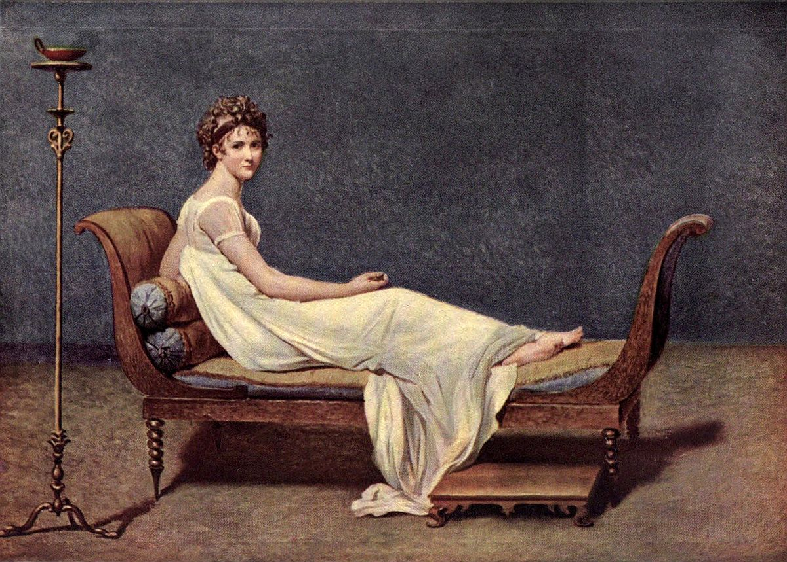

# 레카미에 부인의 초상 — 빈 공간이 사람을 돋보이게 할 때

*흰 드레스와 긴 의자, 끝내 완성되지 않은 그림*

Culture · Art

> 출처 대조와 공개 게시 승인을 마친 이야기입니다. 실제 게시 여부는 사이트 배포 상태를 따릅니다.

*자크 루이 다비드 · Portrait of Mme. Récamier · The Louvre: Fifty Plates in Colour, Plate XLV · Project Gutenberg*

[이미지 출처·제작 근거](https://raw.githubusercontent.com/GITenberg/The-Louvre-Fifty-Plates-in-Colour_63719/master/63719-h/images/i_plate45.jpg) · 퍼블릭 도메인 원작 및 옛 출판물의 재현 도판 · Project Gutenberg 수록본

초상화라면 인물의 얼굴이 가장 중요할 것 같다. 그런데 다비드의 〈레카미에 부인의 초상〉에서는 얼굴보다 먼저 길게 놓인 의자와 흰옷, 넓고 조용한 배경이 눈에 들어온다. 방을 가득 채울 수도 있었을 물건들이 빠져 있어서 오히려 사람이 또렷해 보인다.

무엇을 더 그렸는지뿐 아니라 무엇이 적게 놓였는지도 살펴보자. 이 그림은 끝내 완성되지 않은 작품으로 전해진다. 그 사실을 알고 보면 비어 있는 듯한 부분을 단순히 부족한 자리로만 읽지 않게 된다.

## 1. 얼굴은 몸과 같은 방향을 보지 않는다

레카미에 부인은 긴 의자 위에 몸을 기대고 있다. 몸이 뻗은 방향과 고개가 돌아온 방향이 다르다. 몸의 길고 느긋한 흐름을 따라가다가 얼굴에서 다시 관람자 쪽으로 시선이 돌아온다. 가만히 앉아 있어도 화면에는 움직임의 방향이 생긴다.

몸을 정면으로 세우고 얼굴을 가운데 둔 초상과 비교하면 차이가 분명하다. 우리는 인물을 곧장 마주보기보다 그녀가 놓인 공간과 자세를 거쳐 얼굴에 도착한다. 이것을 실제 모델의 성격이나 마음 상태에 대한 증거로 단정할 필요는 없다. 그림이 관람자를 만나게 하는 방식으로 보면 충분하다.

## 2. 흰옷은 넓은 빛의 자리가 된다

흰 드레스는 인물의 상체와 다리, 의자의 가장자리로 길게 이어진다. 배경이 상대적으로 어둡고 차분해서 밝은 천의 면이 더 쉽게 눈에 들어온다. 얼굴이 차지하는 크기는 작지만 그쪽으로 이어지는 밝은 흐름은 훨씬 넓다.

옷감이 접히고 바닥 쪽으로 내려오는 부분을 천천히 보자. 같은 흰색 안에도 그늘과 빛의 차이가 있다. 빛나는 장신구를 많이 그리지 않아도 밝은 면과 주변 색의 대비만으로 인물의 자리를 강조할 수 있다. 적은 색이 곧 단순한 효과만 만든다는 뜻은 아니다.

## 3. 의자도 인물의 자세를 만든다

인물이 기대는 가구는 양끝이 올라간 긴 형태다. 몸은 그 위에서 옆으로 뻗고 팔은 둥근 받침 가까이에 놓인다. 가구가 없다면 이 자세도 같은 인상을 만들기 어렵다. 의자는 사람 뒤의 소품이면서 몸의 모양을 구성하는 장치다.

옛 도록은 이 가구를 엠파이어 양식의 소파로 설명한다. 낯선 양식 이름을 외우지 않아도 선의 형태를 보면 된다. 곧은 다리와 곡선으로 올라간 끝부분이 화면 안에서 어떤 윤곽을 만드는지 살펴보자. 인물의 부드러운 옷과 가구의 또렷한 선이 서로 다른 표정을 낸다.

## 4. 왼쪽의 긴 기구는 왜 눈에 띌까

화면 왼쪽에는 높고 가느다란 등잔대가 서 있다. 물건이 많지 않은 공간에서 이 세로선은 꽤 강한 역할을 한다. 길게 누운 인물과 가구가 만드는 가로 방향에 다른 방향을 놓아 준다. 비어 있는 배경 속에서 높이도 느껴지게 한다.

이 물건에 반드시 하나의 비밀 상징이 있다고 정해 놓을 필요는 없다. 먼저 실제로 보이는 위치와 크기, 윤곽을 살펴보면 된다. 물건이 적을수록 작은 차이가 크게 느껴진다. 초상화를 읽는 데 항상 인물의 신분을 알려 주는 숨은 암호가 필요한 것은 아니다.

## 5. 왜 방 안이 이토록 조용할까

배경에는 구체적인 생활의 흔적이 많지 않다. 책장과 창문, 손님과 화려한 장식으로 인물의 삶을 설명하지 않는다. 얼굴과 자세, 옷과 가구가 더 많은 몫을 맡는다. 실제 방이 그대로 이렇게 비어 있었다고 증명하는 그림도 아니다.

초상화는 현실의 모든 것을 빠짐없이 옮기는 목록이 아니다. 무엇을 화면에 놓고 무엇을 덜 보여 줄지 선택한 결과다. 이 그림에서는 주변 이야기가 줄어든 자리에 인물의 윤곽과 색의 관계가 남는다. 말수가 적은 공간이 오히려 눈을 오래 머물게 할 수 있다.

## 6. 미완성이라는 사실을 어떻게 볼까

도록은 이 작품이 완성되지 않은 상태로 남았다고 설명한다. 그래서 어떤 부분의 덜 다듬어진 느낌을 볼 때도 그것을 단순히 원래 의도한 완성 효과라고 확정해서는 안 된다. 오늘 우리가 감상하는 모습과 화가가 끝까지 완성했을 모습은 같지 않을 수 있다.

그렇다고 미완성이니 볼 것이 적다는 뜻도 아니다. 현재 남은 그림 안에서 밝은 옷과 차분한 배경, 정리된 가구의 윤곽은 분명히 작동한다. 미완성이라는 역사적 상태와 지금의 감상 효과를 구분하면 둘 중 하나를 지울 필요 없이 그림을 볼 수 있다.

## 7. 거대한 역사화를 그린 사람의 초상

자크 루이 다비드는 혁명과 나폴레옹 시대의 역사화로도 알려져 있다. 여러 인물과 의식을 크게 배치한 작품들을 떠올리면 이 초상의 적은 요소가 더 흥미로워진다. 한 화가가 그린 그림이라고 늘 같은 규모와 목소리로 말하는 것은 아니다.

옛 도록은 그의 여러 작품을 강하게 평가하지만 그 평가를 그대로 오늘의 정답으로 삼을 필요는 없다. 역사화는 차갑고 초상화만 진실하다고 외우기보다, 서로 다른 화면에서 무엇을 강조하는지 비교하는 편이 좋다. 작품을 분류하는 이름은 보기의 출발점이지 감상의 끝은 아니다.

## 8. 적은 물건을 하나씩 따라가기

먼저 흰 드레스가 만드는 밝은 면을 보고, 다음에는 몸과 얼굴의 방향을, 마지막에는 의자와 등잔대가 만드는 선을 따라가 보자. 인물에 대해 아는 것이 많지 않아도 실제 그림 안에서 볼 수 있는 관계가 늘어난다.

함께 실은 이미지는 옛 루브르 도록에 수록된 실제 작품의 재현 도판이다. 인물과 가구를 새로 만든 AI 그림이 아니다. 색은 재현과 화면에 따라 차이가 있을 수 있지만, 빈 배경이 사람을 어떻게 돋보이게 하는지 살펴보기에는 충분한 입구가 된다.

## 이야기의 바탕이 된 자료

- [The Louvre: Fifty Plates in Colour — 다비드·제리코 해설과 도판 캡션](https://raw.githubusercontent.com/GITenberg/The-Louvre-Fifty-Plates-in-Colour_63719/master/63719-0.txt) · 확인일 2026-10-30
  - 확인 내용: Plate XLV: 레카미에 부인·흰 엠파이어 드레스·긴 소파·미완성 / 다비드의 역사화·혁명과 나폴레옹 시대의 작업 / Plate XLVI: 실제 난파에 바탕한 메두사호의 뗏목·1819년 살롱·멀리 보이는 Argus·크기 약 4.91×7.16m

---

[같은 소주제의 이야기](README.md) · [전체 서가](../../README.md)
