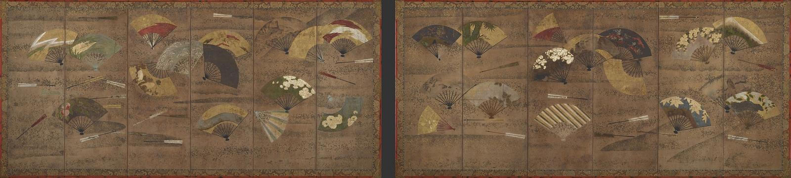

# 일본의 옛 병풍에는 왜 부채가 떠다닐까

*17세기 일본 병풍에 흩어진 부채를 따라 계절과 풍경, 그림의 배치를 살펴봅니다.*

Culture · Art

> 출처 대조와 공개 게시 승인을 마친 이야기입니다. 실제 게시 여부는 사이트 배포 상태를 따릅니다.

*작품 도판 · 《장식 부채》(17세기 초, 일본) 병풍 한 쌍. 스미스소니언 국립아시아미술관 프리어 컬렉션 F1897.93-94.*

[이미지 출처·제작 근거](https://collections.si.edu/search/detail/edanmdm:fsg_F1897.93-94?print=yes) · CC0

부채를 펼치면 손잡이에서 바깥으로 갈수록 넓어지는 작은 화면이 생긴다. 그 안에 산을 그리면 산 아래가 좁고, 꽃을 그리면 가지가 둥근 가장자리를 따라 뻗을 수 있다. 그런데 17세기 초 일본의 한 병풍에서는 이런 부채 그림 여러 점이 커다란 화면에 이리저리 흩어져 있다. 한쪽에는 봄꽃이, 다른 쪽에는 가을 단풍이 놓였다. 부채 하나의 그림을 보다가 눈을 옮기면 또 다른 계절과 장소가 열린다. 이 병풍을 볼 때는 어느 쪽부터 읽어야 할까?

## 01. 손 안의 모양이 큰 화면으로 옮겨 갔다

스미스소니언 국립아시아미술관이 소장한 《장식 부채》는 17세기 초 일본에서 만든 병풍이다. 소장 기록에 따르면 병풍 한 짝의 높이는 148센티미터, 펼친 폭은 336센티미터다. 종이 위에 채색과 먹, 금을 써서 만들었다. 이렇게 큰 화면에 부채 모양이 놓이면 관람하는 거리부터 달라진다. 멀리서 보면 여러 부채가 얼마나 떨어져 있고 어느 쪽으로 기울었는지 먼저 눈에 들어온다. 다가가면 그제야 각 부채 안의 꽃과 풍경을 읽을 수 있다. 작품 하나가 멀리서 볼 그림과 가까이 들여다볼 그림을 함께 품고 있는 셈이다.

## 02. 붙인 것처럼 보이는 부채

16세기 말에서 17세기 초 일본에서는 부채 모양의 종이마다 그림을 그려 병풍에 흩어 붙이는 방식이 인기를 끌었다. 여러 작은 그림을 한자리에서 볼 수 있었고, 배치에 따라 부채가 공중이나 물 위에 떠 있는 듯했다. 스미스소니언의 병풍은 그 효과를 다른 방식으로 냈다. 소장처의 설명에 따르면 바탕에 금박과 은박 모양이 흩어져 있고, 부채는 그 위에 직접 그렸다. 붙인 듯 보이는 모양과 실제 제작 방식이 다르다는 점이 이 작품의 재미다. 부채 안을 보기 전에 윤곽을 따라가면 화가가 화면을 어떻게 나눴는지도 보인다.

## 03. 봄과 가을을 한눈에 보기

어느 부채에 시선을 먼저 둘지 모르겠다면 꽃부터 찾아보자. 스미스소니언은 이 병풍에 식물 소재가 많고 그중에는 특정 계절과 연결되는 것이 있다고 설명한다. 벚꽃을 보면 봄이 떠오르고, 국화와 붉은 단풍은 가을을 불러온다. 한 장의 풍경에 두 계절을 함께 넣으려면 어떤 장면인지 설명이 필요할 수 있다. 부채마다 테두리가 있는 이 병풍에서는 벚꽃과 단풍이 자기 자리에서 나란히 존재할 수 있다. 눈을 한 부채에서 다음 부채로 옮기는 짧은 사이, 보는 사람은 같은 화면 안에서 계절을 건너간다.

## 04. 산과 다리에서 시를 떠올리다

후지산과 우지 다리처럼 이름 있는 장소도 그림의 소재가 됐다. 미술관은 두 곳이 시에 등장하는 장소이기도 하다고 짚는다. 그 지명을 아는 관람객에게 작은 산이나 다리는 화면 밖의 풍경과 글을 떠올리게 할 수 있었다. 지명을 처음 듣는 관람객은 부채 안에 풍경을 어떻게 담았는지부터 보면 된다. 손잡이 쪽은 폭이 좁고 위로 갈수록 넓어진다. 같은 산 그림도 네모난 종이에 그렸을 때와 달리, 이 테두리에서는 넓게 펼쳐지는 쪽과 시선이 모이는 쪽이 또렷하다. 같은 테두리 안에서도 꽃을 그린 그림에서는 시선이 가까운 곳에 머물고, 산을 그린 그림에서는 눈이 먼 곳으로 향한다. 부채 하나를 펼쳐 놓은 듯한 자리에서 이렇게 서로 다른 거리를 경험할 수 있다.

## 05. 먹빛과 줄무늬가 눈을 쉬게 하는 곳

스미스소니언은 먹으로 그린 세 점이 다른 부채들의 금빛, 은빛, 채색과 대비된다고 설명한다. 화려한 부분을 먼저 보았다면 이번에는 색이 적은 그림을 찾아보자. 같은 모양의 작은 화면에서도 어디에 색을 얼마나 쓰느냐에 따라 시선이 머무는 곳이 달라진다. 두 부채의 줄무늬는 기모노 직물 무늬와 관련 있어 보인다는 것이 소장처의 해석이다. 꽃과 산을 찾는 눈으로 줄무늬까지 따라가 보면 옷감에 쓰였을 법한 반복 무늬도 그림의 소재가 될 수 있었음을 알 수 있다.

## 06. 다른 병풍에선 부채 아래로 물결이 흐른다

뉴욕 메트로폴리탄 미술관에는 17세기 중반의 《물결 위의 부채》가 있다. 금박을 쓴 여섯 폭 병풍에 부채와 물결이 함께 나타난다. 병풍은 폭마다 접을 수 있어 펼친 각도에 따라 보이는 면이 조금씩 달라진다. 메트는 물에 부채를 띄우는 풍습과 관련이 있을 수 있다고 설명한다. 기원에 관한 설명은 가능성으로 두고 두 작품에서 확인할 수 있는 차이를 먼저 보자. 메트의 병풍에서는 흐르는 물이 부채를 띄우는 바탕이 된다. 스미스소니언 병풍에서는 금박과 은박이 흩어진 화면 위에서 부채들이 떠 있는 듯하다. 같은 부채 모양을 써도 그것이 놓인 자리에 따라 움직임이 다르게 느껴진다.

## 07. 정해진 순서 없이 펼쳐 보는 그림

처음 본 병풍으로 돌아가자. 부채를 따라 한쪽 끝부터 다른 쪽 끝까지 갈 수도 있고, 닮은 색을 찾아 건너뛸 수도 있다. 벚꽃에서 출발하면 계절이 먼저 보이고, 후지산에서 출발하면 장소가 이어진다. 그림을 만든 이가 누구인지는 확정하기 어렵다. 스미스소니언은 양식으로 보아 가노파 화가들이 그렸을 가능성을 제시한다. 남아 있는 화면에서는 작은 그림들이 큰 화면 속에서 서로 어떻게 보이는지 직접 살필 수 있다. 이 병풍을 보는 순서는 결국 어느 부채 앞에서 눈길을 멈추느냐에 따라 달라진다.

## 이야기의 바탕이 된 자료

- [스미스소니언 국립아시아미술관 — Decorated Fans, 소장품 및 CC0 표기](https://collections.si.edu/search/detail/edanmdm:fsg_F1897.93-94?print=yes) · 확인일 2026-11-09
- [메트로폴리탄 미술관 — Fans upon Waves](https://www.metmuseum.org/art/collection/search/48922) · 확인일 2026-11-09

---

[같은 소주제의 이야기](README.md) · [전체 서가](../../README.md)
