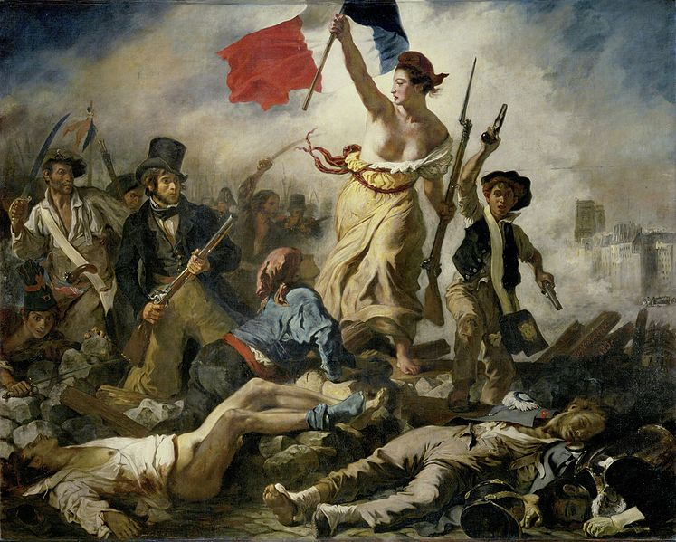

# 민중을 이끄는 자유의 여신 — 삼색기 아래의 1830년

*들라크루아의 7월혁명 회화에서 역사와 의인화를 나누어 보기*

Culture · Art

> 출처 대조와 공개 게시 승인을 마친 이야기입니다. 실제 게시 여부는 사이트 배포 상태를 따릅니다.

*Eugène Delacroix, La Liberté guidant le peuple (1830). Camille Mauclair, Eugène Delacroix 수록 컬러 도판 · Public Domain. 실제 작품을 재현한 역사 출판 도판입니다.*

[이미지 출처·제작 근거](https://raw.githubusercontent.com/GITenberg/Eugene-Delacroix_56518/master/56518-h/images/mauc_025.jpg) · Public Domain · 저작권 만료 작품·역사 출판 도판

연기가 자욱한 거리에서 한 여인이 삼색기를 높이 든다. 사람들은 무너진 장애물과 죽은 이들을 넘어 앞으로 움직인다. 외젠 들라크루아의 『민중을 이끄는 자유의 여신』은 프랑스의 혁명을 대표하는 이미지로 널리 알려졌다. 그러나 그림이 가리키는 사건부터 정확히 짚으면 보이는 것이 달라진다.

이 작품의 직접적인 배경은 1789년이 아니라 1830년의 7월혁명이다. 실제 거리의 인물과 추상적인 자유의 상징이 같은 화면에 있다. 무엇이 역사이고 무엇이 화가의 구성인지 나누어 보면서 그림 속으로 들어가 보자.

## 01. 왕정에 맞선 7월의 거리가 배경이 되다

1830년 프랑스에서는 샤를 10세의 통치에 대한 반발이 거리의 봉기로 이어졌다. 왕이 물러나고 루이 필리프가 등장하는 변화가 일어났다. 그림은 이 격동에 연결된다. 프랑스혁명이라는 넓은 이름만 기억하면 여러 시기의 서로 다른 사건이 한 장면으로 합쳐지기 쉽다.

연도를 아는 것은 시험의 정답을 외우는 일 이상이다. 어떤 권력에 맞섰으며 그 뒤 무엇이 바뀌었는지 질문할 수 있게 한다. 1789년의 상징이 후대의 정치적 행동에 이어 쓰이기도 했지만, 반복되는 상징과 동일한 사건은 구별해야 한다.

## 02. 가운데의 여인은 한 사람의 초상일까

중앙의 여인은 사람들을 이끄는 위치에 서 있지만 특정한 참가자를 그대로 그린 초상으로만 읽기 어렵다. 자유를 사람의 모습으로 나타낸 의인화다. 고전적인 형상과 거리에서 들고 쓰는 무기, 삼색기가 한 인물에 결합한다. 관념이 실제 사건 속으로 들어온 셈이다.

그래서 화면은 현장 사진처럼 사실을 복사하는 방식으로 작동하지 않는다. 화가는 한 사건이 무엇을 의미하는지 보이게 하려 했다. 상징적인 인물이 있다고 모든 인물이 허구가 되는 것도 아니다. 당대의 옷과 무기, 거리의 경험이 상징을 구체적인 현실에 묶어 둔다.

## 03. 서로 다른 옷차림이 같은 방향으로 움직이다

화면에는 모자를 쓰고 격식을 갖춘 인물과 더 소박한 옷의 사람, 어린 인물이 함께 있다. 같은 목표를 향한 집단의 모습이지만 얼굴과 자세는 서로 다르다. 민중이라는 한 단어 안에 다양한 사람이 들어 있음을 보게 된다.

옷만 보고 각 인물의 직업과 정치적 생각을 모두 확정할 수는 없다. 다만 차이를 가진 사람들이 한 장면에 모였다는 구성은 중요하다. 자유가 혼자 승리하는 인물로 서 있는 것이 아니라 다른 이들이 따라 움직이는 힘으로 나타난다. 개인의 몸과 집단의 행동이 연결된다.

## 04. 삼색기의 색이 화면을 붙잡다

높이 든 깃발은 어디부터 볼지 알려 주는 강한 표지다. 원작에서는 어두운 연기와 흙빛 사이로 파랑과 흰색, 빨강이 강하게 드러난다. 색은 사물의 표면을 설명하는 동시에 관람객의 시선을 움직인다. 그림의 의미와 구성의 기술이 같은 곳에서 만난다.

깃발에서 다른 인물과 밝은 부분으로 눈을 옮겨 보면 화면이 무작위로 흩어져 있지 않다는 사실을 느낄 수 있다. 혼란을 그리면서도 화가는 볼 순서를 만들어 놓았다. 역동적인 장면이 알아볼 수 있는 하나의 이미지가 되는 데에는 이런 조직이 필요했다.

멀리에는 파리의 건축을 알아볼 단서도 보인다. 큰 인물과 깃발만이 아니라 배경의 작은 표지가 이 장면을 특정한 도시와 연결한다. 상징적인 자유가 어느 장소에도 속하지 않은 추상적인 구름 속을 걷는 것은 아니다.

## 05. 승리의 전진 아래에 죽음이 놓이다

사람들이 앞으로 나아가는 길에는 쓰러진 몸들이 있다. 깃발만 잘라 보면 승리와 해방의 그림처럼 느껴지지만 전체 화면은 그 대가를 함께 보여 준다. 전진하는 몸과 움직임을 멈춘 몸이 같은 공간에 있다. 바리케이드는 구호의 배경이면서 실제 위험의 장소다.

이 대목을 놓치면 그림이 너무 단순한 선전 문구로 줄어든다. 공동의 이상을 힘 있게 표현하면서도 폭력과 죽음을 지우지 않았다는 점이 중요하다. 관람객은 무엇을 얻었다는 말 곁에 누가 어떤 손실을 겪었는지도 보게 된다. 화면의 아래쪽은 의미 없는 빈자리로 남지 않는다.

## 06. 들라크루아는 감정을 어떻게 역사로 만들었을까

들라크루아는 움직임과 색, 강한 감정의 표현으로 알려진 낭만주의의 중요한 화가다. 그의 그림에서 역사적 사건은 인물의 몸과 시선, 겹치는 동작을 통해 전달된다. 연표의 문장이 주지 못하는 긴장과 열기가 화면에 생긴다.

그러나 감정이 강하다고 구성까지 즉흥적인 것은 아니다. 사람들의 위치와 밝기의 차이, 중심을 만드는 선이 함께 작동한다. 화가가 격동을 어떻게 정리했는지 살피면 격정적인 예술과 치밀한 선택이 함께 갈 수 있음을 알 수 있다. 이 그림의 힘은 내용과 형식 어느 한쪽만으로 설명되지 않는다.

## 07. 널리 쓰이는 상징을 다시 구체적으로 보기

이 그림은 원래 사건의 범위를 넘어 자유와 혁명의 상징으로 반복해서 쓰인다. 널리 알려진 이미지가 되면 삼색기와 중앙 인물만 먼저 떠오르기 쉽다. 그럴수록 연도와 군중, 화면 아래의 몸을 다시 보는 일이 도움이 된다.

작품의 확장된 의미와 처음의 맥락은 함께 읽을 수 있다. 보편적인 자유라는 생각이 어떤 거리와 어떤 사람들의 모습으로 표현되었는지 돌아가는 것이다. 그렇게 보면 『민중을 이끄는 자유의 여신』은 익숙한 표지를 넘어 역사와 상징, 그림의 구성이 만난 한 장의 구체적인 회화가 된다.

## 이야기의 바탕이 된 자료

- [Paul G. Konody, Delacroix — The Barricade, July 1830](https://raw.githubusercontent.com/GITenberg/Delacroix_39943/master/39943-8.txt) · 확인일 2026-11-05
  - 확인 내용: 1830년 7월혁명·1831년 살롱·자유의 의인화와 현실의 옷차림·들라크루아의 역사화 구성
- [Camille Mauclair, Eugène Delacroix](https://raw.githubusercontent.com/GITenberg/Eugene-Delacroix_56518/master/56518-0.txt) · 확인일 2026-11-05
  - 확인 내용: 샤를 10세·루이 필리프 맥락과 자유를 이끄는 작품의 도판. 후대 저자의 미적 평가는 사실로 전재하지 않음

---

[같은 소주제의 이야기](README.md) · [전체 서가](../../README.md)
