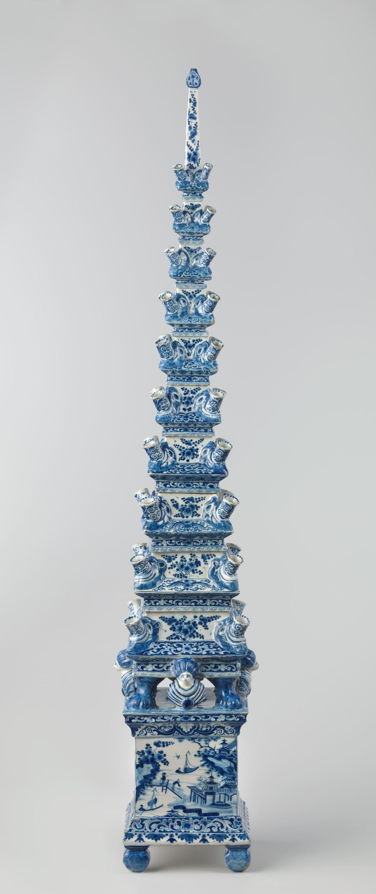

# 델프트의 꽃병에는 왜 꽃을 꽂는 입구가 여덟 개일까

*한 송이씩 볼 수 있게 입구를 나눈 델프트 꽃병과 층층이 쌓은 꽃 피라미드를 비교합니다.*

Culture · Art

> 출처 대조와 공개 게시 승인을 마친 이야기입니다. 실제 게시 여부는 사이트 배포 상태를 따릅니다.

*암스테르담 국립미술관 소장 《Flower pyramid》, 델프트, BK-KOG-1723. 본문 5절의 비교 작품.*

[이미지 출처·제작 근거](https://www.rijksmuseum.nl/en/collection/object/Flower-pyramid--a1010ed8960465b2a8a33b3b4336b5e8) · Public Domain

보통 꽃병에 꽃을 넣으면 줄기들이 한곳으로 모인다. 손을 놓으면 한 송이가 다른 송이 뒤로 숨어 버리기도 한다. 스웨덴 국립미술관이 소장한 델프트 꽃병에는 꽃을 꽂을 만한 입구가 여덟 개나 있다. 양쪽에는 용이 붙어 있고, 정면에는 꽃이 담긴 뿔을 든 인물이 보인다. 꽃을 꽂기 전부터 볼거리가 많은 병이다. 여러 입구를 따라가다 보면 꽃병을 만든 사람이 꽃을 어디에 놓고 어떻게 보이게 하려 했는지 읽을 수 있다.

## 01. 하나의 몸체 위에 여러 자리

이 꽃병은 하트를 닮은 넓은 몸체 위로 꽃을 넣는 주둥이 여덟 개가 솟아 있다. 큰 입구 하나에 줄기를 모으는 방식과 비교하면, 꽂는 순간부터 어느 줄기가 어느 자리에 있을지 나뉜다. 국립미술관은 이 형태가 꽃 한 송이 한 송이를 또렷하게 보이게 했다고 설명한다. 사진을 볼 때는 꽃을 먼저 상상하기보다 입구의 위치를 세어 보자. 폭이 좁은 곳과 넓은 곳에서 줄기가 다른 방향으로 나뉘어 뻗을 수 있다. 그 위치가 이미 꽃꽂이의 밑그림처럼 작동한다. 줄기 하나를 옮길 때 다른 줄기까지 함께 움직이는 묶음과 달리, 따로 꽂힌 꽃에서는 옆의 빈 공간을 남겨 두기 쉽다. 병의 너비 전체를 어떻게 쓸지부터 결정하게 되는 셈이다.

## 02. 꽃이 오기 전에도 꽃을 그려 두었다

병의 정면에는 꽃을 담은 뿔을 든 플로라가 그려져 있다. 플로라는 꽃과 관련된 고대 로마의 여신이다. 가장 위에는 실제 꽃을 꽂을 자리가 있고, 그 아래에는 이미 꽃이 담긴 그림이 있다. 화병을 쓰지 않는 때에도 정면에서 보면 무엇을 담는 물건인지 그림으로 알 수 있는 셈이다. 양옆의 용 두 마리는 꽃줄기가 놓일 몸체의 윤곽을 바깥에서 잡아준다. 박물관 기록은 용을 소개하지만, 각각에 어떤 이야기를 담았는지까지 밝히지는 않는다. 정해진 상징을 찾기 전에 무엇이 어디에 붙어 있는지부터 보아도 충분하다.

## 03. 델프트의 어느 공장에서 나왔을까

스웨덴 국립미술관은 이 모형을 1700년을 전후한 시기의 델프트 제품으로 본다. 람베르튀스 판 에인호른이 드 메탈러 포트 공장을 맡고 있던 때였다. 가느다란 주둥이를 여러 개 세우고 넓은 몸체에 이어 붙인 모양을 보면, 꽃을 보여 주려는 생각이 그릇 자체의 설계에 반영됐음을 알 수 있다. 소장 기록이 알려 주는 것은 제작 시기와 공장이다. 사진에 보이는 모든 장식이 한 사람 손에서 나왔는지까지 그 이름만으로 정할 수는 없다. 그릇의 모양을 살피는 일과 누가 만들었는지 밝히는 일은 서로 다른 단서를 필요로 한다. 그래서 소장품을 찾아볼 때는 작가 이름만 보는 대신 제작 도시와 공장, 추정 시기를 함께 읽는 편이 도움이 된다. 같은 도시에서 나온 꽃병이라도 두 박물관의 예처럼 모습이 꽤 다를 수 있다.

## 04. 귀한 꽃은 한 송이씩 보아도 좋았다

미술관에 따르면 당시 네덜란드에서는 튤립 같은 희귀한 꽃과 구근을 모으는 데 관심이 높았다. 꽃을 한꺼번에 크게 꽂으면 전체 색은 풍성해 보이지만 꽃잎의 모양이나 줄기의 방향은 잘 안 보일 수 있다. 입구가 나뉜 그릇은 각 꽃을 조금 떨어뜨려 놓을 수 있게 한다. ‘튤립 꽃병’이라는 이름에서 튤립이 먼저 떠오르지만, 소장품 설명이 전해 주는 특징은 여러 꽃을 개별적으로 볼 수 있는 구조다. 정원에서 키운 꽃의 차이를 실내에 가져와 살필 수 있는 자리라고 생각하면 그 모양이 이해된다.

## 05. 같은 도시에는 층층이 쌓은 꽃병도 있었다

암스테르담 국립미술관은 같은 델프트 공장에 귀속되는 다른 작품으로 약 1692~1700년의 꽃 피라미드를 소개한다. 여러 층을 위로 쌓아 올리는 주석 유약 토기다. 스웨덴에 있는 여덟 입구 꽃병과 달리 높이가 화면을 나눈다. 암스테르담 작품에서 세 층과 꼭대기 부분은 2004년에 별도 제작해 채운 부분으로 기록돼 있다. 현재 전시된 형태를 볼 때 제작 시기뿐 아니라 보충한 부분까지 살피면, 17세기 물건에서 지금 눈에 들어오는 모양이 어떻게 구성됐는지 알 수 있다.

## 06. 꽃을 꽂기 전부터 감상하는 물건

한 송이를 꽂기 전에는 흰 바탕과 장식, 줄기가 지나갈 여러 구멍이 보인다. 꽃을 꽂은 뒤에는 그 구멍 일부가 가려지고 바깥을 향한 줄기와 꽃잎이 새 윤곽을 만든다. 같은 물건인데도 빈 채로 놓인 모습과 꽃을 담았을 때가 달라진다. 꽂을 자리가 일정하게 나뉘어 있어도 어떤 꽃을 어느 높이로 꽂을지는 꽃을 다루는 사람에게 달려 있다. 도공이 정한 배열 위에 꽃을 고른 사람의 선택이 한 번 더 놓인다. 그래서 이 꽃병의 사진을 읽을 때는 손잡이처럼 보이는 용과 가운데 플로라, 그 위의 입구를 아래에서부터 차례로 보는 방법이 있다. 그러면 그릇이 스스로 보여 주는 그림과 실제 꽃이 더해질 자리를 구별할 수 있다.

## 07. 여덟 개의 입구에 남은 선택

꽃이 하나도 없는 박물관 사진에서도 입구의 수는 셀 수 있다. 그 수는 장식만 보고는 알아차리기 어려운 사용법을 알려 준다. 꽃을 많이 꽂는 일과 각 송이를 분명히 보이게 하는 일은 상황에 따라 다른 그릇을 요구한다. 이 델프트 꽃병은 두 번째 일을 그릇의 구조에 새겨 놓았다. 오늘날 꽃병을 볼 때 몸체의 문양부터 보는 사람이라면, 이 작품에서는 꽃이 들어갈 자리를 먼저 세어 보아도 좋다. 여덟 개의 작은 입구에서 꽃을 감상하던 사람들의 관심이 드러난다.

## 이야기의 바탕이 된 자료

- [스웨덴 국립미술관 · 여덟 입구가 있는 델프트 꽃병](https://collection.nationalmuseum.se/en/collection/item/33350/) · 확인일 2026-11-10
- [암스테르담 국립미술관 · 다층 꽃병과 보충 제작 기록](https://www.rijksmuseum.nl/en/story/multi-level-vase) · 확인일 2026-11-10
- [암스테르담 국립미술관 소장 《Flower pyramid》, 델프트, BK-KOG-1723. 본문 5절의 비교 작품.](https://www.rijksmuseum.nl/en/collection/object/Flower-pyramid--a1010ed8960465b2a8a33b3b4336b5e8) · 확인일 2026-11-10

---

[같은 소주제의 이야기](README.md) · [전체 서가](../../README.md)
