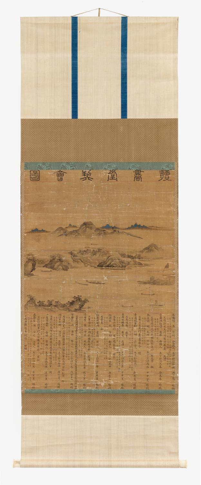

# 그림 속 뱃놀이에는 참석자 명단이 있다

*독서당계회도에 남은 열두 사람의 모임*

Culture · Art

> 출처 대조와 공개 게시 승인을 마친 이야기입니다. 실제 게시 여부는 사이트 배포 상태를 따릅니다.

*독서당계회도, 1531년경 · 국립고궁박물관 소장(고궁4000) · 국립고궁박물관 제공 이미지*

[이미지 출처·제작 근거](https://www.gogung.go.kr/gogung/pgm/psgudMng/view.do?menuNo=800065&psgudSn=436733) · 공공누리 제1유형(출처표시)

옛 그림을 볼 때 글씨는 일단 건너뛰게 된다. 산이 어디 있는지, 사람은 무엇을 하는지부터 찾아보는 편이 쉽다. 한자가 빽빽하게 적혀 있으면 그림 설명이겠거니 하고 지나치기도 한다.

그런데 국립고궁박물관의 「독서당계회도」에서는 아래쪽 글씨에도 잠깐 눈을 주면 좋겠다. 거기에는 이 모임에 참석한 사람들의 이름이 적혀 있다.

그림 속에서는 관복 차림의 사람들이 한강에서 뱃놀이를 한다. 느긋한 풍경화처럼 보이지만, 작품은 모임의 기억과 참석자 정보를 함께 남겨 두었다. 오늘의 단체 기념사진 뒤에 이름을 적어 놓는 모습이 조금 떠오른다.

## 책 읽던 사람들이 그림에 모였다

제목의 ‘계회도’는 모임을 기념하는 그림이라는 뜻으로 읽으면 된다. 이 작품은 사가독서한 이력이 있는 관료들의 모임을 기념해 만들었다고 박물관은 설명한다. 사가독서는 휴가를 받아 독서에 전념하는 일을 가리킨다.

책 읽던 사람들이 모였다고 하니 그림 속에서도 모두 책상 앞에 앉아 있을 것 같다. 하지만 기록된 모임의 모습은 다르다. 사람들은 배를 탔고, 그 주변으로 강과 산이 펼쳐져 있다.

그렇다고 관리들이 몰래 일을 빼먹었다고 상상할 필요는 없다. 그림은 모임의 한 장면을 보여줄 뿐, 사람들이 주고받은 말이나 그날의 속사정까지 알려주지는 않는다. 관복과 뱃놀이가 한 화면에 있다는 것만으로도 충분히 눈길을 끈다.

풍경은 막연히 멋진 산수를 그려 넣은 것만은 아니다. 박물관은 독서당이 있던 한강변 두모포, 지금의 서울 성동구 옥수동 일대가 묘사되어 있다고 설명한다. 화면 가운데 솟은 응봉은 현재의 매봉산에 해당한다.

지금 아는 서울의 지명과 연결해 보면 오래된 그림이 조금 가까워진다. 풍경을 통째로 현재의 지도와 맞출 필요는 없다. 한강변의 어느 장소를 기억하며 그렸다는 단서 정도만 챙겨도 좋다.

## 아래쪽에는 열두 사람의 이름이 있다

이 작품은 위에서 아래로 읽는 순서가 있다. 맨 위에는 제목, 가운데에는 모임 장면, 아래에는 참석자 명단이 놓인다. 멀리서 보면 긴 족자 하나지만, 가까이에서는 서로 다른 일을 하는 세 부분이 모여 있다.

아래쪽 명단은 ‘좌목’이라고 부른다. 이 그림의 좌목에는 열두 사람의 호와 이름뿐 아니라 본관과 생년, 과거에 급제한 연도, 사가독서를 한 시기, 당시 품계와 관직까지 적혀 있다.

이름만 적어도 기념은 될 텐데 꽤 꼼꼼하다. 모임에 누가 있었는지와 그 사람들이 어떤 이력을 지녔는지를 함께 남겼다. 후대의 관람객에게는 그림 옆에 작은 인물 소개가 붙어 있는 셈이다.

우리가 명단의 한자를 모두 읽어야 하는 것은 아니다. 그림에서 사람을 찾은 뒤 아래의 글씨로 눈을 옮겨 보면 된다. 눈앞의 장면과 그 장면에 참여한 사람들의 기록이 한 작품 안에 나란히 있다는 점을 알아보는 것으로 충분하다.

## 그림의 나이는 이름표에서 짐작한다

박물관은 이 작품을 1531년경의 그림으로 소개한다. 화면의 어느 구석에 큰 숫자로 연도가 적혀 있어서일까?

설명에 따르면 제작 시기를 추정하는 근거는 좌목에 적힌 관직이다. 등장인물들이 언제 어떤 자리에 있었는지를 살피면, 그림이 만들어진 때를 좁혀 볼 수 있다. 풍경보다 아래쪽의 글씨가 날짜의 단서를 주는 것이다.

여기서 ‘경’이라는 말도 놓치지 않는 편이 좋다. 1531년의 어느 하루를 정확하게 확인했다는 뜻은 아니다. 남아 있는 정보를 바탕으로 그 무렵이라고 추정한다는 뜻이다. 모르는 부분까지 채워 넣지 않아도 그림의 재미가 줄어들지는 않는다.

단체사진을 오래 보관하다가 누군가의 이름이나 당시의 일을 떠올린 경험이 있을 것이다. 이 그림에서는 그 단서가 작품 아래에 처음부터 함께 적혀 있었다.

다음에 옛 그림 속의 사람들이 모여 있는 장면을 만나면 풍경만 보고 지나치지 말고 주변의 글씨도 한번 살펴보자. 읽기 어려운 글자 사이에, 누가 함께했는지 잊지 않으려 남긴 명단이 있을지도 모른다.

## 이야기의 바탕이 된 자료

- [국립고궁박물관 — 독서당계회도(고궁4000)](https://www.gogung.go.kr/gogung/pgm/psgudMng/view.do?menuNo=800065&psgudSn=436733) · 확인일 2026-10-27
  - 확인 내용: 사가독서 이력이 있는 관료들의 모임을 기념한 그림 / 상단 제목·중단 모임 장면·하단 좌목의 세 부분 구성 / 한강변 두모포와 응봉의 지리 설명, 관복 차림의 뱃놀이 / 열두 사람의 명단과 관직을 근거로 한 1531년경 제작 추정

---

[같은 소주제의 이야기](README.md) · [전체 서가](../../README.md)
