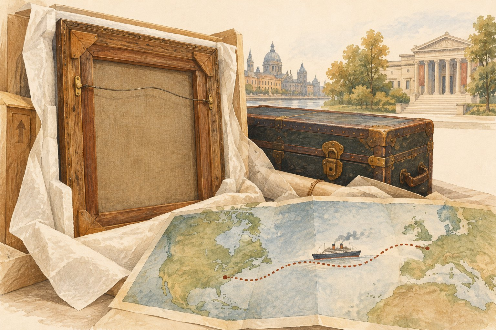

# 유명한 그림도 처음에는 거절당했다

*엘 그레코의 작품을 위해 발 벗고 나선 화가*

Culture · Art

> 출처 대조와 공개 게시 승인을 마친 이야기입니다. 실제 게시 여부는 사이트 배포 상태를 따릅니다.

*KnowledgeWalk 제작 · AI 설명용 삽화. 실제 유물·작품·건축물·전시 배치를 재현한 사진이나 역사적 증거가 아닙니다.*

지금 미술관의 대표 작품이라고 해서 처음부터 모두가 갖고 싶어 했던 것은 아니다. 엘 그레코의 성모승천에도 선뜻 새 집을 찾지 못하던 시간이 있었다.

시카고 미술관의 공식 글은 이 작품이 여러 기관의 거절을 지나 소장품이 된 과정을 소개한다. 이야기의 가운데에는 다른 화가 메리 커샛이 있다. 자기 그림이 아닌 작품을 위해 꾸준히 사람들을 설득한 것이다.

## 1. 스페인에서 파리로

미술관에 따르면 작품은 1904년에 시장에 나왔다. 당시 엘 그레코의 평판은 지금 우리가 생각하는 것과 같지 않았다. 마드리드에서 팔리지 못한 작품은 1904년부터 1905년까지 파리의 뒤랑뤼엘 화랑에서 전시되었다.

그곳에서 커샛을 비롯한 화가들이 이 작품에 관심을 가졌다. 누군가에게는 팔기 어려운 오래된 그림이 다른 누군가에게는 꼭 미술관에 있어야 할 그림이었던 셈이다.

## 2. 커샛이 건넨 연결

커샛은 먼저 친구인 하브마이어 부부가 화랑의 작품 구입을 지원하도록 설득했다. 이후 미국 미술관들이 관심을 갖도록 움직였다. 작품의 다음 주소를 찾는 일이 한 사람의 부탁으로 끝나지 않았던 것이다.

미술관의 글은 뉴욕과 필라델피아, 보스턴에서 거절이 이어졌다고 설명한다. 오늘의 명성만 생각하면 놀랍지만, 그때의 기관들은 각자의 판단을 했다. 유명해진 뒤의 평가를 과거에 그대로 가져가면 보이지 않는 대목이다.

## 3. 그림의 이름을 알고 유통의 길을 보기

기관이 다루는 작품은 엘 그레코의 〈성모 승천〉이다. 종교적 주제를 담은 오래된 그림이 여러 소유자를 거쳐 근대의 시장과 미술관을 만났다. 지금의 전시실에서 보는 한 장면 이전에, 그림에는 다음 주인을 찾으며 도시를 옮긴 시간이 있었다. 소장처는 작품의 처음부터 고정된 주소가 아니었다.

1904년 마드리드에서 판매가 쉽지 않았다는 사실은 작품의 수준을 오늘 대신 판정해 주지 않는다. 당시의 취향과 평가, 구입 조건이 서로 작용했을 수 있다. 미술관의 설명은 특히 그 무렵 엘 그레코의 명성이 높지 않았음을 강조한다. 현재의 유명함을 과거의 모든 사람도 당연히 알았을 것으로 여기지 않을 때 이동의 이야기가 흥미로워진다.

## 4. 화가가 다른 화가의 작품을 위해 움직였다

커샛은 작품을 좋다고 말하는 데서 그치지 않았다. 하브마이어 부부의 지원을 끌어내고 미국의 여러 기관이 관심을 갖도록 연결했다. 미술관에 좋은 그림이 들어오는 과정에는 감식안만이 아니라 사람 사이의 신뢰와 실제 구입을 가능하게 하는 자금도 필요했다. 작품의 가치를 알아보는 판단과 그 판단을 행동으로 옮기는 일은 다른 단계였다.

이 때문에 그림을 둘러싼 사람의 이름도 제작자의 이름 옆에 놓을 수 있다. 누구에게 보여 주고 어떻게 설득했는지가 다음 소장처에 영향을 주었기 때문이다. 다만 커샛이 미래의 명성을 모두 정확히 예견했다고 과장하지는 않는다. 남아 있는 행동을 따라가면 충분하다. 다른 기관들이 거절하는 동안에도 연결을 이어 갔다는 점이 구체적인 이야기다.

## 5. 미술관이 관심을 가져도 곧 구입하지는 못했다

시카고에서의 구입도 한 번의 결정으로 끝나지 않았다. 필요한 돈을 마련하는 데 19개월이 걸렸고, 이사회 내부에도 작가의 미술사적 위치를 의심하는 시선이 있었다고 글은 전한다. 미술관이라는 이름 아래에 하나의 마음만 있었던 것은 아니다. 좋은 작품이라는 평가를 공유하고 비용을 감수할 사람을 모아야 했다.

오늘 대표 소장품이 되었다는 결과를 안 뒤 읽으면 기다림은 당연한 절차처럼 보일 수 있다. 하지만 당시에는 결국 구입하게 될지 정해져 있지 않았을 것이다. 이 불확실성을 기억하면 작품을 지켜낸 한 영웅이라는 설명보다 여러 판단이 이어진 과정을 보게 된다. 전시실의 고요한 벽 뒤에도 토론과 시간이 있었다.

## 6. 소장 이후에 새 관람자의 기억이 생긴다

기관 글은 어린 헤밍웨이가 어머니와 미술관에 와 이 그림을 보았다는 일화도 소개한다. 그가 나중에 엘 그레코의 대담한 표현과 자기 글쓰기를 연결해 말했다는 설명이다. 이는 그 글이 전하는 수용의 일화로 읽을 수 있으며, 모든 작품의 영향력을 숫자로 증명하는 자료처럼 다루지는 않는다.

그래도 작품의 다음 시간이 무엇인지 생각하게 한다. 미술관이 그림을 구입한 뒤에는 실제로 찾아온 사람들이 자기 경험 속에서 만난다. 만들어진 시대의 뜻과 후대 관람자가 얻은 인상은 같지 않을 수 있다. 한 그림의 여정을 본다는 것은 시장과 기관의 이동뿐 아니라 다른 세대의 시선으로 들어가는 길도 보는 일이다.

## 7. 시카고에서도 기다림이 있었다

마침내 시카고 미술관이 관심을 보였지만 자금을 모으는 데에도 19개월이 걸렸다고 한다. 작품은 도착한 뒤 미술관을 대표하는 그림 가운데 하나가 되었다.

한 그림의 자리를 만든 것은 화가의 손길만이 아니었다. 다른 화가의 관심, 친구들의 지원, 기관의 결정과 기다림이 함께 있었다. 전시장 벽에 걸린 한 점을 볼 때 그 벽까지 오는 길도 있었다는 것을 떠올리게 하는 이야기다.

## 이야기의 바탕이 된 자료

- [시카고 미술관 — An Ernest Assumption: El Greco](https://raw.githubusercontent.com/art-institute-of-chicago/api-data/main/json/articles/76.json) · 확인일 2026-10-28
  - 확인 내용: 1904년 시장 출품과 마드리드 판매 난항 / 1904~1905년 파리 전시와 커샛 관심 / 하브마이어 지원·여러 기관 거절·커샛의 연결 / 시카고 자금 마련 19개월과 대표 소장품화

---

[같은 소주제의 이야기](README.md) · [전체 서가](../../README.md)
