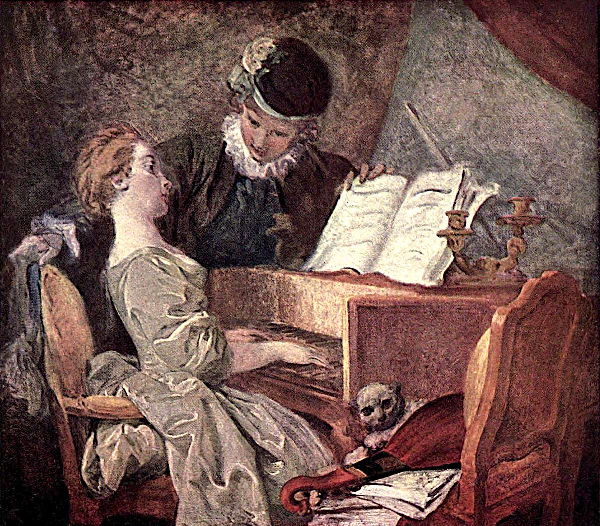

# 음악 수업 — 악보보다 서로의 얼굴이 가까운 시간

*프라고나르의 실내에서 건반과 시선, 작은 고양이를 찾아보기*

Culture · Art

> 자료 대조를 마친 검토용 이야기입니다. 공개 게시 승인은 아직 받지 않았습니다.

*장오노레 프라고나르 원작 · 옛 루브르 도록 Plate XLII 색채 재현 도판 · Project Gutenberg*

[이미지 출처·제작 근거](https://raw.githubusercontent.com/GITenberg/The-Louvre-Fifty-Plates-in-Colour_63719/master/63719-h/images/i_plate42.jpg) · 퍼블릭 도메인 원작의 역사적 재현 자료 · Project Gutenberg 수록본

악보가 펼쳐져 있고 한 사람이 건반 앞에 앉아 있다. 다른 사람은 악보를 들고 가까이 몸을 기울인다. 제목은 음악 수업인데 그림을 볼수록 두 사람의 시선에도 관심이 간다. 무슨 곡을 배우는지보다 어떤 관계의 시간이 흐르는지가 먼저 느껴질 수 있다.

프라고나르의 〈음악 수업〉이다. 소리를 직접 들을 수 없는 그림이 음악을 어떤 방식으로 보여 주는지, 또 일상의 한 장면을 어떻게 친밀한 공간으로 만드는지 살펴보자. 앞쪽 의자에는 뜻밖의 작은 구경꾼도 있다.

## 1. 건반악기와 악보가 장면의 이름을 알려 준다

그림 가운데에는 건반악기가 있고 그 앞에 여성이 앉아 있다. 남성은 펼쳐진 악보 가까이에 손을 둔다. 이 물건들 때문에 제목을 읽기 전에도 음악과 관련된 시간임을 알아볼 수 있다. 보이지 않는 소리가 눈에 보이는 도구로 표현되는 셈이다.

지금 우리가 익숙한 현대 피아노와 소리가 똑같았을 것이라고 가정할 필요는 없다. 우선은 건반을 다루는 사람과 악보를 함께 보는 사람이 어떤 거리를 이루는지 보자. 악기의 정확한 구조를 모두 알아야 장면에 들어갈 수 있는 것은 아니다.

## 2. 손이 서로 다른 일을 하고 있다

남성의 한 손은 악보 쪽에 있고 다른 손은 여성의 의자 뒤 가까이에 놓여 있다. 악보를 도와주는 행동과 인물 곁에 머무는 자세가 동시에 보인다. 하나의 몸 안에서 음악과 관계가 함께 표현된다.

이를 곧바로 특정한 연애 사건의 증거라고 단정하지는 말자. 그림이 보여 주는 것은 몸의 거리와 손의 위치다. 교사와 학생이라는 기능만으로 장면이 끝나는지, 그보다 가까운 분위기도 느껴지는지 관객이 살펴볼 여지가 생긴다.

## 3. 얼굴과 악보 사이에서 시선이 움직인다

악보를 보고 얼굴로 눈을 옮기면 두 사람이 서로를 어떻게 향하는지 관심이 간다. 읽어야 할 종이와 가까이 있는 얼굴이 한 화면 안에서 경쟁하는 것처럼 느껴질 수도 있다. 음악 수업이라는 제목에 작은 웃음이 더해지는 지점이다.

그렇다고 두 사람의 대사를 우리가 실제로 들은 것처럼 써 넣을 필요는 없다. 표정과 방향을 보며 가능성을 느끼는 것과 숨은 사연을 확정하는 것은 다르다. 회화는 말이 없기 때문에 관계의 해석을 여유 있게 남겨 둘 수 있다.

## 4. 전경의 고양이는 무엇을 하고 있을까

앞쪽 의자에는 고양이가 보인다. 음악을 연주하거나 악보를 읽는 주인공은 아니지만, 이 방이 사람들의 일상이 있는 공간처럼 느껴지게 한다. 큰 주제만 찾으려 보면 놓치기 쉬운 작은 존재다.

고양이를 발견했다고 즉시 어떤 고정된 상징으로 번역할 필요는 없다. 먼저 두 사람과 얼마나 가까이 있으며 어떤 물건 곁에 있는지 살펴보자. 방 안의 작은 생명이 장면의 딱딱함을 덜어 주는 듯한 감상을 가질 수 있다. 제목 바깥의 세부가 그림을 더 오래 보게 한다.

## 5. 현악기와 의자는 빈 공간을 채우기만 할까

의자 위와 주변에는 현악기와 악보 같은 물건이 놓여 있다. 몸의 방향과 물건의 비스듬한 선이 서로 이어지며 화면의 움직임을 만든다. 인물 둘만 잘라 보면 이 리듬의 일부가 사라진다.

옛 도록의 악기 이름을 그대로 모든 세부의 확정 답으로 삼기보다, 지금 도판에서 확인할 수 있는 형상과 배치부터 보았다. 생활의 물건이 어떤 선과 면을 만드는지 살피는 일도 감상의 일부다. 장식은 때로 인물과 같은 정도로 화면의 관계를 만든다.

## 6. 부드러운 색과 천이 만드는 가까운 공간

흰 옷과 따뜻한 색의 악기, 흐르는 천의 모양을 번갈아 보자. 얼굴과 손 주변의 밝은 부분이 가까이 다가오고, 나머지 실내는 인물들을 둘러싼다. 세부를 똑같이 선명하게 설명하지 않아도 친밀한 분위기가 생길 수 있다.

이런 장면이 당시 모든 사람의 생활을 보여 주는 것은 아니다. 특정한 실내와 여가의 모습을 화가가 골라 구성한 그림이다. 편안하고 아름다운 인상 속에도 어떤 공간이 예술의 주제가 되었는지 생각할 질문이 있다. 풍경을 즐기면서 그 조건도 함께 볼 수 있다.

## 7. 음악을 그린 그림에서 소리를 상상한다면

우리는 악기를 보면 어떤 소리가 날지 떠올린다. 그러나 그림이 들려 주는 실제 녹음은 없다. 지금 어떤 곡을 연주하는지 확정하기보다 한 사람이 듣고 다른 사람이 연주하는 관계를 상상하는 편이 장면에 가까울 수 있다.

반대로 잠깐 모든 소리를 끄고 두 사람의 자세만 보아도 좋다. 음악이라는 공동의 활동이 어떻게 가까운 거리를 만드는지 눈에 들어온다. 작품의 제목과 시각적인 정보가 서로를 돕지만 한쪽이 모든 해석을 끝내지는 않는다.

## 8. 악보에서 시작해 작은 고양이로 돌아오기

함께 실은 이미지는 옛 루브르 도록에 수록된 실제 회화의 색채 재현 도판이다. 현대인이 새로 만든 음악 수업 삽화가 아니라 프라고나르의 화면을 보는 자료다. 옛 인쇄가 실물의 모든 색과 질감을 대신하지는 않으므로 큰 구성부터 살펴보았다.

처음에는 음악 수업이라는 장면을 확인하고, 다음에는 손과 얼굴, 마지막에는 고양이와 주변 물건을 찾아보자. 같은 방이 볼 때마다 조금 다른 중심을 내어 줄 수 있다. 특별한 사건이 없는 그림도 사람 사이의 거리와 작은 세부를 통해 충분히 풍부한 읽을거리가 된다.

## 이야기의 바탕이 된 자료

- [Konody·Brockwell — The Louvre: Fifty Plates in Colour, 프라고나르와 Plate XLII](https://raw.githubusercontent.com/GITenberg/The-Louvre-Fifty-Plates-in-Colour_63719/master/63719-0.txt) · 확인일 2026-10-30
  - 확인 내용: La Leçon de Musique 표제·건반악기 앞 여성·악보를 든 남성·의자 뒤에 놓인 손 / 전경 의자 위 고양이와 현악기·실내의 인물 배치

---

[같은 소주제의 이야기](README.md) · [전체 서가](../../README.md)
