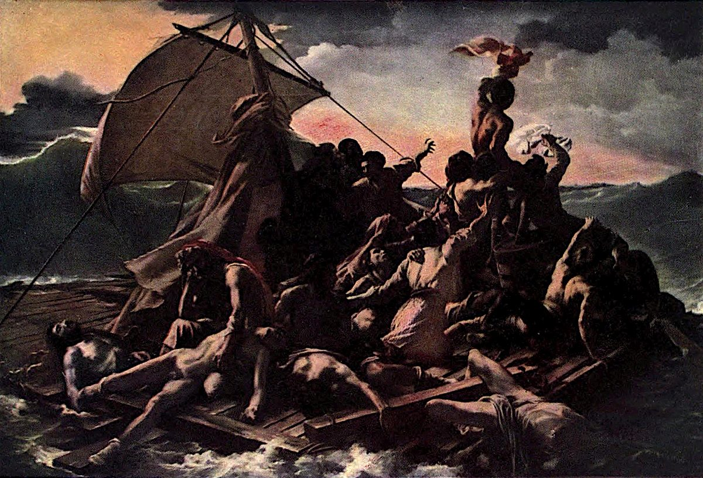

# 메두사호의 뗏목 — 멀리 보이는 작은 배를 향하여

*절망과 구조의 기대가 한 화면에 놓이는 방식*

Culture · Art

> 자료 대조를 마친 검토용 이야기입니다. 공개 게시 승인은 아직 받지 않았습니다.

*테오도르 제리코 · The Raft of the Medusa · The Louvre: Fifty Plates in Colour, Plate XLVI · Project Gutenberg*

[이미지 출처·제작 근거](https://raw.githubusercontent.com/GITenberg/The-Louvre-Fifty-Plates-in-Colour_63719/master/63719-h/images/i_plate46.jpg) · 퍼블릭 도메인 원작 및 옛 출판물의 재현 도판 · Project Gutenberg 수록본

그림 안의 사람들은 먼 곳을 향해 손과 천을 들어 올린다. 그런데 그들이 바라보는 배는 놀랄 만큼 작다. 바로 앞에는 움직이지 않는 몸들이 있고 바다는 불안하다. 제리코의 〈메두사호의 뗏목〉에서는 희망이 거대한 영웅의 모습보다 거의 놓칠 만한 수평선의 점으로 나타난다.

실제 난파 사건에서 출발한 이 그림은 1819년 살롱에서 큰 주목을 받았다. 편안한 풍경화는 아니다. 다만 괴로운 장면을 자세히 설명하기보다 사람들의 시선과 화면의 방향을 따라가면, 화가가 고통과 기대를 어떻게 함께 보이게 했는지 읽을 수 있다.

## 1. 뗏목은 구조선이 아니다

제목의 메두사는 신화 속 인물이 아니라 난파한 배의 이름이다. 살아남은 사람들이 뗏목에 매달려 바다를 떠도는 상황이 그림의 바탕이다. 안정된 배의 갑판처럼 보아서는 안 되는 이유다. 인물들이 서거나 기대는 바닥 자체가 불안정하다.

넓은 바다에 비하면 사람이 딛는 곳은 좁다. 무대의 가장자리처럼 화면 앞쪽에 걸린 뗏목을 보면 관람자와 사건의 거리도 가깝게 느껴진다. 멀리서 바다의 아름다움을 감상하는 시점보다 사람들의 위태로운 자리 가까이에 세워지는 느낌이다.

## 2. 앞쪽의 몸에서 시선이 시작된다

아래쪽에는 힘없이 늘어진 인물들이 있다. 그 곁의 사람들도 서로 다른 방향으로 몸을 기대거나 고개를 숙인다. 모두가 한 가지 감정을 같은 자세로 표현하지 않는다. 이미 지친 사람과 아직 바깥을 바라보는 사람이 같은 뗏목에 있다.

이 차이 때문에 그림을 절망이라는 단어 하나로 끝내기 어렵다. 어떤 인물에게는 몸을 드는 일조차 어려워 보이고, 다른 인물에게는 손을 들어 신호를 보내는 일이 마지막 행동이 된다. 감정은 표정뿐 아니라 몸의 높이와 힘의 방향으로 드러난다.

## 3. 점점 높아지는 사람들의 흐름

시선을 오른쪽 위로 옮기면 몸들이 겹쳐지고 움직임이 높아진다. 낮게 놓인 사람들에서 무언가를 가리키는 사람을 지나, 가장 높은 자리에서 천을 흔드는 인물 쪽으로 올라간다. 여러 사람이 하나의 큰 방향을 만드는 셈이다.

개개인의 해부학적 자세를 분석하지 않아도 이 흐름은 보인다. 화면의 어디가 낮고 어디가 높아지는지, 팔이 어느 쪽으로 뻗는지만 따라가도 된다. 그림은 많은 인물을 무작정 모아 놓은 것이 아니라 우리의 눈이 지나갈 길을 조직하고 있다.

## 4. 그렇게 바라본 곳에는 작은 배가 있다

인물들의 움직임을 따라 끝까지 가면 수평선 근처의 작은 구조선이 보인다. 사람이 아무리 크게 몸짓해도 먼 배에서 알아볼 수 있을지는 알 수 없다. 희망의 대상이 작고 멀다는 사실이 신호를 보내는 사람들의 절박함을 더 크게 만든다.

배가 눈앞에서 확실하게 다가오는 장면이었다면 그림의 긴장은 달랐을 것이다. 여기서는 구조될 가능성과 놓칠 가능성이 함께 남아 있다. 사건의 모든 결과를 한 장면에 펼치기보다 어느 순간을 멈추어 놓을지가 그림의 힘과 연결된다는 것을 볼 수 있다.

## 5. 돛과 하늘도 다른 방향으로 힘을 준다

왼쪽의 돛과 줄, 어두운 하늘과 파도도 화면의 움직임에 참여한다. 사람들의 몸이 구조선 쪽으로 향하더라도 그 바람이 곧 안정된 이동을 보장하지는 않는다. 자연은 인물의 기대에 맞춰 편안한 배경이 되어 주지 않는다.

밝은 부분과 어두운 부분의 대비도 살펴보자. 인물의 몸이 드러나는 곳과 그림자가 뭉치는 곳을 오가면 시선이 한곳에만 고정되지 않는다. 바다가 넓다는 사실과 사람이 가까이 있다는 느낌이 함께 생긴다. 배경의 날씨도 사건의 압력으로 느껴질 수 있다.

## 6. 실제 사건과 그림은 같은 기록일까

이 작품은 실제 난파의 고통에서 출발했지만 사건을 촬영한 사진은 아니다. 화가는 사람과 빛, 동작을 선택하고 구성했다. 실제 일이 있었다는 사실과 눈앞의 모든 세부가 그 순간 그대로라는 주장은 다르다.

오래된 도록에는 인물들을 특정 생존자와 연결하는 설명도 있다. 그러나 이 글에서는 화면에서 직접 볼 수 있는 관계와 확인한 큰 배경을 중심으로 읽는다. 사건의 참가자 수나 책임 문제 전체를 이 한 그림의 모습만으로 확정할 수는 없다. 역사 자료와 회화의 표현은 서로 대조할 필요가 있다.

## 7. 큰 그림이 관람자를 마주 세운다

작품은 세로 약 5미터, 가로 약 7미터에 이르는 거대한 캔버스다. 화면에서 작게 볼 때와 실제 크기 앞에 섰을 때의 경험이 다를 수 있다. 생존을 기다리는 사람들의 몸이 단순한 작은 삽화 속 인물로만 보이지 않는 규모다.

옛 도록은 이 작품을 낭만주의 회화의 중요한 변화와 연결한다. 양식 이름을 외우기보다 무엇이 전면으로 나왔는지 보면 된다. 정돈된 위엄보다 흔들리는 몸과 격한 감정, 현실의 고통이 큰 화면을 차지한다. 미술의 중요한 주제가 무엇일 수 있는지 묻는 그림이기도 하다.

## 8. 한 번은 배를, 다음에는 사람을 보기

처음에는 먼 배가 어디에 있는지 찾아보고, 다음에는 그 배를 향한 몸짓이 어디에서 시작되는지 거꾸로 따라가 보자. 작품의 의미를 숨은 물건 하나의 정답으로 푸는 대신 화면 안의 거리와 방향을 읽는 방법이다.

함께 실은 이미지는 옛 루브르 도록의 실제 작품 재현 도판이다. 고통의 장면을 새로 만들어 낸 AI 삽화가 아니다. 작은 배를 향해 올라가는 시선과 앞쪽에 남은 무게를 함께 보면, 희망과 절망이 어떻게 같은 순간에 존재하는지 느낄 수 있다.

## 이야기의 바탕이 된 자료

- [The Louvre: Fifty Plates in Colour — 다비드·제리코 해설과 도판 캡션](https://raw.githubusercontent.com/GITenberg/The-Louvre-Fifty-Plates-in-Colour_63719/master/63719-0.txt) · 확인일 2026-10-30
  - 확인 내용: Plate XLV: 레카미에 부인·흰 엠파이어 드레스·긴 소파·미완성 / 다비드의 역사화·혁명과 나폴레옹 시대의 작업 / Plate XLVI: 실제 난파에 바탕한 메두사호의 뗏목·1819년 살롱·멀리 보이는 Argus·크기 약 4.91×7.16m

---

[같은 소주제의 이야기](README.md) · [전체 서가](../../README.md)
