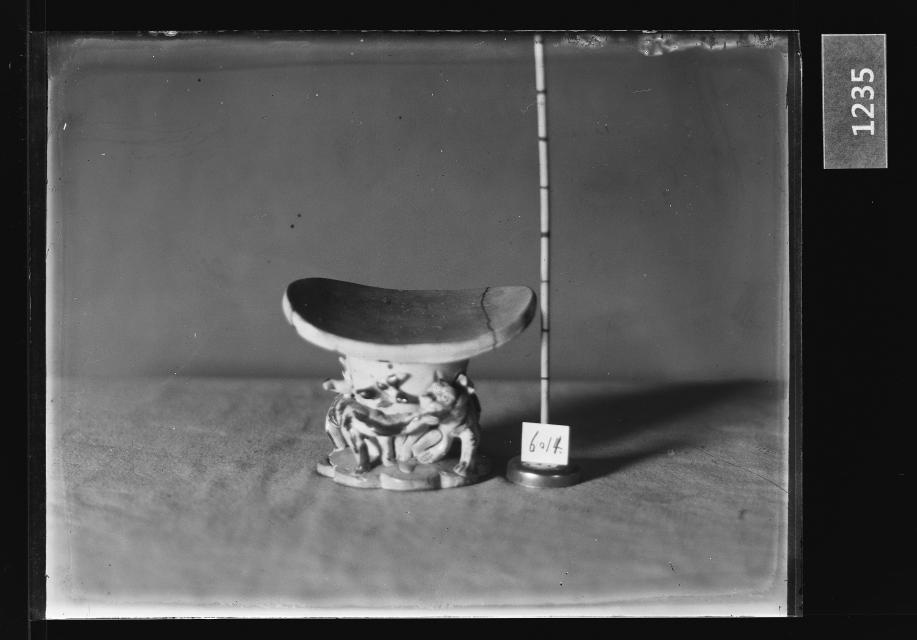

# 옛 베개 사진 옆에는 왜 자가 서 있을까

*주인공만큼 중요한 사진 속 조연*

Culture · Art

> 자료 대조를 마친 검토용 이야기입니다. 공개 게시 승인은 아직 받지 않았습니다.

*백자베개 유리건판 · 국립고궁박물관 소장·제공. 전체 사진을 자르지 않고 사용했습니다.*

[이미지 출처와 소장품 안내](https://www.gogung.go.kr/gogung/pgm/psgudMng/view.do?menuNo=800065&psgudSn=438673) · 공공누리 제1유형(출처표시)

오래된 흑백 사진 한 장을 보자. 가운데에는 베개가 놓여 있고 오른쪽에는 긴 막대가 서 있다. 기념사진이라면 치워 두었을 것 같은 물건인데, 이 사진에서는 함께 남아 있다.

국립고궁박물관이 소장한 백자베개 유리건판이다. 이 자료에서 박물관이 소장한 것은 사진을 담은 유리건판이며, 사진 속 베개 자체와는 구분해야 한다. 한 장의 사진에도 서로 다른 물건의 이력이 겹친다.

## 크기를 알려 주는 동반자

박물관 설명은 오른쪽 막대를 크기 측정용 자라고 알려 준다. 사진만 보면 베개가 손바닥만 한지, 훨씬 큰지 가늠하기 어렵다. 곁에 선 자는 그 판단을 돕는 역할을 한다.

오늘 중고 물품 사진에 동전이나 자를 함께 놓는 일을 떠올려도 좋다. 사진은 모양을 보여 주는 데 능하지만 크기를 저절로 설명하지는 않는다. 오래된 촬영에도 그 빈틈을 채울 도구가 필요했던 것이다.

## 번호가 두 개처럼 보이는 이유

사진 속 오른쪽에는 촬영 당시 번호 6014도 남아 있다. 박물관은 사진 속 베개가 중국 도자이며 현재 국립중앙박물관의 덕수2165로 소장되어 있다고 설명한다.

촬영 번호와 지금의 소장품 번호는 같은 것이 아니다. 그래서 숫자가 다르다고 사진이 잘못되었다고 생각할 필요는 없다. 어느 숫자가 사진을 위한 기록이고 어느 숫자가 물건을 찾는 표지인지 나누어 보면 한결 이해하기 쉽다.

## 사진에 남은 수리의 흔적

설명에는 베개의 파손된 윗부분이 수리되었다는 내용도 있다. 완벽한 외형만 기록한 것이 아니라, 그때 남아 있던 상태 역시 사진과 설명 안에 들어 있는 셈이다.

이 사진을 볼 때 베개 무늬를 모두 읽을 필요는 없다. 옆의 자와 번호부터 찾아보자. 물건을 아름답게 보여 주는 사진과 물건을 정확하게 남기는 사진이 어떤 점에서 다른지, 작은 조연들이 조용히 알려 준다.

## 이야기의 바탕이 된 자료

- [국립고궁박물관 — 백자베개 유리건판](https://www.gogung.go.kr/gogung/pgm/psgudMng/view.do?menuNo=800065&psgudSn=438673) · 확인일 2026-10-28
  - 확인 내용: 백자베개를 촬영한 유리건판 / 촬영번호 6014와 측정용 막대자 / 사진 속 도자의 현재 국립중앙박물관 소장번호 덕수2165 / 상단 파손부 수리

---

[같은 소주제의 이야기](README.md) · [전체 서가](../../README.md)
