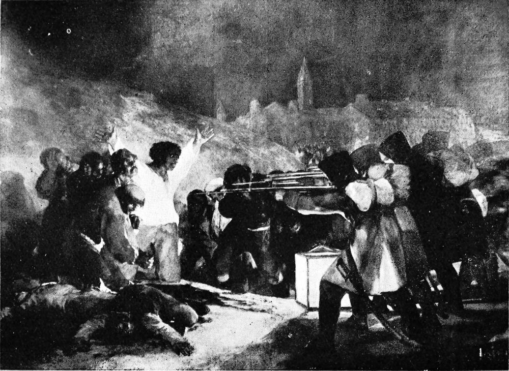

# 고야의 1808년 5월 3일 — 불빛은 누구의 얼굴을 비추는가

*군인의 등과 희생자의 얼굴, 등불과 반복되는 폭력의 시간*

Culture · Art

> 자료 대조를 마친 검토용 이야기입니다. 공개 게시 승인은 아직 받지 않았습니다.

*Francisco Goya, The Third of May 1808. Albert F. Calvert, Goya, Plate 171 · Public Domain. 실제 작품의 역사 흑백 도판입니다. 도록의 옛 5월 2일 캡션과 현재 작품 제목은 구분합니다.*

[이미지 출처·제작 근거](https://raw.githubusercontent.com/GITenberg/Goya-an-account-of-his-life-and-works_64514/master/64514-h/images/ill_171.jpg) · Public Domain · 저작권 만료 작품 및 역사 출판 자료

어두운 밤, 밝은 옷의 남자가 두 팔을 벌리고 무장한 군인들 앞에 서 있다. 고야의 「1808년 5월 3일」은 전쟁을 승리한 장군의 모습으로 보여 주지 않는다. 죽음을 앞둔 사람과 총을 겨누는 집단이 마주한다. 그림의 빛과 얼굴, 화면에 남은 시간을 따라가 보자.

## 01. 제목의 날짜와 그림의 시간

1808년 프랑스의 스페인 침입과 마드리드의 저항은 폭력적인 진압으로 이어졌다. 그림은 그 사건을 다루며, 제작은 1814년으로 알려져 있다. 사건이 벌어진 날과 화가가 화면으로 정리한 때를 구분해야 한다. 눈앞의 장면은 현장에서 즉시 찍은 기록 사진이 아니다.

고야가 사건을 어떻게 보았는지를 모두 단정할 수는 없다. 중요한 것은 어떤 장면을 골라 관객 앞에 놓았는지다. 왕과 군대의 영광보다 무방비한 사람들이 겪는 죽음이 앞에 나온다. 역사화가 무엇을 기억하게 할 것인지에 관한 선택이다.

## 02. 얼굴을 가진 사람과 얼굴을 감춘 집단

오른쪽 군인들은 몸을 기울여 총을 겨눈다. 비슷한 자세가 반복되고 관객에게 얼굴을 거의 보여 주지 않는다. 반대편 사람들은 각기 다른 몸짓과 표정을 갖는다. 두 집단은 같은 방식으로 그려져 있지 않다.

이 차이는 폭력의 비대칭을 만든다. 한쪽은 행동하는 하나의 장치처럼 보이고 다른 쪽은 고통을 겪는 여러 사람으로 보인다. 개인의 이름을 모르더라도 두려움과 절망의 차이를 알아볼 수 있다. 그림은 숫자로 묶일 수 있는 희생자를 서로 다른 얼굴로 되돌린다.

## 03. 땅 위의 등불이 만든 무대

등불은 군인과 희생자 사이의 낮은 곳에 놓여 있다. 그 빛은 밝은 옷의 인물과 앞쪽 사람들을 강하게 드러낸다. 빛이 있다고 안전한 것은 아니다. 여기서 잘 보인다는 사실은 오히려 피할 수 없는 상황을 더 뚜렷하게 만든다.

어둠 속에서 일부만 선명해지면 관객의 시선도 정해진다. 멀리 있는 도시보다 앞의 몸과 손을 먼저 보게 된다. 등불은 장면 안의 물건이면서 그림을 읽는 순서를 만드는 장치다. 빛을 아름다움이나 희망과 자동으로 연결할 수 없는 이유다.

## 04. 벌어진 팔은 무엇을 떠올리게 할까

중앙의 남자는 두 팔을 벌리고 있다. 이 자세는 종교화의 고통이나 희생을 연상시키기도 하지만, 그를 한 가지 상징으로만 바꿀 필요는 없다. 그는 동시에 바로 다음 순간을 맞아야 할 구체적인 사람이다.

무기를 든 영웅처럼 싸우는 모습이 아니라 드러난 몸으로 서 있다는 점이 중요하다. 강한 감정은 승리의 행동에서만 나오지 않는다. 저항할 수 없는 상태를 관객이 바라보게 하는 구성에서도 나온다. 고야는 역사화의 중심에 취약한 몸을 놓았다.

## 05. 이미 죽은 사람과 기다리는 사람이 함께 있다

화면 앞에는 쓰러진 사람들이 있고, 뒤에는 차례를 기다리는 사람들이 있다. 현재의 한 순간 안에 조금 전과 곧 다가올 미래가 겹친다. 죽음을 앞둔 인물은 앞에 놓인 몸을 통해 자기에게 일어날 일을 보게 된다.

그래서 이 그림의 시간은 한 번의 총성으로 끝나지 않는다. 반복될 폭력의 구조를 생각하게 한다. 관객의 눈은 이미 끝난 일과 아직 끝나지 않은 일 사이를 움직인다. 전투의 빠른 움직임 대신 기다림이 더 큰 공포를 만드는 장면이다.

희생자들이 모두 같은 표정과 자세로 서 있지 않다는 점도 다시 살펴볼 만하다. 손을 모으거나 얼굴을 가리고 시선을 피하는 몸이 섞인다. 한 사건에 함께 놓였다고 그 사건을 겪는 방식까지 같아지는 것은 아니다. 작은 차이가 집단 안의 개인을 남긴다.

반대로 군인들의 반복되는 동작은 개별 얼굴보다 명령에 맞추어진 움직임을 앞세운다. 그림이 양쪽을 같은 정도로 자세히 설명하지 않는 것은 관객의 감정에도 영향을 준다. 이 구성을 보고도 폭력의 주체와 대상을 구별하지 않는 추상적인 전쟁만 떠올린다면 화면의 차이를 놓치게 된다. 빛과 배치는 누구의 경험에 더 가까이 서도록 할 것인지 정한다. 구체적인 구도가 윤리적인 질문으로 이어지는 지점이다.

## 06. 먼 도시는 가까운 사람들을 구하지 않는다

배경에는 건물과 언덕이 있지만 앞의 비극을 막아 주는 피난처로 보이지 않는다. 도시의 형태가 남아 있다고 그 안의 질서가 사람을 보호한 것은 아니었다. 가까운 몸과 멀리 있는 건축의 거리가 화면에서 크게 느껴진다.

사용한 역사 도판은 흑백이다. 원작의 색채를 온전히 대신하지는 못하지만 밝기와 집단의 배열은 살필 수 있다. 도판의 옛 캡션이 사건을 넓게 5월 2일과 연결한 것과 오늘의 작품 제목을 구분하면 이미지와 설명의 역사를 혼동하지 않게 된다.

## 07. 승리자를 찾는 대신 시선의 위치를 보기

이 그림에서 누구의 편인지 묻는 일만큼 누구의 얼굴을 보게 하는지 묻는 일이 중요하다. 군인의 등 뒤에서 장면을 바라보는 관객은 폭력의 거리에서 자유롭지 않다. 안전한 곳에서 끝난 사건을 구경하는 느낌이 쉽게 생기지 않는다.

「1808년 5월 3일」은 특정 사건의 기억이면서 전쟁을 그리는 방식에 대한 질문이다. 화려한 지휘관 없이도 역사를 말할 수 있고, 강한 사람보다 취약한 사람을 중심에 놓을 수 있다. 누구의 얼굴이 남는지도 역사를 표현하는 선택이었다. 불빛이 향한 자리를 따라가면 그림이 남기려 한 고통의 무게가 보인다.

## 이야기의 바탕이 된 자료

- [Albert F. Calvert, Goya — French Invasion and Plate 171](https://raw.githubusercontent.com/GITenberg/Goya-an-account-of-his-life-and-works_64514/master/64514-0.txt) · 확인일 2026-11-06
  - 확인 내용: 1808년 프랑스 침입과 마드리드 저항/진압 맥락·실제 5월 3일 작품의 Plate171·빛/군인/희생자의 구도. 도록의 Scenes of the 2nd May라는 옛 캡션은 현재 작품 제목과 구분

---

[같은 소주제의 이야기](README.md) · [전체 서가](../../README.md)
