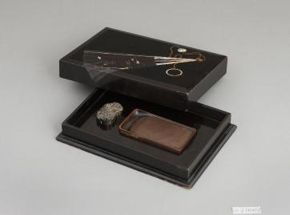

# 벼루함 속 해태의 입에는 작은 구멍이 있다

*글쓰기 도구를 담은 상자에서 만나는 뜻밖의 동물*

Culture · Art

> 출처 대조와 공개 게시 승인을 마친 이야기입니다. 실제 게시 여부는 사이트 배포 상태를 따릅니다.

*나전칠기부채무늬연갑, 고궁2 · 국립고궁박물관 소장·제공*

[이미지 출처·제작 근거](https://www.gogung.go.kr/gogung/pgm/psgudMng/view.do?menuNo=800065&psgudSn=439031) · 공공누리 제1유형(출처표시)

검은 칠을 한 상자에 반짝이는 부채 무늬가 들어 있다. 겉모습만 보면 장식품을 담은 함일 것 같다. 그런데 국립고궁박물관이 소개하는 이 물건의 이름은 「나전칠기부채무늬연갑」이다. 벼루와 연적을 함께 보관하는 상자다.

‘연적’이라는 낯선 말은 잠깐 뒤로 두어도 좋다. 이 상자 안에는 작은 해태 모양의 금속 물건이 들어 있고, 그 등에 하나, 입에 하나 구멍이 있다.

## 1. 상자 속 물건마다 자기 자리가 있다

박물관 설명에 따르면 함의 안쪽 가운데는 벼루 모양에 맞게 파여 있다. 벼루를 그 자리에 끼워 넣어 보관하도록 한 것이다. 연적을 위한 홈도 있어 쉽게 움직이지 않도록 했다.

그냥 넓은 상자에 도구를 넣어 둔 것과는 다르다. 안에 들어갈 물건의 모양을 생각해 자리를 마련했다. 오늘의 안경집이나 도구 보관함에서도 만나는 익숙한 생각이다.

뚜껑이 깊다는 점도 눈에 띈다. 뚜껑과 몸체를 덮으면 몸체의 바닥 부분만 보이는 형태라고 한다. 닫았을 때의 단정한 모습과 열었을 때의 알맞은 자리가 한 물건 안에 있다.

## 2. 해태의 등으로 넣고 입으로 내보내다

연적은 벼루에 쓸 물을 담는 도구다. 이 함의 연적은 해태 모양이며, 등 부분에 물을 넣는 구멍이 있고 입 부분에는 물이 나오는 작은 둥근 구멍이 뚫려 있다.

동물의 얼굴을 알아본 다음에 구멍의 위치를 보면 쓰임도 함께 드러난다. 장식을 위해 더한 입이 물을 내보내는 자리이기도 하다. 물건의 기능이 생김새 안으로 들어가 있다.

사진으로 구멍이 모두 또렷하지 않더라도 박물관 설명을 따라 위치를 짐작해 볼 수 있다. 해태가 왜 그 상자 안에 있는지 알고 나면 작은 동물을 보는 눈이 조금 달라진다.

## 3. 글을 쓰기 전에도 준비가 있었다

먹과 벼루를 사용하는 글쓰기에는 물을 마련하고 도구를 제자리에 두는 일이 따라온다. 완성된 글씨만 보아서는 잘 드러나지 않는 시간이다. 벼루함은 그 준비를 한 물건 안에 모아 놓는다. 어느 도구를 어디에 두고 다시 꺼낼지 생각한 구조가 있어야 사용하는 손도 다음 행동을 찾기 쉽다.

이 함의 안쪽에 도구 모양에 맞춘 홈이 있다는 설명은 그래서 중요하다. 넣을 수 있는 공간을 크게 만들기만 한 것이 아니다. 들어갈 물건의 윤곽에 맞춰 자리를 나누었다. 오늘의 도구 상자와 비교하는 것은 쓰임을 이해하는 비유이며, 당시 사용자가 같은 말을 했다는 기록을 뜻하지는 않는다. 물건의 배치가 글쓰기의 준비를 도왔다는 점을 볼 수 있다.

## 4. 두 구멍이 해태의 몸을 다르게 읽게 한다

물은 등 쪽의 입수구로 들어가고 입 쪽의 작은 구멍으로 나온다. 하나의 형상에서 물을 채우는 자리와 내보내는 자리가 나뉜다. 조각을 보는 눈에서 도구를 쓰는 눈으로 바꾸면 같은 몸이 통로를 가진 용기로 보인다. 장식과 기능이 별도의 부품으로만 나뉘는 것은 아니었던 것이다.

그렇다고 구멍의 위치만으로 당시 물을 따르는 손동작과 사용량을 모두 알 수는 없다. 여기서는 연적이라는 도구의 역할과 확인된 구조를 연결한다. 물을 보관하고 조금씩 쓰는 일을 동물의 몸 안에 담았다는 점이 흥미롭다. 기능을 숨겼다기보다 기능을 즐길 만한 형상으로 만든 물건으로 읽어 볼 수 있다.

## 5. 닫혔을 때와 열렸을 때의 다른 모습

깊은 뚜껑은 닫은 상태에서 몸체의 많은 부분을 가린다. 바깥에서는 하나의 단정한 함처럼 보이고 안을 열면 벼루와 연적의 구체적인 자리가 나타난다. 보관하는 시간과 사용하는 시간이 같은 모습을 요구하지는 않는다. 뚜껑이 만든 경계가 그 두 장면을 나누어 준다.

이런 물건을 사진 한 장으로 볼 때에는 현재 열려 있는지, 무엇이 꺼내져 있는지부터 확인하면 좋다. 전시를 위해 펼쳐 놓은 상태를 언제나 그 모습으로 사용했다고 생각할 필요는 없다. 수납 도구는 닫힌 외형과 열린 내부를 함께 볼 때 설계의 뜻이 더 잘 보인다. 겉의 장식과 안쪽의 홈이 서로 다른 일을 하고 있었다.

## 6. 부채 무늬와 작은 동물의 자리

박물관은 함의 부채 모양 나전과 금색 끈 장식도 설명한다. 바깥의 표면과 내부의 연적은 각기 다른 방식으로 물건에 표정을 더한다. 하나는 면의 무늬와 빛을 만들고, 다른 하나는 입체적인 몸 안에 물을 담는다. 단순히 화려한 상자라는 말보다 각각 어디에 무엇이 놓였는지 보면 더 많은 것이 읽힌다.

해태라는 이름을 들었다고 모든 장식에 같은 기원을 확정할 필요는 없다. 이 물건에서 확인할 수 있는 위치와 쓰임을 먼저 살펴보면 된다. 좋은 글씨가 남기 전의 조용한 준비 시간에도 사람들이 사용하는 물건을 고르고 꾸미는 취향이 있었다. 작은 연적의 입은 그 생활을 떠올리게 하는 뜻밖의 입구다.

## 7. 뚜껑 위의 부채는 바람 대신 빛을 낸다

함의 뚜껑에는 부채를 본뜬 무늬가 있다. 부채에 들어간 무늬와 부챗살, 구슬과 고리는 나전으로 표현했고 끈은 금색 안료로 나타냈다고 한다.

나전은 빛을 받으면 반짝이는 재료다. 상자의 기능만 생각하면 없어도 될 것 같은 부분이지만, 그 덕분에 닫힌 함에도 오래 바라볼 자리가 생긴다.

다음에 옛 문방구를 만나면 글씨를 쓰는 도구라는 설명만 읽고 지나치지 않아도 좋겠다. 뚜껑의 부채에서 안쪽의 작은 해태까지, 쓰는 사람의 손길을 기다리던 물건에는 기능과 구경거리가 나란히 들어 있다.

## 이야기의 바탕이 된 자료

- [국립고궁박물관 — 나전칠기부채무늬연갑(고궁2)](https://www.gogung.go.kr/gogung/pgm/psgudMng/view.do?menuNo=800065&psgudSn=439031) · 확인일 2026-10-27
  - 확인 내용: 벼루·연적을 고정하는 내부의 홈과 깊은 뚜껑 / 해태 모양 금속 연적의 등 입수구와 입 출수구 / 부채 무늬의 나전과 금색 끈 장식

---

[같은 소주제의 이야기](README.md) · [전체 서가](../../README.md)
