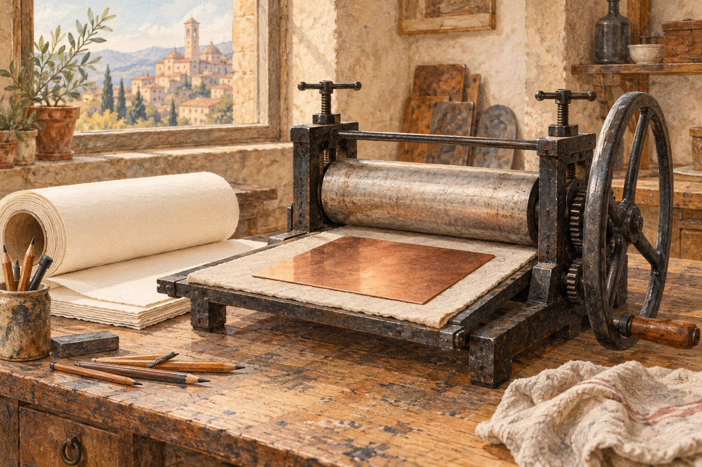

# 판화 한 장이 큰 그림의 제안서가 되었다

*이탈리아 화가가 후원자를 찾던 방법*

Culture · Art

> 출처 대조와 공개 게시 승인을 마친 이야기입니다. 실제 게시 여부는 사이트 배포 상태를 따릅니다.

*KnowledgeWalk 제작 · AI 설명용 삽화. 실제 유물·작품·건축물·전시 배치를 재현한 사진이나 역사적 증거가 아닙니다.*

그림을 크게 그리고 싶은데 그 일을 맡겨 줄 사람이 없다면 어떻게 할까. 요즘이라면 구상안이나 작은 견본을 만들어 보여 줄 수 있을 것이다. 이탈리아의 예술가 살바토르 로사에게는 판화라는 방법이 있었다.

시카고 미술관은 그의 거인들의 추락이라는 판화를 소개하며 큰 그림을 실현하기 위해 후원자의 관심을 얻으려던 목적도 설명한다. 판화가 완성된 작품이면서 다음 일을 제안하는 물건이 된 셈이다.

## 1. 먼저 이야기의 장면을 고르기

미술관 해설에 따르면 작품은 거인들이 신들의 자리를 공격하려 하자 유피테르가 번개로 그들을 떨어뜨리는 장면을 담는다. 위쪽 구름에는 신이, 아래에는 추락하는 거인들이 놓이는 구상이다.

우리가 여기서 보는 삽화는 그 판화를 복제한 것이 아니라 작업실을 떠올리도록 만든 설명용 그림이다. 실제 화면의 구성에 관한 이야기는 미술관의 작품 해설을 근거로 읽으면 된다.

## 2. 하나의 재료에 머물지 않았던 사람

로사는 판화가이면서 화가였고 시와 연기, 음악에서도 활동했다고 미술관은 소개한다. 한 가지 이름표만으로 그의 일을 모두 설명하기는 어려운 인물이었다.

이 판화는 같은 주제의 회화를 제작할 생각을 알리고 그 일을 후원할 사람을 찾기 위한 것이었다고 한다. 이미 한 번 만든 이미지를 다음 재료와 다음 크기의 작업으로 이어 보려는 시도였다.

## 3. 위로 올라가는 욕망과 아래로 떨어지는 몸

미술관이 설명하는 장면에는 뚜렷한 방향이 있다. 거인들은 신들의 자리를 공격하려 하지만 유피테르의 번개를 맞아 아래로 추락한다. 위쪽 구름과 아래쪽 몸의 대비가 이야기를 구성한다. 신화의 이름을 모두 모르더라도 어느 방향으로 힘이 작용하는지 알면 장면의 긴장이 조금 보인다.

다만 본문에 실린 작업실 삽화에서 원본 판화의 인물 배치를 직접 확인할 수는 없다. 실제 화면에 대한 설명은 기관의 원본 해설을 따라 읽는 부분이다. 그림과 설명이 각각 무엇을 보여 주는지 구분하면 상상한 장면을 사료처럼 받아들이지 않으면서도 작품의 구상을 이해할 수 있다.

## 4. 판화 아래의 문장도 함께 읽기

기관 해설은 작품 아래에 올라간 자가 더 큰 몰락을 겪는다는 취지의 경고가 적혀 있다고 소개한다. 추락하는 몸과 문장이 서로 같은 방향을 가리키는 셈이다. 이미지만 보고 신화의 한 장면으로 지나쳤다면 글을 통해 관람자에게 어떤 생각을 요구하는지 다시 볼 수 있다.

그 문장을 곧바로 화가의 모든 정치적 입장이나 개인적 불행의 암호로 해석할 필요는 없다. 여기서 확인되는 것은 그림에 덧붙인 말의 역할이다. 시인이기도 했던 작가의 활동과 연결해 보면 이미지와 언어가 서로 다른 분야로만 떨어져 있지 않았다는 점이 흥미롭다. 그림의 바깥 여백에도 읽을 것이 있었다.

## 5. 완성된 판화가 아직 없는 회화를 가리킨다

보통 우리는 완성품을 본 뒤 그 작품의 전 단계를 찾는다. 이 경우 판화는 그 자체로 완성한 작업이면서 앞으로 만들 회화를 알리는 제안이기도 했다. 지금 있는 이미지가 다음 재료의 작업을 설득하는 역할을 맡았다. 작품이 혼자 닫힌 결과물이 아니라 다음 제작을 향한 대화가 된 것이다.

회화를 실제로 제작하려면 생각과 솜씨만이 아니라 비용과 후원이 필요할 수 있다. 기관이 후원자를 찾으려는 목적을 설명하는 이유다. 이 사실만으로 결국 어느 후원자가 나섰고 계획이 어떻게 끝났는지까지 추정하지는 않는다. 제안의 목적과 나중의 실현 여부는 서로 다른 기록으로 확인할 문제다.

## 6. 여러 일을 한 사람이 만든 하나의 제안

로사가 그림과 판화뿐 아니라 시와 연기, 음악에도 관여했다는 설명은 단순히 재주가 많았다는 칭찬으로 끝나지 않는다. 인물의 몸짓과 장면의 극적인 대비, 문장이 함께 있는 작업을 볼 때 그 폭넓은 관심을 떠올릴 수 있다. 다만 모든 형식의 특징을 다른 직업 하나에서 직접 가져왔다고 확정할 수는 없다.

확인된 활동의 범위는 작가를 만나는 입구를 넓혀 준다. 한 사람을 판화가라는 말로만 기억했을 때보다 여러 매체 사이를 오간 제작자로 볼 수 있다. 작은 종이 위에 큰 장면을 제안하고 또 다른 그림을 기대하게 하는 일도 그 활동의 한 모습이었다. 예술품을 구경하다가 그것을 만들기 위한 조건까지 보게 되는 이야기다.

## 7. 작품의 다음 페이지 보기

오늘의 눈으로 보면 작은 모형이나 제안서를 만드는 일과 닮아 보인다. 다만 판화가 단순한 미완성 초안이었다는 뜻은 아니다. 판화 자체로 완성된 작품이면서 더 큰 계획을 보여 주는 역할도 한 것이다.

미술관의 작품 하나를 볼 때 그 뒤에 무엇을 하려 했는지도 질문해 볼 수 있다. 만든 사람이 이 이미지로 누구를 설득하고 싶었는지 생각하는 것이다. 거인들의 추락은 신화의 장면인 동시에 한 예술가의 다음 작업을 향한 제안이기도 했다.

## 이야기의 바탕이 된 자료

- [시카고 미술관 — The Fall of the Giants](https://raw.githubusercontent.com/art-institute-of-chicago/api-data/master/json/artworks/16.json) · 확인일 2026-10-28
  - 확인 내용: 거인들의 공격과 유피테르의 번개라는 작품 장면 / 화가·시인·배우·음악가 등 로사의 활동 / 같은 주제 회화 후원 유치를 위한 판화 제작 목적

---

[같은 소주제의 이야기](README.md) · [전체 서가](../../README.md)
