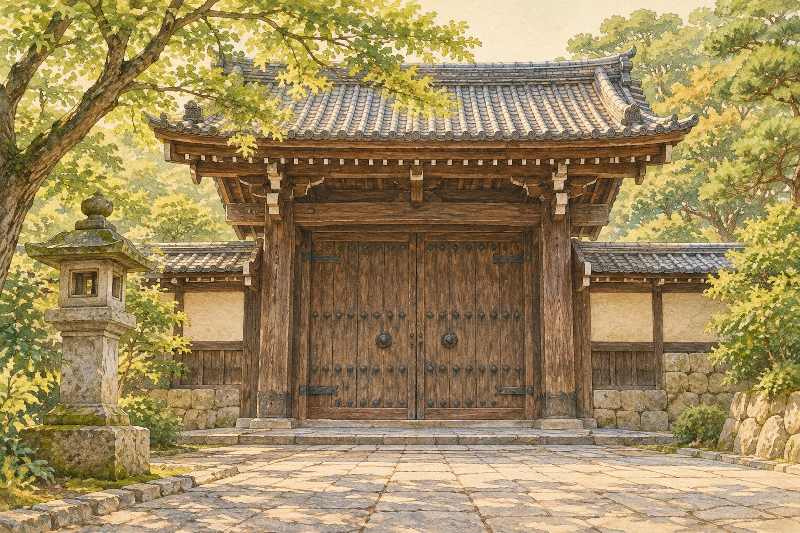

# 절을 지키는 얼굴은 왜 그렇게 무서울까

*일본 수호상을 보는 시선을 바꾸는 방법*

Culture · Art

> 출처 대조와 공개 게시 승인을 마친 이야기입니다. 실제 게시 여부는 사이트 배포 상태를 따릅니다.

*KnowledgeWalk 제작 · AI 설명용 삽화. 실제 유물·작품·건축물·전시 배치를 재현한 사진이나 역사적 증거가 아닙니다.*

눈을 크게 뜨고 입을 벌린 조각상이 앞을 내려다본다. 처음 만났다면 반갑게 맞아 주는 얼굴이라고 하기는 어려울 것이다. 그런데 일본의 불교 수호상을 볼 때는 질문을 한 번 바꿔 볼 수 있다. 누구를 겁주기 위한 표정일까.

시카고 미술관은 슈콘고진으로 소개하는 수호상에 관한 교육 자료에서 바로 그 두 가지 느낌을 함께 짚는다. 무서움과 보호받는 마음이다.

## 나를 향한 위협일까

미술관 설명은 크게 부릅뜬 눈과 외치는 듯 열린 입, 강한 몸의 표현을 이야기한다. 사찰로 다가오는 사람에게 두려움을 줄 수 있는 모습이다.

그러나 안으로 들어가 마음을 가라앉히려는 사람에게는 다른 뜻으로 느껴질 수도 있다. 무언가가 자신을 지켜 주고 있다는 안도감이다. 같은 표정이라도 그 존재를 내 편으로 생각하는지에 따라 인상이 달라지는 것이다.

## 표정만 떼어 보면 놓치는 것

이 조각을 공격적인 얼굴 하나로만 보면 기괴한 장식처럼 느껴질 수 있다. 하지만 사찰을 지키는 역할과 함께 보면 몸짓을 읽는 방법이 달라진다. 웃고 있어야만 친절한 존재인 것은 아니다.

오늘날 문 앞에 붙이는 경고문도 떠올려 볼 수 있다. 들어오는 모든 사람을 미워해서라기보다 안쪽의 사람과 공간을 보호하려는 목적일 때가 있다. 이것은 역할을 이해하기 위한 현대의 비유다.

## 질문을 바꾸어 보는 즐거움

기관 자료는 원래 방문객이 느꼈을 반응을 가능성으로 설명한다. 실제 모든 사람이 같은 두려움이나 안도감을 느꼈다고 정하는 것은 아니다. 오래된 조각 앞에서도 보는 사람의 경험은 다를 수 있다.

그럼에도 누구를 지키고 누구를 향해 힘을 보이는가라는 질문은 쓸모가 있다. 다음에 무서운 표정의 수호상을 만나면 얼굴을 피하기 전에 역할을 생각해 보자. 낯설던 표정이 다른 뜻으로 다가오는 순간이 있을 수 있다.

## 이야기의 바탕이 된 자료

- [시카고 미술관 — Educator Resource Packet: Shukongojin](https://raw.githubusercontent.com/art-institute-of-chicago/api-data/main/json/educator-resources/34.json) · 확인일 2026-10-28
  - 확인 내용: 슈콘고진 수호상의 강한 몸·부릅뜬 눈·열린 입 / 사찰을 지키는 역할 / 공포와 보호·안도감이라는 교육 자료의 가능한 해석

---

[같은 소주제의 이야기](README.md) · [전체 서가](../../README.md)
