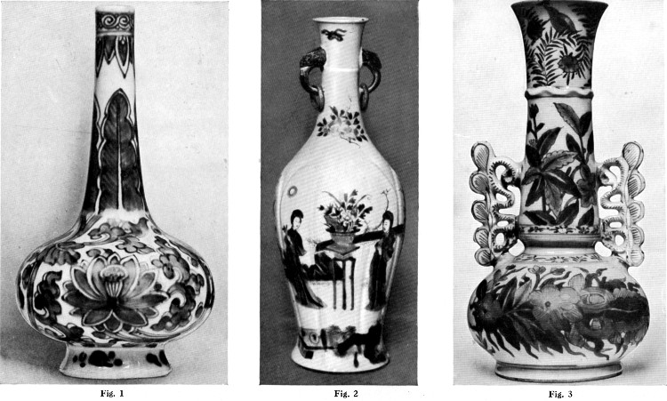

# 청화백자 — 하얀 그릇의 푸른빛은 바다를 건넜다

*징더전의 도자기에서 만나는 공방과 교역의 역사*

Culture · Art

> 출처 대조와 공개 게시 승인을 마친 이야기입니다. 실제 게시 여부는 사이트 배포 상태를 따릅니다.

*R. L. Hobson, Chinese Pottery and Porcelain, Vol. II 도판 92 · 원서가 청화백자로 소개한 작품들의 흑백 재현본이며 실제 푸른색은 이 도판에서 보이지 않습니다.*

[이미지 출처·제작 근거](https://raw.githubusercontent.com/GITenberg/Chinese-pottery-and-porcelain-vol-II-An-account-of-the-potter-s-art-in-China-from-primitive-t__68762/master/68762-h/images/i229.jpg) · 옛 도판 Public Domain · Project Gutenberg 공개본

흰 그릇 위의 푸른 선은 눈에 잘 들어온다. 꽃과 덩굴이 되고, 구름과 용이 되기도 한다. 청화백자는 모양이 복잡해도 먼저 색의 조합으로 기억되는 도자기다. 익숙한 두 색이지만 그 뒤의 역사는 한 공방 안에서 끝나지 않는다.

중국의 도자기 생산지 징더전에서 만들어진 물건들은 중국 안팎의 여러 사람을 만났다. 멀리 운반되는 그릇에는 흙과 불의 기술뿐 아니라 상인의 거래, 사용하는 사람의 취향도 함께 실렸다. 식탁의 물건이 바다의 역사로 이어지는 지점이다.

## 01. 청화백자는 색의 관계를 먼저 보면 된다

청화백자라는 이름에서 먼저 떠올릴 것은 흰 바탕과 푸른 장식이다. 함께 실은 옛 도판은 흑백 재현이므로 실제 푸른색을 보여 주지는 않는다. 여기서는 무늬와 형태를 보는 데 활용하면 된다. 선이 굵어졌다 가늘어지는 곳, 푸른빛이 진하게 모이는 곳과 흰 여백이 남은 곳을 찾아보는 것부터 시작할 수 있다.

같은 두 색을 쓰더라도 인상은 달라진다. 작은 그릇의 가장자리를 따라가는 무늬와 큰 병의 몸통을 감싸는 무늬는 보는 순서를 바꾼다. 도자기는 그림을 평평한 종이에 얹은 것과 달리, 몸체를 돌려 보며 읽는 물건이다.

## 02. 한 도시가 도자기의 이름과 가까워지다

징더전은 오랫동안 중국 도자기 생산의 중요한 중심지였다. OpenStax가 소개하는 18세기의 병과 접시도 이곳에서 만들어진 물건이다. 장소의 이름이 반복해서 등장한다는 것은 한 사람의 재주를 넘어 제작 경험과 일이 모이는 기반이 있었음을 뜻한다.

흙으로 형태를 만들고 장식을 더하고 가마에서 굽는 일은 각각의 조건을 맞추어야 한다. 완성된 그릇의 표면은 매끄러워도 그 과정은 여러 단계로 이루어진다. 감상할 때 화가의 붓끝만 떠올렸다면 이번에는 재료와 가마, 공방의 작업까지 함께 생각해 보아도 좋다.

## 03. 푸른 안료에도 먼 지역의 이야기가 있다

푸른 장식에 쓰이는 코발트는 청화백자의 특징을 이해하는 실마리다. 중국 도자기를 다룬 옛 연구서는 중국 안의 재료와 외부에서 들어오는 안료를 함께 설명한다. 한 가지 아름다운 색에도 재료를 구하고 선택하는 문제가 있었던 것이다.

다만 모든 시대의 청화백자가 같은 산지의 같은 안료로 만들어졌다고 묶을 수는 없다. 특정 그릇의 재료와 제작 시기를 알려면 그 유물의 조사 결과가 필요하다. 여기서는 푸른 무늬가 공방 바깥의 교류와도 연결될 수 있다는 범위까지 읽는다.

## 04. 배에 실린 그릇은 다른 식탁을 만났다

아시아의 해상 교역에서는 향신료와 직물, 도자기 같은 물건이 여러 항구를 오갔다. 유럽의 상인들이 본격적으로 들어오기 전부터 인도양과 동남아시아의 교역망은 움직이고 있었다. 중국 도자기도 이런 오래된 연결 속에서 이동했다.

수출품을 서양이 발견한 뒤에야 비로소 중요한 물건이 되었다고 설명하면 그 앞의 역사가 사라진다. 중국의 사용자와 여러 아시아 지역의 거래 상대도 도자기의 삶을 이루었다. 그릇의 여행을 한 방향의 항로로만 보지 않을 때 바다의 풍경이 더 넓어진다.

## 05. 장식은 같은데 물건의 모양이 다르다

함께 실은 도판에서는 목이 긴 물뿌리개와 두 병의 서로 다른 형태를 볼 수 있다. 몸체의 윤곽과 손잡이의 위치가 달라지면 장식이 놓일 자리도 달라진다. 도자기를 색과 무늬만으로 기억하지 말고, 무엇을 담고 어떻게 잡는 형태인지 살펴보면 좋다.

오래된 병이 아름답다고 해서 모두 같은 용도나 같은 사용자를 가졌다고 생각할 필요는 없다. 소장품 설명이 확인하는 범위를 지키면서 몸체의 균형과 장식의 위치를 보는 것으로도 충분하다. 모양을 관찰하는 작은 습관이 그릇의 차이를 더 잘 느끼게 한다.

## 06. 황실을 위한 물건과 시장의 물건

중국 도자기의 역사에는 황실을 위한 제작도 있고 거래를 위한 제작도 있다. 옛 연구서가 징더전의 황실 공장을 길게 설명한다고 해서 그 도시의 모든 그릇을 황제의 식탁으로 보내지는 말아야 한다. OpenStax 역시 징더전의 생산품이 중국과 다른 지역에서 판매되었다고 소개한다. 생산 중심지는 여러 수요를 만나는 장소이기도 했다.

왕실의 물건인지, 시장에서 유통된 물건인지에 따라 확인해야 할 정보도 달라진다. 유명한 왕조의 이름이 붙었다는 이유만으로 누가 실제 사용했는지까지 알 수는 없다. 작품 설명에서 제작 시기와 생산지, 확인된 유통 이력을 따로 읽는 습관이 도움이 된다. 화려한 무늬를 감상하면서도 그릇의 신분을 섣불리 정하지 않는 방법이다.

## 07. 하나의 대표 이미지에 중국 전체를 넣지 않기

청화백자는 중국 미술을 떠올리게 하는 유명한 물건이지만 중국 도자기의 전부는 아니다. 다른 색과 재료, 가마와 시대의 작품이 함께 존재했다. 널리 알려진 한 양식은 풍부한 세계로 들어가는 입구이지, 그 세계를 모두 대신하는 표지가 아니다.

그래서 다음 그릇을 만날 때는 아는 이름을 곧바로 붙이기보다 한 번 더 보는 편이 좋다. 흰 바탕의 느낌은 어떤지, 선은 어디서 멈추는지, 무늬가 몸체를 어떻게 감싸는지. 바다를 건넌 도자기의 큰 역사도 결국 눈앞의 작은 차이에서 다시 시작된다.

그릇을 정면에서 본 뒤 옆에서 보았다고 상상해 보자. 같은 무늬가 곡면을 따라 달라 보일 것이다. 장식을 그린 손과 그 장식의 바탕이 될 형태를 만든 손이 어떻게 만나는지 생각하면 도자기의 즐거움이 조금 더 커진다.

## 이야기의 바탕이 된 자료

- [OpenStax World History — Exchange in East Asia and the Indian Ocean — Introduction](https://raw.githubusercontent.com/openstax/osbooks-world-history/main/modules/m00007/index.cnxml) · 확인일 2026-11-01
  - 확인 내용: 징더전에서 제작된 18세기 병과 접시, 중국 안팎에서의 판매 / 유럽 진출 이전부터 이어진 인도양과 아시아의 해상 교역
- [R. L. Hobson, Chinese Pottery and Porcelain, Vol. II — 역사적 연구서](https://raw.githubusercontent.com/GITenberg/Chinese-pottery-and-porcelain-vol-II-An-account-of-the-potter-s-art-in-China-from-primitive-t__68762/master/68762-0.txt) · 확인일 2026-11-01
  - 확인 내용: 징더전과 명대 도자기 생산의 역사적 설명 / 청화의 코발트 안료와 중국 내·외부 재료의 관계에 대한 기술; 옛 연구서의 개별 진위·편년 판단과 우열 평가는 채택하지 않음 / 도판 92의 청화백자 물뿌리개와 병 두 점; 흑백 재현본이라는 한계를 명시

---

[같은 소주제의 이야기](README.md) · [전체 서가](../../README.md)
