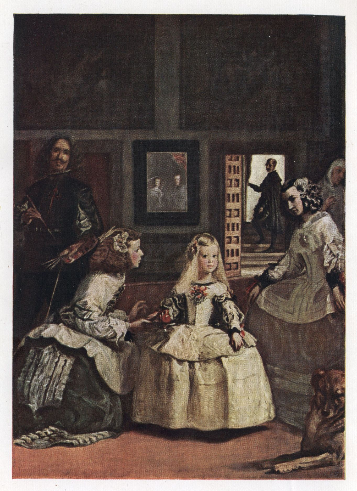

# 『시녀들』 — 그림 속 사람들은 누구를 보고 있을까

*공주와 화가, 거울 뒤에서 관람자의 자리가 바뀌다*

Culture · Art

> 출처 대조와 공개 게시 승인을 마친 이야기입니다. 실제 게시 여부는 사이트 배포 상태를 따릅니다.

*Diego Velázquez (1599–1660), Las Meninas · S. L. Bensusan, Velazquez, Plate II 수록 복제 도판 · Project Gutenberg · Public Domain. 옛 인쇄물의 색과 명암은 원화와 다를 수 있습니다. 원본 파일 그대로 사용했습니다.*

[이미지 출처·제작 근거](https://raw.githubusercontent.com/GITenberg/Velazquez_30316/master/30316-h/images/img-014.jpg) · Public Domain

화가가 붓을 들고 우리 쪽을 본다. 화면 가운데의 어린 공주도, 그 곁의 몇몇 인물도 그림 바깥을 바라보는 듯하다. 『시녀들』을 보고 있으면 어느 순간 이상한 느낌이 생긴다. 내가 그림을 보는 것일까, 그림 속 사람들이 나를 보고 있는 것일까.

벨라스케스가 1656년 무렵 그린 이 작품은 스페인 궁정의 장면을 보여 준다. 실제 작품을 옛 미술서에 복제한 도판을 함께 보며, 어려운 상징의 정답을 외우기보다 시선이 움직이는 길을 따라가 보자. 참고한 해설은 S. L. 벤수전의 『벨라스케스』다.

## 01. 제목의 주인공과 화면의 중심

그림 한가운데에는 어린 마르가리타 공주가 있다. 밝은 드레스와 얼굴에 시선이 먼저 머문다. 양옆의 시녀들이 공주에게 주의를 기울이고, 주변에는 궁정의 여러 인물이 함께 있다. 제목은 시녀들을 가리키지만 한 사람의 초상처럼 단순하게 정리되지는 않는다.

이 작은 차이가 그림의 재미를 연다. 누가 가장 중요하고 누가 배경인지 처음에는 명확해 보이다가, 조금 더 보면 다른 인물의 시선과 동작이 장면을 움직인다. 궁정의 위계는 분명히 존재하지만 그림의 이야기는 한 사람에게만 독점되지 않는다. 서로 다른 자리의 사람들이 같은 순간에 들어 있다.

## 02. 왼쪽의 큰 물건은 그림의 뒷면이다

화면 왼쪽에 커다란 캔버스의 뒤쪽이 보인다. 그 앞에 화가 자신이 서 있다. 우리가 볼 수 있는 것은 그가 작업한다는 사실이지 그 위에 무엇이 그려져 있는지는 아니다. 핵심적인 작업물 하나가 오히려 관람자의 눈에서 가려져 있다.

보이지 않는 캔버스 때문에 궁금증이 생긴다. 화가는 공주를 그리는 중일까, 우리 쪽에 있는 누군가를 그리는 중일까. 그림이 너무 정교해 정답도 곧 보일 것 같지만, 필요한 정보는 일부러 화면의 다른 방향에 놓여 있다. 보이는 것만이 아니라 가려진 면도 이야기의 장치가 된다.

## 03. 작은 거울이 큰 질문을 만든다

뒤쪽 벽에는 왕 펠리페 4세와 왕비 마리아나의 모습으로 읽히는 작은 반영이 있다. 공주의 부모이며 궁정의 중심인 인물들이 정작 화면에서 가장 크지 않다. 그들은 거울의 작은 빛으로 들어온다. 크기와 권위가 같은 방식으로 배치되지 않는 셈이다.

벤수전은 화가가 왕과 왕비의 초상을 그리는 장면으로 설명한다. 하지만 보이지 않는 캔버스에 무엇이 있는지, 반영과 그림 바깥의 위치를 어떻게 이해할지는 해석의 문제를 남긴다. 저자의 설명을 읽을 수는 있어도 캔버스의 앞면을 실제로 확인한 사실처럼 말하지 않는 편이 좋다.

## 04. 그렇다면 우리는 어디에 서 있을까

만약 왕과 왕비가 그림 바깥의 이쪽에 있다면, 관람자는 그들과 비슷한 위치에서 방을 보게 된다. 그래서 그림 속 인물의 시선이 우리에게 닿는 듯하다. 보는 사람의 자리가 구경꾼의 자리만이 아니라 장면을 성립시키는 자리로 달라진다.

그렇다고 실제로 관람객 한 사람이 왕이 된다는 뜻은 아니다. 그림이 시선을 배치하는 방식이 그런 역할을 상상하게 한다는 것이다. 우리는 캔버스 밖에 있으면서도 그 방의 관계 안으로 초대된다. 사람들의 이름을 모두 외우지 않아도 이 느낌은 경험할 수 있다.

## 05. 문가의 빛을 따라 더 안으로

뒤의 문에는 또 다른 인물이 서 있고 밝은 공간이 열린다. 그림 안에 거울만 있었다면 시선이 벽에서 멈출 것 같은데, 문은 그 뒤에도 길이 있다고 느끼게 한다. 가까운 공주와 먼 문 사이에 공기와 거리가 생긴다.

밝은 부분이 여러 곳에 나뉘어 있어서 눈은 앞과 뒤를 오간다. 공주의 얼굴을 본 뒤 문가로 가고, 다시 화가의 얼굴과 거울로 돌아온다. 실제 공간을 똑같이 재현하는 데만 목적이 있었다면 필요 없어 보일 수 있는 선택들이 관람의 순서를 만든다. 방은 배경이 아니라 눈을 이끄는 구조가 된다.

## 06. 화가 자신이 이 방에 들어 있다

벨라스케스는 다른 사람의 초상을 그리는 사람으로 그림 안에 모습을 남겼다. 단순히 작업자의 손만 보여 주는 것이 아니라 붓을 든 자신의 몸을 궁정 사람들과 같은 장면에 둔다. 보는 사람은 그림의 내용과 그림이 만들어지는 일을 한꺼번에 보게 된다.

이 점을 화가의 지위와 연결해 읽을 수도 있다. 그는 궁정에서 일했고 사회적인 인정을 중요하게 여겼다. 다만 기사 작위와 그림의 관계에 얽힌 멋진 일화를 확인 없이 반복할 필요는 없다. 참고한 옛 해설서도 이 작품의 보상으로 곧바로 작위를 받았다는 식의 단순한 설명을 경계한다.

## 07. 옛 미술서와 오늘의 눈 사이

이 글의 이미지는 실제 작품의 오래된 복제 도판이다. 인물과 구도는 작품을 보는 데 도움이 되지만 인쇄의 색과 명암이 원화와 완전히 같지는 않을 수 있다. 어두운 부분의 세부를 모두 판단하는 자료로 쓰기보다는 화면 전체의 배치를 먼저 살펴보면 좋다.

옛 해설서에는 그 시대의 취향과 궁정 인물에 대한 평가도 들어 있다. 현대의 독자가 외모나 신분을 낮추는 표현까지 따라야 하는 것은 아니다. 화면에 함께 있는 사람들을 우열을 매기는 소품으로 보지 않고, 각자의 위치와 동작을 가진 존재로 바라볼 수 있다. 같은 그림도 읽는 눈에 따라 질문이 달라진다.

## 08. 그림 밖으로 나오면서 남는 시선

『시녀들』은 왕실의 한 장면처럼 시작해 그림을 보는 행위 자체를 의식하게 만든다. 누구를 그렸는지뿐 아니라 누가 보고 있는지, 누가 보이지 않는지, 내가 서 있는 자리가 무엇을 바꾸는지 묻게 한다. 오래 바라볼수록 처음의 중심이 조금씩 움직인다.

다시 화면 가운데의 공주를 본 뒤 왼쪽의 화가와 뒤의 거울을 번갈아 보자. 같은 캔버스인데 시선이 돌아올 때마다 방의 관계가 달라진다. 벨라스케스가 만들어 놓은 것은 인물들을 잘 닮게 그린 한 장면만이 아니다. 바깥에 서 있던 우리까지 그 방을 완성하는 데 참여하게 하는 그림이다.

## 이야기의 바탕이 된 자료

- [S. L. Bensusan, Velazquez — Plate II: Las Meniñas 및 작품/궁정 활동 해설](https://raw.githubusercontent.com/GITenberg/Velazquez_30316/master/30316-8.txt) · 확인일 2026-11-01
  - 확인 내용: 1656무렵의 작품·마르가리타와 시녀들·화가 자신/거울의 왕과 왕비·Prado의 작품 복제 도판 / 보이지 않는 캔버스와 관람자 위치는 해석의 여지를 밝힘·산티아고 기사 작위의 단순 보상설을 경계. 본문의 부정확한1658년 연대는 쓰지 않음

---

[같은 소주제의 이야기](README.md) · [전체 서가](../../README.md)
