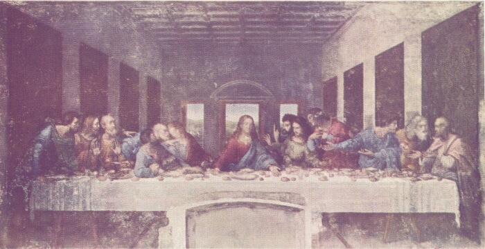

# 레오나르도 다빈치의 생애 — 그림 한 장에서 세상을 관찰하다

*공방의 배움과 궁정의 일, 끝나지 않은 질문들*

Culture · Art

> 출처 대조와 공개 게시 승인을 마친 이야기입니다. 실제 게시 여부는 사이트 배포 상태를 따릅니다.

*레오나르도 다빈치 원작 · Brockwell의 전기 수록 최후의 만찬 재현 도판 · Project Gutenberg*

[이미지 출처·제작 근거](https://raw.githubusercontent.com/GITenberg/Leonardo-Da-Vinci_7785/master/7785-h/images/Plate0004.jpg) · 퍼블릭 도메인 원작의 역사적 재현 자료 · Project Gutenberg 수록본

다빈치라는 이름에는 여러 모습이 겹쳐 있다. 〈모나리자〉를 그린 화가이면서 인체와 물, 날아가는 움직임과 기계에도 관심을 가졌던 사람이다. 이런 이름 앞에서는 타고난 천재였다는 말로 쉽게 정리가 끝나곤 한다.

그러나 1452년에 태어나 1519년에 세상을 떠난 한 사람의 삶에는 배우고 의뢰를 받고 이동하며, 끝내지 못한 일과 다시 살핀 문제가 있었다. 무엇이든 즉시 해낸 사람으로 상상하기보다 무엇을 오래 보고 어떻게 일했는지 따라가 보면 다빈치가 조금 가까워진다.

## 1. 피렌체의 공방은 무엇을 배우는 곳이었을까

그는 피렌체의 베로키오 공방에서 배웠다. 공방은 완성된 그림만 구경하는 장소가 아니라 재료와 도구를 다루고 여러 사람이 작업을 나누는 현장이었다. 그림과 입체적인 형태, 손의 기술과 관찰이 가까이 놓일 수 있는 환경이다.

어린 시절의 재능을 과장하는 일화보다 이런 배움의 조건을 생각해 보아도 좋다. 무엇을 잘 보려면 무엇을 만들어 보고 어떤 재료를 알아야 하는지 익히는 시간이 필요했다. 뛰어난 작품 뒤에도 반복되는 손의 일이 있었음을 떠올릴 수 있다.

## 2. 밀라노에서는 화가의 일이 더 넓어진다

밀라노에서 스포르차 가문의 후원을 받는 동안 다빈치의 활동은 회화만으로 설명되지 않는다. 궁정의 요구와 장식, 기념물과 기술적 관심이 같은 삶 안에 있었다. 예술가가 자기 관심만을 위해 조용히 작업하는 오늘의 낭만적 이미지와는 다른 조건이다.

누가 일을 맡기고 어떤 자원을 주는지는 무엇을 만들 수 있는지와 연결된다. 다빈치의 이동을 도시 이름 몇 개로 외우기보다 작업의 환경이 바뀌는 과정으로 보면 좋다. 새로운 장소는 빛과 풍경뿐 아니라 일의 종류와 사람 관계도 바꾸었다.

## 3. 최후의 만찬에서는 여러 사람의 반응을 묶는다

밀라노의 〈최후의 만찬〉은 긴 식탁을 둘러싼 인물들을 보여 준다. 가운데 예수를 중심으로 제자들의 손과 얼굴, 몸의 움직임이 서로 다르게 펼쳐진다. 같은 사건 앞에서 모두가 똑같이 반응하지 않는다는 점을 한 화면에 엮는다.

사람의 표정을 몇 종류로 분류해 붙인 그림처럼 보기보다, 인물끼리 시선과 손짓이 어떻게 이어지는지 살펴보자. 공간을 구성하는 일과 사람의 반응을 관찰하는 일이 만나는 장면이다. 완성된 유명 작품의 이름 뒤에 무엇을 볼지 구체적인 길이 생긴다.

## 4. 오래 보면서도 끝내지 못한 작업이 있었다

다빈치의 작업에는 미완성으로 남은 것들도 있다. 완벽한 천재라면 왜 끝내지 못했느냐고 쉽게 묻기보다, 관심의 폭과 의뢰의 조건, 이동과 완성 사이에 긴장이 있었다는 점을 생각할 수 있다. 무엇에든 관심이 많다는 사실이 모든 일을 마친다는 보장은 아니다.

이 모습을 근거로 오늘의 병명이나 성격 유형을 붙일 필요는 없다. 확인할 수 있는 것은 작업의 결과와 기록의 흔적이다. 많은 질문을 가졌다는 찬사와 실제로 완성해야 하는 일의 부담을 함께 보는 편이 한 사람의 생애를 더 입체적으로 만든다.

## 5. 사람의 몸과 빛을 살피는 관심

그는 인체와 해부학, 광학과 자연의 움직임 등을 살폈다. 화가가 얼굴과 몸을 표현하려면 겉으로 드러난 윤곽뿐 아니라 안에서 어떻게 움직이는지도 궁금해질 수 있다. 물체가 보이는 방식과 빛을 연구하는 관심도 회화와 떨어져 있지 않았다.

그렇다고 남아 있는 모든 기계 그림을 실제로 제작되어 작동한 발명품이라고 부를 수는 없다. 관찰 기록, 구상, 완성된 물건은 구분해야 한다. 시대를 앞서갔다는 감탄 곁에 무엇이 실제로 확인되는지를 살피면 연구의 성격이 오히려 더 분명해진다.

## 6. 거꾸로 쓴 글씨보다 중요한 내용

그의 기록에는 오른쪽에서 왼쪽으로 쓴 글이 있다. 낯선 글씨 방향은 기억하기 좋은 특징이지만, 비밀 암호를 만들려고 모든 글을 그렇게 썼다고 단정하지는 말자. 기록의 내용과 쓰는 방식은 각각 근거를 살펴야 하는 문제다.

글씨의 특이함에서 한 걸음 더 가면 무엇을 계속 기록했는지에 관심이 생긴다. 본 것을 그리고, 궁금한 구조를 살피며, 문제를 다시 남기는 행위다. 천재의 생각은 머릿속에서 한 번에 완성되기보다 종이 위에서 흔적과 질문으로 남기도 했다.

## 7. 프랑스에서 보낸 말년과 남은 작품들

말년의 다빈치는 프랑수아 1세의 후원을 받으며 프랑스에서 지냈다. 그의 작품과 기록은 한 나라의 작업실에만 머무르지 않았다. 이동과 후원, 후대의 수집을 거치며 오늘의 독자가 여러 장소와 자료에서 만나게 되었다.

왕의 품에서 죽었다는 식의 유명한 장면을 확인된 마지막 순간처럼 재현할 필요는 없다. 한 사람의 생애를 아름다운 일화 하나로 닫지 않아도 그림과 기록은 충분히 풍부하다. 오히려 남은 자료가 서로 다른 시기의 일을 어떻게 보여 주는지 살펴보는 길이 열린다.

## 8. 대표작을 보고 생애로, 다시 관찰로

함께 실은 이미지는 옛 전기에 수록된 〈최후의 만찬〉의 재현 도판이다. 오늘의 벽화 상태와 색을 그대로 보여 주는 최신 사진은 아니지만 인물과 공간의 큰 구성을 살펴볼 수 있다. 다빈치의 상상 속 자화상을 새로 만든 자료와도 구분된다.

그를 읽고 나면 한 그림 안에서 무엇을 보려 했는지 다시 물어볼 수 있다. 사람의 표정과 손, 몸의 구조와 빛이 어떻게 연결되는가. 다재다능하다는 큰 칭찬을 몇 가지 구체적인 관심으로 나누면, 다빈치는 모든 것을 아는 이름에서 오래 관찰하고 질문하던 사람으로 보이기 시작한다.

## 이야기의 바탕이 된 자료

- [Maurice W. Brockwell — Leonardo da Vinci, 역사적 전기](https://raw.githubusercontent.com/GITenberg/Leonardo-Da-Vinci_7785/master/7785-8.txt) · 확인일 2026-10-30
  - 확인 내용: 1452~1519 생애·베로키오 공방·밀라노와 스포르차의 후원 / 미완성 작품·최후의 만찬·모나리자·해부학과 광학 등 연구·거꾸로 쓴 기록·프랑스 말년
- [Leonardo da Vinci — 작품 도판과 캡션](https://raw.githubusercontent.com/GITenberg/Leonardo-Da-Vinci_7785/master/7785-h/7785-h.htm) · 확인일 2026-10-30
  - 확인 내용: Plate IV를 밀라노 최후의 만찬의 역사적 재현 도판으로 식별

---

[같은 소주제의 이야기](README.md) · [전체 서가](../../README.md)
