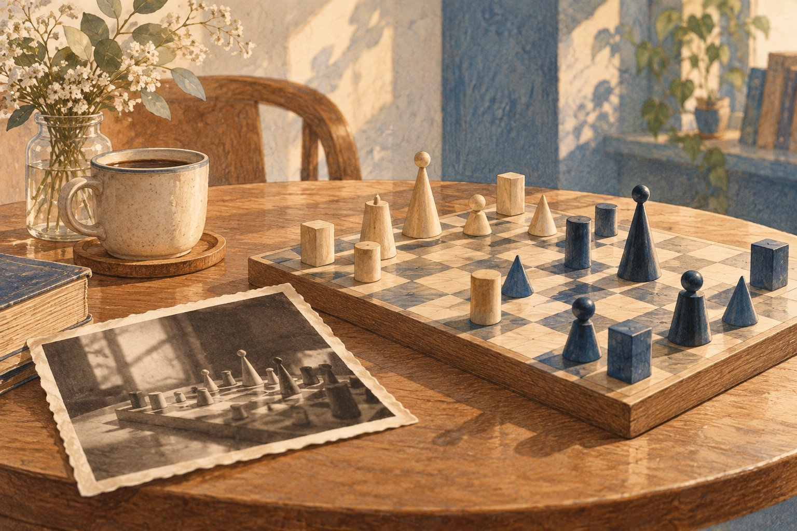

# 체스 말을 어디에 둘지 오래된 사진에 물었다

*작품 전시가 작은 추리 문제가 된 순간*

Culture · Art

> 출처 대조와 공개 게시 승인을 마친 이야기입니다. 실제 게시 여부는 사이트 배포 상태를 따릅니다.

*KnowledgeWalk 제작 · AI 설명용 삽화. 실제 유물·작품·건축물·전시 배치를 재현한 사진이나 역사적 증거가 아닙니다.*

체스 세트를 전시한다고 하면 말들을 예쁘게 세워 두면 될 것 같다. 그런데 게임 도구는 위치에 따라 전혀 다른 장면이 된다. 막 시작한 판일 수도 있고, 누군가 다음 수를 고민하는 판일 수도 있다.

시카고 미술관은 맨 레이가 디자인한 체스 세트를 놓으며 이런 고민을 했다. 어떻게 배치해야 이 물건을 더 잘 보여 줄 수 있을까. 그 질문은 오래된 사진 한 장으로 이어졌다.

## 1. 조각이면서 놀이 도구

공식 설명에 따르면 맨 레이는 1920년에 첫 체스 세트를 디자인했다. 미술관의 세트는 인도 인도르의 마하라자를 위해 1927년에 만든 것으로 소개된다.

예술가가 만든 체스 말이니 조각으로 볼 수 있지만, 동시에 실제 게임의 자리를 가진 물건이다. 말을 한 개만 앞으로 옮겨 놓는 것과 게임 중간의 판을 만드는 것은 보는 사람에게 다른 느낌을 준다.

## 2. 사진에는 판 전체가 없었다

미술관은 다른 세트의 사진을 참고해 배치하기도 했지만 더 오래된 자료를 살폈다. 중요한 단서는 1921년 맨 레이의 자화상 사진이었다. 문제는 사진에 체스판 일부만 나와 있다는 점이었다.

기관 글의 필자는 사진을 확대하고 보이는 칸의 가장자리를 따라 평행선을 그었다. 보이는 말의 위치를 찾고, 체스의 규칙을 생각해 가려진 부분의 배치를 추정했다. 사진을 보는 일이 작은 퍼즐 풀이가 된 것이다.

## 3. 말의 모양과 말의 자리는 다른 질문이다

체스 세트를 조각처럼 본다면 개별 말의 형태와 재료가 먼저 중요해 보인다. 게임의 도구로 보면 어떤 말이 어느 칸에 있는지도 의미를 만든다. 같은 물건을 놓고도 전시는 두 질문 사이에서 선택해야 한다. 단정하게 줄 세우는 것이 언제나 제작자가 즐기던 게임의 모습을 잘 보여 주는 것은 아닐 수 있다.

미술관은 한때 졸 하나만 앞으로 옮겨 전시했다고 소개한다. 이후 다른 소장 세트의 사진을 참고한 배치도 사용했다. 작품이 남아 있다고 그 전시 방식이 처음부터 하나로 정해져 있었던 것은 아니다. 보존된 물건과 그것을 보여 주는 배열은 서로 연결되지만 다른 층의 결정이다.

## 4. 일부만 보이는 사진에서 시작한 추정

1921년 자화상 사진은 체스판 전체를 명확히 보여 주지 않는다. 필자는 확대 사진에서 보이는 칸의 가장자리를 따라 선을 긋고 판의 방향을 가늠했다. 사진을 크게 보면 저절로 모든 답이 나오는 것이 아니라, 이미 보이는 정보의 관계를 이용해 가려진 부분을 좁혀 간 것이다.

체스 규칙도 보조 단서가 되었다. 어떤 말이 움직였다면 다른 말의 가능한 자리가 줄어들 수 있기 때문이다. 다만 규칙에 맞는 배치를 찾는 것과 실제 그날의 게임을 확정하는 것은 다르다. 이 차이를 놓치면 흥미로운 연구 제안이 마치 완전히 입증된 역사 장면처럼 바뀌어 버린다.

## 5. 다섯 번째 수라는 설명도 가설로 남는다

기관 글의 필자는 흰 말을 두는 맨 레이가 다섯 번째 수를 둔 뒤 파이프에 불을 붙이는 순간으로 보면 배치가 잘 맞는다고 설명한다. 그 말은 사진이 직접 모든 수순을 기록하고 있다는 뜻이 아니다. 보이는 자료와 게임의 가능성을 이어 만든 해석이다. 글은 마지막에도 맞게 복원했는지를 질문으로 남긴다.

미술관이 그 제안을 전시 배치에 반영했다는 사실도 가설의 성격을 없애지는 않는다. 전시에는 지금 가진 자료로 가장 적절하다고 판단한 선택이 들어갈 수 있다. 확신의 정도를 솔직하게 표시하면서도 관람자에게 생각할 장면을 제시하는 것이다. 박물관은 물건을 보관하는 곳이면서 이런 판단을 설명하는 곳이기도 하다.

## 6. 놀이의 기록이 예술의 자료가 될 때

체스판은 사용자가 손을 댈 때 배치가 바뀌는 물건이다. 완성한 뒤 움직이지 않는 조각만 기대하면 이 특성을 놓치게 된다. 맨 레이가 체스를 즐겼고 새로운 말의 형태를 고안했다는 사실을 함께 보면, 디자인과 놀이가 서로 다른 세계로만 떨어져 있지 않았음을 생각할 수 있다.

현재 전시의 특정 칸을 정답처럼 외우기보다 배열을 정할 때 어떤 자료를 보았는지 물어보자. 사진과 작품, 규칙과 큐레이터의 판단이 함께 작용한다. 작은 말을 어디에 놓을지라는 문제에서 예술품이 원래 어떻게 쓰였는지 보여 주려는 노력까지 읽힌다. 전시장의 정지한 모습 뒤에도 움직였던 손의 시간이 남아 있다.

## 7. 그럴듯한 답과 확정된 답 사이

그가 제안한 배치는 실제 전시를 다시 놓는 데 사용되었다고 글은 전한다. 그렇다고 사진 밖의 말까지 완벽하게 확인했다는 뜻은 아니다. 필자 역시 자신의 가설이 맞는지 질문을 남겼다.

이 이야기의 재미는 작품의 제목이나 가격에 있지 않다. 체스 말 몇 개를 어디에 둘지 정하려고 사진과 게임 규칙을 함께 살폈다는 데 있다. 전시장 속 가지런한 배치에도 누군가의 긴 관찰과 조심스러운 추리가 들어 있을 수 있다.

## 이야기의 바탕이 된 자료

- [시카고 미술관 — Your Move](https://raw.githubusercontent.com/art-institute-of-chicago/api-data/main/json/articles/18.json) · 확인일 2026-10-28
  - 확인 내용: 1920년 첫 세트와 1927년 인도르 마하라자를 위한 소장 세트 / 이전 배치와 다른 사진 참고 / 1921년 자화상 일부에서 말 위치 추정 / 필자의 가설을 이용한 재배치

---

[같은 소주제의 이야기](README.md) · [전체 서가](../../README.md)
