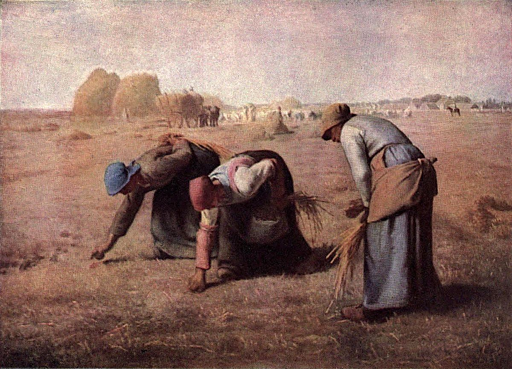

# 이삭 줍는 여인들 — 풍요로운 들판의 가장 낮은 자리

*밀레의 그림에서 수확과 작은 줍기를 함께 보기*

Culture · Art

> 자료 대조를 마친 검토용 이야기입니다. 공개 게시 승인은 아직 받지 않았습니다.

*장프랑수아 밀레 원작 · 옛 도록 Plate LII 색채 재현 도판 · Project Gutenberg*

[이미지 출처·제작 근거](https://raw.githubusercontent.com/GITenberg/The-Louvre-Fifty-Plates-in-Colour_63719/master/63719-h/images/i_plate52.jpg) · 퍼블릭 도메인 원작의 역사적 재현 자료 · Project Gutenberg 수록본

들판의 멀리에는 곡식이 많이 모여 있다. 그런데 그림 앞쪽의 세 사람은 허리를 굽혀 바닥에서 작은 이삭을 줍는다. 같은 수확의 풍경 안에 큰 더미와 손끝의 작은 양이 함께 놓인다. 밀레의 〈이삭 줍는 여인들〉이다.

이 그림은 무엇을 하는 사람들인지 알기 쉬우면서도, 오래 보면 그 단순한 설명보다 많은 것을 느끼게 한다. 전경과 배경, 몸의 크기와 일의 양이 서로 다른 감각을 만들기 때문이다. 먼저 세 사람의 손에서 시작해 들판 끝까지 눈을 옮겨 보자.

## 1. 이삭을 줍는 것은 어떤 일일까

이삭 줍기는 큰 수확을 거둔 뒤 들판에 남은 작은 곡식들을 모으는 일이다. 그림에서는 두 사람이 깊이 허리를 굽히고 다른 한 사람은 조금 몸을 세운 자세를 보인다. 일을 하는 동안 계속 반복될 동작을 한 화면 안에서 만나는 셈이다.

이를 단순히 산책하다 떨어진 곡식을 줍는 가벼운 일로 상상하면 몸의 무게를 놓치기 쉽다. 손은 낮은 곳에 닿아야 하고 시선은 땅을 살핀다. 그림은 노동이라는 큰 말 대신 그 일을 하는 데 필요한 자세를 보여 준다.

## 2. 얼굴보다 몸이 먼저 말하는 장면

우리는 초상화에서 얼굴의 표정을 먼저 찾는 데 익숙하다. 이 그림의 인물들은 고개를 숙이고 있어 얼굴만으로 감정을 읽기 어렵다. 대신 등과 허리, 팔과 무릎이 어떤 방향으로 놓였는지가 눈에 들어온다.

표정을 뚜렷이 보지 못한다고 사람이 사라지는 것은 아니다. 오히려 몸이 하는 일을 더 오래 보게 될 수 있다. 무슨 생각을 했는지 대사를 붙이기보다, 지금 이 행동을 얼마나 반복해야 작은 묶음이 생길지 상상해 보자. 그림의 시간은 한 번의 동작보다 길어진다.

## 3. 세 자세를 차례로 따라가기

왼쪽의 인물에서 가운데를 거쳐 오른쪽으로 눈을 옮겨 보자. 비슷한 일을 하지만 몸의 높이와 팔의 위치는 조금씩 다르다. 모두 똑같은 모양으로 반복되지 않기 때문에 장면은 정지된 도식이 아니라 살아 있는 움직임처럼 느껴질 수 있다.

이를 한 사람이 움직이는 연속 사진이라고 확정하는 뜻은 아니다. 서로 다른 인물의 자세를 이어 보며 일의 리듬을 느끼는 방법이다. 같은 일을 하는 사람들도 각자의 몸과 속도를 가진다는 점이 화면 안에 남는다.

## 4. 뒤쪽의 풍요는 왜 멀리 놓였을까

배경에는 곡식 더미와 수레, 수확하는 사람들, 말을 탄 인물이 보인다. 앞쪽에서 손으로 모으는 양과는 다른 규모다. 두 자리를 함께 보면서 누가 무엇을 얼마나 가지는지에 관한 질문을 떠올릴 수 있다.

그렇다고 그림 한 장으로 당시의 모든 토지 제도와 임금 관계를 확인했다고 말할 수는 없다. 지금 눈으로 확인하는 것은 큰 수확과 작은 줍기가 한 화면에 함께 있다는 점이다. 그 시각적 차이가 사회의 관계를 생각하도록 여지를 연다.

## 5. 인물을 크게 그렸다는 선택

전경의 세 사람은 화면에서 큰 자리를 차지한다. 멀리의 풍요로운 수확이 장면 전체를 설명하는 주인공으로만 남지 않는다. 가까운 곳에서 몸을 낮추는 사람들이 우리의 눈앞에 먼저 놓인다. 무엇을 중심에 둘지 화가가 고른 결과다.

작은 일을 하는 사람을 작게 그릴 필요는 없었다. 그림의 물리적인 크기와 사회적인 주목이 어떤 관계를 맺는지 생각하게 된다. 오늘의 감상을 작가가 직접 선언한 정치적 구호처럼 만들지는 않더라도, 이 선택이 보는 순서를 바꾸는 것은 느낄 수 있다.

## 6. 들판의 색은 편안함만 전할까

따뜻한 흙빛과 수확기의 풍경 때문에 처음에는 평온한 농촌 장면처럼 보일 수 있다. 그러나 사람들의 굽은 몸을 함께 보면 다른 무게도 느껴진다. 보기 좋은 풍경과 그 안에서 살아가는 노동은 같은 감정으로만 정리되지 않는다.

색이 따뜻하니 생활도 행복했을 것이라고 결론 내리지 말자. 반대로 몸을 굽혔으니 얼굴에 보이지 않는 절망까지 우리가 모두 안다고 할 수도 없다. 눈에 보이는 자세와 공간을 근거로 생각을 넓히되, 인물의 내면을 단정하지 않는 감상이 가능하다.

## 7. 옛 도판에서 보는 실제 작품

함께 실은 이미지는 오래된 미술 도록에 수록된 실제 회화의 색채 재현 자료다. 농민들의 모습을 AI로 다시 만든 그림은 아니다. 인물의 배치와 넓은 들판이 이루는 관계를 확인할 수 있도록 원래 도판을 사용했다.

오래된 소장품 안내의 번호와 전시 정보는 오늘의 위치를 보증하지 않는다. 이 자료는 현재 박물관을 찾아가는 지도가 아니라 작품을 읽는 데 쓰는 이미지다. 옛 인쇄의 색과 세부 역시 실물 전체를 대신하지 않으므로 큰 구성부터 보는 편이 적절하다.

## 8. 손끝의 작은 양으로 돌아오기

그림을 본 뒤 처음의 손으로 다시 돌아가 보자. 뒤의 큰 더미를 알고 나면 앞의 작은 줍기가 처음과 다르게 보일 수 있다. 멀리와 가까이, 많은 것과 작은 것이 서로의 의미를 만든다. 한 부분만 잘라 볼 때보다 전체에서 생기는 힘이다.

〈이삭 줍는 여인들〉은 일하는 사람이 있다는 사실만 알려 주는 그림이 아니다. 누구의 몸을 크게 보고 어떤 풍요를 배경으로 두는지 묻게 한다. 길게 설명하지 않아도 세 사람의 반복되는 자세가 시선을 붙잡는다. 그 앞에 잠시 머무는 것이 이 작품을 읽는 좋은 시작이다.

## 이야기의 바탕이 된 자료

- [Konody·Brockwell — The Louvre: Fifty Plates in Colour, 밀레와 Plate LII](https://raw.githubusercontent.com/GITenberg/The-Louvre-Fifty-Plates-in-Colour_63719/master/63719-0.txt) · 확인일 2026-10-30
  - 확인 내용: 밀레·Les Glaneuses 표제·전경에서 이삭 줍는 세 여성 / 배경의 곡식 더미·수레·수확 인물과 말 탄 사람·넓은 들판 / 옛 도록에 수록된 실제 작품 도판의 정체

---

[같은 소주제의 이야기](README.md) · [전체 서가](../../README.md)
