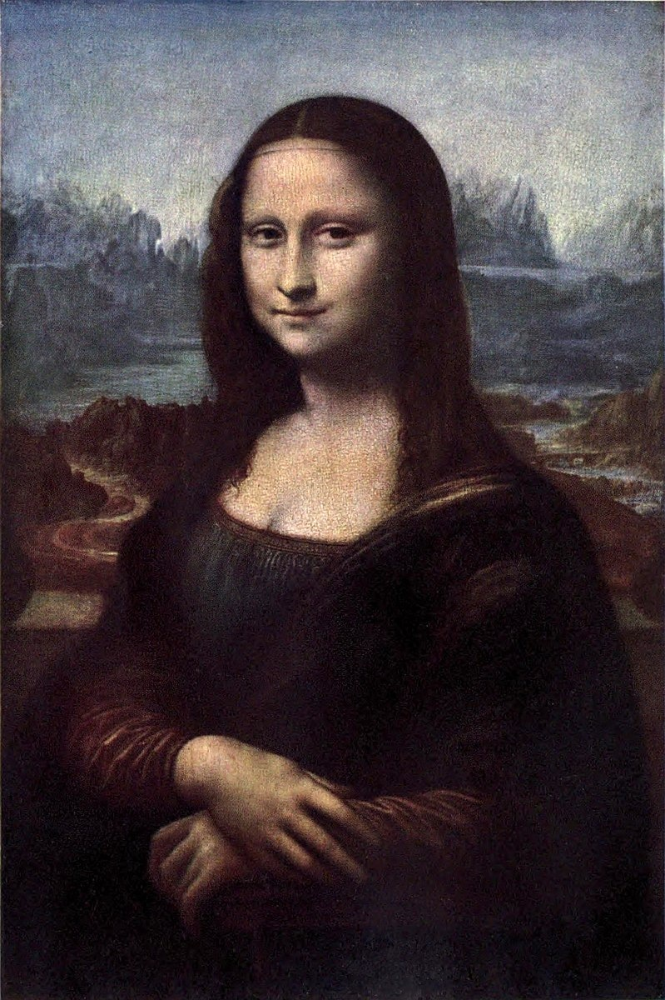

# 모나리자 — 미소보다 먼저 손을 보아도 좋다

*유명한 얼굴을 다시 보는 루브르 감상 입문*

Culture · Art

> 자료 대조를 마친 검토용 이야기입니다. 공개 게시 승인은 아직 받지 않았습니다.

*레오나르도 다빈치, 모나리자 · 옛 루브르 도록의 회화 재현도판 · 역사적 색채 재현도판. 인쇄된 번호와 색조는 옛 자료 기준이며 현재 전시실 안내가 아닙니다.*

[이미지 출처·제작 근거](https://raw.githubusercontent.com/GITenberg/The-Louvre-Fifty-Plates-in-Colour_63719/master/63719-h/images/frontispiece.jpg) · 퍼블릭 도메인 원작의 역사적 재현 도판 · Project Gutenberg 수록본

너무 유명한 그림 앞에서는 오히려 무엇을 봐야 할지 막막할 때가 있다. 「모나리자」도 그렇다. 수수께끼 같은 미소라는 말을 먼저 기억하면 입가만 확인하고 그림 전체를 다 보았다고 느끼기 쉽다.

이 작품은 르네상스의 화가 레오나르도 다빈치가 그린 초상화로 루브르 컬렉션의 대표작이다. 오늘은 미소의 정답을 맞히려고 애쓰기보다 손과 몸의 방향, 뒤쪽 풍경으로 시선을 조금씩 옮겨 보자.

## 제목 속에 들어 있는 사람

이 초상화는 리자 게라르디니를 그린 것으로 알려져 있다. 프랑스어 이름 라 조콩드, 이탈리아어로 자주 부르는 라 조콘다는 남편의 성 조콘도와 이어지는 이름이다. 단순히 쾌활한 표정이라는 뜻으로 제목을 풀면 사람의 이름과 연결된 부분을 놓치게 된다.

유명한 얼굴이기 전에 어떤 사람을 그린 초상이라는 점이 중요하다. 다만 그림을 보고 그가 당시 무슨 생각을 했는지, 어떤 사연 때문에 웃었는지까지 읽어 낼 수 있는 것은 아니다. 확인되는 이름과 우리가 느끼는 인상은 다른 층위다.

## 얼굴 아래의 안정된 자리

인물은 정면으로 꼿꼿하게 서 있지 않고 몸을 약간 돌려 앉아 있다. 얼굴은 관객을 향하지만 아래쪽에는 두 손이 겹쳐져 있다. 입가보다 먼저 손을 보면 그림 전체가 차분하게 자리를 잡는 느낌을 받을 수 있다.

손이 만드는 안정감 위로 시선을 올리면 몸과 얼굴의 방향이 조금 다르게 느껴진다. 한 점을 뚫어지게 보는 대신 손에서 얼굴로, 다시 어깨로 천천히 움직여 보자. 인물의 존재감이 미소 한 부분만으로 만들어진 것은 아니라는 사실이 보인다.

## 배경은 단순한 장식일까

인물 뒤에는 멀리 이어지는 바위와 물길 같은 풍경이 있다. 사람의 가까운 몸과 멀리 펼쳐진 세계가 같은 화면 안에 놓인 셈이다. 얼굴만 떼어 놓은 복제품과 전체 그림을 볼 때의 느낌이 다른 이유도 여기서 생각해 볼 수 있다.

어느 풍경이 실제 어느 장소인지 이 글에서 확정하지는 않는다. 지금은 가까운 인물과 먼 배경 사이에서 시선이 움직이는 경험을 살피면 된다. 그림의 모든 요소를 상징 사전처럼 해독해야 감상이 시작되는 것은 아니다.

## 오래된 해설과 지금의 관찰

함께 실은 이미지는 옛 루브르 도록에 수록된 실제 작품의 색채 재현도판이다. 옛 인쇄의 색과 표면이 오늘의 실물 상태를 그대로 보여 주는 최신 사진은 아니지만, 인물과 풍경이 이루는 전체 구성을 살펴볼 수 있다. 언젠가 실물을 보게 된다면 도판에서 본 인상과 어떤 차이가 있는지 비교해 보아도 좋겠다.

이 그림에서 무엇을 느껴야 한다는 단 하나의 답은 없다. 손과 몸, 얼굴과 풍경을 한 바퀴 돌아본 뒤 다시 입가를 보자. 처음 들었던 유명한 설명을 확인하는 데서 멈추지 않고, 자신의 눈으로 작품 전체를 다시 만나는 작은 방법이다.

## 이야기의 바탕이 된 자료

- [Konody·Brockwell — The Louvre: Fifty Plates in Colour, 작품별 설명·도판](https://raw.githubusercontent.com/GITenberg/The-Louvre-Fifty-Plates-in-Colour_63719/master/63719-0.txt) · 확인일 2026-10-29
  - 확인 내용: 레오나르도 작품·리자 게라르디니 모델·La Joconde 명칭의 가족 성과 연관 / 몸의 방향·포개진 손·관객을 향한 얼굴·풍경의 도판 관찰 / 실제 루브르 회화 도판과 역사적 도록의 출처

---

[같은 소주제의 이야기](README.md) · [전체 서가](../../README.md)
