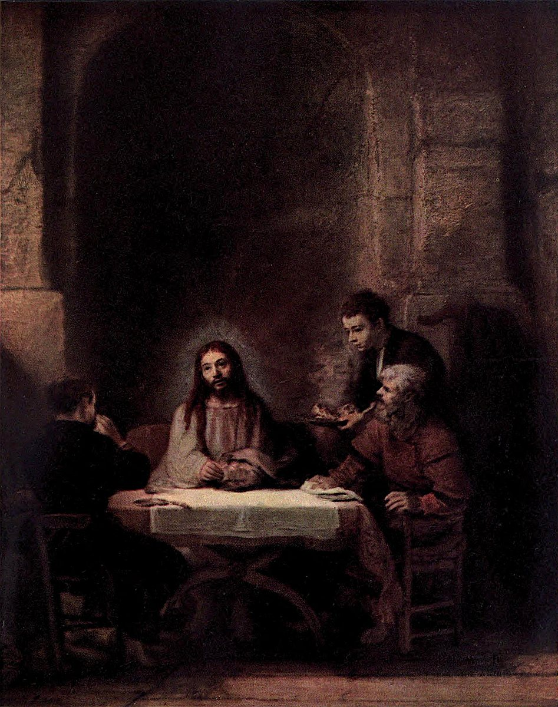

# 엠마오의 순례자들 — 식탁에서 낯선 이를 알아보는 순간

*렘브란트가 빵과 빛으로 만든 조용한 이야기*

Culture · Art

> 자료 대조를 마친 검토용 이야기입니다. 공개 게시 승인은 아직 받지 않았습니다.

*렘브란트 원작 · 옛 루브르 도록 Plate XXIX 색채 재현 도판 · Project Gutenberg*

[이미지 출처·제작 근거](https://raw.githubusercontent.com/GITenberg/The-Louvre-Fifty-Plates-in-Colour_63719/master/63719-h/images/i_plate29.jpg) · 퍼블릭 도메인 원작의 역사적 재현 자료 · Project Gutenberg 수록본

어두운 방 한가운데 작은 식탁이 있다. 사람들이 앉아 있고 옆에서는 음식을 가져온다. 그런데 이 평범한 식사 안에서 함께 있던 사람이 누구인지 알아보는 사건이 일어난다. 렘브란트의 〈엠마오의 순례자들〉이다.

이 작품은 큰 몸짓과 군중으로 이야기를 전달하지 않는다. 빵을 잡은 손과 다른 사람들의 반응, 인물 위로 남겨진 넓은 벽이 장면의 힘을 만든다. 먼저 무슨 이야기인지 조금 알고 그림을 보면 조용한 식탁의 긴장이 눈에 들어온다.

## 1. 엠마오로 가던 길에는 어떤 일이 있었을까

이 장면은 부활한 예수가 엠마오로 가는 제자들과 만나는 기독교의 이야기와 이어진다. 제자들은 길에서 함께 걷고 이야기하면서도 동행한 사람이 누구인지 알아보지 못하다가 식탁에서 빵을 나누는 행위를 통해 알아본다.

제목 속 낯선 지명을 모두 외우지 않아도 핵심은 이해할 수 있다. 곁에 있으면서도 알아보지 못했던 사람을 일상적인 행동 하나에서 다시 보게 되는 순간이다. 그림의 종교적 주제를 지우지 않으면서도, 가까운 이를 이해하는 일이 언제 일어나는지에 관한 감각으로 다가갈 수 있다.

## 2. 시선은 중앙의 얼굴에서 손으로 내려간다

화면 가운데에는 예수가 앉아 있고 두 제자가 좌우에 놓여 있다. 얼굴만 보는 데서 그치지 말고 손과 식탁의 빵으로 눈을 내려 보자. 이야기에서 알아봄의 계기가 되는 행동이 바로 그곳에 놓여 있다.

상징을 많이 알아야만 이해할 수 있는 그림처럼 느껴졌다면 인물의 몸짓부터 보면 된다. 누가 손을 모으고 누가 몸을 움직이는지, 그 움직임이 중앙을 어떻게 향하는지 살펴보는 것이다. 이름표를 확인하던 화면이 사람 사이의 반응으로 바뀐다.

## 3. 빛은 무엇을 먼저 보게 할까

방의 모든 곳이 같은 밝기로 그려져 있지는 않다. 식탁과 중앙의 인물, 주변의 어두운 자리를 번갈아 보면 눈이 어디에 머무는지 느낄 수 있다. 옛 도록은 왼쪽에서 들어오는 빛을 설명한다. 실제 도판에서도 밝은 부분과 그늘의 차이가 장면을 묶는다.

이를 빛 하나하나가 특정 교리를 가리키는 암호라고만 해석할 필요는 없다. 우선 밝기 때문에 어떤 손과 얼굴이 가까워지는지 보자. 렘브란트의 회화에서 빛은 사물의 표면을 드러내면서 동시에 인물들의 관계를 보게 하는 길이 될 수 있다.

## 4. 위쪽의 넓은 벽은 비어 있기만 할까

인물들 위에는 넓고 어두운 공간이 남아 있다. 사람만 잘라 확대하면 놓치기 쉬운 부분이다. 식탁의 높이와 방의 크기를 함께 보면 작은 모임이 큰 공간 안에 조용히 놓였다는 느낌을 받게 된다.

이 여백을 쓸모없는 배경으로 생각하지 말고 잠깐 머물러 보자. 주변이 덜 복잡할수록 식탁 가까이의 움직임은 더 중요하게 보일 수 있다. 큰 사건을 크게 그려야만 중요해지는 것은 아니라는 감상을 가능하게 하는 구성이다.

## 5. 오른쪽의 인물은 장면을 일상에 붙잡아 둔다

오른쪽에는 접시를 들고 들어오는 젊은 인물이 있다. 중앙의 종교적 사건과 함께 음식을 나르는 구체적인 일이 같은 화면 안에 놓인다. 초월적인 주제가 현실의 생활 공간 속에서 표현되는 것이다.

누구나 같은 정도로 무슨 일이 벌어지는지 알아차리고 있다고 단정할 필요는 없다. 각자의 자세와 시선이 다르다는 점을 보는 편이 좋다. 우리가 중요한 순간을 겪을 때도 주변의 모든 일이 동시에 멈추는 것은 아니다. 식탁의 사건과 생활의 움직임이 겹쳐 있다.

## 6. 이 그림의 시간을 어떻게 느낄 수 있을까

그림은 한 순간을 보여 주지만, 이야기를 알고 보면 그 앞뒤의 시간이 함께 떠오른다. 알아보지 못했던 길 위의 시간, 빵을 나누는 지금, 그 뒤 달라질 이해가 같은 화면 주변에 놓이는 셈이다. 회화가 정지된 장면만 전달하는 것은 아니다.

그래서 처음 볼 때와 줄거리를 알고 다시 볼 때 경험이 달라진다. 지식이 그림을 보는 일을 대신하는 것이 아니라, 자세와 물건이 어떤 시간과 연결되는지 알려 준다. 정보를 하나 얻고 화면으로 돌아오는 왕복을 즐겨 보아도 좋다.

## 7. 1648년의 작품과 지금 보는 도판

옛 도록은 작품의 서명에 1648년을 제시한다. 함께 실은 것은 그 도록에 수록된 실제 회화의 색채 재현 자료다. 당시 성서 장면을 새로 상상한 현대 삽화가 아니라 렘브란트의 화면 구성을 보는 데 쓰는 자료다.

다만 옛 인쇄물이므로 현재 실물의 색과 표면을 완전히 대신하지는 않는다. 그 차이를 모른 채 세부 색 하나를 단정하기보다 식탁의 배치와 큰 밝기, 사람 사이의 거리를 살펴보면 좋다. 도판이 가진 조건 안에서도 감상의 길은 충분히 열린다.

## 8. 얼굴을 다시 보게 하는 것은 무엇일까

그림을 한 바퀴 보고 다시 빵을 나누는 손으로 돌아와 보자. 제자들이 사람을 알아보는 계기는 이름을 새로 들었기 때문만이 아니라 익숙한 행동을 보았기 때문이다. 이 서사는 그 작은 인식의 변화를 중심에 둔다.

모든 관객이 종교적 믿음을 공유하지 않아도 장면을 읽을 수 있다. 다만 작품이 가진 종교적 의미를 없애기보다 그 의미가 어떻게 구체적인 손과 식탁으로 표현되었는지 보는 것이다. 조용한 방에서 한 사람을 다시 알아보는 순간이 오래 남는 그림이다.

## 이야기의 바탕이 된 자료

- [Konody·Brockwell — The Louvre: Fifty Plates in Colour, 렘브란트와 Plate XXIX](https://raw.githubusercontent.com/GITenberg/The-Louvre-Fifty-Plates-in-Colour_63719/master/63719-0.txt) · 확인일 2026-10-30
  - 확인 내용: Les Pèlerins d’Emmaüs·1648년 서명·예수와 두 제자의 식탁 / 빵을 나누는 행위로 인물을 알아보는 서사·오른쪽에서 들어오는 시중 인물·왼쪽의 빛

---

[같은 소주제의 이야기](README.md) · [전체 서가](../../README.md)
