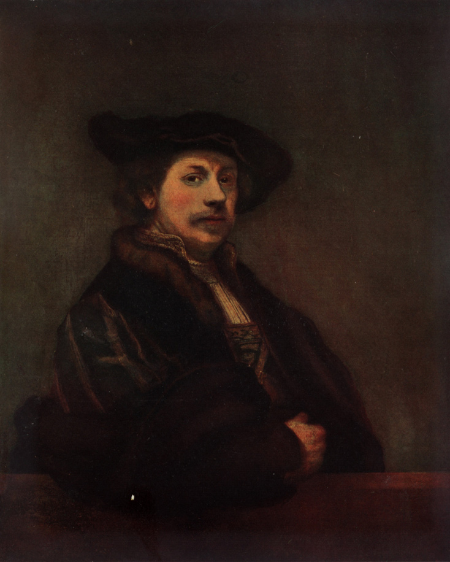

# 렘브란트의 생애 — 얼굴과 빛을 다시 바라본 시간

*레이던에서 암스테르담으로, 초상과 판화와 자화상의 길*

Culture · Art

> 출처 대조와 공개 게시 승인을 마친 이야기입니다. 실제 게시 여부는 사이트 배포 상태를 따릅니다.

*렘브란트 원작 · 1640년 자화상 · Mortimer Menpes 전기 수록 재현 도판 · Project Gutenberg*

[이미지 출처·제작 근거](https://raw.githubusercontent.com/GITenberg/Rembrandt_17215/master/17215-h/images/illus07.jpg) · 퍼블릭 도메인 원작의 역사적 재현 자료 · Project Gutenberg 수록본

어떤 자화상에서는 화려한 옷을 입은 사람이 관객을 바라보고, 다른 자화상에서는 나이 든 얼굴이 어두운 바탕에서 드러난다. 한 사람이 자기 모습을 여러 번 그렸다는 사실만으로도 오래 볼 이야기가 생긴다. 렘브란트의 얼굴은 생애를 생각하게 하는 여러 입구 중 하나다.

그는 17세기 네덜란드에서 초상과 종교화, 판화 등을 만들었다. 성공과 상실이라는 큰 단어로만 정리하기보다 어떤 사람들을 어떻게 그렸고 자기 모습을 어떻게 다시 보았는지 따라가 보자. 어두운 그림을 남긴 슬픈 화가라는 인상보다 넓은 삶이 보인다.

## 1. 레이던에서 배운 젊은 화가

레이던에서 자란 렘브란트는 그림을 배우고 작업을 시작했다. 처음부터 오늘날의 이름값을 가진 거장이었던 것은 아니다. 재료와 표현을 익히고 다른 그림을 보며 어떤 장면을 만들지 찾아가는 시간이 있었다.

전기는 유년의 일화를 재미있게 전하지만 모든 기억을 완벽한 현장 기록으로 볼 수는 없다. 대신 초기의 배움과 작업이라는 실제 과정을 생각하면 좋다. 인물의 표정과 빛, 이야기를 한 화면에 놓는 능력도 연습과 관찰을 통해 다듬어 갔다.

## 2. 암스테르담에서 커진 일과 관계

암스테르담으로 옮긴 뒤에는 의뢰인과 주문, 결혼과 생활이 이어진다. 사스키아와의 관계도 이 삶의 중요한 부분이다. 도시에서 사람의 초상을 그린다는 것은 얼굴을 잘 묘사하는 일뿐 아니라 그 사회의 관계 속에서 일하는 문제이기도 했다.

인물들은 자신의 모습이 어떤 그림으로 남을지 기대했을 것이다. 화가는 그런 요구와 자기 표현의 선택 사이에서 화면을 만든다. 작품이 훌륭하다는 오늘의 평가만으로 당시의 모든 의뢰 관계까지 순조로웠다고 생각할 수는 없다. 일의 조건과 결과는 함께 살펴야 한다.

## 3. 집단초상을 사람들의 관계로 만들기

〈튈프 박사의 해부학 강의〉나 흔히 〈야경〉이라 부르는 시민경비대의 집단초상에서는 여러 인물을 한 화면에 묶는다. 모두가 같은 방향을 바라보고 같은 자세를 취하는 목록으로 끝나지 않는다. 관심과 움직임의 차이가 모임의 성격을 만든다.

특히 〈야경〉이라는 이름만 보고 한밤의 근무 장면이라고 확정하지 않는 편이 좋다. 옛 작품 해설도 이 유명한 호칭의 문제를 짚는다. 제목을 아는 일에서 출발해, 실제로 사람들의 몸이 어떻게 움직이고 빛이 어디에 놓이는지 보는 쪽으로 나아갈 수 있다.

## 4. 판화에서는 또 다른 방식으로 사람을 만난다

렘브란트는 회화뿐 아니라 에칭 같은 판화 작업도 했다. 금속판에 선을 만들고 인쇄하는 과정에서는 색이 넓게 놓이는 그림과 다른 방식으로 빛과 공간을 표현한다. 작은 선과 비어 있는 자리가 큰 역할을 할 수 있다.

유명한 유화 몇 점만 기억하면 이 작업의 폭을 놓치기 쉽다. 한 작가가 언제나 같은 재료로 같은 효과만 찾은 것은 아니었다. 판화와 그림을 번갈아 보면 얼굴과 몸, 생활과 성서 이야기를 다루는 관심이 서로 다른 재료 안에서 이어지는 모습을 볼 수 있다.

## 5. 자기 얼굴은 가까이 있는 작업 대상이었다

자화상을 그린다는 것은 자기 인생을 기록하는 일처럼 보이지만 그것만으로 설명되지는 않는다. 가까이 있는 모델을 통해 표정과 빛, 옷과 자세를 실험할 수도 있다. 오늘의 독자는 같은 사람이 여러 모습으로 나타나는 시간을 함께 보게 된다.

젊은 자화상과 늦은 자화상을 비교하며 생애의 차이를 느껴도 좋다. 다만 얼굴에 보이는 모든 주름을 특정한 사건의 결과라고 읽을 수는 없다. 작품은 날짜와 자료의 도움을 받아 이해하는 회화이지, 과거의 감정과 병을 모두 판독할 수 있는 검사표는 아니다.

## 6. 가족의 상실과 재정 문제를 지나서

사스키아를 비롯한 가까운 사람들의 상실과 재정의 어려움은 그의 생애에서 중요한 사건이다. 티투스와 주변 사람들 역시 작품과 생활 속에 자리를 가진다. 사람을 그리는 작업과 그 사람들과 살아가는 일은 같은 시간 안에 있었다.

그렇다고 어떤 대표작이 실패해 곧바로 모든 것을 잃었다는 단순한 추락의 이야기로 정리할 필요는 없다. 후대 전기에는 극적인 일화가 덧붙기도 한다. 확인되는 사건을 보되 작품 전체가 불행 하나에서 자동으로 나왔다고 생각하지 않는 편이 사람과 그림을 더 잘 이해하게 한다.

## 7. 후기에도 작업의 종류는 남아 있다

늦은 시기에도 그는 초상과 여러 이야기를 그렸다. 큰 이름으로 알려진 작품들만이 아니라 다른 사람의 얼굴을 어떻게 보이게 할지 판단하는 작업이 이어졌다. 삶이 어려워졌다는 한 줄이 그 뒤의 모든 시간을 설명하지는 못한다.

그는 1669년에 세상을 떠났다. 오늘의 명성과 당대의 생활을 완전히 같은 것으로 놓을 수는 없지만, 잊힌 천재라는 표현 하나로도 작업의 관계가 다 담기지는 않는다. 남은 그림과 판화가 각각 어떤 시간을 보여 주는지 차례로 보는 편이 더 풍부하다.

## 8. 돌 난간에 기댄 사람을 다시 보기

함께 실은 것은 1640년 렘브란트가 돌 난간에 기대 선 모습을 그린 자화상의 옛 재현 도판이다. 모자와 옷, 팔의 위치가 얼굴과 함께 관객을 향하는 인상을 만든다. 실제 작품의 구성을 보는 자료이며 새로 상상한 초상이 아니다.

한 사람의 생애를 읽은 뒤 이 얼굴로 돌아오면 성공이나 비극 가운데 하나만 고를 필요가 없어진다. 일하고 관찰하고 자기 모습을 다시 그린 시간이 함께 떠오른다. 렘브란트의 교양은 어두운 바탕의 화가라는 이름을 외우는 것에서, 여러 얼굴과 빛을 구체적으로 보는 쪽으로 넓어질 수 있다.

## 이야기의 바탕이 된 자료

- [Mortimer Menpes·C. Lewis Hind — Rembrandt, 역사적 전기·작품 해설](https://raw.githubusercontent.com/GITenberg/Rembrandt_17215/master/17215.txt) · 확인일 2026-10-30
  - 확인 내용: 레이던의 배움·암스테르담 이주·사스키아·티투스·재정의 어려움·1669년 사망 / 해부학 강의·1642년 시민경비대 집단초상·자화상과 에칭·후기 작업 / 1640년 돌 난간에 기댄 자화상 도판과 생애의 작품 비교
- [Rembrandt — 실제 작품 도판과 캡션](https://raw.githubusercontent.com/GITenberg/Rembrandt_17215/master/17215-h/17215-h.htm) · 확인일 2026-10-30
  - 확인 내용: illus07을 1640년 Rembrandt Leaning on a Stone Sill, 런던 소장 작품의 재현으로 식별

---

[같은 소주제의 이야기](README.md) · [전체 서가](../../README.md)
