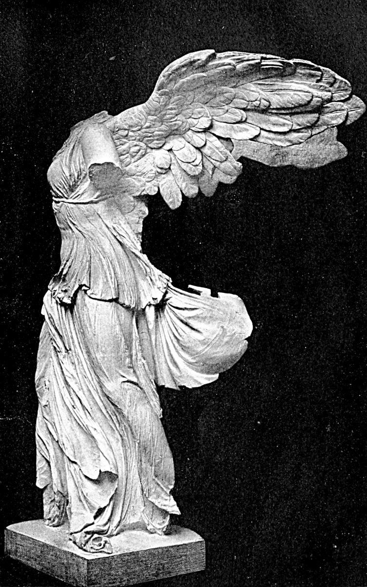

# 사모트라케의 니케 — 머리 없는 여신에게 바람이 보이는 이유

*승리가 사람의 모습을 얻다에서 시작하는 역사와 작품 읽기*

Culture · Art

> 출처 대조와 공개 게시 승인을 마친 이야기입니다. 실제 게시 여부는 사이트 배포 상태를 따릅니다.

*Estelle M. Hurll, Greek Sculpture (1901), Plate XV. Neurdein Frères 사진 / John Andrew & Son 재현 · Public Domain. 실제 작품의 역사 흑백 도판.*

[이미지 출처·제작 근거](https://raw.githubusercontent.com/GITenberg/Greek-Sculpture--13-A-collection-of-sixteen-pictures-of-Greek-marbles-with-introduction-and-i__34842/master/34842-h/images/illus16.jpg) · Public Domain · 저작권 만료 작품 및 역사 출판 도판

루브르의 계단 위에서 날개 달린 조각을 만나면, 없는 부분보다 다가오는 힘을 먼저 느낄 수 있다. 사모트라케의 니케는 머리와 팔이 온전히 남아 있지 않지만 몸과 옷, 날개로 움직임을 전달한다. 이 작품을 그리스의 이야기로 읽는 것은 현재의 전시 장소와 만들어진 문화의 맥락을 구분하기 위해서다.

## 01. 승리가 사람의 모습을 얻다

니케는 그리스 신화에서 승리를 의인화한 존재다. 승리라는 추상적인 결과가 날개를 가진 형상으로 나타나면, 그것은 사람에게 찾아오거나 머무는 무엇처럼 느껴진다. 신화의 인물은 장식만이 아니라 인간이 경험하는 사건을 눈에 보이는 형태로 바꾸는 방법이었다.

이 조각은 헬레니즘 시대의 작품으로 이해된다. 다만 정확히 어느 전투를 기념했는지, 사라진 팔이 무엇을 들었는지는 남은 몸만으로 확정하기 어렵다. 특정 해전의 이름을 외우는 것보다 확실히 보이는 요소와 학자들의 가설을 나누어 보는 일이 먼저다.

## 02. 배의 앞부분 위에 선 여신

여신 아래의 받침은 평범한 네모난 돌이 아니라 배의 앞부분을 떠올리게 한다. 이 구성은 바다와 해군의 승리를 연결해서 생각하게 한다. 몸의 자세와 받침을 따로 보지 않아야 조각이 만들어 내는 장면이 넓어진다.

땅에 단단히 서 있는 인물과 배 위에 나타난 여신은 다르게 보인다. 배는 이동과 파도, 바람을 암시한다. 움직이지 않는 돌 받침도 관객의 경험 속에서는 바다의 일부가 된다. 전시실에서 바다를 직접 보지 못해도 해상의 감각을 상상하게 하는 장치다.

## 03. 옷이 몸을 보여 주는 방법

가슴과 배의 옷은 몸에 밀착되어 굴곡을 드러내고, 다른 부분에서는 두껍게 모이거나 바깥으로 흔들린다. 같은 옷감이 어떤 곳에서는 피부처럼 얇고 다른 곳에서는 무게를 가진 덩어리처럼 보인다. 이 차이가 조각을 평평한 표면에서 벗어나게 한다.

옷의 주름을 단순히 정교한 장식으로 보면 중요한 효과를 놓친다. 주름은 바람이 어느 쪽에서 오는지, 몸이 어느 방향으로 힘을 받는지 생각하게 한다. 공기를 직접 조각할 수 없기 때문에 조각가는 공기에 반응하는 물질을 보여 준 셈이다.

## 04. 날개와 몸이 만드는 방향

날개는 인물을 알아보게 하는 표지이면서 공간을 넓히는 큰 형태다. 몸에 붙어 있는 팔다리와 달리 좌우로 펼쳐져 조각이 차지하는 범위를 확장한다. 관객이 한쪽으로 움직이면 몸과 날개의 겹침도 달라진다.

사진 한 장은 특정한 각도를 고정하지만 조각은 여러 방향에서 경험하도록 만들어진다. 정면의 강한 인상만 보고 끝내기보다 옆면에서 옷과 날개의 깊이를 비교해 보자. 신체의 방향과 바람의 방향이 완전히 같은 선으로 정리되지 않는 데서 긴장이 생긴다.

조각의 큰 덩어리와 작은 주름을 번갈아 보아도 좋다. 멀리서는 앞으로 향하는 형상과 날개의 폭이 먼저 읽히고 가까이서는 옷감의 얇고 두꺼운 차이가 보인다. 시선을 옮기는 동안 하나의 힘찬 장면이 세부적인 제작의 선택으로 나뉜다. 감동과 관찰은 서로 다른 감상이 아니라 이어지는 과정이다.

승리를 표현한 작품에는 승리한 쪽이 기억하고 싶었던 세계가 담긴다. 여신의 아름다움에 감탄하면서도 누구의 승리가 기념되었고 누가 그것을 바라보았을지 질문할 수 있다. 이름이 전해지지 않는 관객까지 떠올리면 기념물의 사회적 역할이 더 넓게 보인다.

## 05. 섬에서 발견되어 파리로 오기까지

작품은 1863년 사모트라케에서 발견되었고, 조각과 받침을 이해하고 다시 조합하는 작업이 이어졌다. 우리가 보는 형상은 땅속에서 완성된 한 덩어리로 나온 것이 아니다. 여러 조각의 위치를 판단하고 연결한 연구와 보존의 결과가 포함되어 있다.

19세기 발굴과 유물의 이동은 유럽 박물관의 수집 역사와도 연결된다. 오늘 프랑스의 박물관에 있다는 사실과 그리스의 성소에서 만들어지고 봉헌되었다는 사실을 함께 기억할 필요가 있다. 현재 주소만으로 작품의 문화적 소속을 모두 설명할 수는 없다.

## 06. 사라진 부분을 함부로 채우지 않기

오래된 미술사 책에는 이 조각의 연대나 손에 들었던 물건을 오늘과 다르게 설명한 경우도 있다. 그 설명을 그대로 반복하면 연구의 변화를 지우게 된다. 비교할 만한 동전이나 다른 조각이 있다는 것과 그것이 유일한 복원의 정답이라는 것은 다르다.

머리가 없다는 이유로 상상 속 얼굴을 정답처럼 덧붙일 필요도 없다. 현재의 강렬한 인상이 원래 관객의 경험과 완전히 같지는 않다는 점을 인정하면 된다. 손실을 감추지 않는 태도는 작품을 덜 이해하는 것이 아니라 증거의 범위를 더 정확히 아는 방법이다.

## 07. 계단에서 한 번 더 바라보기

계단을 오르는 관객은 조각을 아래에서 위로 바라본다. 높이와 접근 방향은 여신이 다가오는 듯한 경험을 만든다. 이런 현대의 전시 연출도 작품을 읽는 방식에 영향을 준다. 원래 성소의 공간과 오늘의 계단을 같은 장면으로 생각하지 않는 편이 좋다.

니케는 완벽히 보존된 형상만이 감동을 준다는 생각을 흔든다. 남은 옷과 몸, 받침만으로도 바람과 도착, 승리의 감각이 전달된다. 무엇이 사라졌는지를 아는 눈과 무엇이 여전히 작동하는지를 보는 눈을 함께 가질 때, 이 조각은 더 풍부해진다.

## 이야기의 바탕이 된 자료

- [F. B. Tarbell, A History of Greek Art](https://raw.githubusercontent.com/GITenberg/A-History-of-Greek-Art-With-an-Introductory-Chapter-on-Art-in-Egypt-and-Mesopotamia_4390/master/4390.txt) · 확인일 2026-11-06
  - 확인 내용: 니케의 옷·배 선수 받침·1863년 발견·파편의 재조합. 옛 책의 특정 해전·연대·팔 복원 가설은 확정 사실로 채택하지 않음
- [Estelle M. Hurll, Greek Sculpture — Nike (1901)](https://raw.githubusercontent.com/GITenberg/Greek-Sculpture--13-A-collection-of-sixteen-pictures-of-Greek-marbles-with-introduction-and-i__34842/master/34842-0.txt) · 확인일 2026-11-06
  - 확인 내용: 옷의 주름·배의 선수·니케 도판. 특정 전투를 확정하는 오래된 해석은 사용하지 않음

---

[같은 소주제의 이야기](README.md) · [전체 서가](../../README.md)
