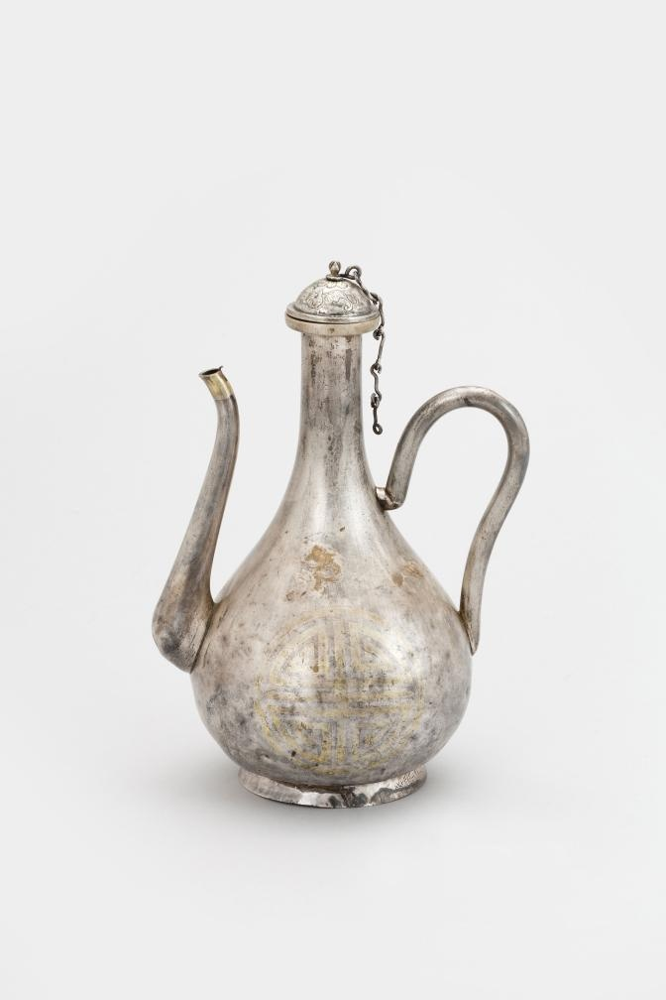

# 주전자의 이야기는 바닥에도 적혀 있다

*반짝이는 몸체 아래의 작은 글자들*

Culture · Art

> 자료 대조를 마친 검토용 이야기입니다. 공개 게시 승인은 아직 받지 않았습니다.

*은제주전자 · 국립고궁박물관 소장·제공. 전체 사진을 자르지 않고 사용했습니다.*

[이미지 출처와 소장품 안내](https://www.gogung.go.kr/gogung/pgm/psgudMng/view.do?menuNo=800065&psgudSn=390404) · 공공누리 제1유형(출처표시)

은빛 주전자를 보면 먼저 길게 뻗은 주둥이와 휘어진 손잡이가 눈에 들어온다. 가운데 둥근 몸통까지, 물을 따르는 물건이라는 사실은 어렵지 않게 알아볼 수 있다.

하지만 이 주전자는 옆모습만 보고 끝내기 아깝다. 국립고궁박물관의 설명을 따라가면 뚜껑에는 꽃봉오리가 있고, 몸체 양쪽에는 글자가 있으며, 바닥에도 기록이 있다. 한 물건을 보는 방향이 세 번 바뀐다.

## 뚜껑 위에 달린 봉오리

박물관은 뚜껑 손잡이를 연봉오리 형태로 설명한다. 집어 드는 부분에 꽃의 모양을 빌려 놓은 것이다. 실제 연꽃이 핀 풍경을 그린 대신 손에 닿는 작은 꼭지를 꽃처럼 만들었다.

뚜껑에는 선으로 새긴 박쥐무늬도 있다고 한다. 사진 한 장에 모든 방향이 보이지는 않으니, 보이지 않는 무늬를 억지로 찾아내기보다 설명을 길잡이로 삼으면 된다. 박쥐의 뜻까지 이 자료만으로 길게 풀지는 않기로 하자.

## 옆에는 수, 아래에는 기록

몸체 양쪽에는 둥근 틀의 수명 수, 곧 壽를 나타낸 무늬가 있다. 주전자의 둥근 형태 안에 글자 장식이 더해진 것이다. 단순히 반짝이는 은그릇이라고만 보기에는 볼거리가 많다.

굽에는 선희궁을 뜻하는 宣禧宮으로 시작하는 글이 새겨져 있다. 박물관은 그 명문 전체를 소개한다. 그중에는 새로 만들었다는 新造와 무게를 뜻하는 重 같은 글자도 보인다. 장식과 별개로 제작에 관한 정보를 남기는 자리였음을 읽을 수 있다.

## 돌려 보듯 읽는 즐거움

여기서는 무인년을 특정한 서기 연도로 바꾸거나 옛 무게를 지금의 그램으로 환산하지 않는다. 추가 대조 없이 숫자만 확정하면 작은 글씨가 알려 주는 범위를 넘어설 수 있기 때문이다.

대신 보는 순서 하나를 기억해 두면 좋겠다. 뚜껑의 꽃, 몸체의 글자, 바닥의 기록. 익숙한 주전자도 어디를 보느냐에 따라 장식품이 되었다가 기록물이 된다. 다음에 옛 그릇을 만날 때 바닥 사진을 한 번 더 눌러 보고 싶어지는 이유다.

## 이야기의 바탕이 된 자료

- [국립고궁박물관 — 은제주전자](https://www.gogung.go.kr/gogung/pgm/psgudMng/view.do?menuNo=800065&psgudSn=390404) · 확인일 2026-10-28
  - 확인 내용: 은제 주전자 형태와 연봉오리 손잡이 / 몸체 양쪽 원수문과 뚜껑 박쥐무늬 / 굽 명문 宣禧宮 戊寅仲冬新造重 二十三両四戔

---

[같은 소주제의 이야기](README.md) · [전체 서가](../../README.md)
