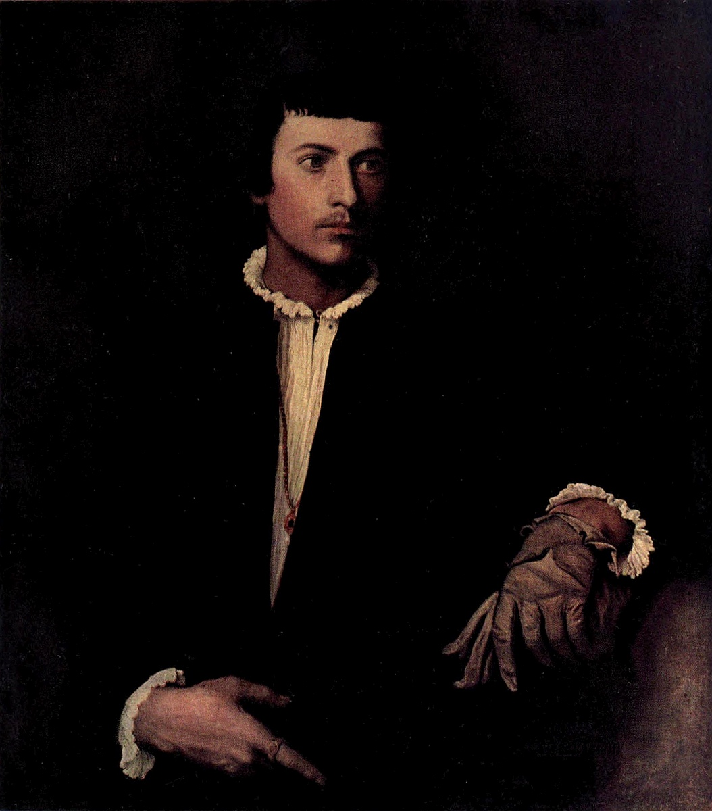

# 장갑을 낀 남자 — 얼굴보다 손이 먼저 알려 주는 것

*티치아노의 초상에서 검은 옷과 작은 물건 읽기*

Culture · Art

> 출처 대조와 공개 게시 승인을 마친 이야기입니다. 실제 게시 여부는 사이트 배포 상태를 따릅니다.

*티치아노 원작 · 옛 루브르 도록 Plate XII 색채 재현 도판 · Project Gutenberg*

[이미지 출처·제작 근거](https://raw.githubusercontent.com/GITenberg/The-Louvre-Fifty-Plates-in-Colour_63719/master/63719-h/images/i_plate12.jpg) · 퍼블릭 도메인 원작의 역사적 재현 자료 · Project Gutenberg 수록본

한 남자가 검은 옷을 입고 서 있다. 흰 셔츠와 목깃, 얼굴과 손이 어두운 화면에서 먼저 눈에 들어온다. 그가 무엇을 했고 어떤 이름을 가졌는지 몰라도 어떤 태도로 우리 앞에 놓였는지는 느낄 수 있다. 티치아노의 〈장갑을 낀 남자〉다.

초상화를 보면 모델의 신원을 먼저 알고 싶어진다. 하지만 이 작품에서는 제목이 가리키는 작은 물건을 따라가 보는 것도 좋은 시작이다. 얼굴을 보고 손으로 내려오면, 인물의 존재감이 한 부분만으로 만들어진 것은 아니라는 점이 보인다.

## 1. 검은 옷은 아무것도 없는 자리가 아니다

인물의 옷은 넓고 어두운 면을 이룬다. 멀리서 보면 색이 단조롭다고 느낄 수 있지만, 그 어두움 때문에 얼굴과 흰 옷깃, 두 손의 차이가 더 또렷해진다. 모든 부분이 같은 정도로 시선을 끌지 않는 구성이 인물의 중심을 잡아 준다.

화려한 옷의 무늬가 많지 않아도 초상은 풍부할 수 있다. 어디가 밝고 어디가 가라앉아 있는지, 어깨와 몸의 윤곽이 배경에서 어떻게 구별되는지 살펴보자. 검은색을 그림의 빈칸으로 취급하지 않으면 볼 부분이 늘어난다.

## 2. 얼굴은 관객과 조금 다른 곳을 향한다

인물은 얼굴과 눈길을 정면에 고정하지 않는다. 약간 옆을 바라보는 듯한 자세다. 관객을 향해 모든 것을 설명하려는 모습보다, 화면 밖에도 자기 관심이 있는 사람처럼 느껴질 수 있다.

그 방향에 무엇이 실제로 있었는지 우리가 확인할 수 있는 것은 아니다. 그림 밖의 사람이나 대화를 지어내는 대신, 정면을 볼 때와 이 시선이 주는 인상이 어떻게 다른지 생각해 보자. 한 사람의 내면을 모두 안다고 주장하지 않아도 자세의 효과는 느낄 수 있다.

## 3. 제목 속 장갑은 어디에 있을까

왼손 쪽에는 장갑과 다른 한 짝의 장갑이 보인다. 손은 받침대 가까이 놓여 있어 몸의 위치를 안정시키는 역할도 한다. 제목을 알고 나면 그 부분이 먼저 보이지만, 한 번 찾은 뒤에는 얼굴과의 거리를 함께 살피면 좋다.

장갑은 손을 덮는 물건이면서 초상 속 차림새의 일부다. 옷과 장신구, 몸의 태도를 함께 보면 인물이 어떤 사회적 이미지를 보여 주도록 구성되었는지 생각하게 된다. 다만 장갑 하나로 정확한 직업이나 신분을 확정하는 것은 다른 증거가 필요한 일이다.

## 4. 장갑 낀 손과 맨손의 차이

그림에는 장갑으로 덮인 손과 그렇지 않은 손의 차이가 있다. 맨손 쪽에는 반지도 보인다. 얼굴과 함께 피부가 드러나는 부분, 천과 가죽으로 덮인 부분을 번갈아 보면 초상 안의 재료가 다양하다는 사실을 느낄 수 있다.

손은 얼굴에 덧붙은 부속품이 아니다. 어떻게 놓여 있느냐에 따라 인물의 긴장과 편안함이 다르게 보일 수 있다. 입가의 표정만 관찰하던 감상을 손과 팔로 넓히는 좋은 작품이다. 누군가의 성격을 손 하나로 진단하는 대신 화면이 만드는 자세를 살펴보자.

## 5. 흰 셔츠와 작은 금빛이 만드는 중심

검은 옷 사이의 흰 셔츠는 얼굴 아래에서 밝은 길을 만든다. 목 근처의 금빛과 손의 작은 장식은 시선을 다시 멈추게 한다. 큰 장식보다 작은 차이가 두드러지는 화면이다. 어디에 눈이 먼저 가는지 스스로 따라가 보면 구성을 구체적으로 느낄 수 있다.

얼굴에서 흰 옷으로, 손과 장갑으로 내려왔다가 다시 얼굴로 올라가 보자. 익숙한 초상도 눈길의 순서를 바꾸면 다른 관계가 보인다. 이 순서가 정답이라는 뜻은 아니다. 작품을 한 번 더 보는 작은 방법으로 사용하면 된다.

## 6. 티치아노의 초상을 만나는 방식

티치아노는 베네치아 회화의 중요한 화가로, 인물과 옷, 피부와 빛의 관계를 다루는 초상들을 남겼다. 이 작품에서도 주인공의 이야기를 글로 길게 붙이지 않고 화면 자체로 존재감을 만든다. 사람의 얼굴뿐 아니라 주변 재료를 그리는 일이 함께 작용한다.

모델의 이름을 확인하는 연구는 중요하지만, 관객의 감상이 그 확인 전까지 정지해야 하는 것은 아니다. 아는 사실이 적을 때에도 색과 자세, 물건의 관계를 볼 수 있다. 나중에 더 정확한 정보를 얻으면 그때 다시 그림으로 돌아오면 된다.

## 7. 옛 인쇄 도판에서 무엇을 볼 수 있을까

함께 실은 이미지는 옛 루브르 도록에 실린 실제 회화 재현 자료다. 검은 옷과 배경의 미묘한 차이는 옛 인쇄에서 실물과 다르게 보일 수 있다. 그러므로 모든 어두운 부분의 표면까지 확정하기보다 큰 밝기와 인물의 배치를 중심으로 살펴보았다.

원작을 닮게 새로 만든 AI 초상이 아니라 실제 작품의 도판이라는 점은 구분해 두면 좋다. 현대인이 상상한 남자의 옷차림을 티치아노의 선택이라고 설명하지 않기 위해서다. 이미지의 종류를 알고 보는 것이 작품에 관한 지식을 더 단단하게 해 준다.

## 8. 이름 대신 한 물건으로 남은 사람

그림을 본 뒤 제목을 다시 읽으면 장갑이라는 작은 물건이 다른 무게를 가진다. 얼굴과 손, 차림새를 연결해 기억하게 하는 표지가 되었기 때문이다. 평범한 물건도 화면 속 위치와 관계에 따라 사람을 떠올리는 열쇠가 될 수 있다.

오늘은 이 남자의 모든 사연을 알아내려 하지 않아도 좋다. 어떤 부분은 밝게 드러나고 어떤 부분은 어둠에 남는지 보며 한 사람의 앞에 잠시 머물러 보자. 초상화의 교양은 이름을 외우는 일뿐 아니라 사람을 보는 자신의 습관을 조금 넓히는 데서도 생긴다.

## 이야기의 바탕이 된 자료

- [Konody·Brockwell — The Louvre: Fifty Plates in Colour, 티치아노와 Plate XII](https://raw.githubusercontent.com/GITenberg/The-Louvre-Fifty-Plates-in-Colour_63719/master/63719-0.txt) · 확인일 2026-10-30
  - 확인 내용: L’homme au Gant 표제·검은 옷과 흰 셔츠·금목걸이·반지 / 장갑 낀 손과 다른 장갑·받침대·인물의 시선과 서명 / 실제 초상화 재현 도판의 정체

---

[같은 소주제의 이야기](README.md) · [전체 서가](../../README.md)
