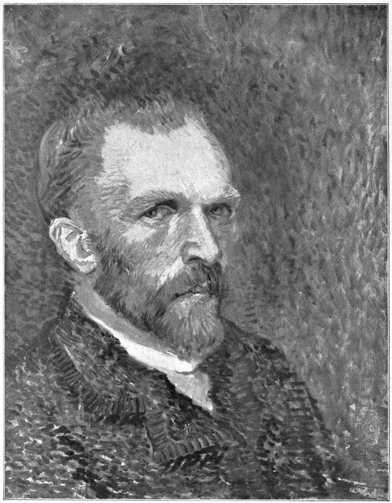

# 반 고흐의 생애 — 그림 곁에는 편지가 있었다

*천재라는 한마디 밖에서 만나는 한 사람*

Culture · Art

> 자료 대조를 마친 검토용 이야기입니다. 공개 게시 승인은 아직 받지 않았습니다.

*반 고흐 자화상 · 1913년 The Letters of a Post-Impressionist 수록 재현도판 · 원본 도판 전체 유지. AI 재현 이미지가 아닙니다.*

[이미지 출처·제작 근거](https://raw.githubusercontent.com/GITenberg/The-Letters-of-a-Post-ImpressionistBeing-the-Familiar-Correspondence-of-Vincent-Van-Gogh_40393/master/40393-h/images/i_004f_lg.jpg) · 퍼블릭 도메인 원작의 역사적 재현 도판 · Project Gutenberg 수록본

빈센트 반 고흐를 떠올리면 강렬한 색과 굵게 움직이는 붓질, 힘겨운 삶에 관한 이야기가 함께 떠오르곤 한다. 하지만 천재라는 말이나 고통이라는 말 하나가 한 사람의 생애를 모두 설명하지는 못한다. 그의 그림 곁에는 많은 편지가 남아 있다.

반 고흐는 1853년에 태어나 1890년에 세상을 떠난 네덜란드 화가다. 이 글은 진단명이나 극적인 소문으로 삶을 풀기보다, 편지를 통해 확인되는 배움과 작업, 동생 테오와의 관계를 짧게 따라가 보려 한다.

## 그림은 저절로 나오지 않았다

서간집에서 반 고흐는 무엇을 그리고 어떻게 연습할지 거듭 고민한다. 다른 작품을 공부하고 사람과 풍경을 살피며, 자신의 작업이 어떤 방향으로 가야 할지 설명한다. 완성된 명화만 보았을 때는 잘 보이지 않는 시간이 여기에 있다.

우리는 뛰어난 화가의 작업을 순간적인 영감으로만 상상하기 쉽다. 그러나 편지 속에는 물감과 돈, 작업의 계획과 실패에 관한 말도 이어진다. 그림은 마음속에서 갑자기 솟은 이미지이면서 동시에 재료와 연습, 생활을 필요로 하는 일이었다.

## 네덜란드에서 프랑스의 여러 도시로

그의 작업 여정에는 네덜란드의 장소들과 파리, 아를, 생레미, 오베르쉬르우아즈 등이 등장한다. 서간집은 이런 장소를 옮겨 가며 계속 그림을 생각하던 모습을 전한다. 익숙한 풍경을 떠나 새로운 빛과 사람, 작업 조건을 만나는 과정도 화가의 삶에 들어 있었다.

이동은 단순히 유명한 그림의 배경을 바꾸는 일만은 아니었을 것이다. 다른 환경과 사람, 작업 조건을 만나게 된다. 반 고흐의 삶을 볼 때는 정해진 천재의 모습이 처음부터 끝까지 그대로 있었다고 생각하기보다 변화하는 작업의 과정을 함께 보는 편이 좋다.

## 테오에게 보내는 말

동생 테오는 편지의 중요한 상대이며 형의 생활과 작업을 도운 인물이다. 반 고흐는 작품에 관한 생각뿐 아니라 현실적인 어려움도 동생과 나눈다. 화가의 삶을 혼자만의 싸움으로 그리면 이 관계가 지워지기 쉽다.

건강이 좋지 않아 치료를 받던 시기에도 그림과 앞으로의 작업에 관한 생각이 이어진다. 그 고통이 곧 좋은 그림을 만들어 주었다고 말할 수는 없다. 이 글에서는 편지에 남은 어려움을 선정적인 사건으로 바꾸거나, 확인하지 않은 병명을 붙이지 않는다.

## 자화상을 보는 다른 방법

함께 실은 것은 1913년 서간집에 수록된 반 고흐 자화상의 재현도판이다. 화가가 자신의 얼굴을 그린 자료이지만, 얼굴의 선만 보고 그날의 마음이나 병의 상태를 진단할 수 있는 것은 아니다. 초상은 한 사람을 만나는 창이지 모든 사정을 설명하는 검사표는 아니다.

1890년 그의 삶은 끝났지만 그림과 편지를 통해 서로 다른 모습이 전해진다. 화가를 이해하려면 작품만 보아야 한다거나 삶의 사연만 알아야 한다는 한 가지 답은 없다. 자화상을 보고 편지를 조금 읽은 뒤 다시 그림으로 돌아가 보자. 이름 뒤에 있던 일하는 사람의 시간이 조금 더 가까워질 수 있다.

## 이야기의 바탕이 된 자료

- [반 고흐 — The Letters of a Post-Impressionist(1913), 서간 선집](https://raw.githubusercontent.com/GITenberg/The-Letters-of-a-Post-ImpressionistBeing-the-Familiar-Correspondence-of-Vincent-Van-Gogh_40393/master/40393-0.txt) · 확인일 2026-10-29
  - 확인 내용: 동생 테오에게 보내는 작업·생활·재료·지원에 관한 편지와 편집 서문 / 네덜란드 및 파리·아를·생레미·오베르쉬르우아즈라는 작업 장소 / 서간집의 치료·생활상의 어려움 언급과 자신의 작업 계획 / 자화상을 By Himself라고 식별하는 1913년 도판 캡션
- [반 고흐 서간집 서지 정보 — 저자 생몰년·판본 정보](https://raw.githubusercontent.com/GITenberg/The-Letters-of-a-Post-ImpressionistBeing-the-Familiar-Correspondence-of-Vincent-Van-Gogh_40393/master/metadata.yaml) · 확인일 2026-10-29
  - 확인 내용: 반 고흐 1853~1890 생몰년·판본 및 번역자 정보

---

[같은 소주제의 이야기](README.md) · [전체 서가](../../README.md)
