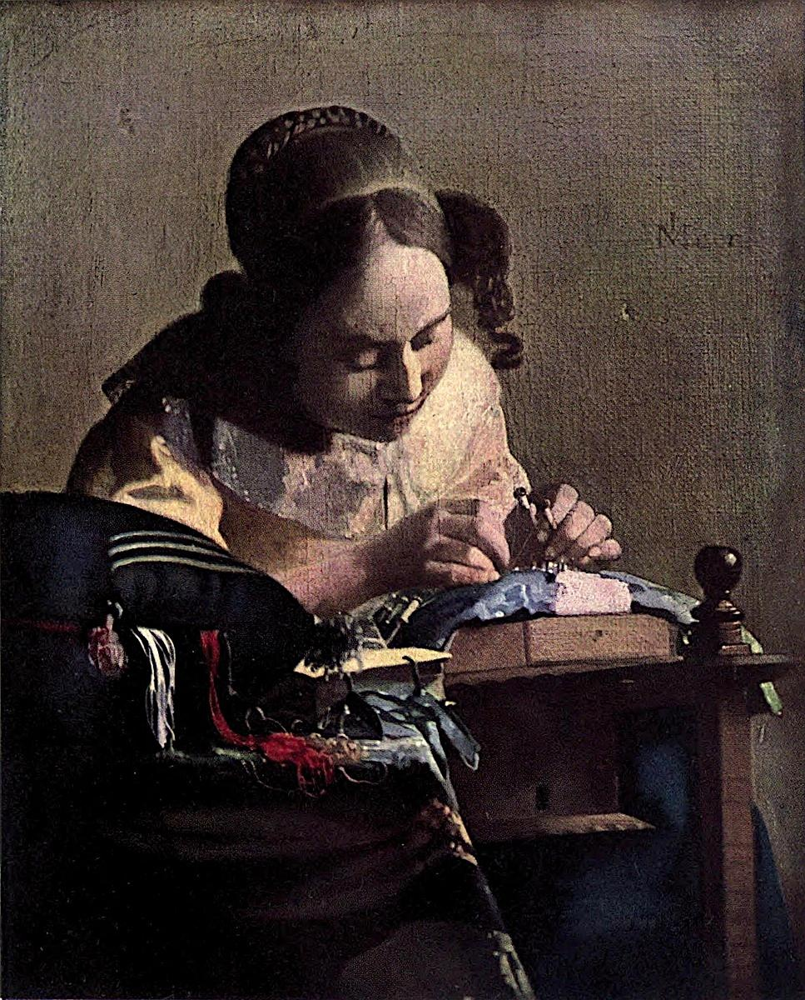

# 레이스 뜨는 여인 — 작은 일에 시선이 모일 때

*베르메르가 보여 주는 손과 집중의 장면*

Culture · Art

> 자료 대조를 마친 검토용 이야기입니다. 공개 게시 승인은 아직 받지 않았습니다.

*요하네스 베르메르, 레이스 뜨는 여인 · 옛 루브르 도록 Plate XXXVI · 역사적 색채 재현도판. 인쇄된 번호와 색조는 옛 자료 기준이며 현재 전시실 안내가 아닙니다.*

[이미지 출처·제작 근거](https://raw.githubusercontent.com/GITenberg/The-Louvre-Fifty-Plates-in-Colour_63719/master/63719-h/images/i_plate36.jpg) · 퍼블릭 도메인 원작의 역사적 재현 도판 · Project Gutenberg 수록본

한 여인이 고개를 숙이고 손끝에 집중하고 있다. 영웅의 승리도 왕의 즉위도 아닌, 작은 작업이 그림의 전부인 것처럼 보인다. 요하네스 베르메르의 〈레이스 뜨는 여인〉을 처음 만나면 무엇을 오래 보아야 할지 막막할 수도 있다.

하지만 그림 속 사람이 바라보는 방향을 따라가면 화면의 중심을 찾을 수 있다. 이 작품은 큰 사건 없이도 사람의 시간을 붙잡을 수 있다는 것을 보여 준다. 프랑스어 제목 라 당텔리에르는 레이스를 만드는 여인을 가리킨다.

## 1. 뜨개질과는 조금 다른 손의 일

여인은 보빈이라는 작은 도구에 감긴 실을 다루며 레이스를 만들고 있다. 실의 교차로 무늬를 짜는 일이다. 긴 대바늘로 털옷을 뜨는 장면을 먼저 떠올렸다면 손 주변의 작은 도구와 작업 자리를 다시 보자. 그림의 제목을 아는 것과 그 일이 무엇인지 아는 것은 조금 다른 경험이다.

도판에서는 실과 도구의 세부를 모두 구별하기 어렵다. 그렇다고 작은 점 하나를 억지로 특정 도구라고 판정할 필요는 없다. 두 손이 아주 좁은 자리에 모여 있고 시선이 그곳을 향한다는 관계부터 보면 된다. 장면을 이해하는 데 필요한 핵심은 이미 보인다.

## 2. 관객을 보지 않는 사람을 바라보기

초상화에서는 인물이 관객을 정면으로 바라보는 경우가 많다. 여기의 여인은 우리를 향해 포즈를 취하기보다 자기 일을 하고 있다. 그래서 관객은 누군가의 방에 잠깐 들어와 조용히 그 시간을 지켜보는 듯한 위치에 놓인다.

인물의 눈에서 손으로 내려오는 길을 따라가 보자. 우리가 보는 방향과 그림 속 사람이 보는 방향이 겹치면서 작은 작업이 더 중요하게 느껴진다. 무슨 사건인지 몰라서 비어 있는 그림이 아니라, 한 사람이 집중하고 있다는 사건이 이미 일어나고 있는 그림으로 볼 수 있다.

## 3. 노란 옷이 먼저 눈에 들어오는 까닭

여인은 밝은 노란빛 상의를 입었다. 주변의 비교적 어두운 부분과 구별되면서 몸이 가까이 느껴진다. 먼저 색에 이끌리고, 그 색을 입은 사람의 자세를 따라가며 손끝에 이르는 식으로 감상해 보아도 좋다. 이는 한 가지 읽는 방법이며 모든 관객이 같은 순서로 보아야 한다는 뜻은 아니다.

머리와 어깨, 두 팔이 만드는 모양을 살피면 인물이 크게 움직이지 않아도 화면에 방향이 있다는 것을 느낄 수 있다. 손이 어디에 모이는지, 팔이 그 자리를 어떻게 감싸는지 보는 것이다. 색만 따로 보는 것에서 몸의 구조로 넘어가면 그림이 조금 더 입체적으로 다가온다.

## 4. 앞쪽의 실과 물건을 보는 방법

화면 앞에는 쿠션과 실, 책처럼 보이는 물건이 놓여 있다. 노란 옷의 넓은 색면과 달리 앞쪽의 붉은 실은 풀어진 가닥처럼 보인다. 이 어수선한 부분과 손 주변의 집중된 자세를 번갈아 보아도 재미있다. 모든 곳이 같은 정도로 또렷하게 정리되어야만 그림이 생생해지는 것은 아니다.

작업하는 장면에 다른 물건들이 끼어 있다는 사실도 중요하다. 사람은 배경 없는 공간에서 손만 움직이지 않는다. 주변의 물건과 거리를 만들며 일한다. 다만 책이 있다는 이유만으로 여인의 신앙이나 성격을 곧바로 단정하지는 말자. 물건의 존재를 확인하는 것과 그 상징을 확정하는 일은 다르다.

## 5. 베르메르와 17세기 네덜란드의 실내

베르메르는 17세기 네덜란드 화가이며 조용한 실내의 인물을 그린 작품들로 알려져 있다. 왕실의 큰 사건보다 방 안의 일상, 편지를 읽거나 일을 하는 인물 같은 장면에서 회화의 주제를 찾았다. 이 작품도 그런 감상의 입구가 된다.

그렇다고 그림을 당시 네덜란드의 모든 가정이 이랬다는 사진 증거처럼 읽을 수는 없다. 화가는 실제 생활에서 볼 수 있는 소재를 고르고 배치하여 화면을 만든다. 일상의 장면이면서 동시에 잘 구성된 회화라는 두 성격을 함께 생각하면 좋다.

## 6. 모델의 이름을 몰라도 알 수 있는 것

그림 속 여인이 화가의 가족 중 누구라고 여기서 확정하지 않는다. 얼굴을 보고 이름을 알아맞혀야 작품을 이해하는 것은 아니다. 어깨를 둥글게 모으고 시선을 낮추는 자세만으로도 우리는 집중하는 몸의 경험을 알아볼 수 있다.

바느질이나 글쓰기, 작은 물건을 고치는 일을 해 본 기억을 떠올려 보자. 남이 부르면 잠깐 고개를 들지만 곧 다시 돌아가고 싶은 그런 시간이 있다. 옛 그림 속 사람을 오늘의 우리와 똑같다고 단순화하지 않으면서도, 몸의 자세를 통해 가까워질 수는 있다.

## 7. 큰 그림처럼 보려 하지 않기

이 작품을 볼 때는 모든 부분의 설명을 빠짐없이 외우기보다 세 번 시선을 옮겨 보자. 노란 옷을 보고, 얼굴과 손의 연결을 보고, 마지막으로 주변 물건과의 관계를 보는 것이다. 함께 실은 옛 색채 재현 도판에서는 미세한 표면보다 전체 구성과 큰 색의 관계를 중심으로 살펴보는 편이 적절하다.

한 사람의 작은 일이 그림의 중심에 놓였다는 사실을 기억하고 나면 조용한 장면이 심심하게만 보이지 않는다. 큰 사건을 그린 그림은 사건의 결과를 궁금하게 한다. 이 그림은 한 사람이 지금 보내고 있는 시간을 조금 더 바라보게 한다. 그 차이를 느끼는 것이 베르메르를 만나는 좋은 시작이다.

## 이야기의 바탕이 된 자료

- [Konody·Brockwell — The Louvre: Fifty Plates in Colour, 작품별 설명·도판](https://raw.githubusercontent.com/GITenberg/The-Louvre-Fifty-Plates-in-Colour_63719/master/63719-0.txt) · 확인일 2026-10-29
  - 확인 내용: Vermeer·La Dentellière 표제와 루브르 도록 Plate XXXVI / 고개를 숙여 보빈을 다루는 여인·노란 상의·쿠션·책 등의 설명과 실제 도판 / 17세기 화가라는 도판의 시기 정보와 작품 감상

---

[같은 소주제의 이야기](README.md) · [전체 서가](../../README.md)
