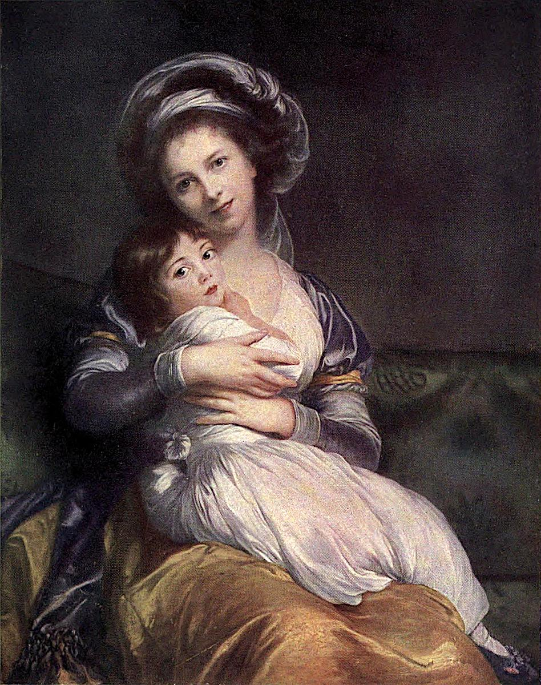

# 딸을 안은 자화상 — 비제 르 브룅이 남긴 두 가지 얼굴

*그림 속 어머니를 넘어, 그림을 그린 사람의 생애까지*

Culture · Art

> 자료 대조를 마친 검토용 이야기입니다. 공개 게시 승인은 아직 받지 않았습니다.

*엘리자베트 루이즈 비제 르 브룅 원작 · 옛 루브르 도록 Plate XLIV의 색채 재현 도판 · Project Gutenberg*

[이미지 출처·제작 근거](https://raw.githubusercontent.com/GITenberg/The-Louvre-Fifty-Plates-in-Colour_63719/master/63719-h/images/i_plate44.jpg) · 퍼블릭 도메인 원작·역사적 재현 자료 · Project Gutenberg 수록본

아이를 품에 안은 여인이 우리를 바라본다. 아이도 고개를 돌려 관객을 향한다. 두 팔은 아이를 단단히 감싸고 옷의 넓은 주름은 두 몸을 하나로 묶는다. 처음 보면 다정한 모녀의 초상이다.

그런데 그림 속 여인은 이 작품을 그린 화가 자신이다. 엘리자베트 루이즈 비제 르 브룅은 자신을 그리면서 어머니의 모습도 함께 남겼다. 모델과 작가가 같은 사람이라는 사실을 알고 나면, 품 안의 관계뿐 아니라 이 화면을 만들고 내놓은 사람의 삶에도 관심이 생긴다.

## 1. 두 얼굴에서 시작해 두 팔로 내려오기

먼저 어른과 아이의 얼굴을 각각 보고 그 사이의 거리를 살펴보자. 서로 기대고 있으면서도 얼굴의 방향은 관객에게 열려 있다. 보는 사람은 둘만의 관계를 방해하기보다 그 관계를 함께 보도록 초대받는 듯한 느낌을 받을 수 있다.

그다음에는 얼굴에서 팔로 눈을 내려 보자. 안쪽으로 모이는 손과 팔이 아이를 둘러싸며 큰 덩어리를 만든다. 표정만 떼어 놓고 볼 때보다 몸 전체의 연결이 분명해진다. 다정하다는 감정이 얼굴의 미소 하나로만 만들어지는 것은 아니다.

## 2. 옷의 색과 주름이 관계를 만든다

밝은 상의와 보랏빛 소매, 노란빛 치마가 어두운 배경에서 구별된다. 아이의 밝은 옷은 어른의 몸 가까이에 놓이면서 두 사람을 더 밀접하게 보이게 한다. 색은 의상을 설명하는 정보이면서 화면의 관계를 만드는 재료이기도 하다.

주름을 모두 세밀하게 해독할 필요는 없다. 넓은 천의 흐름이 어디로 향하는지, 손과 아이의 몸이 어떤 색면 위에 놓이는지 따라가 보자. 초상화에서 인물의 얼굴을 이해하는 일과 몸을 둘러싼 사물을 보는 일은 따로 떨어져 있지 않다.

## 3. 자화상은 거울을 옮긴 그림만은 아니다

화가가 자기 모습을 그리면 우리는 그 사람의 실제 얼굴을 알 수 있을 것이라 기대한다. 그러나 자화상에는 어떻게 보일지 고르는 선택도 들어간다. 어떤 옷을 입고 누구와 함께 있으며 관객을 어느 방향으로 볼 것인가. 화면은 그런 판단의 결과다.

이 작품에서 화가는 혼자 붓을 든 모습 대신 딸과 함께 나타난다. 그렇다고 작업하는 사람의 정체성이 사라지는 것은 아니다. 오히려 어머니의 모습을 이처럼 구성해 보여 준 주체가 바로 화가라는 사실이 두 역할을 함께 생각하게 한다. 어느 한쪽만이 그 사람의 진짜 모습이라고 고를 필요는 없다.

## 4. 1755년에 태어난 화가의 작업 세계

비제 르 브룅은 1755년 파리에서 태어났고 아버지도 화가였다. 회고록에는 그림을 배우던 일과 초상 주문을 받으며 생활을 꾸리던 경험이 남아 있다. 재능 있는 아이가 곧바로 유명한 왕실 화가가 되었다는 한 줄 사이에는 사람을 만나고 그림을 완성하며 신뢰를 얻는 일이 들어 있었다.

그는 마리 앙투아네트를 비롯한 왕실과 귀족의 초상을 그렸고 아카데미에도 받아들여졌다. 회고록은 그 과정에 다른 화가들의 지지와 반대가 있었다고 전한다. 전문 화가로 인정받는 일은 좋은 그림을 그리는 능력만으로 저절로 끝나는 문제가 아니었다.

## 5. 왕실 가까이에 있었다는 것의 다른 얼굴

왕실의 주문은 성공과 명성을 가져다주었지만 정치적 격변 속에서는 위험한 관계가 될 수도 있었다. 프랑스혁명기의 불안 속에서 그는 딸을 데리고 파리를 떠난다. 회고록은 당시의 두려움과 이동을 자신의 시선으로 자세히 전한다.

이 기록을 읽을 때는 작가가 특정 사회적 관계와 경험을 가진 사람이었다는 점도 기억하면 좋다. 회고록은 중요한 직접 기록이지만 혁명 전체를 중립적으로 정리한 교과서는 아니다. 자기 삶을 설명하는 목소리와 더 넓은 역사를 같은 것으로 만들지 않고 읽을 수 있다.

## 6. 낯선 도시에서도 이어진 초상 주문

이탈리아와 오스트리아, 러시아 등 여러 곳을 거치는 동안에도 그는 초상화를 그렸다. 떠남이 곧 작업의 끝이 된 것은 아니다. 의뢰인을 만나고 자신의 평판을 이어 가는 능력은 그의 생애에서 큰 비중을 차지한다. 예술가의 삶에 이동과 일의 조건이 함께 들어 있음을 보여 준다.

그렇다고 모든 이동을 화려한 여행으로만 읽을 수는 없다. 정치적 불안과 가족의 사정, 타지의 생활도 그 안에 있다. 성공한 화가라는 말과 불안정한 시간을 보낸 사람이라는 말은 한 생애 안에서 함께 성립할 수 있다.

## 7. 모녀의 그림으로 그 이후를 모두 알 수는 없다

따뜻한 포옹을 보고 두 사람의 관계가 평생 언제나 같았을 것이라고 생각하기 쉽다. 하지만 한 장의 초상은 한 생애 전체의 기록이 아니다. 회고록에는 딸의 성장과 결혼, 가족 관계의 어려움도 등장한다. 화면의 다정함을 사실이 아닌 것으로 지울 필요도, 그것으로 모든 시간을 설명할 필요도 없다.

오히려 그림과 생애를 함께 보면 초상화가 무엇을 보여 주고 무엇을 남겨 두는지 생각하게 된다. 그림을 보고 마음을 느낀 다음, 그 느낌과 역사적 사실이 서로 다른 층위임을 아는 것은 감상을 차갑게 만드는 일이 아니다. 한 사람을 지나치게 단순하게 만들지 않는 방법이다.

## 8. 작가의 삶을 알고 다시 얼굴을 보기

함께 실은 도판은 옛 루브르 도록에 수록된 작가와 딸의 자화상 중 한 점이다. 비슷한 주제의 다른 자화상과는 구분해야 하며, 옛 인쇄의 색이 현재의 실물과 완전히 같다고 볼 수는 없다. 여기서는 두 얼굴과 팔, 옷이 만드는 전체 관계를 살펴보았다.

처음에는 아이를 안은 어머니가 보였다면, 다시 볼 때는 그 장면을 설계하고 직접 그려 다른 사람 앞에 내놓은 화가도 보일 것이다. 다정한 관계와 전문적인 작업은 한 화면 안에 함께 있다. 비제 르 브룅의 자화상은 사람을 한 가지 역할로만 기억하지 않도록 시선을 넓혀 준다.

## 이야기의 바탕이 된 자료

- [Konody·Brockwell — The Louvre: Fifty Plates in Colour, Plate XLIV](https://raw.githubusercontent.com/GITenberg/The-Louvre-Fifty-Plates-in-Colour_63719/master/63719-0.txt) · 확인일 2026-10-29
  - 확인 내용: 비제 르 브룅 1755~1842·작가와 딸의 초상·옷·팔·소파의 구성 / 루브르 소장 자화상 두 점 중 No.522라는 도판 식별
- [엘리자베트 비제 르 브룅 — The Memoirs of Madame Vigée Lebrun](https://raw.githubusercontent.com/GITenberg/The-Memoirs-of-Madame-Vig-e-Lebrun_31934/master/31934.txt) · 확인일 2026-10-29
  - 확인 내용: 화가인 아버지·초상 작업과 생계·왕실 의뢰와 아카데미 입회 / 혁명기에 딸과 파리를 떠난 기록·여러 도시에서 이어진 작업과 사회 관계

---

[같은 소주제의 이야기](README.md) · [전체 서가](../../README.md)
