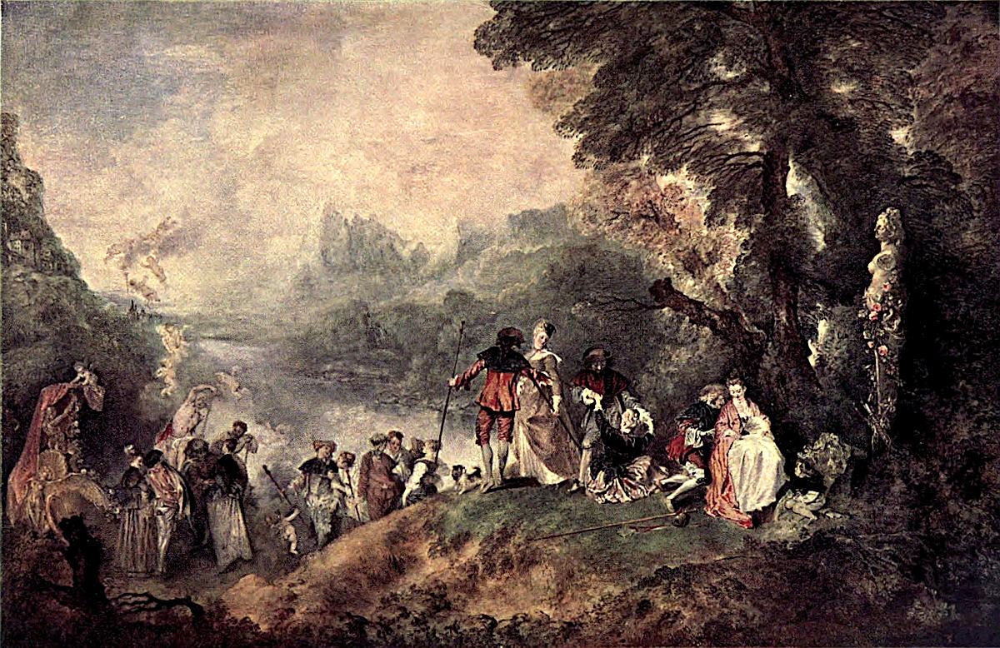

# 시테라 섬으로의 순례 — 연인들은 어디로 가는 걸까

*와토의 그림에서 손짓과 발걸음, 행복 속의 머뭇거림을 읽기*

Culture · Art

> 출처 대조와 공개 게시 승인을 마친 이야기입니다. 실제 게시 여부는 사이트 배포 상태를 따릅니다.

*앙투안 와토 원작 · 옛 루브르 도록 Plate XXXIX의 색채 재현 도판 · Project Gutenberg*

[이미지 출처·제작 근거](https://raw.githubusercontent.com/GITenberg/The-Louvre-Fifty-Plates-in-Colour_63719/master/63719-h/images/i_plate39.jpg) · 퍼블릭 도메인 원작·역사적 재현 자료 · Project Gutenberg 수록본

잘 차려입은 사람들이 나무 아래에 모여 있다. 어떤 이는 앉아 있고 어떤 이는 일어서며, 또 다른 이들은 배 쪽으로 걸어간다. 축제의 한 장면 같지만 무엇이 막 시작되는지 끝나는지 분명하게 말하기는 어렵다.

앙투안 와토의 〈시테라 섬으로의 순례〉다. 시테라 섬으로의 출항이라는 이름으로도 알려진 이 그림은 사랑의 풍경을 보여 주면서도 떠남과 머무름 사이의 시간을 느끼게 한다. 인물들의 작은 몸짓을 따라가면 제목만 읽을 때보다 훨씬 많은 일이 보인다.

## 1. 시테라는 왜 사랑의 장소가 되었을까

그리스의 섬 시테라는 사랑의 여신 아프로디테와 연결되어 온 이름이다. 로마식 이름으로는 비너스다. 그림 오른쪽 나무 곁에도 비너스의 모습을 한 표지가 있고 꽃장식이 더해져 있다. 공간의 성격을 알려 주는 단서다.

그렇다고 이 그림을 섬의 실제 지형을 안내하는 여행 지도로 볼 수는 없다. 사랑을 연상시키는 장소의 이름과 상상 속 풍경을 엮은 회화로 만나는 편이 좋다. 무엇이 사실의 지명이고 무엇이 그림의 구성인지 구분하면 상상을 더 자유롭게 즐길 수 있다.

## 2. 먼저 오른쪽의 앉은 두 사람부터 보기

오른쪽 나무 아래에는 아직 자리를 뜨지 않은 남녀가 보인다. 주변 사람들이 이동하는데도 이들은 잠시 자기들만의 시간을 보내는 것처럼 느껴진다. 조용한 대화가 이어지는지, 마지막으로 머물러 있는지 몸의 방향을 보며 상상해 볼 수 있다.

이때 인물들의 마음속 대사를 확정해 줄 필요는 없다. 그림이 보여 주는 것은 자세와 거리, 손과 얼굴의 방향이다. 보는 사람은 그 단서를 연결해 관계를 읽는다. 사랑이라는 큰 주제가 거창한 선언보다 작은 몸짓에서 먼저 시작되는 셈이다.

## 3. 일어나는 사람과 이끄는 사람 사이

조금 왼쪽으로 눈을 옮기면 남자가 여자의 손을 잡아 일으키는 듯한 모습이 나온다. 더 가운데에서는 다른 두 사람이 몸을 가까이한 채 이동한다. 앉아 있음, 일어남, 걷기라는 다른 단계가 한 화면에 나란히 놓인 것이다.

이들을 시간의 흐름처럼 읽으면 정지된 그림이 천천히 움직이기 시작한다. 그렇다고 같은 인물 한 쌍이 여러 번 그려졌다고 확정하는 뜻은 아니다. 서로 다른 자세를 이어 보면서 그림 안에 만들어진 리듬을 느끼는 감상 방법이다.

## 4. 왼쪽 끝에는 배와 큐피드가 기다린다

오른쪽에서 시작한 시선은 사람들을 따라 왼쪽의 배 쪽으로 이어진다. 주변에는 날개 달린 작은 사랑의 신들이 떠다닌다. 인간의 몸짓만으로 이루어진 현실적 장면에 신화적 표지가 섞이면서, 이 모임이 평범한 외출 이상의 상상 속 공간임을 알려 준다.

인물만 확대해서 보면 놓치기 쉬운 부분이다. 전체 도판으로 돌아와 배와 나무, 먼 물과 산을 함께 보자. 가까운 사람들의 이야기가 넓은 풍경 속에 놓일 때 기분도 달라진다. 작은 관계와 큰 공간이 서로를 받쳐 준다.

## 5. 도착일까, 출발일까

제목은 길을 가리키지만 화면의 모든 사람을 한 가지 행동으로 정리하기는 어렵다. 배 쪽으로 향하는 움직임을 따라가면 떠남처럼 느껴지고, 사랑의 섬이라는 제목을 먼저 떠올리면 도착의 장면을 상상할 수도 있다. 그림 속 머뭇거림은 이런 질문을 오래 남긴다.

여기서는 모든 인물이 같은 방향의 감정을 가지고 있다고 단정하지 않는다. 함께 있어도 누군가는 더 머물고 싶고 누군가는 먼저 일어날 수 있다. 목적지를 알아야만 읽을 수 있는 그림이 아니라, 움직임과 망설임을 보는 것 자체가 감상의 내용이 되는 그림이다.

## 6. 행복한 장면에서 아쉬움이 느껴지는 이유

부드러운 색과 가까운 몸짓은 즐거운 기분을 준다. 그러나 즐거움이 끝없이 계속될 것 같은 확신만 있는 것은 아니다. 자리를 정리하고 길을 나서는 사람을 보면 좋은 시간이 지나가고 있다는 느낌을 받을 수도 있다. 이는 작품을 읽는 한 방법이며 모든 사람의 감정이 같아야 하는 것은 아니다.

친구들과 즐거운 시간을 보낸 뒤 헤어지는 순간을 떠올려 보아도 좋다. 실제 그림의 인물들을 오늘의 우리와 똑같다고 말하는 것이 아니라, 낯선 옷과 신화의 이름을 넘어 가까워질 감각을 찾는 것이다. 작은 몸짓이 오래 남는 이유도 그런 경험과 연결될 수 있다.

## 7. 1717년의 그림, 비슷한 다른 그림과 구분하기

옛 루브르 도록은 이 작품을 와토가 아카데미에 제출한 1717년 작품으로 설명한다. 비슷한 주제의 다른 판본도 언급한다. 같은 제목이나 비슷한 구도가 보인다고 모두 같은 그림의 다른 사진은 아니라는 점을 알아 두면 좋다.

함께 실은 것은 그 도록의 루브르 판본 색채 재현 도판이다. 옛 인쇄물이라 오늘 실물의 색을 완전히 대신하지는 않는다. 현재의 전시 위치를 알려 주는 안내도로 쓰기보다 인물들의 배치와 큰 색의 관계를 보는 자료로 활용했다.

## 8. 제목을 잠시 덮고 한 번 더 바라보기

오른쪽의 앉은 사람, 일어나는 사람, 가운데 걷는 사람, 왼쪽 배의 순서로 천천히 시선을 옮겨 보자. 다음에는 반대 방향으로 돌아와 나무 아래의 조용한 두 사람을 다시 보면 좋다. 처음에는 사람 수가 많아 복잡하던 그림에 작은 이야기들이 생긴다.

와토는 사랑을 설명하는 문장 하나 대신 여러 사람의 자세와 풍경을 남겼다. 출발인지 도착인지 한 번에 결론 내리지 않아도 된다. 그림 속 시간이 어디에서 머물고 어디에서 움직이는지 보고 나면, 섬의 이름보다 그곳을 떠나거나 찾아가는 사람들의 마음이 더 오래 남을 수 있다.

## 이야기의 바탕이 된 자료

- [Konody·Brockwell — The Louvre: Fifty Plates in Colour, 와토 설명과 Plate XXXIX](https://raw.githubusercontent.com/GITenberg/The-Louvre-Fifty-Plates-in-Colour_63719/master/63719-0.txt) · 확인일 2026-10-29
  - 확인 내용: 1717년 아카데미 제출작과 루브르 판본 / 오른쪽 비너스의 표지·연인들의 자세·왼쪽 배와 공중의 큐피드·먼 풍경 / 별도의 후대 판본과 구별되는 도판의 정체

---

[같은 소주제의 이야기](README.md) · [전체 서가](../../README.md)
