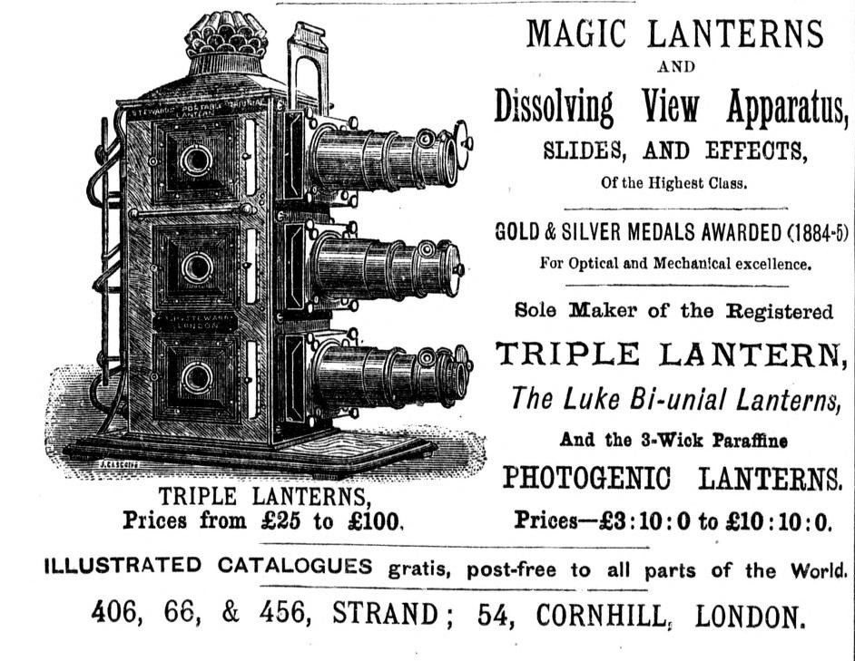

# 영화가 없던 시절, 사람들은 벽에 무엇을 비춰 봤을까

*영화 이전의 관객들이 환등기로 벽에 비친 이야기를 어떻게 즐겼는지 살펴봅니다.*

Culture · Film

> 출처 대조와 공개 게시 승인을 마친 이야기입니다. 실제 게시 여부는 사이트 배포 상태를 따릅니다.

*역사 도판 · 《Colonial and Indian Exhibition》 공식 카탈로그(1886)의 삼중 렌즈 환등기 광고. 위키미디어 공용.*

[이미지 출처·제작 근거](https://commons.wikimedia.org/wiki/File:Magiclantern.jpg) · Public Domain Mark

벽 한쪽을 비추는 작은 기계에 그림이 그려진 유리판을 끼운다. 유리판을 빼고 다른 판을 넣으면 같은 벽에 새 장면이 나타난다. 영화가 등장하기 전에도 사람들은 이렇게 한자리에 모여 벽에 비친 이야기를 봤다. 그때 쓰인 기계 가운데 하나가 환등기다. 공개 공연에선 이야기와 음악을 함께 들었고, 작은 환등기는 집에도 들어왔다. 미국 일리노이의 한 교사는 교실에서 환등기를 꺼내 학생들에게 슬라이드를 보여주었다. 사람들은 이 작은 기계로 무엇을 보고, 어떤 이야기를 만들어 냈을까?

## 01. 벽을 스크린으로 바꾸는 기계

환등기의 기본에는 광원과 그림을 담은 유리판, 렌즈가 있다. 촛불이나 기름등에서 나온 빛이 그림이 담긴 유리를 지나고, 렌즈를 거치면 맞은편 벽이나 천에 더 큰 상이 맺힌다. 손에 들고 보던 그림을 방 안의 여러 사람이 한꺼번에 볼 수 있는 것이다. 기계가 보여주는 것은 유리판을 통과한 빛으로 맺힌 상이다. 방이 어두워지면 벽에 비친 이미지가 주위에서 더 선명하게 구별된다. 화면이 되기 위해 벽이 특별한 재료로 만들어져야 하는 것은 아니다. 빛을 받을 평평한 자리가 있으면 된다.

## 02. 유리판을 넘기는 순서가 줄거리가 된다

움직이는 영상을 찍지 않아도 장면을 연결할 수 있다. 한 유리판에 인물이 나타나고 다음 유리판에서 장소가 바뀌면, 관객은 두 장면 사이에 어떤 일이 있었는지 떠올린다. 미국 영상박물관은 채색한 유리 슬라이드를 차례로 비추어 이야기를 들려준 공연을 소개한다. 한 장의 그림에서 무엇을 보여줄지 정하는 일이 화가의 몫이라면, 다음 그림을 언제 꺼낼지는 상영자의 몫이다. 어떤 슬라이드를 오래 보여주고 어느 때 넘기느냐에 따라 같은 그림 묶음으로도 이야기가 천천히 흐르거나 빠르게 느껴질 수 있다. 영국 국립과학미디어박물관이 소개한 슬라이드 연작에는 넬이라는 인물이 횃불을 들어 배를 암초에서 멀어지게 하려는 장면과, 쓰러진 넬을 사람들이 발견하는 장면이 따로 담겨 있다. 판을 넘기는 사이에 이야기가 앞으로 나아간다.

## 03. 렌즈가 여러 개라면 화면도 달라진다

미국 영상박물관에는 1877년 피 하르팅이 만든 렌즈 세 개짜리 환등기가 있다. 렌즈가 여러 개 달린 기계로는 숙련된 상영자가 슬라이드를 동시에 조작해 움직이는 듯한 효과를 낼 수 있었다. 한 장면이 비치고 있는 동안 다른 그림을 준비할 수 있다는 점을 떠올리면 구조가 조금 쉬워진다. 한 화면이 사라질 때 다른 화면을 겹쳐 비추면 두 그림 사이의 경계가 부드러워진다. 슬라이드를 한 장씩 바꾸는 경우에는 화면이 바뀌는 순간이 드러나지만, 겹쳐 보이는 동안에는 벽 위 풍경 자체가 달라지는 듯 보인다.

## 04. 화면에 이야기를 붙인 목소리와 음악

일리노이 주립박물관은 공개 환등 공연에 장면을 설명하는 말과 현장 음악이 함께했다고 소개한다. 벽 위에 같은 풍경을 띄워도 상영자가 이야기를 붙이면 관객은 그림 속에서 무엇을 봐야 할지 알게 된다. 음악은 장면이 바뀌는 동안에도 이어질 수 있다. 환등 공연의 즐거움은 유리판에 들어 있던 그림을 확대해 보는 일에서 시작해, 관객이 그 그림들을 한 이야기로 받아들이는 데까지 이어졌다. 객석에 앉아 벽을 보는 경험은 기계와 그림, 그날 공연을 이끄는 사람들의 솜씨로 완성됐다.

## 05. 교사가 아끼던 환등기 한 대

일리노이 주립박물관이 소개하는 환등기는 양철공 에드워드 어니스트 퀴클러가 교사인 아들 찰스를 위해 손수 만든 물건이다. 찰스는 교실이 하나뿐인 학교에서 학생들에게 상으로 슬라이드를 보여주었다. 무엇을 비췄는지까지 박물관 설명에 적혀 있지는 않지만, 누가 만들었고 누가 보았는지는 기록에 남아 있다. 환등기는 교사였던 찰스의 사위와 손자, 증손자에게 이어진 뒤 박물관에 기증됐다. 같은 물건이 여러 세대의 손을 거쳐 남은 덕분에, 큰 공연장의 기록으로는 만나기 어려운 교실의 상영도 알 수 있다.

## 06. 집으로 들어온 작은 상영회

공개 공연에만 환등기가 있었던 것은 아니다. 일리노이 주립박물관에 따르면 집에서 쓰는 작은 환등기도 있었고, 이런 제품은 명절 선물로 인기가 있었다. 집에 기계가 있으면 보고 싶은 유리판을 골라 가족이나 친구 앞에서 직접 보여줄 수 있었다. 공연장에서 전문가가 맡던 장면 선택과 순서 정하기를 집 안에서도 해볼 수 있게 된 것이다. 같은 환등기라도 여러 사람이 모인 공연장에서는 상영의 도구였고, 학교에서는 교사가 꺼내는 특별한 물건이었으며, 집에서는 선물로 주고받을 수 있는 놀이 도구였다.

## 07. 영화가 등장하기 전에 익숙해진 풍경

영화는 이어지는 여러 프레임을 빠르게 보여 움직임을 만들고, 환등 공연에서는 그림을 바꾸거나 겹쳐 움직이는 듯한 효과를 냈다. 두 장치의 작동 방식은 다르지만, 어두운 곳에 모여 밝은 화면을 바라보는 풍경은 이어진다. 1886년 전시 자료에 실린 환등기 도판을 보면, 그림이 벽에 비치기까지 관객의 시선이 모이는 지점 바깥에서 기계가 어떤 구실을 했는지 생각해 볼 수 있다. 그림을 띄우는 사람은 그 옆에서 다음 유리판을 준비했다. 환등기는 영화가 오기 전에도 사람들이 화면에서 장면이 바뀌기를 기다리며 함께 이야기를 즐겼음을 보여준다.

## 이야기의 바탕이 된 자료

- [미국 영상박물관 — Optical Toys](https://movingimage.org/collection/collection-spotlight_optical-toys/) · 확인일 2026-11-09
- [일리노이 주립박물관 — Magic Lantern](https://story.illinoisstatemuseum.org/content/magic-lantern) · 확인일 2026-11-09
- [영국 국립과학미디어박물관 — Christmas magic lantern slides](https://blog.scienceandmediamuseum.org.uk/christmas-magic-lantern-slides/) · 확인일 2026-11-09
- [위키미디어 공용 — 1886년 환등기 도판](https://commons.wikimedia.org/wiki/File:Magiclantern.jpg) · 확인일 2026-11-09

---

[같은 소주제의 이야기](README.md) · [전체 서가](../../README.md)
