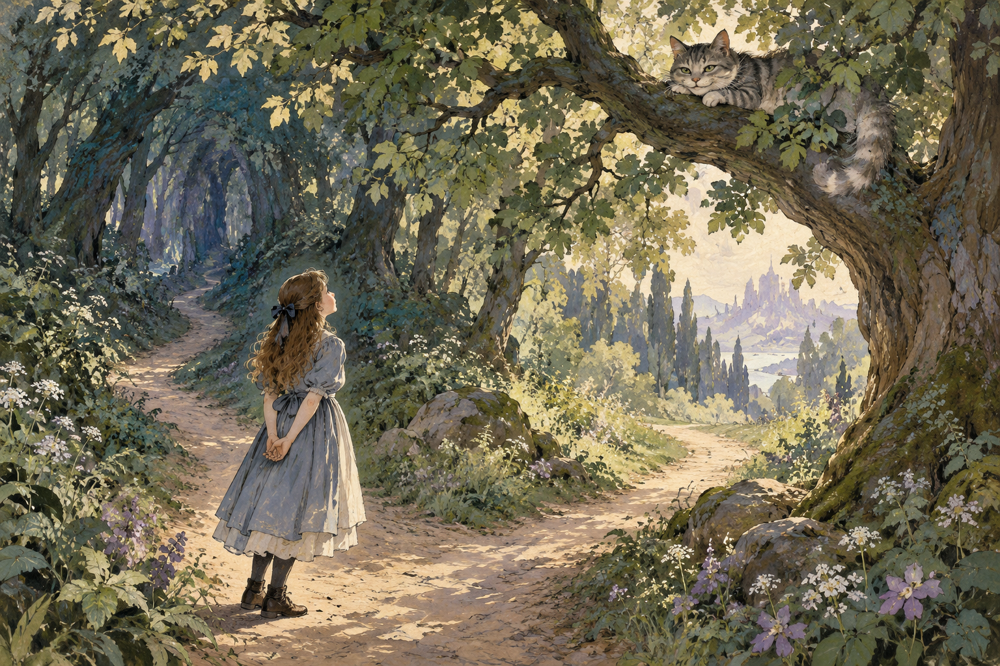

# 이상한 나라의 앨리스 — 말이 통하지 않는 세계에서 나를 찾기

*토끼굴과 다과회, 이상한 재판을 지나가는 소녀*

Culture · Literature

> 출처 대조와 공개 게시 승인을 마친 이야기입니다. 실제 게시 여부는 사이트 배포 상태를 따릅니다.

*KnowledgeWalk 제작 AI 삽화 · 작품의 장면이나 분위기를 새로 상상한 그림이며 원작 도판·작곡가의 실제 방·역사적 현장 재현 자료가 아닙니다.*

급하게 달리는 토끼가 회중시계를 꺼낸다. 신기해서 따라간 소녀는 토끼굴 아래로 떨어지고, 몸의 크기와 대화의 규칙이 자꾸 달라지는 세계에 들어간다. 루이스 캐럴의 『이상한 나라의 앨리스』다. 익숙한 제목이지만 줄거리를 차례로 읽어 보면 단순히 기묘한 생물을 만나는 이야기보다 훨씬 장난스럽다.

앨리스는 배운 말과 예절을 가지고 낯선 세계를 이해하려 한다. 그러나 그곳의 인물들은 같은 단어를 쓰면서도 같은 뜻을 나누지 않는다. 아래에는 주요 장면과 결말이 포함되어 있다.

## 1. 작은 문 앞에서 몸의 크기부터 문제가 된다

토끼굴을 내려간 앨리스는 작은 문 너머의 아름다운 정원에 가고 싶어 한다. 하지만 문과 몸의 크기가 맞지 않는다. 마시고 먹으며 작아지거나 커지는 동안 열쇠를 놓치고 자기 눈물에 휩쓸리기도 한다. 원하는 곳에 들어가는 일이 생각처럼 단순하지 않다.

이 변화는 재미있는 마법이면서 자신을 알아보는 감각을 흔든다. 몸이 자꾸 바뀌니 평소에 당연했던 일을 할 수 없고, 외웠던 말도 이상하게 나온다. 독자는 앨리스와 함께 익숙한 기준을 잠시 잃는다. 무엇을 하려는지만큼 지금 어떤 상태인지도 중요해진다.

## 2. 애벌레가 묻는 ‘너는 누구냐’

애벌레를 만났을 때 앨리스는 자신이 누구인지 설명하기 어렵다. 오늘만 해도 몸이 여러 번 달라졌기 때문이다. 상대의 질문은 간단하지만 대답할 조건은 간단하지 않다. 어제 알고 있던 자기 모습이 오늘의 상황을 충분히 설명하지 못한다.

이를 한 가지 철학 이론의 정답으로 해석할 필요는 없다. 어린아이에게도 어른에게도 변화하는 자신을 말하기 어려운 순간은 있다. 작품은 그 문제를 무거운 강의 대신 크기와 말투, 엉뚱한 문답으로 보여 준다. 웃음 속에서 자기소개가 잠깐 낯설어진다.

## 3. 체셔 고양이는 길보다 목적지를 묻는다

갈림길에서 만난 체셔 고양이와의 대화에서는 어디로 가고 싶은지가 중요해진다. 길을 묻는 사람은 있지만 목적지가 분명하지 않으면 어느 길이 맞는지도 달라진다. 흔히 이 장면만 떼어 격언처럼 읽지만, 작품 속에서는 고양이의 엉뚱함과 앨리스의 당황이 함께 있다.

소설의 한 문장을 인생의 모든 선택에 적용할 명령으로 만들 필요는 없다. 다만 무엇을 원하느냐는 질문 없이 효율적인 길만 찾을 때 생기는 이상함을 느껴 볼 수 있다. 함께 실은 삽화는 이 만남을 새로 상상한 장면이다. 원작의 옛 도판이나 영화의 고양이를 복제한 자료는 아니다.

## 4. 다과회에서는 대화의 약속이 무너진다

모자 장수와 삼월 토끼, 겨울잠쥐가 있는 다과회는 손님을 반기는 편안한 자리가 아니다. 자리를 옮기고 말장난을 하며 질문과 대답이 엇갈린다. 앨리스가 예의를 지키며 이해하려 할수록 대화는 다른 방향으로 달아난다.

단순히 모두가 이상한 말을 해서 웃긴 것만은 아니다. 우리는 질문을 받으면 답할 것이라는 기대, 말의 순서와 뜻이 어느 정도 공유될 것이라는 믿음을 가지고 있다. 그 약속이 계속 어긋날 때 익숙한 차 한 잔의 자리도 낯선 세계가 된다.

## 5. 여왕의 크로케에서는 도구도 가만있지 않는다

여왕의 경기에서는 홍학과 고슴도치가 도구가 되고, 사람들의 태도도 안정적이지 않다. 물건처럼 다루려는 대상이 살아 움직이니 경기의 규칙을 지키기 어렵다. 여왕은 자주 위협적인 명령을 내리지만 그 목소리가 합리적인 질서를 보장하지는 않는다.

앨리스는 정해진 규칙을 잘 따르는 것만으로 문제를 해결할 수 없는 자리에 놓인다. 규칙을 말하는 사람이 자기 기분에 따라 그것을 바꾸기 때문이다. 권위가 크다는 사실과 말이 이치에 맞는다는 사실은 다를 수 있다는 감상이 가능해진다.

## 6. 파이 재판은 왜 우스울까

후반에는 파이를 훔친 사건을 두고 재판이 열린다. 증거와 증언을 따져야 할 자리인데 엉뚱한 말과 순서가 끼어들고, 판결과 처벌의 관계마저 흔들린다. 격식을 갖춘 장소라고 해서 판단이 제대로 이루어지는 것은 아니었다.

앨리스는 이곳에서도 계속 당황하기만 하지는 않는다. 몸이 커지는 변화와 함께 상대의 말을 전보다 덜 두려워하며 반응한다. 처음에는 낯선 세계에 맞추려 애썼던 소녀가, 이제 그 세계의 이상함을 자기 말로 지적할 수 있게 된다.

## 7. 카드의 무리가 덮쳐 올 때

마지막에 카드들이 날아오르고 앨리스는 잠에서 깨어난다. 모험은 꿈의 시간으로 돌아온다. 그렇다고 꿈이었으니 모든 장면이 무의미해졌다고 생각할 필요는 없다. 낯선 말과 규칙을 통과하며 느꼈던 혼란과 웃음은 독자에게 남아 있다.

끝에서는 언니가 앨리스의 꿈과 앞으로의 시간을 떠올리는 장면도 이어진다. 이상한 세계가 닫히고 일상으로 돌아와도 이야기를 듣고 상상하는 능력은 계속된다. 그래서 결말은 퍼즐의 해답 하나를 주기보다 꿈을 이야기로 간직하는 자리를 남긴다.

## 8. 한 번은 줄거리, 다음에는 대화를 따라 읽기

처음에는 어떤 인물을 어떤 순서로 만나는지 편하게 읽어도 좋다. 다음에는 앨리스가 쓴 말이 상대에게 어떻게 받아들여지는지 살펴보자. 누가 질문을 피하고 누가 자기 뜻대로 단어를 쓰는지 보면 기묘한 대화가 조금 더 정교하게 들린다.

『이상한 나라의 앨리스』는 낯선 세계에 대한 상상과 우리가 당연하게 쓰는 언어에 대한 장난을 함께 가진다. 모든 상징에 하나씩 정답을 붙이지 않아도 즐길 수 있다. 토끼굴에서 나와 평소의 대화를 떠올릴 때, 말이 통한다는 일이 얼마나 많은 약속 위에 놓여 있는지 조금 새롭게 느껴질 수 있다.

## 이야기의 바탕이 된 자료

- [루이스 캐럴 — Alice’s Adventures in Wonderland 원문](https://raw.githubusercontent.com/GITenberg/Alice-s-Adventures-in-Wonderland_11/master/11-0.txt) · 확인일 2026-10-30
  - 확인 내용: 흰 토끼·토끼굴·크기 변화·애벌레·체셔 고양이 / 모자 장수와 다과회·여왕의 크로케·파이 재판·잠에서 깨어나는 결말

---

[같은 소주제의 이야기](README.md) · [전체 서가](../../README.md)
