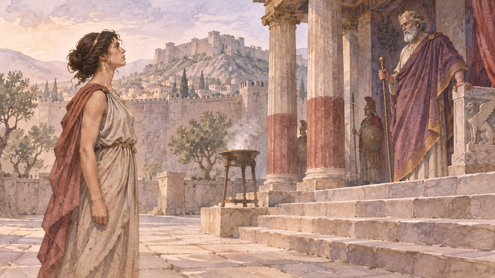

# 안티고네 — 왕의 명령으로 장례를 금할 수 있을까

*소포클레스의 비극에서 장례와 통치, 듣는 능력을 묻기*

Culture · Literature

> 자료 대조를 마친 검토용 이야기입니다. 공개 게시 승인은 아직 받지 않았습니다.

*AI 관련 장면 삽화 · 작품과 장소를 떠올리기 위한 상상 그림이며 실제 사진·배우 초상·정확한 복원이나 설계도가 아닙니다.*

도시를 공격한 사람의 시신을 묻지 말라는 명령이 내려진다. 그런데 그 죽은 이는 한 여성의 오빠이기도 하다. 소포클레스의 『안티고네』는 공동체의 질서와 가족의 의무가 충돌할 때 누가 옳다고 말할 수 있는지 묻는다. 테베를 무대로 한 이 비극의 주요 사건과 결말을 따라가 보자.

## 01. 싸움이 끝난 도시에서 시작되는 갈등

오이디푸스의 두 아들 에테오클레스와 폴리네이케스는 서로 적이 되어 싸우다 함께 죽는다. 새 지배자 크레온은 도시를 지킨 쪽은 장례를 치르고, 공격한 폴리네이케스는 매장하지 못하게 한다. 죽은 두 사람의 몸에 서로 다른 정치적 의미가 부여된다.

안티고네에게 두 사람은 모두 오빠다. 크레온의 명령을 받아들이면 가족에게 해야 할 의무를 버리게 된다. 싸움은 끝났지만 죽은 사람을 어떻게 대할 것인지를 둘러싸고 새로운 싸움이 시작된다. 전쟁 뒤의 질서가 누구에게 어떤 고통을 요구하는지가 드러난다.

## 02. 같은 가족도 같은 선택을 하지는 않는다

안티고네는 자매 이스메네에게 함께 행동하자고 한다. 이스메네는 권력에 맞설 처지와 이미 가족이 겪은 파멸을 두려워한다. 두 자매의 대화는 용감한 사람과 비겁한 사람이라는 구분만으로 충분히 읽히지 않는다. 살아남아야 한다는 판단도 그들의 역사 속에서 나온다.

안티고네는 혼자라도 장례의 의무를 수행하려 한다. 그녀에게 그것은 왕이 허용하면 하고 금하면 멈추는 일이 아니다. 인간의 명령보다 오래된 신성한 의무가 있다고 믿기 때문이다. 법을 어기는 행동이 더 높은 규범에 대한 복종이라는 역전이 생긴다.

## 03. 숨기지 않는 사람이 권력 앞에 서다

경비병은 시신에 흙이 덮인 흔적을 발견한다. 뒤이어 붙잡힌 안티고네는 자신이 한 일을 부인하지 않는다. 몰랐다고 변명하거나 잘못을 용서해 달라고 말하지도 않는다. 그녀가 명령을 알면서도 어겼다는 사실이 대립을 더욱 날카롭게 만든다.

크레온은 자신의 지시가 무시되면 도시를 다스릴 권위가 무너진다고 생각한다. 그러나 명령을 지키게 하는 일과 그 명령이 옳은지 검토하는 일은 다르다. 그는 불복종을 개인적인 도전으로 받아들일수록 다른 판단을 들을 여유를 잃는다.

## 04. 아들의 충고가 닿지 않는 이유

크레온의 아들 하이몬은 안티고네와 결혼할 사이지만, 단순히 약혼자를 살려 달라고만 말하지 않는다. 시민들이 공개적으로 하지 못하는 다른 의견이 있음을 전한다. 통치자는 자기가 듣는 말이 도시 전체의 생각과 같지 않을 수 있음을 알아야 한다는 뜻이다.

크레온은 그 충고를 아들의 미숙함과 불복종으로 받아들인다. 대화는 점점 누가 누구를 가르칠 수 있는가 하는 싸움이 된다. 가족의 관계와 정치적 권위가 겹치면서, 가까운 사람의 말조차 내용보다 말한 사람의 지위로 평가된다.

작품에는 사건을 바라보고 노래하는 합창대도 있다. 이들은 주인공처럼 직접 결정을 내리지 않으면서 도시와 인간의 삶을 생각하게 한다. 인물의 대사만 따라 읽기보다 장면 사이의 목소리가 무엇을 두려워하고 어떻게 판단하는지 살피면 갈등의 범위가 넓어진다.

하이몬과 크레온의 다툼에서도 사랑과 정치가 단순하게 나뉘지 않는다. 아들은 아버지를 설득하려 하지만 아버지는 자기 편에 서는지가 먼저 중요해진다. 충고를 적대의 표시로 받아들이는 순간 대화의 문은 닫힌다. 가족 안의 장면이 통치의 문제를 보여 주는 이유다.

## 05. 살아 있는 사람을 무덤에 두다

안티고네에게 내려지는 처벌은 바위 동굴에 가두는 것이다. 죽은 사람에게 무덤을 주려던 사람 자신이 산 채로 죽음의 공간에 놓인다. 장례를 둘러싼 갈등이 삶과 죽음의 자리를 뒤집는 형태로 나타난다.

그녀는 마지막까지 한 가지 감정만 가진 철인처럼 행동하지 않는다. 결혼과 앞으로의 삶을 잃는 슬픔도 말한다. 자신의 선택을 옳다고 믿는다는 사실이 죽음을 두렵지 않게 만드는 것은 아니다. 확신과 상실이 함께 있을 때 인물의 결심은 더 무겁게 느껴진다.

## 06. 판단을 바꾸었을 때는 이미 늦었다

예언자 테이레시아스는 도시의 제의가 어긋나고 있음을 경고한다. 크레온은 처음에는 그 말도 의심하지만 결국 결정을 바꾼다. 폴리네이케스를 묻고 안티고네를 풀어 주려 한다. 비극은 끝까지 한 번도 마음을 바꾸지 않은 사람에게만 일어나는 것이 아니다.

동굴에 이르렀을 때 안티고네는 이미 죽어 있다. 하이몬도 목숨을 잃고, 소식을 들은 크레온의 아내 에우리디케까지 죽는다. 통치자는 명령을 거두었지만 관계를 되돌릴 수 없다. 판단의 수정에 필요한 시간이 다른 사람에게는 마지막 시간이었기 때문이다.

## 07. 옳은 말을 들을 자리를 남기기

『안티고네』를 한쪽이 완전히 옳고 다른 쪽은 아무 이유 없이 악하다는 이야기로 만들면 질문의 깊이가 줄어든다. 도시의 질서는 필요하지만 그 필요가 모든 명령을 옳게 하지는 않는다. 가족의 의무도 개인이 감당해야 할 큰 대가를 없애 주지 않는다.

특히 크레온의 비극은 듣는 능력의 실패와 연결된다. 자매와 경비병, 아들과 예언자의 말이 이어지는데도 대화가 판단을 고치는 기회가 되지 못한다. 고대의 무대는 법과 양심을 논하는 동시에, 다른 목소리가 들어올 틈을 권력이 어떻게 닫는지 보여 준다.

## 이야기의 바탕이 된 자료

- [Sophocles, Antigone, translated by F. Storr](https://raw.githubusercontent.com/GITenberg/Plays-of-Sophocles--Oedipus-the-King--Oedipus-at-Colonus--Antigone_31/master/31.txt) · 확인일 2026-11-06
  - 확인 내용: 두 형제·크레온의 명령·이스메네·장례·하이몬·동굴·테이레시아스·에우리디케와 결말

---

[같은 소주제의 이야기](README.md) · [전체 서가](../../README.md)
