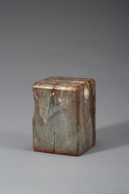

# 책에도 주인의 이름표를 찍어 두었다

*작은 연경재장서인이 알려주는 책과 도장의 관계*

Culture · Literature

> 출처 대조와 공개 게시 승인을 마친 이야기입니다. 실제 게시 여부는 사이트 배포 상태를 따릅니다.

*석제 연경재장서인 인장, 창덕7857 · 국립고궁박물관 소장·제공*

[이미지 출처·제작 근거](https://www.gogung.go.kr/gogung/pgm/psgudMng/view.do?menuNo=800065&psgudSn=363701) · 공공누리 제1유형(출처표시)

책을 빌려주기 전에 첫 장에 이름을 써 둔 경험이 있을 것이다. 나중에 돌아왔을 때 누구의 책인지 알아볼 수 있게 하려는 작은 표시다.

옛 책과 서화에서는 그런 역할을 하는 도장도 만난다. 장서인이다. 국립고궁박물관에는 ‘연경재장서인’이라는 글자를 새긴 돌도장이 있다.

사진 속의 몸체는 손에 들어올 만한 크기의 작은 돌이다. 그런데 그 도장이 남기는 글자에는 책이 머물던 곳의 이름이 들어 있다.

## 1. 도장을 찍으면 책의 자리가 남는다

박물관은 이 인장이 연경재에 소장한 서적과 서화 등에 찍던 것이라고 설명한다. 제목의 ‘장서’는 책을 모아 소장한다는 말이다. 도장은 작은 이름표가 되어 소장 관계를 드러냈다.

서명과 닮은 점도 있지만 한 번 새긴 글자를 여러 곳에 반복해 찍을 수 있다는 차이가 있다. 책이 여러 권이어도 같은 도장으로 표시할 수 있다. 손으로 매번 같은 글자를 쓰는 것과는 다른 재미다.

그렇다고 옛 책의 도장이 모두 같은 목적이었다고 생각할 필요는 없다. 이 이야기에서 살펴보는 것은 소장을 표시하는 장서인 한 점이다. 인장의 세계에는 국가 업무용 도장부터 개인이 쓰는 도장까지 여러 종류가 있었다.

## 2. 누구의 도장이었을까

이 인장의 사용자에 대해 박물관은 ‘헌종 추정’이라고 적어 둔다. 헌종이 사용했다고 확정하는 대신, 현재의 판단에 여지를 남긴 설명이다.

유물 이름이 또렷하게 적혀 있어도 그 이력의 모든 부분을 같은 정도로 아는 것은 아니다. 무엇이 새겨져 있는지와 누가 실제로 사용했는지는 다른 질문이기 때문이다.

박물관의 설명에는 헌종이 여러 옛 인장을 수집하고 감상했으며 개인용 인장도 사용했다는 이야기가 함께 나온다. 다만 그 일반적인 배경이 이 한 점의 사용자 추정을 확정으로 바꾸어 주는 것은 아니다.

우리가 챙길 것은 어려운 왕실 계보보다 이 작은 말의 차이다. ‘추정’이라는 두 글자를 그대로 두어도 도장을 구경하는 재미는 충분하다.

## 3. 책의 내용과 책을 가졌던 사람

같은 제목의 책이라도 어느 집이나 기관에 있었는지에 따라 서로 다른 흔적이 남을 수 있다. 장서인은 그 흔적 가운데 하나다. 본문을 읽는 사람에게는 저자의 문장이 먼저 중요하지만, 책을 물건으로 살펴보는 사람은 누가 소장하고 어떻게 옮겨 갔는지도 묻는다. 도장 하나가 그 두 번째 읽기를 열어 준다.

소유 표시가 있다고 책의 모든 이동 경로가 곧 완성되는 것은 아니다. 인장이 찍힌 때와 이후의 전래를 다른 자료와 비교해야 한다. 그래도 아무 흔적 없는 표면과는 질문의 출발점이 달라진다. 같은 글자가 다른 책에도 찍혀 있다면 어떤 묶음에 속했는지 살펴볼 가능성이 생긴다. 작은 표지가 소장의 관계를 이어 주는 것이다.

## 4. 돌에 새긴 글과 종이에 찍힌 글

인장은 새겨 둔 면에 색을 묻혀 다른 표면에 찍는 도구다. 손으로 매번 같은 글자를 쓰는 대신 같은 모양을 반복해서 남길 수 있다. 도장 자체의 조형과 찍힌 자국은 서로 다른 대상으로 볼 수 있다. 돌로 된 물건을 감상할 때와 책의 여백에서 인영을 찾을 때 눈여겨보는 점도 달라진다.

사진으로 인장을 만난다면 새겨진 면과 몸체, 잡는 부분을 구별해 볼 수 있다. 다만 이미지에서 보이는 글자를 그대로 읽었다고 실제 찍혔을 때의 방향까지 같은 것으로 여겨서는 안 된다. 사용해 남긴 자국과 도구의 상태를 함께 확인하면 더 정확하다. 물건의 모양이 행동을 거쳐 다른 기록으로 옮겨 가는 구조를 생각할 수 있다.

## 5. 연경재라는 이름이 알려 주는 범위

박물관은 연경재에 소장한 책과 서화에 사용한 인장이라고 설명한다. 이름은 소장 공간과 관계를 알려 주지만 개별 책마다 언제 누가 직접 찍었는지까지 기록하는 것은 아니다. 공간의 이름과 사용자의 이름도 언제나 같은 층의 정보는 아니다. 표시가 무엇을 가리키는지 먼저 구별하는 편이 좋다.

헌종의 인장 수집과 감상이라는 배경은 이 물건을 시대 안에 놓는 데 도움을 준다. 그러나 일반적인 배경만으로 한 점의 사용자까지 확정할 수는 없다. 박물관이 추정이라고 남긴 표현을 유지하면 이야기가 덜 재미있어지는 것이 아니다. 확실한 부분과 남은 질문을 함께 가진 물건으로 더 세밀하게 보게 된다.

## 6. 책은 읽는 동안에도 이력을 얻는다

오늘의 책에도 이름을 적거나 책갈피를 넣고 메모를 남긴다. 이것을 왕실의 장서인과 같은 제도라고 할 수는 없지만, 텍스트를 담은 물건에 사용자의 흔적이 더해진다는 점은 떠올릴 수 있다. 한 권이 같은 인쇄 내용만으로 설명되지 않는 이유다. 읽고 보관하고 건네는 행동이 책의 시간을 늘린다.

장서인을 보았을 때에는 글자 모양을 살핀 뒤 어디에 사용했다고 설명하는지 읽어 보자. 인장의 재료와 새김은 제작을, 소장 표시는 책과 사람의 관계를 보여 준다. 독서의 역사는 무엇을 읽었는지만이 아니라 어떤 물건을 모으고 알아보며 보관했는지도 포함한다. 작은 돌 도장에 그런 주변의 시간이 담겨 있다.

## 7. 책의 내용 바깥에도 이야기가 있다

책에서 읽을거리는 본문에만 있는 것이 아니다. 이름을 적은 자리, 소장 표시, 누군가 남긴 메모도 그 책이 지나온 시간을 생각하게 한다.

장서인을 보면 글자를 읽는 방식도 달라진다. 문장의 뜻만 이해하려는 것이 아니라, 왜 그 자리에 그 이름을 남겼는지 궁금해진다. 같은 책이라도 누구의 책장에 있었는지가 또 하나의 이야기가 될 수 있다.

다음에 오래된 책의 첫 장에서 작은 인장을 발견한다면 본문으로 바로 넘어가기 전에 잠깐 보아도 좋겠다. 책에 담긴 이야기 옆에, 책을 가지고 있던 사람의 흔적이 찍혀 있을지도 모른다.

## 이야기의 바탕이 된 자료

- [국립고궁박물관 — 석제 연경재장서인 인장(창덕7857)](https://www.gogung.go.kr/gogung/pgm/psgudMng/view.do?menuNo=800065&psgudSn=363701) · 확인일 2026-10-27
  - 확인 내용: 연경재에 소장한 서적·서화에 사용한 장서인 / 돌로 만든 인장과 크기 / 사용자를 헌종으로 추정한다는 설명

---

[같은 소주제의 이야기](README.md) · [전체 서가](../../README.md)
