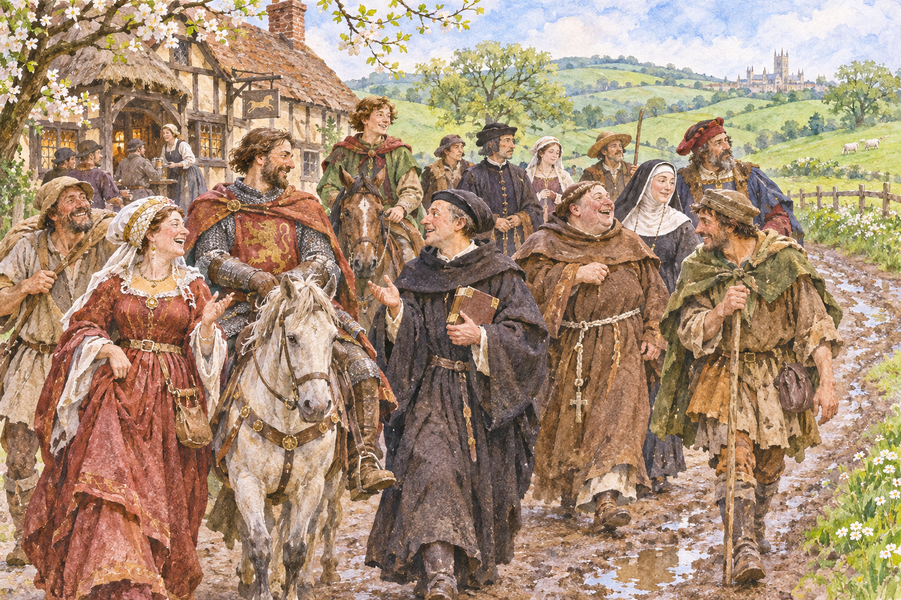

# 캔터베리 이야기 — 순례길에서는 누가 이야기를 잘했을까

*초서의 순례 액자와 금화를 발견한 세 젊은이의 비극*

Culture · Literature

> 자료 대조를 마친 검토용 이야기입니다. 공개 게시 승인은 아직 받지 않았습니다.

*AI 이야기 장면 삽화 · 작품·역사적 상황을 떠올리기 위한 그림이며 실제 사진이나 정확한 복원이 아닙니다.*

여행길에 처음 만난 사람들이 차례로 이야기를 들려준다. 누군가는 고상한 사랑을 말하고 누군가는 남을 속이는 우스운 사건을 꺼낸다. 제프리 초서의 『캔터베리 이야기』는 목적지에 도착하는 과정만큼이나 길 위에서 서로 말하고 반응하는 일이 중요한 작품이다.

제목만 보면 성스러운 순례에 관한 책 같지만, 그 안에는 돈과 욕망, 직업의 자부심과 남의 허물을 들추는 웃음이 가득하다. 큰 구성을 먼저 살펴보고 「면죄부 판매인의 이야기」를 따라 읽으면 중세 문학이 예상보다 훨씬 시끌벅적하게 다가온다. 아래에는 주요 이야기의 결말도 포함된다.

## 01. 순례자들은 왜 캔터베리로 향했을까

순례자들의 목적지는 토머스 베켓의 성지가 있는 캔터베리다. 그러나 출발부터 기도만 하는 행렬은 아니다. 런던 남쪽 서더크의 태버드 여관에 모인 이들은 함께 길을 가며 시간을 보낼 방법을 찾는다. 여관 주인이 이야기 경연을 제안하면서 여행과 문학이 한 틀 안에 들어온다.

이 구조를 액자 이야기라고 부른다. 바깥에는 여행하는 사람들의 상황이 있고 안쪽에는 각자가 들려주는 사건이 있다. 그래서 같은 이야기도 누가 언제 말하느냐에 따라 의미가 달라진다. 독자는 줄거리만이 아니라 이야기하는 사람과 듣는 사람 사이의 관계까지 읽게 된다.

## 02. 기사와 방앗간 주인이 같은 길에 서다

이 여행에는 기사와 수도자, 상인과 여러 직업의 사람들이 등장한다. 그들의 옷차림과 말투, 자랑거리와 약점은 서두부터 드러난다. 중세 사회를 몇 개의 신분 이름으로만 외울 때보다 구체적인 사람들이 보인다. 다만 이들이 당시 사회의 모든 계층을 빠짐없이 대표하는 것은 아니다.

초서는 인물을 소개하면서 겉으로 칭찬하는 말 안에 의심할 단서를 심기도 한다. 화자가 좋다고 말한다고 독자도 곧이곧대로 믿을 필요는 없다. 직업이 내세우는 이상과 실제 행동 사이의 틈을 발견하는 것이 이 작품의 중요한 재미다.

## 03. 순서는 정해져 있어도 말은 계획대로 흐르지 않는다

처음 제안된 경연에는 길을 오가며 여러 이야기를 하겠다는 큰 계획이 있었다. 하지만 남아 있는 작품이 그 계획을 모두 채운 것은 아니다. 『캔터베리 이야기』를 처음부터 완벽하게 닫힌 하나의 장편 줄거리처럼 기대하면 특유의 느슨함을 이해하기 어렵다.

사람들은 남의 이야기에 반응하고 끼어들며 때로는 맞받아친다. 점잖은 이야기 다음에 거친 웃음이 나오는 식이다. 경연이라는 규칙 안에서 실제 사람들의 경쟁심이 흘러넘친다. 그 덕분에 이야기를 모아 둔 책이면서도 함께 여행하는 현장처럼 느껴진다.

## 04. 탐욕을 꾸짖는 사람이 먼저 자신을 드러낸다

면죄부 판매인은 탐욕을 경계하는 설교를 하면서도 자신은 돈을 원한다고 드러내는 인물이다. 그의 말과 동기는 서로 어긋난다. 독자는 좋은 교훈을 듣기 전에 그 교훈을 이용해 이익을 얻는 사람이 누구인지부터 보게 된다.

여기서 작품을 당시 모든 종교인을 한꺼번에 공격하는 글로 단순화할 필요는 없다. 중요한 것은 성스러운 권위의 말도 현실에서는 거래의 수단이 될 수 있다는 관찰이다. 설교 내용이 옳다는 사실과 설교하는 사람을 믿을 수 있다는 사실은 같지 않다.

## 05. 죽음을 찾아 나선 세 사람은 금을 만난다

그가 들려주는 이야기에서 세 젊은이는 친구를 죽였다는 죽음을 찾아 나선다. 길에서 만난 노인은 나무가 있는 곳을 가리킨다. 그런데 그곳에는 눈에 보이는 죽음 대신 금화가 쌓여 있다. 분노하며 출발한 세 사람의 관심은 순식간에 재물로 옮겨 간다.

금을 옮길 방법을 의논하면서 그들의 우정도 무너진다. 한 사람이 먹을 것과 술을 사러 간 사이 남은 둘은 돌아온 그를 없애고 몫을 늘리려 한다. 밖으로 나간 사람도 독을 이용해 금을 독차지할 생각을 한다. 같은 목적을 가진 동료가 서로의 장애물이 된다.

## 06. 죽음은 금화 곁에서 모습을 드러낸다

돌아온 사람은 두 동료에게 살해당하고, 살아남은 둘도 독이 든 술을 마셔 죽는다. 죽음을 없애겠다는 사람들 모두가 죽음에 이른다. 이야기 처음의 위협이 마지막에 다른 모습으로 돌아오는 구성이다. 금 자체가 마법을 부린 것이 아니라 그것을 대하는 행동이 파국을 만든다.

교훈은 분명해 보이지만 그것으로 바깥의 순례길까지 정리되지는 않는다. 이 교훈을 들려준 사람 자신이 탐욕스럽다는 사실이 남기 때문이다. 이야기는 탐욕을 경계하게 하고, 액자는 그 경계를 입에 올리는 권위도 다시 살피게 한다. 두 층이 함께 작동한다.

## 07. 중세의 길에서 오늘의 독자가 듣는 것

『캔터베리 이야기』를 읽을 때에는 어느 인물이 초서 자신의 의견을 그대로 말한다고 서둘러 결정하지 않는 것이 좋다. 작가는 서로 다른 목소리를 부딪치게 하면서 독자가 그 차이를 알아차리도록 한다. 순례길은 하나의 정답을 전달하는 줄이 아니라 여러 사람이 말할 차례를 얻는 자리다.

여행의 틀이 없었다면 이 작품은 서로 다른 교훈을 모은 책처럼 읽혔을 수도 있다. 하지만 듣는 이들의 반응이 들어오면서 말은 곧 행동이 된다. 어떤 이야기를 골라 꺼냈는지가 이야기꾼 자신의 성격을 드러내는 방식이기도 하다.

성지로 향하는 길 위에서도 사람은 허세를 부리고 돈을 탐내며 남의 말을 웃어넘긴다. 그 생활의 구체성이 작품을 오래 살아 있게 한다. 순례의 역사와 이야기꾼들의 경쟁을 함께 보면 이 책은 먼 시대의 교재를 넘어 사람들 사이에 앉아 듣는 문학이 된다.

## 이야기의 바탕이 된 자료

- [Geoffrey Chaucer, The Canterbury Tales and Other Poems, General Prologue / The Pardoner’s Tale](https://raw.githubusercontent.com/GITenberg/The-Canterbury-Tales-and-Other-Poems_2383/master/2383.txt) · 확인일 2026-11-05
  - 확인 내용: 순례의 틀·태버드 여관·주인의 경연 제안·직업별 인물과 상호 반응, 면죄부 판매인의 고백 및 세 젊은이의 금화·살인·독살 결말

---

[같은 소주제의 이야기](README.md) · [전체 서가](../../README.md)
