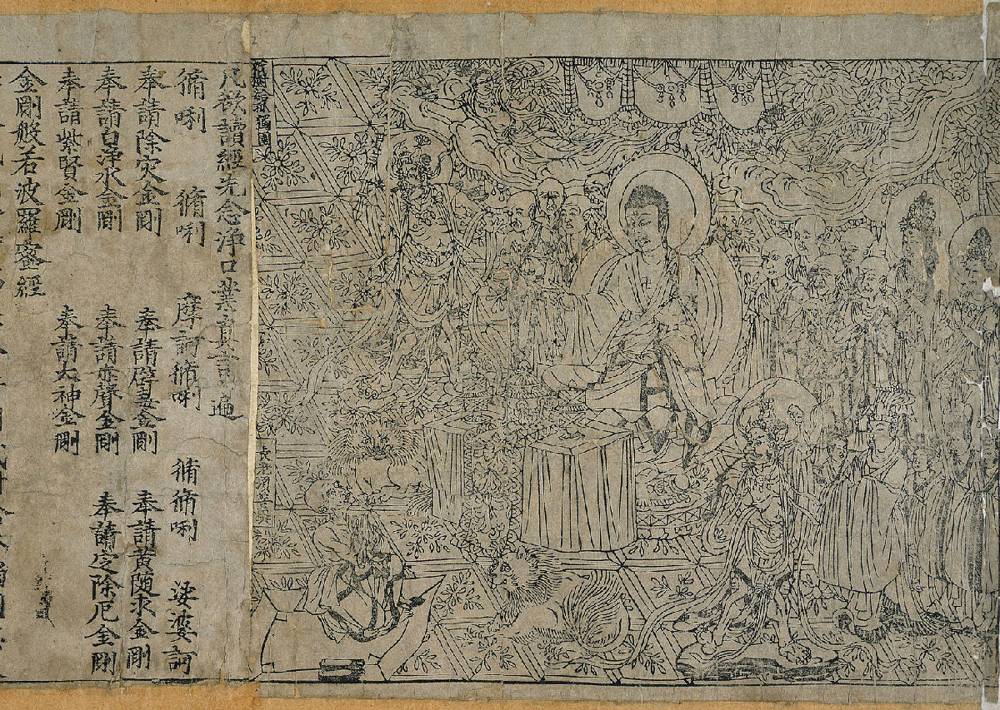

# 『금강경』 — 천 년 전의 책은 어떻게 여러 독자를 만났을까

*868년 인쇄본 한 장에서 만나는 믿음과 목판의 힘*

Culture · Literature

> 출처 대조와 공개 게시 승인을 마친 이야기입니다. 실제 게시 여부는 사이트 배포 상태를 따릅니다.

*British Library의 금강경 도판 · OpenStax 교재에 수록된 편집본*

[이미지 출처·제작 근거](https://raw.githubusercontent.com/openstax/osbooks-world-history/main/media/OSX_WorldHist_A12_01_Jingangjin.jpg) · 원본 도판 Public Domain

오래된 책의 첫 장에서 사람들은 한 인물의 말을 듣고 있다. 불교 경전 『금강경』의 868년 인쇄본에 실린 그림이다. 장면은 조용하지만, 그 그림과 글을 여러 장 찍어 낼 수 있었다는 사실까지 생각하면 종이 한 장이 조금 다르게 보인다.

오늘은 글을 복사하는 데 큰 결심이 필요하지 않다. 그러나 한 권씩 손으로 옮겨 적던 세계에서는 같은 내용을 여러 사람에게 전하는 일이 많은 시간을 요구했다. 이 오래된 인쇄본은 책의 내용뿐 아니라 책이 사람을 찾아가는 방식도 함께 생각하게 한다.

## 01. 경전은 읽는 내용이면서 전하는 물건이었다

당대 중국에서 불교는 신앙과 사상, 생활의 여러 영역에 영향을 미쳤다. 경전을 배우고 전하는 일도 그 확산의 일부였다. 글을 이해하는 사람과 직접 읽지 못하는 사람, 가르치는 사람과 배우는 사람이 각기 다른 방식으로 경전과 만났다.

여기서 인쇄를 곧바로 모든 사람의 독서로 연결할 필요는 없다. 책이 늘어난다고 문해력과 접근 조건이 한꺼번에 같아지지는 않는다. 그래도 같은 글을 더 많이 만들 수 있다는 변화는 배움과 신앙의 통로를 넓히는 중요한 조건이었다.

## 02. 글자를 거꾸로 새기는 수고

목판 인쇄는 나무판에 글과 그림을 새기고 먹을 묻혀 종이에 찍는 방식이다. 찍힌 결과가 바르게 읽히려면 판의 형상은 반대로 준비되어야 한다. 편하게 보이는 한 장 뒤에 먼저 거꾸로 생각하고 새기는 일이 놓여 있다.

글을 쓴 사람만으로 책이 만들어지지 않는 이유도 여기에 있다. 판을 다루는 사람과 종이, 먹, 작업의 질이 함께 결과를 결정한다. 인쇄는 손의 노동을 없앤 마법이라기보다, 많은 준비를 바탕으로 같은 내용을 되풀이해 만들 수 있게 한 작업 방식이었다.

## 03. 그림도 함께 여행할 수 있었다

함께 실은 실제 도판에는 부처와 그 말을 듣는 이들의 모습이 담겨 있다. 글줄만으로 이루어진 책이 아니라 그림을 통해 내용을 만날 수 있는 물건이었던 것이다. 인쇄는 글자뿐 아니라 장면을 반복해서 전하는 방법이기도 했다.

그림을 볼 때는 먼저 가운데와 주변의 관계를 살펴보자. 누가 말하고 누가 귀를 기울이는지 눈으로 따라갈 수 있다. 모든 인물의 명칭을 바로 외우지 않아도 된다. 한 장이 어떻게 독자의 주의를 이끄는지 보는 것만으로도 오래된 책을 읽는 길이 열린다.

## 04. 날짜가 남으면 물건의 시간이 보인다

이 인쇄본이 자주 소개되는 이유 가운데 하나는 868년이라는 제작 시점을 알 수 있다는 점이다. 막연히 오래된 책이라고 부를 때와 특정한 시기의 물건으로 바라볼 때는 역사 속 자리가 달라진다. 당대의 신앙과 제작 기술이라는 맥락 속에 놓을 수 있다.

다만 이것을 인류가 처음으로 무언가를 인쇄한 순간이라고 단정해서는 안 된다. 남아 있는 자료와 처음 발명된 때는 같은 질문이 아니다. 가장 오래되었다는 순위를 서둘러 붙이기보다, 이 자료가 무엇을 확실하게 보여 주는지 살피는 편이 더 많은 것을 알려 준다.

## 05. 복제가 가능해져도 모든 차이가 사라지지는 않는다

같은 판을 사용하면 같은 내용을 반복해서 찍을 수 있다. 그러나 종이의 상태와 먹의 농도, 판의 마모, 보존 과정은 개별 인쇄물의 모습에 영향을 줄 수 있다. 오늘의 복사본을 떠올리되 완전히 동일한 작업 환경이었다고 생각하지 않는 것이 좋다.

원본과 복제라는 말도 여기서는 조금 복잡해진다. 인쇄된 책은 처음부터 여러 장을 만들기 위해 준비된 물건이다. 똑같은 내용이 있다는 이유로 한 장의 가치가 사라지는 것이 아니라, 어떻게 찍히고 남았는지가 다시 그 물건의 이력이 된다.

## 06. 인쇄의 발전과 신앙의 역사는 한 방향이 아니었다

당대에 불교가 널리 퍼졌다고 해서 국가와 언제나 편안한 관계를 유지한 것은 아니다. OpenStax는 9세기 중엽 불교의 영향력을 둘러싼 긴장과 탄압도 함께 설명한다. 경전의 보급이라는 밝은 장면만 이어 놓으면 그 경전을 둘러싼 사람들의 불안한 처지는 보이지 않게 된다. 책의 역사는 기술의 발전과 정치의 변화가 만나는 곳이다.

이 인쇄본 한 점이 그 모든 갈등의 직접적인 현장을 보여 준다고 말할 수는 없다. 다만 같은 시대에 여러 흐름이 함께 있었다는 맥락을 제공한다. 남아 있는 책을 보며 왜 만들었는지만 묻는 데서 한 걸음 더 나아가, 어떻게 전해지고 어떤 환경에서 남을 수 있었는지도 생각하게 된다. 종이 한 장의 생존도 당연한 결과는 아니었다.

## 07. 책 한 장에서 사람들의 연결을 보기

이야기의 끝에서 다시 도판을 보자. 부처의 말을 듣는 인물들 바깥에도 보이지 않는 사람들이 있다. 글을 전하고, 판을 새기고, 종이를 마련하고, 책을 보관한 사람들이다. 한 장의 책은 여러 역할이 만난 결과로 남았다.

중국의 오래된 인쇄 문화를 읽는 즐거움은 발명의 순위를 외우는 데만 있지 않다. 누군가 중요하다고 여긴 말을 더 멀리 보내려 했다는 사실에 있다. 화면에서 이 그림을 만나는 지금의 우리도, 매체는 달라졌지만 그 긴 전달의 맨 뒤에 잠시 서 있는 셈이다.

그림의 가장자리와 이어지는 선도 함께 살펴보자. 내용과 제작, 감상과 전달이 만나는 지점이다. 오래된 책의 가치는 글을 이해하는 사람에게만 열리는 것이 아니라, 그 물건이 만들어진 방식을 바라보는 사람에게도 열려 있다.

## 이야기의 바탕이 된 자료

- [OpenStax World History — The Indian Ocean World in the Early Middle Ages](https://raw.githubusercontent.com/openstax/osbooks-world-history/main/modules/m00153/index.cnxml) · 확인일 2026-11-01
  - 확인 내용: 당대 불교와 경전 필사·전파의 맥락 / 목판에 거울상으로 새기고 먹을 묻혀 종이에 찍는 과정 / 868년 금강경 인쇄본과 불교 장면 도판; 최초 발명 또는 모든 계층의 독서를 단정하지 않음

---

[같은 소주제의 이야기](README.md) · [전체 서가](../../README.md)
