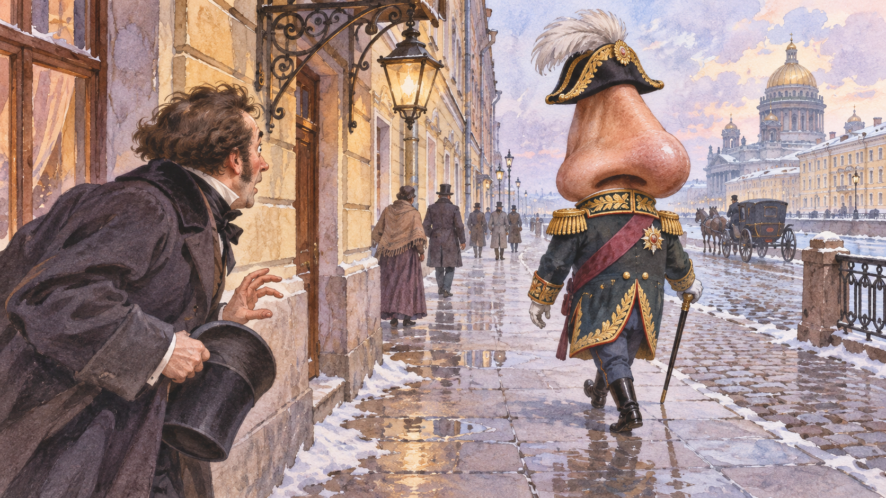

# 고골의 코 — 얼굴에서 사라진 코가 나보다 높은 관리라면

*관등과 체면, 절차와 환상이 만난 페테르부르크의 풍자*

Culture · Literature

> 자료 대조를 마친 검토용 이야기입니다. 공개 게시 승인은 아직 받지 않았습니다.

*AI 이야기 장면 삽화 · 작품을 떠올리기 위한 상상 그림이며 실제 사진·배우 초상·정확한 복원이 아닙니다.*

어느 아침 이발사는 빵 속에서 코를 발견하고, 한 관리는 자기 얼굴에서 코가 사라진 것을 알게 된다. 고골의 「코」는 설명하기 어려운 사건을 매우 구체적인 일상의 말투로 전한다. 웃음이 나는 동안 신분과 체면을 둘러싼 질서가 드러난다. 아래에는 사건의 전개와 결말이 포함된다.

## 01. 빵과 거울에서 시작되는 이상한 아침

이발사 이반 야코블레비치는 평범한 식사 중 있을 수 없는 것을 발견한다. 그는 그것이 자기가 면도해 주던 사람의 코임을 알아보고 두려워한다. 무엇이 일어났는지보다 누가 자신을 의심할지, 어떻게 치워야 할지를 먼저 걱정한다.

한편 코발료프는 거울을 보고 자기 코가 없어진 사실을 안다. 몸의 일부가 사라졌다는 충격은 곧 사람들 앞에 나설 수 없다는 문제로 이어진다. 작품은 환상적인 사건을 경찰과 직업, 외모와 평판이라는 익숙한 관계 안에 놓는다.

## 02. 관등과 호칭이 사람을 설명하다

코발료프는 자신을 더 그럴듯하게 보이게 하는 호칭을 좋아한다. 그에게 신분은 이름 앞에 붙는 말 이상이다. 누구를 만나고 어떤 기회를 얻을지, 결혼을 어떻게 생각할지도 체면과 연결된다. 코의 상실이 그에게 특별히 큰 사회적 재난이 되는 이유다.

여기서 웃음은 인물 한 사람을 놀리는 데만 있지 않다. 다른 사람이 나를 어떤 직함과 모습으로 볼 것인지에 삶의 많은 부분이 걸린 질서를 비춘다. 얼굴에서 작은 부분이 사라졌는데 사회 전체와의 관계가 흔들리는 과장이 풍자를 만든다.

## 03. 자기 코에게 공손하게 말을 걸다

코발료프는 거리를 다니는 자기 코를 본다. 그런데 코는 관복을 입고 자신보다 높은 지위의 인물처럼 행동한다. 원래 몸의 일부였던 것이 이제는 독립된 권위가 되었다. 주인은 자기 소유를 돌려 달라고 요구해야 하지만 상대의 지위 앞에서 말을 고른다.

코는 그와의 관계를 인정하지 않는다. 독자는 이 상황의 불가능함을 알면서도 호칭과 예의가 작동하는 방식은 익숙하게 느낀다. 무엇이 사람을 높은 사람으로 보이게 하는지, 사람들이 어떤 표지를 보고 복종하는지가 기묘하게 드러난다.

몸의 일부가 자기보다 높은 관등의 모습으로 나타난다는 설정은 우연한 장식이 아니다. 코발료프가 평소 중요하게 생각하던 기준이 자기 문제를 해결하는 순간에도 장애물이 된다. 상대의 정체를 알고 있다고 생각하면서도 외형이 나타내는 권위 앞에서 망설이는 것이다.

이 장면을 읽을 때에는 코가 어떻게 걷는지를 현실적으로 복원하려 애쓰지 않아도 된다. 작품은 옷과 이동, 말투와 예의라는 구체적인 표지를 통해 불가능한 존재를 사회 안에서 작동하게 한다. 환상은 현실을 완전히 버린 세계가 아니라 현실의 규칙 일부를 극단까지 밀어붙인 세계다. 독자는 그 불가능함에 웃으면서도 사람들이 지위의 표지를 알아보는 방식은 낯설지 않다고 느낄 수 있다. 익숙한 체계가 기이한 몸을 통해 새롭게 드러나는 순간이다.

## 04. 도움을 청할 곳마다 다른 논리가 있다

코발료프는 소문을 내거나 문제를 해결하려고 여러 곳을 찾는다. 신문 광고를 통해 알리고 싶지만 신문의 체면과 운영 논리가 그 요청을 막는다. 절박한 개인의 사건이 기관의 관례 속에서는 다른 종류의 문제가 된다.

의사에게 가도 원하는 해결을 얻지 못한다. 코가 없다는 사실이 너무 이상해서 설명되지 않는 동안, 주변 사람들은 저마다 익숙한 방식으로 반응한다. 세계 전체가 멈추기보다 일상의 절차가 기이한 사건을 둘러싸고 계속 돌아가는 점이 더 우스우면서 불편하다.

## 05. 돌아온 코도 곧바로 돌아갈 자리는 없다

경찰을 통해 코를 돌려받는 과정에서도 사건은 깔끔하게 해결되지 않는다. 코가 손에 있다고 얼굴에 다시 붙일 수 있는 것은 아니기 때문이다. 원래의 물건을 찾았다는 사실과 원래 상태를 회복했다는 사실은 다르다.

코발료프는 누가 자신에게 이런 일을 했을지 의심하며 원인을 찾으려 한다. 그러나 작품은 독자가 납득할 만한 한 가지 인과관계를 제공하지 않는다. 무언가를 되찾기 위한 행동은 계속되지만 그 행동의 합리성이 기이한 세계 전체를 바로잡지는 못한다.

## 06. 어느 날 다시 코가 있다

마침내 코는 처음부터 아무 일도 없었던 것처럼 얼굴로 돌아온다. 코발료프는 기뻐하며 일상으로 복귀한다. 왜 사라졌고 왜 돌아왔는지에 대한 충분한 설명은 남지 않는다. 사건의 해결과 사건의 이해가 서로 갈라진다.

달라진 일을 겪었다고 인물의 가치관이 크게 바뀌었다고 단정하기도 어렵다. 그는 다시 자신을 보이고 사람들을 만나며 이전의 관심을 이어 간다. 풍자는 교훈을 얻은 주인공의 성장으로 정리되지 않는다. 익숙한 사회가 계속된다는 사실이 결말의 한 부분이다.

## 07. 서술자까지 고개를 갸웃하는 이야기

끝부분의 서술자는 이 이야기가 왜 그렇게 되었는지 스스로 이상하게 여기는 태도를 보인다. 읽는 사람의 의문을 미리 말하면서도 제대로 설명하지 않는다. 작품은 진짜 있었던 사건처럼 세부를 쌓다가 그럴듯함의 바닥을 흔든다.

「코」는 황당한 일을 상상하는 재미에 더해 권위가 어떤 모습으로 통용되는지 묻는다. 코가 높은 관리처럼 보이면 사람들은 그 앞에서 지위를 의식한다. 현실의 규칙을 지키는 말투가 불가능한 상황과 만날 때, 고골의 풍자는 아주 낯설고도 알아볼 수 있는 얼굴을 얻는다.

## 이야기의 바탕이 된 자료

- [Nikolai Gogol, The Nose, in The Mantle and Other Stories, translated by Claud Field](https://raw.githubusercontent.com/GITenberg/The-Mantle-and-Other-Stories_36238/master/36238-8.txt) · 확인일 2026-11-06
  - 확인 내용: 이발사와 빵·코발료프(Kovaloff)·관등과 호칭·관복 입은 코·신문/의사/경찰·돌아온 코·서술자의 결말

---

[같은 소주제의 이야기](README.md) · [전체 서가](../../README.md)
