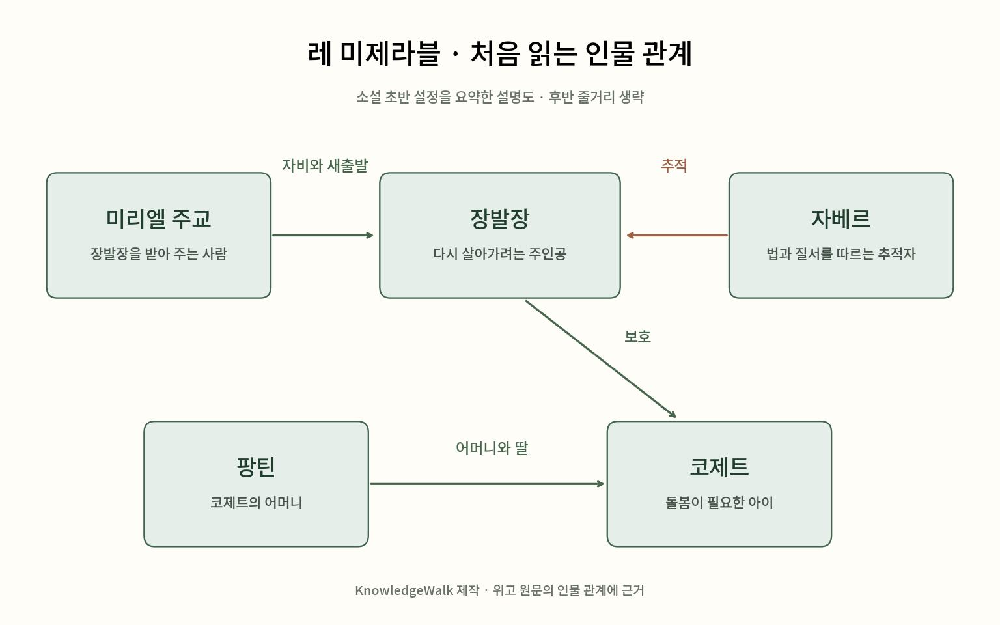

# 레 미제라블 — 빵 한 조각에서 시작된 긴 질문

*장발장은 어떻게 다시 살아갈 사람이 되었을까*

Culture · Literature

> 자료 대조를 마친 검토용 이야기입니다. 공개 게시 승인은 아직 받지 않았습니다.

*KnowledgeWalk 제작 · 작품 원문·악보에 근거한 읽기·감상 길잡이. 원본 표지·역사적 자료·완전한 연주용 악보를 복제한 이미지가 아닙니다.*

[이미지 출처·제작 근거](https://raw.githubusercontent.com/GITenberg/Les-Mis-rables_135/master/135-0.txt) · KnowledgeWalk 직접 제작 설명도

빵을 훔친 사람이 있다. 굶주린 가족을 먹이려던 일이었지만 그는 감옥에 갔고, 여러 번의 탈옥 시도로 형기는 더 길어졌다. 오랜 수감 끝에 밖으로 나와서도 전과자라는 표지는 쉽게 떨어지지 않는다. 『레 미제라블』의 장발장이 서 있는 출발점이다.

빅토르 위고의 소설은 한 사람의 범죄 이력만으로 그 사람이 누구인지 다 알 수 있느냐고 묻는 작품으로 읽을 수 있다. 이름은 익숙하지만 방대한 분량이 부담스럽다면, 처음에는 장발장을 대하는 서로 다른 두 사람의 시선부터 따라가 보자.

## 문을 열어 준 사람

장발장을 받아 준 미리엘 주교의 집에서도 사건이 생긴다. 장발장이 은식기를 가져갔다가 붙잡혀 돌아오는 것이다. 그런데 주교는 그것을 자신이 준 것이라고 말하며 은촛대까지 더해 준다. 소설 초반의 이 장면은 이후 장발장의 삶에 중요한 흔적을 남긴다.

처벌받을 일을 아무렇지 않게 넘기는 장면이라고만 읽을 수도 있다. 하지만 주교는 장발장을 이미 끝난 사람으로 대하지 않는다. 그가 다른 삶을 시작할 수 있다고 믿는 쪽을 택한다. 소설이 독자에게 보여 주는 것은 법 조항 하나로는 다 담기지 않는 인간의 가능성이다.

## 자베르는 단순한 악당일까

장발장을 추적하는 자베르는 질서와 법을 중요하게 여기는 인물이다. 그래서 처음에는 주인공을 괴롭히는 악역처럼 보이기 쉽다. 그러나 법을 지키려는 사람이 왜 다른 인간을 이해하는 데 막히는지 살피면 갈등이 조금 더 깊어진다.

장발장의 삶이 달라져도 과거의 기록은 남는다. 자베르에게 그 기록은 판단의 단단한 근거다. 독자는 두 인물 사이에서 죄를 기억하는 일과 사람이 바뀔 수 있음을 인정하는 일이 어떻게 충돌하는지 보게 된다. 누가 옳다는 한 줄의 답보다 그 사이의 긴장이 소설을 움직인다.

## 장발장만의 이야기를 넘어

팡틴과 그의 딸 코제트, 청년 마리우스 등이 등장하면서 이야기는 가난과 돌봄, 사랑과 사회의 문제로 넓어진다. 제목도 한 사람의 이름이 아니다. 여러 비참한 처지의 사람들을 가리키는 말이라고 생각하면, 왜 이렇게 많은 인물의 삶이 들어 있는지 이해하기 쉽다.

시대 배경도 구분해 두면 도움이 된다. 후반의 파리 봉기를 곧바로 1789년 프랑스혁명과 같은 사건으로 생각해서는 안 된다. 원문에는 1832년 6월의 날짜가 명시된다. 혁명 이후에도 불평등과 갈등이 계속된 사회 속에서 인물들이 움직이는 것이다.

## 처음 읽는다면 이 질문 하나

책은 1862년에 나온 작품이며, 서문 역시 그 시대의 사회적 고통을 정면으로 언급한다. 그렇다고 등장인물들이 어떤 주장을 설명하기 위한 종이 인형만은 아니다. 망설이고 잘못 판단하고 누군가를 돌보는 구체적인 장면들이 긴 이야기를 떠받친다.

처음 읽을 때 모든 역사적 설명과 인물 관계를 한 번에 외울 필요는 없다. 이 사람을 과거의 잘못만으로 판단해도 되는가라는 질문을 옆에 두어 보자. 소설의 결말을 미리 알아내지 않아도, 장발장이 누군가의 문 앞에 서는 첫 장면부터 작품의 큰 질문에 들어갈 수 있다.

## 이야기의 바탕이 된 자료

- [빅토르 위고 — Les Misérables, 이사벨 햅굿 영문 번역 원문](https://raw.githubusercontent.com/GITenberg/Les-Mis-rables_135/master/135-0.txt) · 확인일 2026-10-29
  - 확인 내용: 장발장의 빵 절도·수감·석방과 미리엘 주교의 은식기·촛대 장면 / 자베르·팡틴·코제트·마리우스 관계와 인물의 행위 / 원문 서문 1862년 및 제4부의 1832년 6월 봉기 날짜

---

[같은 소주제의 이야기](README.md) · [전체 서가](../../README.md)
