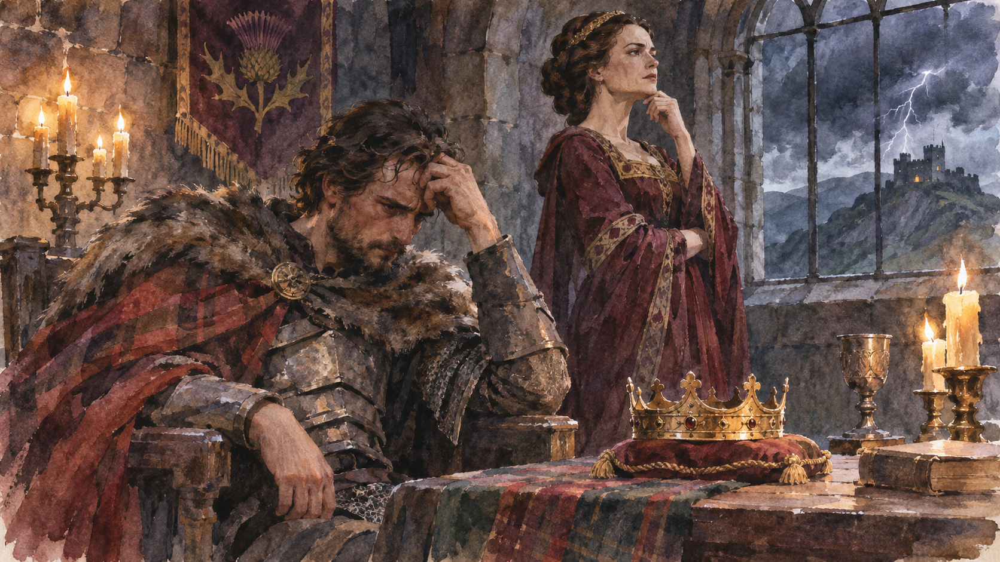

# 맥베스 — 예언은 누구의 손으로 현실이 되었을까

*셰익스피어의 비극에서 예언·불안·권력·선택을 따라가기*

Culture · Literature

> 출처 대조와 공개 게시 승인을 마친 이야기입니다. 실제 게시 여부는 사이트 배포 상태를 따릅니다.

*AI 관련 장면 삽화 · 작품과 장소를 떠올리기 위한 상상 그림이며 실제 사진·배우 초상·정확한 복원이나 설계도가 아닙니다.*

왕이 될 것이라는 말을 들은 사람이 있다. 그는 그 말을 기다리는 대신 직접 실현하려 한다. 셰익스피어의 『맥베스』는 예언이 맞는지 확인하는 이야기이면서, 미래에 관한 말을 들은 사람이 현재의 책임을 어떻게 바꾸는지 보여 주는 비극이다. 아래에는 주요 사건과 결말이 포함된다.

## 01. 전쟁에서 돌아오는 길의 세 목소리

스코틀랜드의 장군 맥베스와 뱅코는 전투 뒤 기이한 존재들을 만난다. 맥베스에게는 새로운 지위와 왕위가, 뱅코에게는 후손이 왕이 될 미래가 제시된다. 두 사람이 듣는 약속은 서로 다르다. 미래의 영광은 처음부터 우정 안에 경쟁의 가능성을 심는다.

예고된 지위 하나가 실제로 주어지자 나머지 말도 믿을 만하게 느껴진다. 그러나 일부가 맞았다는 사실이 모든 행동을 정당하게 만들지는 않는다. 맥베스는 아직 일어나지 않은 일을 상상하면서, 지금 자신이 해야 할 일과 해서는 안 될 일의 경계를 흔들기 시작한다.

## 02. 손님으로 온 왕을 대하는 부부

던컨 왕이 맥베스의 성에 온다. 맥베스는 왕의 신하이면서 그를 보호해야 할 주인이다. 왕을 해치지 말아야 할 이유를 스스로 알고 있지만, 왕위를 얻고 싶은 마음도 버리지 못한다. 작품은 처음부터 양심이 없는 악인을 보여 주는 대신, 알면서도 선택하는 사람을 보여 준다.

맥베스 부인은 망설이는 남편을 밀어붙인다. 부부의 대화에서는 용기와 남자다움이라는 말이 도덕적인 주저함을 누르는 데 사용된다. 결국 던컨은 죽고, 달아난 왕자들에게 의심이 향하는 틈에 맥베스는 왕이 된다. 예언은 저절로 성취된 것이 아니다.

## 03. 왕이 된 뒤에 더 커지는 불안

왕관을 얻었다고 불안이 끝나지는 않는다. 뱅코의 후손이 왕이 된다는 말이 남아 있기 때문이다. 맥베스는 자기가 얻은 왕위가 다른 가문의 미래를 준비하는 데 그칠까 두려워한다. 성취는 만족보다 지켜야 한다는 강박으로 이어진다.

그는 뱅코를 제거하려 하고, 뱅코는 죽지만 아들 플리언스는 도망친다. 없애려던 가능성은 남는다. 연회에서 맥베스가 뱅코의 유령을 보는 장면은 왕의 공적인 얼굴을 무너뜨린다. 다른 사람에게 보이지 않는 공포가 모두가 보는 자리에서 그의 몸을 움직인다.

연회의 자리는 왕이 주변 사람들에게 안정된 질서를 보여 주어야 하는 곳이다. 그래서 유령의 출현은 맥베스 혼자 놀라는 사건으로 끝나지 않는다. 누구도 이해할 수 없는 왕의 행동을 사람들이 지켜본다. 사적인 죄책감이 공적인 통치 능력의 문제로 드러나는 순간이다.

무대에서 유령을 어떤 모습으로 보여 줄지는 공연마다 다를 수 있다. 중요한 것은 관객과 등장인물이 같은 것을 보고 같은 정보를 갖는 상황이 아니라는 점이다. 독자는 맥베스의 공포를 따라가면서, 그를 바라보는 사람들의 당혹감도 함께 상상할 수 있다.

## 04. 듣고 싶은 뜻으로 바뀌는 예언

맥베스는 다시 초자연적인 목소리를 찾는다. 여자가 낳은 자에게 패하지 않으며 버넘 숲이 던시네인으로 오기 전에는 무너지지 않는다는 말은 불가능한 조건처럼 들린다. 그는 자신에게 유리한 해석을 선택해 안전하다고 믿는다.

하지만 말의 범위와 듣는 사람이 이해한 범위는 같지 않다. 작품의 긴장은 예언이 거짓이어서만 생기지 않는다. 사실일 수 있는 말도 일부만 듣거나 뜻을 성급히 확정하면 위험해진다. 맥베스는 경고를 더 조심하라는 요구보다 두려워할 필요 없다는 보증으로 받아들인다.

## 05. 공포는 집 밖의 사람들에게 번진다

맥베스의 권력은 주변 사람의 삶을 파괴한다. 맥더프의 가족이 희생되는 사건은 왕 개인의 불안이 다른 집의 비극으로 옮겨 가는 모습을 보여 준다. 왕위 다툼이라는 큰 말 아래 구체적인 가족과 일상의 손실이 놓인다.

처음에는 함께 행동했던 부부도 같은 방식으로 공포를 견디지 못한다. 맥베스 부인은 잠든 상태에서 손을 씻는 듯한 몸짓과 말을 되풀이한다. 지워졌다고 생각한 흔적은 마음에서 사라지지 않았다. 그녀의 죽음 뒤 맥베스의 말에서는 삶의 의미 자체가 흔들린다.

## 06. 숲이 움직이고 말의 틈이 드러나다

맥베스에게 맞서는 군대는 나뭇가지를 들고 이동한다. 성에서 보면 숲이 다가오는 것처럼 보인다. 불가능하다고 믿었던 조건이 다른 방식으로 현실이 된다. 숲 전체가 뿌리째 걸어와야 한다고 생각한 것은 맥베스의 해석이었다.

마지막 대결에서 맥더프는 자신이 통상적인 출생과 다른 방식으로 어머니의 몸에서 나왔다고 밝힌다. 맥베스가 의지한 또 하나의 확신이 깨진다. 그는 패하고 던컨의 아들 맬컴이 왕위를 잇는다. 예언의 수수께끼가 풀려도 이미 잃은 생명은 돌아오지 않는다.

## 07. 운명이라는 말로 지울 수 없는 선택

마녀들이 모든 책임을 대신 지는 것은 아니다. 맥베스는 말을 들은 뒤 판단하고 계획하고 명령한다. 미래가 정해져 있다고 믿는 태도가 오히려 지금의 폭력을 선택하게 만들었다. 운명에 관한 이야기가 행동의 책임에 관한 이야기로 이어지는 이유다.

『맥베스』를 다시 읽을 때에는 누가 예언했는지만큼 누가 어떻게 해석했는지 살펴보자. 왕관은 목표를 이루었다는 증거이지만 안전을 주지 못했다. 얻으려는 것과 얻은 뒤의 삶을 구분하지 못한 사람의 비극이, 짧고 빠른 장면들 속에서 오래 남는다.

## 이야기의 바탕이 된 자료

- [William Shakespeare, Macbeth](https://raw.githubusercontent.com/GITenberg/Macbeth_2264/master/2264.txt) · 확인일 2026-11-06
  - 확인 내용: 마녀의 예언·던컨·부부·뱅코와 플리언스·연회·맥더프 가족·버넘 숲·맥더프의 출생과 결말

---

[같은 소주제의 이야기](README.md) · [전체 서가](../../README.md)
