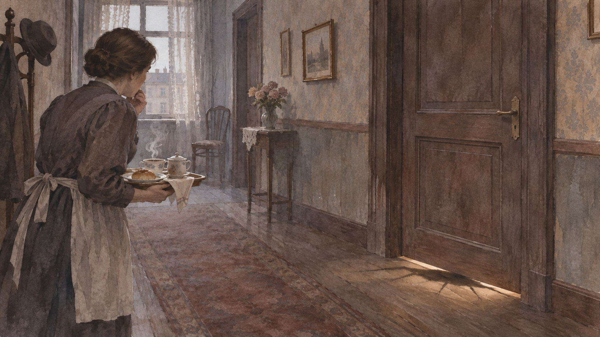

# 변신 — 그레고르의 방문 밖에서는 무엇이 달라졌을까

*출근과 돌봄, 방의 변화와 음악을 따라 읽는 카프카의 중편*

Culture · Literature

> 출처 대조와 공개 게시 승인을 마친 이야기입니다. 실제 게시 여부는 사이트 배포 상태를 따릅니다.

*AI 이야기 장면 삽화 · 작품을 떠올리기 위한 상상 그림이며 실제 사진·배우 초상·정확한 복원이 아닙니다.*

어느 날 아침 그레고르 잠자는 낯선 생물의 몸으로 깨어난다. 카프카의 『변신』에서 이 사건은 원인을 설명하는 수수께끼로만 다뤄지지 않는다. 출근과 가족의 생계, 닫힌 문과 방의 가구가 더 큰 문제로 다가온다. 아래에는 작품의 주요 사건과 결말이 포함된다.

## 01. 변한 몸보다 먼저 떠오른 출근 시간

그레고르는 몸이 달라졌는데도 일과 열차 시간을 걱정한다. 독자에게 가장 놀라운 일이 인물에게는 당장의 의무와 얽힌다. 그는 가족을 부양하는 외판원이었다. 몸을 잃은 충격은 수입을 잃을지 모른다는 불안과 떨어져 있지 않다.

회사에서는 지배인이 집까지 찾아온다. 한 번의 지각이 해명해야 할 문제로 커지는 모습을 보면 그레고르가 어떤 압박 속에서 일했는지 드러난다. 변신 이전의 일상도 마음 편한 상태는 아니었다. 기이한 사건이 익숙한 생활의 조건을 더 선명하게 비춘다.

## 02. 문을 열어도 말은 통하지 않는다

그레고르는 안쪽에서 설명하려 하지만 바깥 사람들은 그의 말을 제대로 알아듣지 못한다. 스스로 느끼는 마음과 남들이 듣는 소리가 갈라진다. 문을 연다는 물리적인 행동이 관계를 다시 연결해 주지는 못한다.

가족과 회사 사람은 눈앞의 몸을 보고 반응한다. 독자는 그의 생각을 따라갈 수 있기 때문에 그 몸만 보는 사람들과 다른 정보를 갖는다. 작품은 누구를 이해할 때 무엇을 근거로 판단하는지 묻게 한다. 인간적인 마음이 있다는 사실이 다른 사람에게 곧바로 전달되는 것은 아니다.

## 03. 여동생의 돌봄은 조금씩 바뀐다

처음에 여동생 그레테는 먹을 것을 가져오고 방을 살핀다. 그는 음식의 취향과 움직임이 이전과 달라졌지만 여전히 가족에게 마음을 쓴다. 돌봄의 장면은 혐오와 연민, 배려와 두려움이 단순하게 나뉘지 않음을 보여 준다.

하지만 돌봄은 계속 시간과 노동을 요구한다. 가족의 생계도 바뀌면서 그레테의 태도는 달라진다. 처음 한 번 도와주었다는 사실과 오래 관계를 유지할 수 있다는 사실은 같지 않다. 작품은 가족의 사랑을 선언보다 반복되는 행동과 부담 속에서 보여 준다.

## 04. 가구를 치우는 것이 도움이 될까

그레고르가 움직이기 편하게 방의 가구를 치우려는 일이 벌어진다. 그러나 물건은 장애물만이 아니다. 예전 생활과 자기 모습을 기억하게 하는 흔적이기도 하다. 공간을 편하게 만드는 판단이 당사자에게는 삶의 일부를 없애는 일로 느껴질 수 있다.

그가 지키려 하는 그림도 이런 맥락에서 볼 수 있다. 남들이 보기에는 낡은 물건이지만 그에게는 방이 아직 자기의 공간이라는 표지가 된다. 상대를 위한다고 생각한 행동과 상대가 실제로 바라는 것이 같지 않은 장면이다.

## 05. 아버지의 사과와 깊어지는 고립

아버지는 그레고르를 위협하고 사과를 던진다. 그중 하나가 몸에 박혀 상처가 남는다. 집은 보호받는 장소이면서 위험이 생기는 곳이 된다. 몸의 고통과 관계의 고립이 함께 깊어진다.

가족은 각자 일을 하며 생계를 다시 꾸리기 시작한다. 그레고르가 생각했던 가족의 무능력과 실제 가능한 일 사이에도 차이가 보인다. 동시에 그의 방은 점점 불필요한 물건을 두는 곳처럼 변한다. 한 사람의 자리가 생활 공간 안에서 어떻게 밀려나는지가 구체적인 배치로 드러난다.

## 06. 바이올린 소리 앞에서 밖으로 나오다

집에 머무는 하숙인들 앞에서 그레테가 바이올린을 켠다. 그레고르는 그 소리에 끌려 나온다. 자신이 동생의 음악을 이해하고 가까이하고 싶어 한다는 마음이 남아 있다. 겉의 몸과 안의 반응이 같은 속도로 바뀌지 않았다.

그러나 그의 등장은 다른 사람들에게 위협과 골칫거리로 받아들여진다. 그레테는 이제 이 존재를 예전의 오빠와 연결해 계속 받아들이지 못하겠다고 말한다. 그레고르는 방으로 돌아가고 결국 죽는다. 가족은 그 뒤 앞으로의 생활을 생각하며 집 밖으로 나간다.

그레고르는 동생이 음악을 더 배울 수 있게 돕고 싶었던 마음을 품고 있다. 이런 생각은 그의 몸이 변한 뒤에도 이어진다. 자신을 알아보지 못하는 가족을 향한 관계가 그의 안에서는 쉽게 끊어지지 않았음을 보여 준다. 그러나 속으로 간직한 계획과 다른 사람이 실제로 듣는 말은 다르다.

바이올린의 소리는 언어가 통하지 않는 인물을 움직인다. 가족과 하숙인들은 다른 기준으로 장면을 평가하지만 독자는 그가 음악을 향해 다가가는 마음을 안다. 그래서 방에서 나온 행동을 단순한 방해로만 볼 수 없다. 몸의 낯섦이 보이는 관객과 안의 생각까지 아는 독자 사이에 거리가 생긴다. 작품은 그 간격을 유지한 채 마지막 장면으로 간다. 누군가를 안다고 말할 때 보이는 모습과 들리지 않은 마음 중 무엇을 놓쳤는지 질문하게 한다.

## 07. 이유를 알 수 없다고 질문이 사라지지는 않는다

변신의 정확한 원인을 설명하지 않는 결말은 독자를 불편하게 할 수 있다. 그러나 작품이 보여 준 출근의 압박과 돌봄, 방의 변화는 구체적이다. 원인을 푸는 데만 집중하면 그 뒤에 벌어진 일들의 무게를 놓친다.

카프카는 프라하에서 독일어로 글을 쓴 작가다. 이 글은 그 도시와 작가의 맥락으로 체코에 배치하되 작품을 한 국가의 성격으로 일반화하지 않는다. 『변신』은 쓸모를 제공하지 못할 때도 한 사람을 같은 존재로 대할 수 있는지 묻는 낯선 가족 이야기로 남는다.

## 이야기의 바탕이 된 자료

- [Franz Kafka, Metamorphosis, translated by David Wyllie](https://raw.githubusercontent.com/GITenberg/Metamorphosis_5200/master/5200.txt) · 확인일 2026-11-06
  - 확인 내용: 출근과 지배인·문과 목소리·그레테·가구와 그림·아버지의 사과·하숙인/바이올린·죽음과 가족의 외출. 현대 영어 번역의 표현을 옮기지 않고 사건을 독립적인 한국어 해설로 작성

---

[같은 소주제의 이야기](README.md) · [전체 서가](../../README.md)
