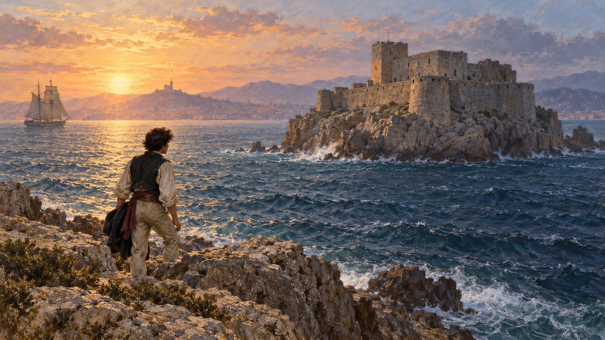

# 몬테크리스토 백작 — 복수가 끝나면 삶은 돌아올까

*감옥에서 얻은 지식과 보물이 되돌려 주지 못한 것*

Culture · Literature

> 자료 대조를 마친 검토용 이야기입니다. 공개 게시 승인은 아직 받지 않았습니다.

*AI 관련 장면 삽화 · 소설의 바다와 섬 감옥을 떠올리는 독립적인 삽화입니다. 이프성의 정확한 복원이나 소설 속 특정 순간을 재현한 자료는 아닙니다.*

젊은 선원은 곧 선장이 되고 사랑하는 사람과 결혼하리라 믿었다. 그러나 결혼을 앞둔 날 체포되어 섬의 감옥으로 보내진다. 알렉상드르 뒤마의 『몬테크리스토 백작』은 한 사람에게서 미래를 빼앗는 사건으로 시작한다.

이 소설의 쾌감은 억울한 사람이 힘을 얻어 돌아오는 데 있다. 그런데 끝까지 읽으면 질문이 조금 바뀐다. 원수를 무너뜨리는 힘이 잃어버린 삶까지 돌려줄 수 있을까. 아래에는 주요 줄거리와 결말이 포함되어 있다.

## 1. 편지 한 장이 무기가 되었다

1815년 마르세유의 선원 에드몽 단테스는 항해 중 맡은 편지 때문에 나폴레옹의 복귀를 돕는 인물로 몰린다. 동료 당글라르는 그의 승진을 시기했고, 페르낭은 약혼녀 메르세데스를 원했다. 이들은 정치적 의심을 개인의 질투에 이용한다.

검사 빌포르는 사정을 확인하고도 단테스를 구하지 않는다. 편지가 자신의 아버지와 연결되어 있음을 알고 경력을 지키려 한다. 같은 피해가 서로 다른 사람의 계산에서 만들어진다. 단테스는 자신이 왜 버려졌는지조차 알기 어렵다.

## 2. 감옥에서 만난 두 번째 교육

이프성에 갇힌 그는 오랜 절망 끝에 다른 죄수 파리아 신부를 만난다. 탈출을 위해 파던 통로가 두 사람을 이어 준다. 신부는 단테스에게 언어와 학문을 가르치고, 그의 이야기를 듣고 배신의 구조를 짚어 준다.

이 만남은 보물의 위치를 알려 주는 장치 이상이다. 단테스는 사건을 이해하고 다른 사회에서 행동할 지식을 얻는다. 훗날 백작으로 나타날 때 필요한 힘은 돈뿐 아니라 감옥에서 새로 배운 판단과 언어에도 있었다.

## 3. 죽은 사람의 자루에서 바다로

파리아가 죽자 단테스는 시신을 넣은 자루에 대신 들어간다. 바다에 던져진 뒤 빠져나와 탈출에 성공한다. 이후 신부가 알려 준 몬테크리스토섬의 보물을 찾는다. 감옥에서 무력했던 사람에게 막대한 자원이 생긴 것이다.

하지만 귀환한 세상은 기다려 주지 않았다. 아버지는 이미 죽었고 메르세데스는 페르낭과 결혼했다. 단테스가 빼앗긴 것은 자유와 재산만이 아니었다. 보물로 살 수 없는 시간과 관계가 사라져 있었다.

## 4. 백작이라는 이름으로 돌아오다

그는 여러 이름과 신분을 사용하며 과거의 사람들에게 접근한다. 몬테크리스토 백작은 그 가운데 가장 눈부신 얼굴이다. 돈과 정보, 치밀한 준비 덕분에 파리 사교계에서 사람들의 관심을 끌 수 있었다.

복수는 단순한 칼싸움으로 진행되지 않는다. 누가 무엇을 두려워하고 어디에 평판과 재산을 걸었는지 알아낸 뒤 그 약점을 움직인다. 돈이 정보와 신분을 열어 주는 사회 자체가 백작의 무대가 된다.

## 5. 각자의 성공이 각자의 약점이 되다

페르낭은 훗날 모르세르 백작으로 명예를 얻었지만 과거의 배신과 연결되어 있다. 알리 파샤의 딸 에데의 증언은 그 명예를 무너뜨린다. 당글라르에게는 재산과 신용, 빌포르에게는 숨겨 둔 가족의 범죄가 돌아온다.

단테스는 상대가 얻은 성공의 바탕을 겨냥한다. 그래서 독자는 통쾌함과 불안을 함께 느낀다. 사실이 밝혀지는 정의와 한 사람이 결과를 설계하는 복수는 어디까지 같은 일인가. 백작의 준비가 완벽할수록 이 질문도 커진다.

## 6. 죄 없는 자녀들이 길을 막았다

원수들에게도 자녀와 가족이 있다. 메르세데스는 아들 알베르를 지키려 하고, 백작은 과거의 사랑과 복수 계획이 만나는 자리에 선다. 자신이 정한 상대만 벌하고 주변은 그대로 둘 수 있다는 믿음이 흔들린다.

빌포르 집안의 비극에서 어린 에두아르까지 죽자 그는 자기 계획이 불러온 결과 앞에서 충격을 받는다. 원수의 몰락을 계산하는 일과 그 주변 사람의 생명을 책임지는 일은 분리되지 않았다. 소설은 이 지점에서 복수의 속도를 늦춘다.

## 7. 벌을 내리는 사람의 한계

백작은 자신을 특별한 심판의 역할에 놓고 움직여 왔다. 하지만 다른 사람의 운명을 끝까지 아는 사람은 아니다. 피해자가 얻은 힘이 그를 언제나 옳은 판단자로 만들어 주지도 않는다.

그는 당글라르를 끝까지 파멸시키는 대신 살아갈 여지를 남긴다. 모든 잘못이 가벼워졌기 때문은 아니다. 복수의 완성이 자기 삶의 완성과 같지 않다는 사실이 드러난 것이다. 힘을 멈추는 선택도 필요해진다.

## 8. 복수 곁에서 이어진 다른 사랑

작품에는 막시밀리앙과 발랑틴의 사랑도 흐른다. 이들의 관계는 과거에 묶인 백작의 삶과 다른 방향을 보여 준다. 백작이 이들을 돕는 일은 누군가를 벌하는 능력을 넘어 누군가의 미래를 지키는 능력을 묻는다.

에데와의 관계 역시 끝에 가서 새 삶의 가능성을 연다. 그렇다고 결말이 오래된 상처를 모두 지웠다는 뜻은 아니다. 이미 잃은 시간을 되돌리는 대신 남아 있는 시간에 무엇을 할지 고르는 쪽으로 시선이 옮겨 간다.

## 9. 다시 읽을 때 보이는 기다림

마지막에 남는 말은 기다림과 희망이다. 긴 복수극을 지나 도착한 이 말은 아무 일도 하지 말라는 권고로만 들리지 않는다. 세상을 자기 뜻대로 모두 통제하려던 사람이 모르는 미래를 인정하는 말로도 읽을 수 있다.

처음에는 탈출과 변장, 반격의 재미를 따라 읽어도 좋다. 다음에는 단테스가 어느 순간부터 자신이 만든 백작이라는 역할에 붙잡히는지 살펴보자. 이 소설의 긴 여정은 원수를 찾는 길과 자기 삶으로 돌아오는 길이 얼마나 다른지 보여 준다.

## 이야기의 바탕이 된 자료

- [Alexandre Dumas, The Count of Monte Cristo — 소설 원문](https://raw.githubusercontent.com/GITenberg/The-Count-of-Monte-Cristo_1184/master/1184-0.txt) · 확인일 2026-10-31
  - 확인 내용: 단테스의 누명·투옥·파리아와 교육·탈출과 보물 / 당글라르·페르낭·빌포르를 향한 복수와 가족의 피해 / 에두아르의 죽음·당글라르의 생존·막시밀리앙과 발랑틴·기다림과 희망의 결말

---

[같은 소주제의 이야기](README.md) · [전체 서가](../../README.md)
