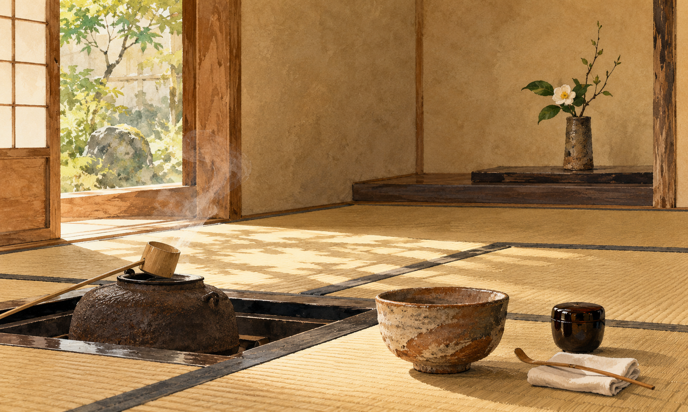

# 『차의 책』 — 찻잔 하나를 위해 방을 비운다는 것

*오카쿠라 가쿠조가 차를 통해 설명한 예술과 일상*

Culture · Literature

> 자료 대조를 마친 검토용 이야기입니다. 공개 게시 승인은 아직 받지 않았습니다.

*AI 이야기 장면 삽화 · 본문의 분위기를 돕는 해석적 그림이며 실제 장소·유물의 사진이나 정확한 역사 복원이 아닙니다.*

방을 잘 꾸민다고 하면 좋은 물건을 더 놓는 장면부터 떠올리기 쉽다. 그림을 걸고 꽃병을 들이고 멋진 그릇을 모은다. 그런데 차를 마시는 작은 방에서는 무엇을 더할지보다 무엇을 남겨 둘지가 중요해지기도 한다. 물건이 적어지면 찻잔 하나에 머무는 시간이 길어진다.

오카쿠라 가쿠조의 『차의 책』은 차의 종류를 설명하는 실용 안내서만은 아니다. 차를 둘러싼 공간과 꽃, 예술을 대하는 태도로 일본의 문화를 소개하는 글이다. 여기서는 복잡한 예법을 외우기보다 그가 찻방에서 무엇을 보려 했는지 따라가 본다.

## 01. 차를 설명하며 문화를 말한 작가

오카쿠라는 이 책을 영어로 썼다. 차에 익숙하지 않은 독자에게 찻잔을 매개로 예술과 생활의 관계를 설명하려 했다. 이미 잘 아는 독자를 향한 내부의 규칙집과, 낯선 독자에게 의미를 전달하려는 책은 말의 방향이 다르다.

그래서 『차의 책』은 당시 일본 사회 전체를 그대로 옮긴 중립적인 보고서로 읽기보다 한 작가의 주장과 감상이 담긴 문화 에세이로 읽는 편이 좋다. 그의 표현에 고개를 끄덕일 수도 있고 거리를 둘 수도 있다. 책이 제시하는 이상과 실제 모든 사람의 생활은 같지 않다.

## 02. 낮은 문 앞에서는 몸이 먼저 달라진다

책의 찻방 설명에는 몸을 낮추어 들어가는 작은 입구가 나온다. 들어가는 사람은 말로 겸손을 선언하기 전에 몸의 자세를 바꾸게 된다. 오카쿠라는 높은 사람과 낮은 사람 모두에게 그런 움직임이 요구된다고 설명한다. 공간이 행동을 부탁하는 셈이다.

이는 신분 차별이 역사에서 실제로 사라졌다는 증거는 아니다. 찻방 안에서 지향한 태도를 보여 주는 설명이다. 사회의 모든 불평등이 작은 문 하나로 해결될 수는 없다. 그 한계를 기억하면서도, 일상의 자세를 바꾸어 다른 관계를 상상한 장치를 볼 수 있다.

## 03. 칼을 밖에 두는 장면

오카쿠라의 글에서는 무사가 찻방에 들어갈 때 칼을 바깥에 둔다. 그는 이 방을 평화의 공간으로 설명한다. 전사의 무기를 내려놓는 장면은 말로 길게 설명하지 않아도, 지금은 다른 규칙으로 만나려 한다는 인상을 준다.

이 대목을 모든 찻자리에서 한 번도 어김없이 지켜진 역사적 장면으로 확대할 필요는 없다. 책이 전하려는 의미를 읽으면 된다. 상대에게 힘을 보이기 위한 물건을 잠시 내려놓고, 한 잔을 앞에 둔 사람으로 앉는다는 상상이다.

## 04. 비어 있는 자리가 물건을 돋보이게 한다

책은 찻방의 장식을 고정된 전시실처럼 다루지 않는다. 그날 놓는 그림과 꽃, 그릇과 공간의 관계를 중시한다. 모든 좋은 물건을 한 번에 꺼내 놓는 대신 서로가 서로를 가리지 않게 하는 선택에 가깝다.

현대의 작은 방에서도 비슷한 경험을 할 수 있다. 책상 위에 물건을 잔뜩 올려 두었을 때는 잘 보이지 않던 컵이 주변을 정리하자 눈에 들어온다. 이것이 곧 전통 다도의 전부라는 뜻은 아니다. 낯선 미감을 이해하기 위한 작고 익숙한 출발점일 뿐이다.

## 05. 완벽한 대칭만이 질서는 아니다

오카쿠라는 찻방의 장식에서 비대칭과 여백을 이야기한다. 모두 똑같이 맞추어 채우는 것과 다른 균형이다. 보는 사람에게 남아 있는 빈 곳이 방의 부족함이 아니라, 관계를 생각하게 하는 자리가 될 수 있다는 설명이다.

다만 일본 미술은 언제나 비대칭이고 다른 문화는 늘 대칭이라는 식으로 나눌 수는 없다. 책 자체도 시대와 예술에 따라 다른 경향을 언급한다. 한 작가가 강조한 미감을 국가 전체의 변하지 않는 성격으로 바꾸지 않을 때 오히려 그 생각을 더 자유롭게 받아들일 수 있다.

## 06. 주인과 손님이 함께 만드는 장면

오카쿠라는 찻자리를 주인 혼자 완성하는 전시로 설명하지 않는다. 주인과 손님이 그날의 조화를 함께 만든다는 생각이 책 곳곳에 흐른다. 그림과 꽃, 소리와 움직임이 서로를 가리지 않게 하는 것이 중요하다. 그릇이 비싸다는 사실만으로 좋은 장면이 저절로 이루어지는 것은 아니라는 뜻으로 읽을 수 있다.

이렇게 보면 예술은 박물관 벽에 걸린 대상만을 가리키지 않는다. 물건을 고르고 놓는 일, 사람을 맞이하고 함께 시간을 보내는 일에도 감상의 문제가 들어온다. 물론 이것은 저자가 강조한 이상이다. 실제 찻자리가 언제나 완전했다는 증언으로 바꾸기보다, 일상을 예술의 언어로 설명하려던 그의 시도를 읽는 편이 책에 더 가깝다.

## 07. 차를 잘 모르는 사람도 읽을 수 있는 이유

『차의 책』을 읽었다고 찻자리를 바로 진행할 수 있는 것은 아니다. 책의 매력은 자격을 얻는 데 있지 않다. 꽃을 한 번 더 보고, 손에 닿는 그릇을 살피고, 같이 앉은 사람에게 주의를 기울이는 시간을 상상하게 한다는 데 있다.

한 잔의 차가 세상의 모든 소란을 해결하지는 못한다. 그래도 무엇을 보느라 바빴는지 잠깐 돌아보게 할 수는 있다. 방을 꽉 채운 뒤 감탄하는 대신 한두 가지를 남겨 두고 오래 바라보는 일. 오카쿠라가 찻잔을 통해 전하고 싶었던 생각의 한 갈래가 그곳에 있다.

옛 책의 모든 주장에 동의할 필요도 없다. 마음에 남는 장면 하나를 가져오고 다른 부분에는 질문을 남겨 둘 수 있다. 문화 에세이를 읽는 일은 한 국가를 한 번에 이해하는 일보다, 한 사람의 시선과 천천히 대화하는 일에 가깝다.

## 이야기의 바탕이 된 자료

- [Okakura Kakuzo, The Book of Tea — IV. The Tea-Room 외](https://raw.githubusercontent.com/GITenberg/The-Book-of-Tea_769/master/769.txt) · 확인일 2026-11-01
  - 확인 내용: 영어로 쓰인 차 문화 에세이의 화자·독자와 논지 / 낮은 출입문과 겸손, 무사의 칼·찻방의 평화라는 저자의 설명 / 장식·꽃과 그림·비대칭과 여백에 관한 주장을 역사 전체의 중립적 사실과 구분

---

[같은 소주제의 이야기](README.md) · [전체 서가](../../README.md)
