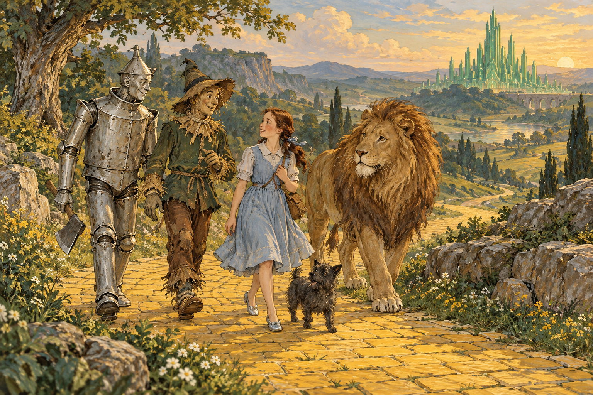

# 오즈의 마법사 — 필요한 것은 이미 길 위에 있었을까

*도로시와 세 동료가 찾아 나선 지혜와 마음, 용기*

Culture · Literature

> 자료 대조를 마친 검토용 이야기입니다. 공개 게시 승인은 아직 받지 않았습니다.

*KnowledgeWalk 제작 AI 삽화 · 소설의 인물과 분위기를 바탕으로 새로 상상한 장면입니다. 원작 도판이나 실제 역사 현장을 재현한 자료는 아닙니다.*

집이 통째로 바람에 실려 낯선 나라에 내려앉는다. 캔자스에서 살던 도로시에게 필요한 것은 거대한 힘이나 왕관이 아니다. 익숙한 집으로 돌아가는 길이다. 그런데 그 길에서 만난 동료들은 저마다 자신에게 꼭 없는 것이 하나씩 있다고 말한다.

L. 프랭크 바움의 『오즈의 마법사』는 1900년 서문을 가진 모험 이야기다. 어린이를 위한 작품이지만 어른이 읽어도 남는 질문이 있다. 내가 없다고 생각하는 능력을 다른 사람은 이미 내 행동에서 보고 있는 것은 아닐까. 아래에는 주요 줄거리와 결말이 포함되어 있다.

## 1. 은구두를 신고 노란 길을 따라가다

회오리바람에 날려 온 집은 동쪽의 나쁜 마녀 위에 떨어진다. 도로시는 마녀의 은구두를 얻고, 에메랄드 시의 위대한 오즈를 찾아가면 집으로 돌아갈 방법을 알 수 있으리라는 말을 듣는다. 토토와 함께 노란 벽돌길을 따라 나서는 이유다.

원작의 구두는 은색이다. 다른 각색에서 익숙해진 모습과 구별하면 작은 물건 하나도 새롭게 보인다. 다만 색을 외우는 것이 감상의 목적은 아니다. 낯선 세계에 들어온 소녀가 도움을 구하며 한 걸음씩 움직이기 시작했다는 점이 이야기의 출발이다.

## 2. 머리가 없다는 허수아비가 내놓는 생각

허수아비는 자신에게 뇌가 없어서 지혜롭지 못하다고 생각한다. 오즈에게 뇌를 달라고 청하려고 도로시와 동행한다. 그러나 길에서 위험을 피하고 문제를 풀어야 할 때 그는 여러 생각을 내놓는다. 스스로의 평가와 실제 행동 사이에 틈이 생긴다.

작품은 ‘사실은 똑똑했다’고 설명하고 곧바로 끝내지 않는다. 독자가 허수아비의 말을 듣고, 이어지는 행동을 여러 번 보게 한다. 누군가를 이해하는 데에는 그 사람이 자기소개에서 말한 부족함뿐 아니라 실제로 어떻게 문제를 대하는지도 중요하다는 읽기가 가능해진다.

## 3. 마음을 원하지만 남을 아끼는 양철 나무꾼

양철 나무꾼은 심장을 원한다. 자신에게 따뜻한 마음이 없다고 느끼기 때문이다. 그런데 그는 다른 생명을 걱정하고 남에게 해를 끼칠까 조심한다. 몸이 양철로 되어 있다는 사실과 타인을 대하는 태도는 같은 것이 아니다.

심장은 몸속의 물건이면서 사랑하고 돌볼 수 있다는 확신의 상징처럼 읽힌다. 허수아비가 뇌를 바라는 것과 나란히 보면 동료들의 소망이 서로 다른 질문을 꺼낸다. 무엇을 가졌다는 증명과 실제로 그렇게 살아가는 일은 어떤 관계에 있을까.

## 4. 겁이 많은 사자가 용기를 보여 주는 순간

사자는 자신이 겁쟁이라고 말한다. 강한 몸과 큰 목소리가 있으니 두려움도 없어야 한다고 기대하지만 실제로는 그렇지 않다. 그는 오즈에게 용기를 얻고 싶어 한다. 자기에게 모자란 것을 다른 존재가 채워 줄 수 있다고 믿는 셈이다.

여행이 이어지면 사자는 두려움을 느끼면서도 동료들을 위해 행동한다. 그래서 용기는 아무것도 무섭지 않은 상태만을 뜻하는지 생각하게 된다. 이 역시 작품이 현대의 심리학 이론을 설명하려 썼다는 뜻은 아니다. 인물의 말과 행동을 비교하며 얻을 수 있는 감상의 한 방향이다.

## 5. 위대한 오즈는 왜 먼저 어려운 일을 요구할까

에메랄드 시에 도착해도 소원은 바로 이루어지지 않는다. 오즈는 서쪽의 나쁜 마녀를 물리치라는 조건을 내건다. 도움을 받으려면 이미 두려워하던 일을 해내야 하는 상황이다. 겉으로는 힘없는 사람들이 거대한 권위를 찾아갔지만, 실제로 길 위에서 위험을 감당하는 것은 이 동료들이다.

서쪽 마녀의 손에 붙잡힌 뒤 도로시는 뜻밖의 방식으로 벗어난다. 물이 마녀를 녹이는 결말이다. 이를 치밀하게 계획한 영웅의 승리라고만 읽기보다, 낯선 세계에서 몰랐던 조건을 경험하며 길이 열리는 모험의 성격으로 볼 수 있다.

## 6. 커다란 권위 뒤에서 발견하는 작은 사람

돌아온 동료들은 오즈의 정체를 알게 된다. 무서운 모습과 거대한 권위 뒤에 있었던 것은 사람들이 기대한 초월적 존재와 다른 평범한 사람이었다. 그가 보여 준 위엄과 실제 능력의 간격이 드러난다.

하지만 이 장면이 모든 도움은 거짓이라는 결론으로만 이어지지는 않는다. 허수아비와 나무꾼, 사자에게 주는 물건과 말은 그들이 자신을 바라보는 방식을 바꾸기도 한다. 이미 행동으로 보여 준 능력을 스스로 인정하려면 어떤 계기가 필요한가라는 질문이 남는다.

## 7. 도로시는 왜 마지막까지 집을 찾을까

오즈가 준비한 기구로 함께 떠나려던 계획은 어긋나고, 도로시는 다시 길을 찾아야 한다. 끝내 글린다를 만나 은구두가 가진 힘을 알게 된다. 집으로 돌아갈 수 있는 물건은 생각보다 일찍부터 곁에 있었지만 그 사실을 알기까지 긴 여행이 필요했다.

이것을 모험 전체가 쓸데없었다는 뜻으로 읽을 필요는 없다. 여행하는 동안 동료들이 생기고 각자의 모습을 보게 된다. 원하는 결과에 가장 빨리 도착하는 길과, 그 사이 사람을 만나고 달라지는 시간은 서로 다른 가치를 가질 수 있다.

## 8. 함께 걷는 그림으로 다시 이야기 보기

함께 실은 것은 도로시와 토토, 세 동료가 길을 걷는 모습을 새로 상상한 AI 삽화다. 원작에 실린 옛 그림이나 특정 영화의 장면을 복제한 자료는 아니다. 이들이 함께 움직이는 모습이 글로 들어가는 입구가 되도록 만들었다.

작품을 읽고 나면 누가 가장 강했는지 고르는 대신 각자가 어떤 순간에 다른 이를 도왔는지 떠올려 보자. 뇌와 심장, 용기라는 소망은 결국 길 위의 구체적인 행동과 이어진다. 집으로 돌아가는 이야기 안에, 자신을 조금 다르게 보게 되는 이야기도 함께 놓여 있다.

## 이야기의 바탕이 된 자료

- [L. 프랭크 바움 — The Wonderful Wizard of Oz 원문](https://raw.githubusercontent.com/GITenberg/The-Wonderful-Wizard-of-Oz_55/master/55.txt) · 확인일 2026-10-30
  - 확인 내용: 1900년 서문·도로시와 토토·캔자스·동쪽 마녀와 은구두 / 허수아비·양철 나무꾼·사자의 소망과 실제 행동 / 서쪽 마녀·물·오즈의 정체·기구·글린다·귀환

---

[같은 소주제의 이야기](README.md) · [전체 서가](../../README.md)
