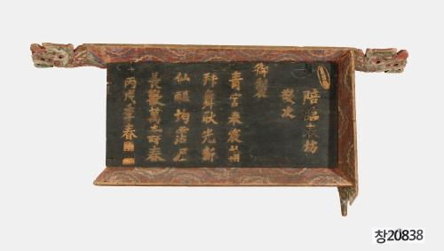

# 이 현판의 글자는 따로 만들어 붙였다

*세자가 답한 시가 나무판에 남는 과정*

Culture · Literature

> 출처 대조와 공개 게시 승인을 마친 이야기입니다. 실제 게시 여부는 사이트 배포 상태를 따릅니다.

*배림춘방경차어제 현판 · 국립고궁박물관 소장·제공. 전체 사진을 자르지 않고 사용했습니다.*

[이미지 출처·제작 근거](https://www.gogung.go.kr/gogung/pgm/psgudMng/view.do?menuNo=800065&psgudSn=430001) · 공공누리 제1유형(출처표시)

현판이라고 하면 건물 이름이 크게 적힌 판을 떠올리기 쉽다. 그런데 이 현판에는 여러 줄의 글이 담겨 있다. 이름표라기보다 벽에 걸어 두는 한 편의 시에 가깝다.

국립고궁박물관의 배림춘방경차어제 현판이다. 제목은 길고 낯설지만 그 안의 상황은 조금 친숙하다. 누군가 먼저 시를 지었고 다른 사람이 그 시에 답했다.

## 1. 아버지의 시에 답한 세자

박물관에 따르면 1886년 3월 15일 고종은 세자가 공부하는 자리에 나아갔다. 기쁜 마음에 관원들에게 술을 내리고 시를 지었으며, 왕세자는 그 시에 화답했다. 훗날 순종이 되는 세자다.

이 현판에는 그 답시가 새겨져 있다. 긴 관직명이나 어려운 의례 절차를 먼저 알아야만 보는 물건은 아니다. 누군가의 글에 다른 글로 응답한 장면이라고 생각하면 시작이 한결 가벼워진다.

## 2. 시를 종이 밖으로 옮기면

박물관은 같은 내용이 순종의 문집인 정헌집에도 기록되어 있다고 설명한다. 글은 책 안에도 남았고, 현판이라는 물건에도 남았다. 같은 문장이 머무는 자리가 달라지는 것이다.

책에서는 페이지를 넘겨 읽지만 현판은 공간에 걸어 둔다. 그래서 시를 기억하는 방식도 다르게 상상할 수 있다. 물론 실제로 누가 이 앞에서 시를 읽었는지는 이 물건만 보고 정할 수 없다.

## 3. 한 편의 시가 답시를 부른다

화답은 앞선 글에 다른 글로 응답하는 일이다. 고종이 공부하는 세자를 찾아와 지은 시와 세자의 답시를 함께 떠올리면 이 현판은 혼자 닫힌 문장이 아니게 된다. 글을 주고받은 관계와 특정한 날의 상황이 작품의 배경에 있다. 글씨를 다 읽지 못해도 누군가의 말에 다시 말을 건넨 장면이라는 틀은 이해할 수 있다.

왕과 세자라는 지위도 단순한 가족의 대화와 다른 문맥을 만든다. 학습의 자리와 관원들이 함께 있는 상황에서 시가 지어졌다는 기록이 남아 있다. 다만 그 자리에 있던 사람들의 실제 표정과 대사를 상상으로 채워 넣지는 않는다. 남은 날짜와 행동을 따라가면 기념할 일을 글로 옮기는 당시의 선택이 보인다.

## 4. 새기는 것과 붙이는 것은 다른 손일이다

이 현판은 나무 글자를 따로 조각해 판에 붙인 방식이라고 박물관은 설명한다. 평평한 면을 먹으로 채우거나 바탕을 파내는 것과 제작 과정이 다르다. 글자의 모양을 개별 부품으로 만들어 자리를 맞추는 일이 필요했다. 완성된 문장을 읽을 때에는 잘 드러나지 않는 조립의 시간이 있는 것이다.

붙인 글자는 면에서 높이가 생긴다. 그래서 글씨는 뜻을 전하는 표지이면서 두께와 그림자를 가진 형상이기도 하다. 실제 사진에서는 정면뿐 아니라 가장자리와 글자 주변을 살펴보면 그 구조를 생각하는 데 도움이 된다. 다만 사진의 빛만으로 정확한 두께나 접착 방식을 새로 판정하지는 않는다. 제작 방식은 박물관 설명을 근거로 읽는다.

## 5. 책에서 읽는 글과 벽에 거는 글

정헌집 안의 같은 시는 저술의 흐름 속에 놓인다. 현판은 한 공간에 걸어 그 문장을 계속 보이게 한다. 내용이 같아도 페이지를 넘겨 만나는 방식과 고개를 들어 마주하는 방식은 다르다. 어느 것이 더 진짜 기록인지 고르기보다 서로 다른 형태가 무엇을 남기는지 살펴볼 수 있다.

공간에 놓이는 글은 사람들의 이동과 시선의 높이도 만나게 된다. 다만 이 유물만으로 원래 걸렸던 모든 위치와 관람 상황을 알 수는 없다. 여기서는 문장을 나무 글자로 만들었다는 구체적인 물성을 먼저 본다. 문학이 종이의 페이지 밖으로 나가 건축과 장식의 일부가 될 수도 있었다는 점이 가까워진다.

## 6. 읽기 어려운 글씨도 관찰할 수 있다

한자를 모두 해독하지 못하면 유물 앞에서 할 일이 없다고 느끼기 쉽다. 그러나 글자를 붙인 구조와 문장 줄의 배열, 제목과 설명의 관계를 먼저 볼 수 있다. 박물관의 번역과 해설을 곁들이면 내용으로 들어갈 길도 생긴다. 읽는 능력과 물건을 보는 경험이 서로 도울 수 있다.

현판은 시를 기억하게 하는 매체이면서 장인의 손을 거친 나무 물건이다. 왕과 세자의 글쓰기, 책으로 남은 기록, 개별 글자를 조각한 제작이 한 표면에 겹친다. 글자 하나가 판에서 조금 솟아 있다는 사실을 알면 문장이 단순히 적혀 있다는 말도 더 구체적으로 들린다. 의미와 재료를 함께 만나는 감상이 가능해진다.

## 7. 나무 위에 놓인 나무 글자

만드는 방법도 눈여겨볼 만하다. 박물관은 글자를 따로 나무로 조각한 뒤 붙였다고 한다. 평평한 판에 붓으로 쓰는 방법과 달리 글자 자체가 작은 부품이 되는 셈이다.

사진에서 글자 하나의 가장자리를 따라보자. 시의 뜻을 모두 번역하지 않아도, 문장을 입체적인 물건으로 바꾸는 손길을 생각할 수 있다. 누군가의 답시가 책의 한 페이지와 나무판의 한 줄로 각각 남았다는 사실이 이 현판을 조금 다르게 보게 한다.

## 이야기의 바탕이 된 자료

- [국립고궁박물관 — 배림춘방경차어제 현판](https://www.gogung.go.kr/gogung/pgm/psgudMng/view.do?menuNo=800065&psgudSn=430001) · 확인일 2026-10-28
  - 확인 내용: 1886년 3월 15일 고종의 시와 왕세자 화답 / 정헌집에도 같은 내용 기록 / 따로 조각한 나무 글자를 붙인 제작 방식

---

[같은 소주제의 이야기](README.md) · [전체 서가](../../README.md)
