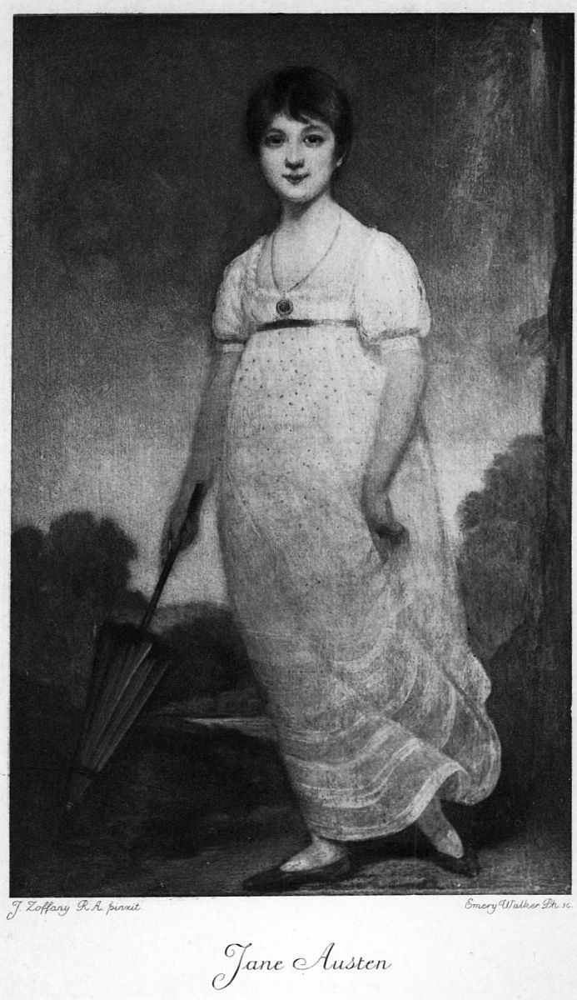

# 오만과 편견 — 처음 본 인상을 믿어도 될까

*사랑 이야기 안에 들어 있는 판단의 습관*

Culture · Literature

> 출처 대조와 공개 게시 승인을 마친 이야기입니다. 실제 게시 여부는 사이트 배포 상태를 따릅니다.

*1913년 Jane Austen: Her Life and Letters 수록 제인 오스틴 초상 재현도판 · 원본 도판 전체 유지. AI 재현 이미지가 아닙니다.*

[이미지 출처·제작 근거](https://raw.githubusercontent.com/GITenberg/Jane-Austen-Her-Life-and-LettersA-Family-Record_22536/master/22536-h/images/frontis.jpg) · 퍼블릭 도메인 원작의 역사적 재현 도판 · Project Gutenberg 수록본

무도회에서 누군가 나를 대수롭지 않게 여기는 말을 했다고 생각해 보자. 그 사람의 다음 행동도 쉽게 좋게 보이지 않을 것이다. 제인 오스틴의 『오만과 편견』은 그런 첫인상이 굳어지는 속도와, 그것을 고치는 데 필요한 시간을 사랑 이야기 속에 넣은 작품이다.

1813년에 출간된 소설에는 전쟁터보다 거실과 식탁, 산책길이 자주 나온다. 하지만 조용한 장소라고 이해관계까지 작지는 않다. 사랑을 고르는 일에 재산과 상속, 가족의 평판이 따라붙는다. 아래에는 주요 사건과 결말이 포함되어 있다.

## 1. 딸 다섯 명이 있는 집에 빙리가 찾아오다

베넷 부부에게는 제인, 엘리자베스, 메리, 키티, 리디아라는 다섯 딸이 있다. 가까운 저택에 부유한 독신 남자 빙리가 이사 오자 어머니는 딸들의 장래를 떠올린다. 무도회에서 빙리와 맏딸 제인은 서로 호감을 느끼지만, 빙리의 친구 다아시는 차갑고 거만하게 보인다.

엘리자베스는 자신을 낮게 평가하는 다아시의 말을 듣고 반감을 품는다. 이후 독자는 재치 있는 엘리자베스의 눈으로 다아시를 보는 일이 많다. 주인공과 함께 웃고 판단하다 보면, 우리가 가진 정보도 한쪽으로 기울어 있을 수 있다는 점을 잊기 쉽다.

## 2. 결혼에 돈 이야기가 따라붙는 이유

베넷가의 재산은 정해진 상속 조건 때문에 아들이 없는 경우 남자 친척 콜린스에게 넘어가게 되어 있다. 어머니의 호들갑에는 우스운 면도 있지만 딸들의 생활 기반을 걱정하는 현실도 들어 있다. 다만 이를 당시 모든 여성이 재산을 상속받을 수 없었다는 뜻으로 확대하면 안 된다. 작품 속 이 집안에 걸린 조건이 문제다.

콜린스가 청혼했을 때 엘리자베스는 거절한다. 그러나 친구 샬럿은 그와 결혼한다. 같은 선택을 하지 않았다고 샬럿을 단지 계산적인 사람으로 치부하면 작품이 보여 주는 폭이 좁아진다. 사랑을 기다릴 여유와 안정된 생활을 확보할 기회가 누구에게나 똑같이 주어지지는 않는다는 것이다.

## 3. 매력적인 위컴, 불쾌한 다아시

장교 위컴은 다정한 태도로 엘리자베스에게 접근하고, 다아시에게 부당한 대우를 받았다고 말한다. 이미 다아시를 싫어하던 엘리자베스에게는 믿기 쉬운 이야기다. 반면 다아시는 점차 그에게 끌리지만 자신의 계급의식과 베넷 가족에 대한 평가를 충분히 넘어서지 못한다.

다아시의 첫 청혼은 사랑 고백이면서 동시에 상대 가족의 낮은 지위를 들먹이는 말이 된다. 엘리자베스는 거절하고, 제인과 빙리 사이를 갈라놓은 일과 위컴에 관한 일까지 비난한다. 다아시는 편지를 써 자신의 행동과 위컴의 과거를 설명한다. 여기서 편지는 감동적인 장식보다, 독자가 알고 있던 사실을 다시 점검하게 하는 자료에 가깝다.

## 4. 편지를 읽고도 변화에는 시간이 걸린다

편지를 읽은 엘리자베스는 위컴에 대한 자신의 판단이 얼마나 호감에 기대고 있었는지 돌아본다. 그렇다고 다아시의 불쾌한 태도까지 한꺼번에 정당화되는 것은 아니다. 그는 다른 사람을 대하는 방식을 바꾸어야 하고, 엘리자베스도 자신이 보고 싶은 것만 보았을 가능성을 받아들여야 한다.

후에 다아시의 저택 펨벌리를 방문하면서 엘리자베스는 하인들의 평가와 그의 달라진 태도를 접한다. 부유한 집을 보았으니 마음이 바뀌었다는 설명만으로는 부족하다. 처음의 말, 다른 사람들의 증언, 실제 행동을 함께 비교하게 되었다는 점이 중요하다. 상대를 이해하는 근거가 넓어지는 것이다.

## 5. 리디아의 사건이 가족 전체를 흔들다

막내 리디아가 위컴과 함께 떠나는 사건은 한 사람의 연애 문제로 끝나지 않는다. 결혼하지 않은 동행이 알려지면 가족 전체의 평판과 다른 딸들의 혼인에도 큰 타격이 생길 수 있는 사회다. 다아시는 문제를 수습하고 두 사람의 결혼이 이루어지는 데 개입하지만, 처음에는 자신의 역할을 드러내지 않는다.

이 행동은 엘리자베스에게 그의 성격을 다시 생각하게 한다. 첫 청혼에서 자기 감정을 앞세우던 사람과 지금의 행동 사이에 차이가 있기 때문이다. 동시에 소설은 결혼이 성립했다고 해서 위컴과 리디아의 관계가 훌륭해졌다고 포장하지도 않는다. 모든 혼인이 같은 행복의 증거는 아니다.

## 6. 누가 오만하고 누가 편견에 빠졌을까

제인과 빙리는 다시 만나 결혼하고, 엘리자베스와 다아시 역시 서로의 변화를 확인한 뒤 함께하기로 한다. 다아시의 친척 레이디 캐서린이 신분 차이를 내세워 반대하는 장면에서는, 누가 결혼을 결정할 권리가 있는지도 문제가 된다. 사랑 이야기의 결말 안에 개인의 판단과 사회적 위계의 충돌이 남아 있다.

다아시는 오만, 엘리자베스는 편견이라고 딱 나누면 외우기 편하다. 그러나 두 사람은 각기 자부심과 선입견을 드러낸다. 이 작품의 즐거움은 단점을 하나씩 배정하는 데 있기보다, 똑똑한 사람도 틀리고 그것을 인정하며 달라질 수 있다는 과정을 지켜보는 데 있다.

## 7. 대화가 많은 소설을 즐기는 방법

오스틴은 누가 말을 독차지하고 누구의 말을 못 알아듣는지, 예의 바른 문장 속에 어떤 무례함이 숨어 있는지 보여 준다. 사건만 요약하면 사라지는 재미다. 다음에 거실의 긴 대화가 나오면 정보를 빨리 얻으려 하기보다, 그 말이 상대에게 어떻게 들릴지 한 번 생각해 보자.

함께 실은 초상은 엘리자베스가 아니라 작가 제인 오스틴의 역사적 재현 도판이다. 소설 속 인물의 얼굴은 독자의 몫으로 남겨 두어도 좋다. 첫인상은 누구나 갖지만 그것을 끝까지 지켜야 할 의무는 없다는 생각, 이 오래된 연애소설이 오늘의 만남에도 건네는 읽을거리다.

## 이야기의 바탕이 된 자료

- [제인 오스틴 — Pride and Prejudice 원문](https://raw.githubusercontent.com/GITenberg/Pride-and-Prejudice_1342/master/1342-0.txt) · 확인일 2026-10-29
  - 확인 내용: 베넷가 딸 다섯 명·빙리·다아시와 엘리자베스의 초기 관계 / 베넷 재산의 한정 상속·콜린스 관련 조건 / 위컴에 대한 판단·다아시의 편지와 후속 행위 / 베넷의 다섯 딸·빙리·다아시·무도회·한정 상속 조건 / 콜린스 청혼 거절·샬럿 결혼·위컴 진술과 다아시 편지 / 펨벌리 방문·리디아와 위컴 사건·다아시의 도움·레이디 캐서린과 두 쌍의 결혼
- [Austen-Leigh — Jane Austen: Her Life and Letters(1913)](https://raw.githubusercontent.com/GITenberg/Jane-Austen-Her-Life-and-LettersA-Family-Record_22536/master/22536-h/22536-h.htm) · 확인일 2026-10-29
  - 확인 내용: 1813년 1월 출간이라는 연표·서지 정보 / 1913년 전기에 실린 제인 오스틴 초상의 성격

---

[같은 소주제의 이야기](README.md) · [전체 서가](../../README.md)
