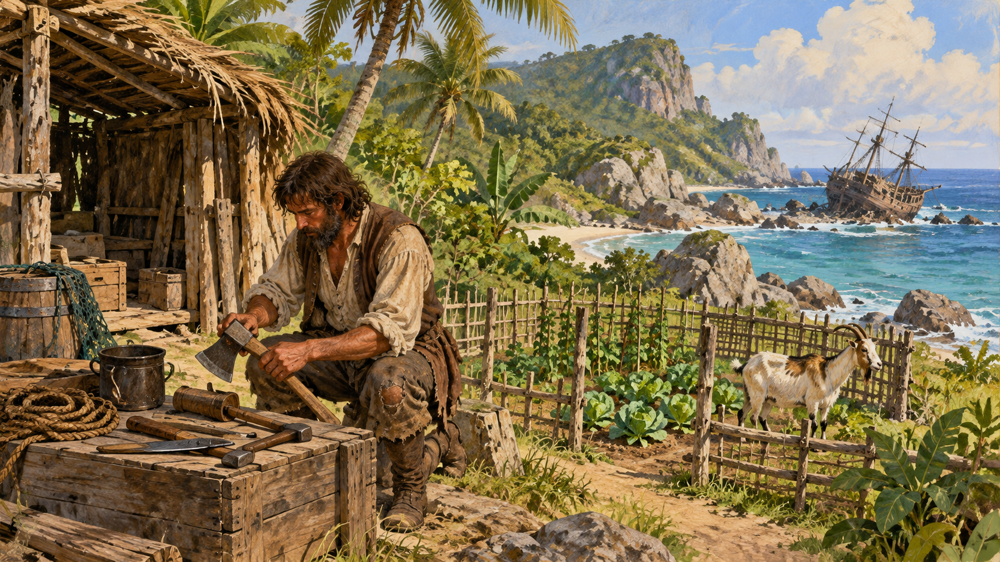

# 『로빈슨 크루소』 — 무인도에는 정말 혼자였을까

*난파선의 연장, 모래 위 발자국, 프라이데이가 바꾼 생존 이야기*

Culture · Literature

> 출처 대조와 공개 게시 승인을 마친 이야기입니다. 실제 게시 여부는 사이트 배포 상태를 따릅니다.

*AI 이야기 장면 삽화 · 소설 속 생존 생활을 떠올린 독립 삽화이며 실제 인물·섬의 사진이나 영화 배우의 모습이 아닙니다.*

무인도에 떨어진 사람은 무엇부터 해야 할까. 흔히 불을 피우거나 집을 지으리라 생각한다. 그런데 『로빈슨 크루소』의 주인공은 먼저 난파선으로 돌아간다. 살아남기 위해 필요한 것은 용기뿐 아니라 이미 다른 사람들이 만들어 둔 연장과 물건이기 때문이다.

대니얼 디포의 소설을 막연히 혼자서 모든 것을 이룬 남자의 이야기로 기억하면 중요한 장면들을 놓친다. 이 글은 섬에 이르기 전의 사연부터 귀환까지 주요 줄거리와 결말을 포함한다.

## 01. 모험을 원한 청년의 불편한 출발

크루소는 안정된 생활을 바라는 가족의 뜻을 거스르고 바다로 나간다. 항해에는 위험과 거래가 함께 따라온다. 그는 브라질에서 농장을 운영하게 되고, 더 많은 노동력을 얻기 위해 아프리카로 사람을 사러 가는 항해에 참여한다. 그 길에서 배가 난파한다.

이 출발은 단순히 낯선 세상을 구경하려 떠난 여행과 다르다. 작품의 경제 활동에는 노예제가 깊이 들어 있다. 크루소 자신이 한때 붙잡혀 억류된 경험과, 이후 타인을 사고파는 체계에 참여하는 일도 함께 등장한다. 주인공을 응원하면서도 그가 서 있는 세계를 빼놓지는 말아야 한다.

## 02. 난파선에서 가져온 문명

홀로 해변에 살아남은 크루소는 배가 완전히 사라지기 전에 여러 차례 물건을 옮긴다. 총과 화약, 먹을 것, 옷과 도구가 그의 생존 기반이 된다. 물건을 싣고 나를 뗏목도 만든다. 섬에서 시작하는 새 생활은 이전 사회와 완전히 끊어진 출발이 아니다.

이 점을 알면 모험이 덜 대단해지는 것이 아니라 더 구체적이 된다. 맨손의 의지만으로 도끼와 총을 만들 수는 없다. 그가 의지하는 물건에는 보이지 않는 장인과 선원들의 노동이 들어 있다. 혼자 살아가는 장면 한가운데 이미 여러 사람의 흔적이 놓여 있는 셈이다.

## 03. 집 한 채보다 오래 걸리는 생활

크루소는 거처를 마련하고 둘레를 막으며 먹을 것을 보관한다. 날짜를 세고, 해야 할 일을 나누고, 몸이 아프면 혼자 견딘다. 독자가 읽는 것은 멋진 탈출 장면만이 아니라 같은 일을 되풀이해야 유지되는 하루다. 생존은 끊임없이 물건을 손질하는 생활로 펼쳐진다.

농사도 한 번에 성공하지 않는다. 곡식이 자라는 것을 발견했다고 바로 빵이 생기지는 않는다. 씨앗을 남기고 수확을 기다리고 저장하는 과정이 뒤따른다. 그릇을 만들거나 물건을 옮기는 일에서도 실패가 나온다. 소설의 자세한 설명은 편리한 일상이 얼마나 많은 단계 위에 서 있는지 보여 준다.

## 04. 바쁜 손과 쓸쓸한 마음

염소를 기르고 생활이 안정되어도 외로움까지 해결되지는 않는다. 일기를 쓰고 성경을 읽으며 자신의 삶에 의미를 찾으려 한다. 작품 속 신앙은 섬 생활에 덧붙인 장식이 아니라 주인공이 불운과 생존을 이해하는 방식의 중요한 부분이다.

현대 독자가 같은 믿음을 가져야 이야기를 읽을 수 있는 것은 아니다. 중요한 것은 크루소에게 먹을 것과 잠자리만큼 삶을 설명할 말도 필요했다는 점이다. 일과 기록과 신앙이 함께 시간을 채운다. 구조될 때까지 멈춰 있는 사람이 아니라, 그 기다림 안에 하나의 생활을 만든 사람으로 바뀐다.

## 05. 발자국 하나가 섬을 뒤집는다

어느 날 모래 위에서 사람의 발자국을 발견한다. 오래 바라던 타인의 흔적이어야 할 것 같은데 크루소의 첫 반응은 공포다. 집을 들키지는 않을까, 누가 다가오는 것은 아닐까 걱정하며 자신이 만든 안전을 다시 점검한다. 섬은 그대로인데 그 섬을 보는 눈이 바뀐다.

외롭다고 해서 낯선 사람이 곧바로 반가운 것은 아니라는 사실이 이 장면을 강하게 만든다. 자신이 통제할 수 있던 세계에 다른 의지가 들어온다. 크루소가 섬의 주인처럼 느끼게 된 과정도 드러난다. 발자국은 타인의 존재인 동시에 소유와 경계에 관한 불안이다.

## 06. 프라이데이에게도 삶이 있었다

크루소는 위기에 놓인 한 사람을 구하고 프라이데이라는 이름을 붙인다. 함께 일하고 말을 익히며 관계를 맺는 과정은 고독한 섬의 분위기를 바꾼다. 크루소에게는 협력자가 생기고, 독자에게는 대화와 새로운 시선이 들어온다.

그러나 이름을 정하는 쪽도, 자신을 주인이라고 부르도록 가르치는 쪽도 크루소다. 프라이데이는 섬에서 태어난 빈 종이가 아니라 이전의 언어와 관계를 가진 사람이다. 구조와 우정이 있다는 이유로 이 불균형이 사라지지는 않는다. 둘의 관계를 읽는 일은 모험담의 재미와 식민주의의 시선을 함께 보는 일이다.

## 07. 귀환하면 끝나는가

마침내 다른 배와 선원들이 이야기 안으로 들어오고, 선상 반란을 둘러싼 사건이 탈출의 기회가 된다. 크루소는 선장을 도우며 섬을 떠날 길을 얻는다. 그러나 소설은 해변에서 배를 발견하는 환호 하나로 모든 문제를 지워 주지 않는다. 바깥에는 그가 떠나온 경제와 인간관계가 여전히 기다린다.

『로빈슨 크루소』는 실제 인물의 일기를 그대로 옮긴 책이 아니라 허구의 인물이 자신의 삶을 말하는 소설이다. 그 목소리가 워낙 구체적이라 우리는 연장과 발자국을 실제 기억처럼 간직한다. 다시 읽을 만한 이유도 거기에 있다. 혼자 살아남았다는 익숙한 한 문장 뒤에서, 그를 살게 한 물건과 타인들의 모습을 새롭게 발견할 수 있기 때문이다.

## 이야기의 바탕이 된 자료

- [Daniel Defoe, The Life and Adventures of Robinson Crusoe](https://raw.githubusercontent.com/GITenberg/The-Life-and-Adventures-of-Robinson-Crusoe_521/master/521-0.txt) · 확인일 2026-11-01
  - 확인 내용: 가족과 항해·브라질 농장과 노예 구매 항해·난파·배의 물자와 도구 회수 / 거처·경작·염소·일기와 신앙·발자국의 공포·프라이데이의 이름과 Master 호칭 / 선상 반란·선장 도움과 귀환. 허구의 1인칭 소설과 실제 자서전을 구별

---

[같은 소주제의 이야기](README.md) · [전체 서가](../../README.md)
