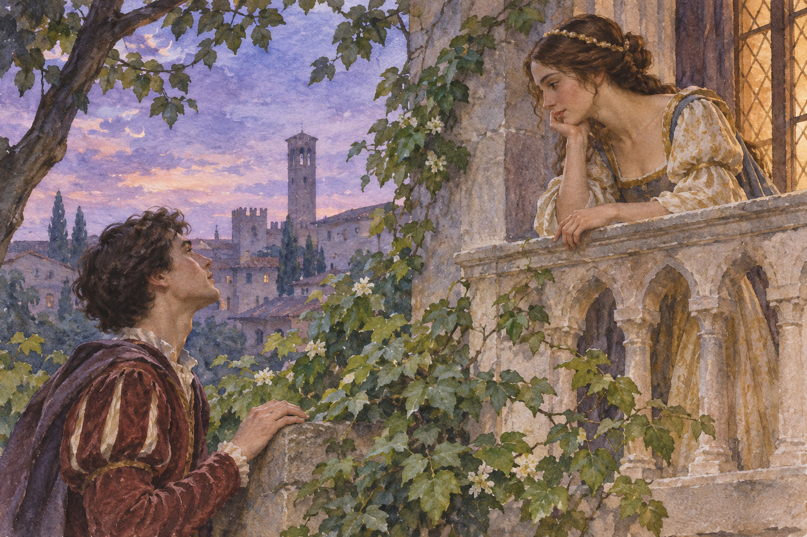

# 로미오와 줄리엣 — 두 사람 사이에 이름과 편지가 놓이다

*사랑보다 먼저 있었던 가문의 다툼에서 시작하는 역사와 작품 읽기*

Culture · Literature

> 출처 대조와 공개 게시 승인을 마친 이야기입니다. 실제 게시 여부는 사이트 배포 상태를 따릅니다.

*AI 관련 장면 삽화 · 작품과 장소를 떠올리기 위한 상상 그림이며 실제 사진·배우 초상·정확한 복원이 아닙니다.*

서로 사랑하는 두 사람이 있는데 가족들은 원수 사이다. 『로미오와 줄리엣』의 출발은 널리 알려져 있다. 그러나 셰익스피어의 비극을 끝까지 따라가면 사랑과 증오만으로 설명되지 않는 일들이 보인다. 결혼의 결정, 거리의 폭력, 어른들의 도움과 전달되지 못한 편지가 서로 얽힌다.

무대는 이탈리아 베로나지만 여기서는 영문학 작품의 맥락으로 읽는다. 아래에는 주요 사건과 결말이 포함된다. 유명한 발코니 장면에서 잠시 더 나아가 두 사람을 둘러싼 도시와 관계가 어떻게 비극을 만들었는지 살펴보자.

## 01. 사랑보다 먼저 있었던 가문의 다툼

몬터규와 캐풀렛 두 집안의 대립은 거리의 싸움으로 번진다. 갈등은 집 안의 말다툼만이 아니라 도시의 안전과 질서를 흔드는 문제다. 로미오와 줄리엣은 자신들이 시작하지 않은 적대 속에서 만난다. 개인에게 주어진 이름이 이미 관계의 조건을 정해 놓은 셈이다.

로미오는 캐풀렛 집안의 잔치에 들어갔다가 줄리엣을 만난다. 서로에게 끌린 뒤에 상대가 어떤 가문에 속하는지의 문제가 따라온다. 작품에서 사랑의 강도만큼 중요한 것은 한 사람을 집단의 이름으로 먼저 판단하는 질서다. 두 사람은 그 질서를 쉽게 벗어날 수 없다.

## 02. 비밀 결혼에 기대를 건 사람들

두 사람은 서로의 뜻을 확인하고 로런스 수사의 도움으로 비밀리에 결혼한다. 수사는 이 결합이 두 가문의 갈등을 누그러뜨릴 가능성도 생각한다. 사랑은 개인의 선택이면서 화해를 위한 방안이 된다. 그러나 그 기대를 다른 사람들이 함께 알고 있는 것은 아니다.

유모 역시 줄리엣과 바깥세계를 잇는 중요한 역할을 한다. 두 사람의 만남은 그들만의 힘으로 이루어지지 않는다. 정보를 전하고 자리를 마련하는 어른들이 필요했다. 비밀을 지키는 도움이 있는 동시에, 그 비밀 때문에 다른 사람들이 행동을 잘못 해석할 여지도 커진다.

## 03. 결혼 뒤의 거리에서 다른 뜻이 충돌하다

티볼트와의 갈등에서 로미오의 태도는 주변 사람들에게 이상하게 보인다. 그는 이미 줄리엣과 결혼했기 때문에 관계를 달리 생각하지만 그 이유를 모두에게 설명할 수 없다. 머큐쇼가 싸움에 휘말려 죽고, 로미오는 티볼트를 죽인다. 사랑을 통해 피하려던 폭력이 더 크게 돌아온다.

그 결과 로미오는 추방된다. 비밀 결혼이 이루어졌다고 안전한 미래가 생긴 것은 아니었다. 같은 행동도 누가 무엇을 알고 있는지에 따라 다른 의미가 된다. 작품의 긴장은 강한 감정에서만 나오지 않고 서로 다르게 나누어 가진 정보에서도 나온다.

## 04. 줄리엣에게는 다른 결혼의 시간이 다가온다

줄리엣의 가족은 파리스와의 결혼을 추진한다. 그녀는 이미 결혼한 사실을 드러내기 어렵고 가족의 요구를 받아들일 수도 없다. 겉으로 보이는 순종과 실제 마음 사이의 거리가 커진다. 집이 가장 가까운 장소이면서 가장 말하기 어려운 공간이 된다.

로런스 수사는 죽은 것처럼 보이게 한 뒤 다시 로미오와 만나게 할 계획을 세운다. 여기에는 정확한 시간과 전달이 필요하다. 계획의 내용을 알고 있는 사람과 시신처럼 보이는 모습만 보게 될 사람의 차이가 결정적이다. 희망은 점점 더 좁은 조건 위에 놓인다.

편지가 닿지 않는 일은 오늘의 독자에게 우연한 사고처럼 보일 수 있다. 그러나 인물들은 충분한 정보를 공유하지 못한 채 빠르게 결정한다. 관객은 이 간격을 미리 알기에 마지막 장면을 단순한 반전보다 막을 수 있었던 비극으로 경험한다.

## 05. 편지보다 잘못된 소식이 먼저 도착하다

로미오에게 계획을 알려야 할 편지는 전달되지 못한다. 그는 줄리엣이 죽었다는 소식을 듣고 돌아온다. 독자는 실제 사정을 알지만 인물은 모른다. 바로 그 차이 때문에 다음 장면을 지켜보는 일이 더욱 고통스러워진다.

무덤에서 로미오는 줄리엣이 깨어나기 전에 죽고, 뒤이어 깨어난 줄리엣도 목숨을 잃는다. 약속한 재회와 실제 도착의 시간이 어긋난다. 비극은 누군가의 악의 하나가 계획대로 성공해서만 일어난 것이 아니다. 서로를 구하려던 방안도 전달이 무너지면 돌이킬 수 없는 결과가 된다.

## 06. 어른의 도움은 왜 충분하지 못했을까

수사와 유모는 중요한 조력자지만 모든 상황을 통제하지는 못한다. 각자의 판단이 바뀌거나 계획이 어긋나면서 두 사람은 더 고립된다. 그래서 작품을 아무 어른도 도와주지 않은 사랑 이야기로만 기억하면 실제 관계의 복잡함이 사라진다.

도움의 의도가 있다는 사실과 그 도움이 충분하다는 사실은 다르다. 개인적인 중재만으로 가문의 권력과 도시의 폭력을 해결하기 어려웠다. 두 사람의 선택을 존중할 공개적인 길이 좁았다는 문제도 남는다. 비밀이 보호막이 되는 동안 동시에 위험의 조건이 된 것이다.

## 07. 화해는 너무 늦게 찾아오다

마지막에 두 가문은 자녀들의 죽음 앞에서 대립을 돌아본다. 그러나 화해가 이루어져도 두 사람의 삶이 회복되지는 않는다. 오래된 증오의 비용이 누가 감당한 손실인지 분명해지는 결말이다. 도시의 질서도 그 비극을 외면할 수 없다.

『로미오와 줄리엣』은 사랑이 강했다는 사실만으로 오래 읽히는 작품이 아니다. 이름과 권력, 도움과 정보, 시간의 어긋남이 함께 인간의 운명을 만든다. 두 사람의 열정을 따라 읽으면서 그들을 둘러싼 관계까지 보면 익숙한 비극이 더 넓고 구체적인 이야기로 다가온다.

## 이야기의 바탕이 된 자료

- [William Shakespeare, Romeo and Juliet](https://raw.githubusercontent.com/GITenberg/The-Tragedy-of-Romeo-and-Juliet_1112/master/1112.txt) · 확인일 2026-11-06
  - 확인 내용: 가문 갈등·비밀 결혼·머큐쇼와 티볼트·추방·편지 미전달·무덤과 결말

---

[같은 소주제의 이야기](README.md) · [전체 서가](../../README.md)
