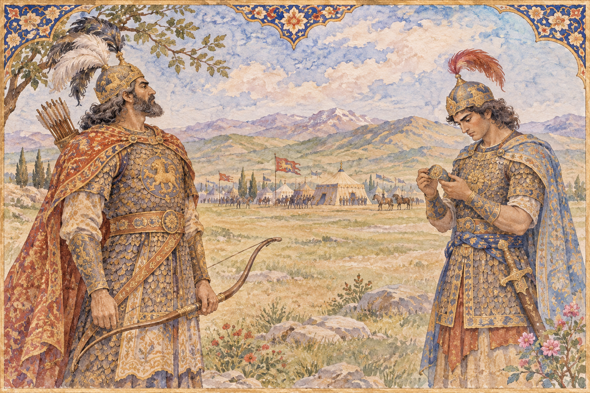

# 로스탐과 소흐라브 — 서로를 알아보지 못한 부자의 결투

*역사가 아닌 서사시를 읽는 자리에서 시작하는 역사와 작품 읽기*

Culture · Literature

> 자료 대조를 마친 검토용 이야기입니다. 공개 게시 승인은 아직 받지 않았습니다.

*AI 관련 장면 삽화 · 작품과 장소를 떠올리기 위한 상상 그림이며 실제 사진·배우 초상·정확한 복원이 아닙니다.*

페르시아의 대서사시 『샤나메』에는 왕과 영웅의 이야기가 길게 이어진다. 그 전체를 몇 장면으로 설명하기보다, 여기서는 로스탐과 소흐라브의 비극에 집중한다. 아버지를 찾는 아들과 상대의 정체를 알지 못한 아버지가 전장에서 만나는 이야기다. 힘이 강하다는 사실은 이들을 구하지 못한다.

## 01. 역사가 아닌 서사시를 읽는 자리

피르다우시의 『샤나메』는 신화적 기원과 전설적인 왕조, 역사와 연결되는 이야기를 함께 품은 작품이다. 로스탐의 활약을 실제 전쟁의 사실 기록처럼 읽어서는 안 된다. 오랜 기억과 이상, 두려움이 시의 형태로 조직된 세계다.

이 글은 그중 한 에피소드의 인물 관계와 결말을 따라간다. 번역과 재화에 따라 표기와 세부 표현이 달라질 수 있다. 로스탐을 루스템으로 적은 오래된 영어 번역도 같은 영웅을 가리킨다. 이름의 차이 때문에 서로 다른 인물로 오해하지 않으면 좋다.

## 02. 만남 뒤에 남은 표지

로스탐과 타흐미네의 만남 뒤에 소흐라브가 태어난다. 아들은 아버지 곁에서 함께 자라지 않는다. 아버지의 이름과 그를 확인할 표지는 남아 있지만, 일상에서 얼굴과 목소리를 익힐 시간은 없었다. 이 간격이 뒤의 비극을 준비한다.

부자 관계는 독자에게 알려져 있으나 당사자들이 같은 정보를 충분히 공유하지 못한다. 이야기를 읽는 사람은 만남이 가까워질수록 기뻐하기보다 불안해진다. 만날 수 있다는 가능성과 제대로 알아보지 못할 수 있다는 위험이 함께 커지기 때문이다.

## 03. 아버지를 찾으려는 아들의 힘

소흐라브는 젊고 강한 전사로 성장한다. 그는 이름난 아버지를 찾으려 하지만 그 바람은 적대하는 세력들의 전쟁과 얽힌다. 가족을 찾는 개인의 목적이 군대와 왕의 이해관계 속에 들어간 것이다.

그에게 필요한 것은 용기만이 아니라 정확한 정보다. 그러나 전장에서는 상대의 이름과 위치를 알려 주는 말도 전략이 된다. 누군가 사실을 감추거나 다른 설명을 하면 개인이 가진 힘만으로 그 장벽을 넘기 어렵다. 소흐라브의 강함과 취약함은 바로 그 지점에서 겹친다.

## 04. 독자가 아는 사실을 전사는 모른다

두 사람이 마주할 때 독자는 이들이 부자라는 사실을 알고 있다. 그래서 무예를 겨루는 장면은 누가 이길지 궁금한 경기와 다르다. 어느 쪽이 이기더라도 끔찍한 결과가 생길 수 있음을 미리 알고 보기 때문이다.

상대를 알아보려는 질문과 감추어진 이름은 전투의 일부가 된다. 진실은 어딘가에 존재하지만 필요한 사람에게 제때 전달되지 않는다. 이 서사에서 무지는 단순히 머리가 나쁘다는 뜻이 아니다. 경쟁과 불신이 정보를 가로막는 상황을 뜻한다.

소흐라브를 기다리는 어머니의 위치도 잊지 말자. 전장에 직접 나서지 않는 사람도 전쟁의 결과를 감당한다. 영웅의 결투에 시선을 모으는 동안 그 뒤에 남겨진 가족의 시간이 사라져서는 안 된다. 죽음의 소식은 무대 밖의 관계까지 바꾸며 비극의 범위를 넓힌다.

이야기의 표지는 누구나 즉시 뜻을 알아볼 수 있는 신분증과 다르다. 그것을 기억하고 관계를 아는 사람이 적절한 때에 보아야 한다. 물건 자체에 진실이 들어 있어도 해석과 전달이 없으면 기능하지 않는다. 이 점에서 팔에 지닌 작은 표지는 거대한 군대보다 결정적인 의미를 갖는다. 아버지의 이름을 찾는 여정이 그 아버지의 손에서 끝난다는 역전은 그래서 오래 기억된다.

## 05. 한 번의 승부로 끝나지 않는 결투

처음 맞붙었을 때 소흐라브는 로스탐을 제압할 기회를 얻는다. 그러나 상대가 내세우는 말과 규칙을 받아들이며 치명적인 결말을 늦춘다. 젊은 전사는 힘에서 앞서면서도 경험과 말의 작용에서는 다른 위치에 놓여 있다.

다시 이어진 싸움에서는 로스탐이 소흐라브에게 치명상을 입힌다. 이 장면의 비극은 강자가 약자를 이겼다는 단순한 결과에 있지 않다. 자신이 지켜야 할 관계를 모르는 채, 승부에서 이기기 위해 가진 능력을 사용했다는 데 있다.

## 06. 표지는 너무 늦게 읽힌다

소흐라브의 말과 몸에 지닌 표지를 통해 로스탐은 상대가 자기 아들임을 깨닫는다. 두 사람의 관계를 증명할 물건은 처음부터 의미가 있었지만, 그것이 읽히는 시점은 돌이킬 수 없는 뒤다. 진실을 아는 것과 진실을 제때 아는 것은 같지 않다.

로스탐의 슬픔은 영웅의 명성을 무력하게 만든다. 이름난 전사가 되어 수많은 상대를 이겨도 이 한 번의 행동을 취소할 수는 없다. 서사시는 영웅을 찬양하는 데서 멈추지 않고 그 힘이 겪는 한계와 책임도 드러낸다.

## 07. 전쟁 속에서 끊어진 가족의 이야기

이 에피소드를 운명이 나빴다는 말로만 마무리하면 인물 주변의 조건을 놓친다. 이름을 숨기는 관행과 적대하는 진영, 왕과 지휘관의 목적이 가족의 만남을 방해한다. 개인적인 비극과 정치적인 세계가 서로 떨어져 있지 않다.

오늘 읽어도 이 이야기가 아픈 것은 서로를 사랑할 가능성이 있었던 사람들이 적으로 만났기 때문이다. 필요한 표지와 말은 존재했지만 이해의 순간이 늦었다. 독자는 결말을 알고 다시 읽으며 앞선 질문과 침묵의 의미를 새롭게 발견할 수 있다. 로스탐과 소흐라브는 힘을 갖추는 일만큼 상대가 누구인지 알아보는 일이 중요하다는 질문을 남긴다.

## 이야기의 바탕이 된 자료

- [Ferdowsi, Shahnameh: Sohrab, translated by James Atkinson](https://raw.githubusercontent.com/GITenberg/The-Persian-Literature-Comprising-The-Shah-Nameh-The-Rubaiyat-The-Divan-and-The-Gulistan-Volu__10315/master/10315-8.txt) · 확인일 2026-11-06
  - 확인 내용: 타흐미네·팔의 표지·아버지 탐색·정보 은폐·첫 결투와 재대결·인지와 애도. 전체 서사시 아닌 에피소드

---

[같은 소주제의 이야기](README.md) · [전체 서가](../../README.md)
