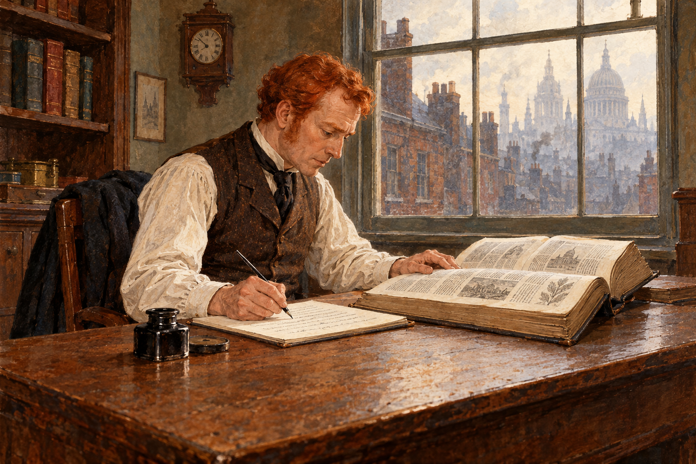

# 붉은 머리 연맹 — 너무 좋은 아르바이트의 비밀

*셜록 홈즈는 이상한 일자리에서 무엇을 보았을까*

Culture · Literature

> 출처 대조와 공개 게시 승인을 마친 이야기입니다. 실제 게시 여부는 사이트 배포 상태를 따릅니다.

*KnowledgeWalk 제작 AI 삽화 · 필사하는 윌슨의 상황을 새로 상상한 장면 · 실제 인물·영화·옛 출판 도판을 복제한 자료가 아닙니다.*

머리카락이 붉다는 이유만으로 돈을 받는 자리가 있다. 해야 할 일은 정해진 시간에 사무실에 와서 백과사전을 베끼는 것뿐이다. 이상하지만 돈은 제대로 지급된다. 아서 코넌 도일의 셜록 홈즈 이야기 「붉은 머리 연맹」은 이렇게 우스운 구인 광고로 독자를 불러들인다.

사소하고 기묘해 보이는 조건이 사실은 누군가에게 매우 중요한 장치였다. 무엇이 이상한가를 알아차리는 일과 그 이상함이 누구에게 도움이 되는지 묻는 일은 다르다. 아래에는 사건의 해결과 결말이 포함되어 있다.

## 1. 전당포 주인이 가져온 고민

제이베즈 윌슨은 런던에서 작은 전당포를 운영한다. 그의 조수 빈센트 스폴딩은 신문 광고를 보여 주며 붉은 머리 남성들을 위한 자리를 권한다. 윌슨에게는 평범한 영업 외에 안정적인 수입이 생길 기회처럼 보인다.

이야기는 의사 왓슨이 홈즈와 함께 윌슨의 말을 듣는 방식으로 진행된다. 독자도 손님과 같은 정보를 전달받지만 홈즈는 무엇을 따로 기억하는지 충분히 알려 주지 않는다. 같은 설명을 들으면서 서로 다른 것에 주목하는 사람들의 차이가 추리의 재미를 만든다.

## 2. 일자리는 경쟁 끝에 주어진다

지원 장소에는 붉은 머리의 남자들이 많이 모여 있다. 윌슨은 자신의 머리색을 확인받고 자리를 얻는다. 별것 아닌 조건이 엄격하게 검사되고 경쟁까지 벌어지자, 이상한 일은 오히려 제대로 운영되는 제도처럼 보이기 시작한다.

이런 장면은 사람의 믿음을 만드는 방식도 보여 준다. 줄을 선 사람이 많고 담당자가 까다롭게 굴면 기회가 희귀하고 중요하다고 느끼기 쉽다. 그러나 많은 지원자와 정교한 절차가 있다고 해서 일자리의 목적까지 정당하다는 보장은 없다. 소설은 그 틈을 장난스럽게 이용한다.

## 3. 중요한 것은 베낀 내용이 아니었다

윌슨이 하는 일은 백과사전을 손으로 옮겨 쓰는 것이다. 근무 시간은 오전 열 시부터 오후 두 시까지이고, 그동안 사무실을 떠나면 안 된다. 보수는 주당 4파운드다. 반복해서 잘 지급되니 처음의 의심은 누그러진다.

독자는 무엇을 왜 베끼는지에 관심을 갖게 되지만 다른 질문도 가능하다. 이 일이 실제로 생산하는 것은 글의 사본뿐일까. 근무 시간 동안 윌슨이 어디에 없게 되는지 생각하면 사건의 방향이 바뀐다. 노동의 결과보다 사람의 자리를 일정하게 비워 두는 일이 중요할 수 있다.

## 4. 어느 날 갑자기 사라진 연맹

일이 계속되던 어느 날 윌슨은 연맹이 해산되었다는 안내를 발견한다. 설명해 줄 사람은 없고 담당자의 정체도 분명하지 않다. 자신이 일한 이유보다 갑자기 수입을 잃었다는 당혹감이 먼저 든다. 그는 이 이상한 일을 홈즈에게 가져온다.

이미 돈을 받았으니 속은 것이 없다고 생각할 수도 있다. 하지만 누군가가 보수를 지급해서라도 얻고 싶었던 것이 무엇인지가 남는다. 겉으로 보이는 거래가 손해처럼 보이지 않아도, 그 거래 뒤에 다른 계획이 있을 수 있다. 홈즈는 광고의 기묘함을 감상하는 데서 멈추지 않는다.

## 5. 조수의 다른 모습과 전당포의 위치

홈즈는 전당포 주변을 살피고 조수와도 마주친다. 윌슨이 말한 조수의 사진 취미와 지하실에 머무는 습관은 다른 뜻을 얻는다. 홈즈가 주목한 바지 무릎의 흔적도 그 사람이 몸을 어떻게 사용했는지 생각하게 하는 단서다.

거리에서 보이는 건물의 앞면만으로는 충분하지 않다. 전당포 뒤쪽이 어떤 장소와 이어지는지 살펴야 한다. 홈즈가 골목과 주변을 확인하는 장면은 작은 점포를 더 큰 공간 안에 놓는다. 이야기의 지도는 종이에만 있는 것이 아니라 건물의 배치 속에도 있다.

## 6. 붉은 머리가 필요했던 진짜 이유

목표는 가까운 은행의 지하에 보관된 금이었다. 범인들은 전당포 지하에서 은행 쪽으로 통로를 만들려 했다. 이를 위해 주인인 윌슨을 매일 일정한 시간 가게 밖에 두는 장치가 필요했다. 조수가 상대적으로 적은 보수로 일하던 이유도 이 계획 속에서 달라 보인다.

붉은 머리라는 조건과 백과사전 필사는 윌슨을 특별히 선택된 사람처럼 느끼게 하는 무대였다. 임금을 실제로 지급한 것도 계획을 유지하기 위한 비용이었다. 이상한 일자리와 진지한 범죄가 서로 무관한 이야기가 아니었던 것이다. 연맹이 사라진 시점은 준비가 끝났다는 신호로 읽힌다.

## 7. 기다림 끝에 통로가 열린다

홈즈와 동료들은 은행 지하에서 범인들이 나타나기를 기다린다. 밝은 사무실에서 우스운 사연을 듣던 분위기는 어두운 공간의 긴장으로 바뀐다. 조수로 행세한 인물의 정체와 계획이 드러나고 범행은 저지된다.

홈즈는 나중에 자신이 어떤 단서를 연결했는지 설명한다. 독자는 앞에서 이미 읽었던 정보를 다시 보게 된다. 처음에는 지나친 머리색 검사나 근무 규정이 웃음의 재료였지만, 결말 뒤에는 목적을 달성하기 위해 짜인 조건으로 바뀐다. 다시 읽을 때 재미가 남는 이유다.

## 8. 이상함을 어디에 연결할 것인가

이 이야기는 세상에서 너무 좋은 제안을 만나면 모두 범죄라고 생각하라는 설명서가 아니다. 소설의 즐거움은 관찰한 것들이 하나의 목적과 공간 안에서 맞물리는 순간에 있다. 단서를 많이 보는 일뿐 아니라 어느 질문을 던질지가 중요하다.

함께 실은 AI 삽화는 백과사전을 베끼는 윌슨의 상황을 새로 상상했다. 사건의 지도를 그려 정답을 먼저 알려 주는 그림은 아니다. 평범하게 책상 앞에 앉은 사람이 어떤 계획의 일부가 되어 있는지, 본문을 따라가며 조금 늦게 알아차리는 재미를 남겨 두었다.

## 이야기의 바탕이 된 자료

- [아서 코넌 도일 — The Adventures of Sherlock Holmes, The Red-Headed League 원문](https://raw.githubusercontent.com/GITenberg/The-Adventures-of-Sherlock-Holmes_1661/master/1661.txt) · 확인일 2026-10-30
  - 확인 내용: 윌슨·스폴딩·주당 4파운드·오전 10시~오후 2시 필사 / 연맹 해산·조수와 지하실·은행을 향한 통로·체포와 해결

---

[같은 소주제의 이야기](README.md) · [전체 서가](../../README.md)
