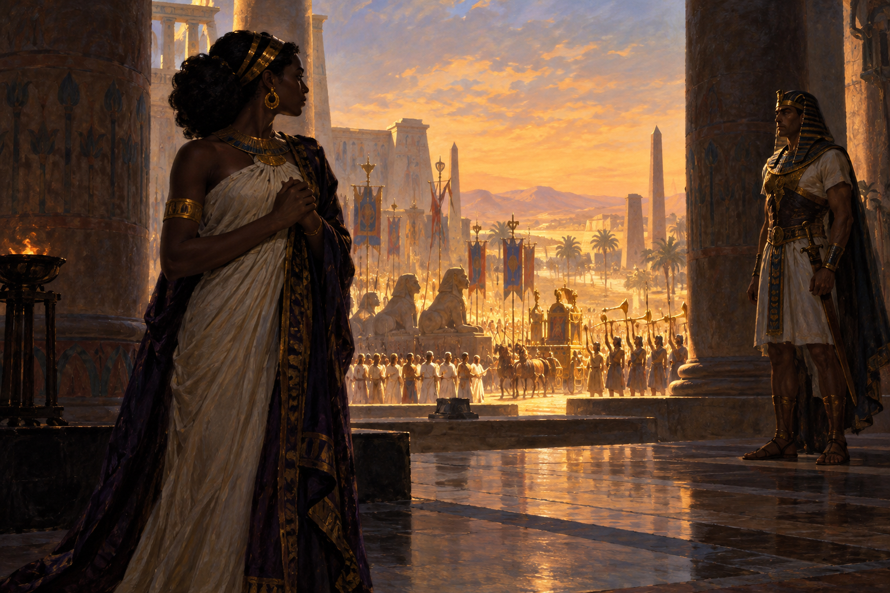

# 『아이다』 — 개선행진곡이 울릴 때 슬퍼하는 사람들

*베르디의 화려한 승리 장면 뒤에 숨은 세 사람의 비극*

Culture · Music

> 출처 대조와 공개 게시 승인을 마친 이야기입니다. 실제 게시 여부는 사이트 배포 상태를 따릅니다.

*AI 이야기 장면 삽화 · 오페라의 개선 행렬과 사적인 슬픔을 대비한 독립 삽화입니다. 실제 고대 이집트의 의상·행사나 특정 공연을 고증한 자료가 아닙니다.*

## 소제목 바로가기

- [01. 노예로 살지만 왕의 딸인 사람](#user-content-part-1)
- [02. 승리하고 돌아오라는 말의 두 뜻](#user-content-part-2)
- [03. 거짓 소식으로 알아낸 비밀](#user-content-part-3)
- [04. 가장 큰 소리가 가장 복잡한 장면](#user-content-part-4)
- [05. 강가의 밤에 고향을 떠올리다](#user-content-part-5)
- [06. 둘만의 도망이 둘만의 일이 아니었다](#user-content-part-6)
- [07. 살리고 싶어졌을 때에는 늦었다](#user-content-part-7)
- [08. 위의 기도와 아래의 작별](#user-content-part-8)

행진곡이 울리고 군대가 돌아온다. 무대는 사람과 깃발로 가득하고 관객은 승리의 규모에 압도된다. 그런데 그 장면에 있는 모두가 기쁜 것은 아니다. 『아이다』의 재미와 아픔은 이렇게 같은 음악 아래 서로 다른 마음이 놓인다는 데 있다.

베르디의 오페라는 1871년 카이로에서 초연되었다. 안토니오 기슬란초니가 대본을 썼고, 고대 이집트를 무대로 삼는다. 다만 실제 고대의 한 사건을 그대로 재현한 역사는 아니다. 여기서는 주요 줄거리와 비극의 결말까지 따라가 본다.

## 01. 노예로 살지만 왕의 딸인 사람

아이다는 이집트에서 포로이자 노예의 처지로 살아간다. 하지만 본래 에티오피아 왕 아모나스로의 딸이다. 사랑하는 사람은 이집트의 장수 라다메스다. 두 사람이 가까워지고 싶다는 소망은 처음부터 전쟁과 신분의 벽 안에 놓인다.

게다가 이집트 왕의 딸 암네리스도 라다메스를 사랑한다. 두 여인의 마음이 같은 사람을 향하지만, 그 마음을 표현하고 상대를 압박할 수 있는 힘은 같지 않다. 아이다의 말 한마디에는 위험이 따르고 암네리스의 의심에는 권력이 붙는다. 단순한 삼각관계만으로 보기 어려운 이유다.

## 02. 승리하고 돌아오라는 말의 두 뜻

라다메스는 전쟁에서 공을 세우면 아이다와의 미래도 열릴 것이라고 기대한다. 그가 부르는 「청아한 아이다」에는 사랑과 희망이 담긴다. 한편 전쟁을 앞둔 아이다에게는 승리를 바라는 말조차 쉬울 수 없다. 연인이 이기면 고향과 가족이 패할 수 있기 때문이다.

아이다의 「이기고 돌아오라」는 바로 그 충돌을 드러낸다. 남들이 한 방향으로 외치는 말을 자신은 같은 마음으로 외칠 수 없다. 그녀가 갈등하는 까닭은 사랑이 부족해서가 아니다. 누구를 바라보느냐에 따라 바라는 결과가 달라지는 상황에 있기 때문이다.

## 03. 거짓 소식으로 알아낸 비밀

암네리스는 아이다의 마음을 확인하려 라다메스가 죽었다고 말한다. 아이다가 크게 흔들리는 반응을 보자 의심은 확신으로 바뀐다. 누군가를 떠보는 짧은 대화이지만 두 사람의 힘의 차이가 선명하게 드러난다. 한쪽은 정보를 시험 삼아 쓸 수 있고 다른 쪽은 그 말에 삶이 흔들린다.

암네리스에게도 진심은 있다. 그러나 진심이 있다고 해서 상대를 위협하고 선택을 빼앗는 행동이 정당해지지는 않는다. 작품은 그녀의 질투를 음악으로 강하게 들려주면서도, 나중에는 자기 행동이 불러온 결과 앞에서 무너지는 모습까지 보여 준다. 처음부터 감정이 하나인 악역으로만 남지 않는다.

## 04. 가장 큰 소리가 가장 복잡한 장면

라다메스가 승리해 돌아오는 개선 장면은 이 작품의 유명한 볼거리다. 군대와 시민, 왕과 사제, 포로들이 한곳에 모인다. 행진과 합창은 이집트의 힘을 드러낸다. 그러나 아이다의 눈에는 그 행렬 속에 잡혀 온 아버지가 보인다.

아모나스로는 자신의 왕이라는 신분을 감춘다. 라다메스는 포로들의 생명을 살려 달라고 청하고, 왕은 일부를 풀어 주되 아이다와 아버지는 남긴다. 이어 승리의 보상으로 암네리스와 라다메스의 결혼을 정한다. 모두가 환호하는 순간 두 연인의 길은 오히려 막힌다. 음악의 겉모습과 인물의 속마음이 어긋나는 장면이다.

## 05. 강가의 밤에 고향을 떠올리다

웅장한 낮의 장면 뒤에는 다른 크기의 음악이 온다. 아이다는 고향의 푸른 하늘과 익숙한 풍경을 그리워한다. 승리의 언어로는 설명되지 않던 한 사람의 상실이 앞으로 나온다. 「오, 나의 고향이여」로도 알려진 노래가 인상적인 것은 화려한 무대 안에 없는 장소를 듣게 하기 때문이다.

아버지는 딸의 사랑을 알아채고 라다메스에게서 군사 정보를 얻으라고 요구한다. 아이다는 연인과 조국 사이에서 더 날카로운 압박을 받는다. 가족을 사랑하라는 말도 이 순간에는 딸을 움직이는 힘이 된다. 어느 쪽을 택해도 상처 없이 빠져나갈 길이 잘 보이지 않는다.

## 06. 둘만의 도망이 둘만의 일이 아니었다

아이다는 라다메스와 함께 달아날 길을 이야기한다. 그는 지나갈 경로에 관한 정보를 말하고, 숨어 있던 아모나스로는 그 내용을 듣는다. 비밀이 밖으로 나왔음을 알게 된 라다메스는 자신이 어떤 일을 했는지 깨닫는다. 사랑을 위한 대화가 군사적인 사건이 된다.

암네리스와 사제들이 나타나고 아이다와 아버지는 달아나지만 라다메스는 남는다. 여기서 비극은 한 사람의 말실수만으로 생긴 것이 아니다. 연인을 택하는 행동이 국가에 대한 배신으로 읽히는 구조, 가족과 전쟁이 사적인 관계 안으로 들어와 있던 상황이 함께 작동한다.

## 07. 살리고 싶어졌을 때에는 늦었다

암네리스는 이제 라다메스를 살리려 한다. 그러나 그가 아이다를 버리고 자신에게 돌아오기를 바라는 마음과 상대를 살리고 싶은 마음이 쉽게 분리되지는 않는다. 라다메스는 그녀가 원하는 답을 주지 않는다. 심판은 진행되고, 그는 지하 공간에 갇혀 생을 마감하는 형을 받는다.

암네리스의 지위도 결과를 마음대로 바꾸지 못한다. 질투로 상대를 움직일 수 있다고 생각했던 인물은 마침내 사제들의 판단 앞에서 절망한다. 힘을 가졌던 사람마저 자신이 들어간 체계를 멈출 수 없게 된다. 그때 그녀의 고통도 관객에게 가까이 들린다.

## 08. 위의 기도와 아래의 작별

마지막 무대는 위와 아래로 나뉜다. 갇힌 라다메스는 아이다가 이미 그곳에 와 있음을 알게 된다. 두 사람은 지상과 작별하는 노래를 부르고, 위에서는 암네리스가 평화를 빈다. 장대한 개선 장면과 달리 마지막의 힘은 가까운 목소리와 조용한 이별에서 나온다.

이 결말은 사랑한다면 함께 죽어야 한다는 생활의 본보기가 아니다. 살아서 함께할 길을 허락하지 않은 세계의 비극이다. 다음에 개선행진곡을 듣게 되면 승리의 행렬 옆에도 시선을 주어 보자. 『아이다』는 가장 크게 환호하는 음악 안에서조차 들리지 않는 슬픔이 있을 수 있음을 끝까지 기억하게 한다.

## 이야기의 바탕이 된 자료

- [George P. Upton, The Standard Operas, 12th edition — Aida / The Barber of Seville](https://raw.githubusercontent.com/GITenberg/The-Standard-Operas--12th-edition---13-Their-Plots-Their-Music-and-Their-Composers_14968/master/14968-8.txt) · 확인일 2026-11-01
  - 확인 내용: Aida의1871카이로·인물과갈등·CelesteAida/Ritornavincitor/개선행진/Ocieliazzurri/마지막상하무대 / Barber의1816로마·Sterbini/Beaumarchais·변장과편지·Largoalfactotum/Unavocepocofa/Lacalunnia. 잘못된초연일/시대에뒤진최후작주장과근거부족한작곡일화를제외
- [Charles Annesley, The Standard Operaglass — Aïda / The Barber of Seville](https://raw.githubusercontent.com/GITenberg/The-Standard-OperaglassDetailed-Plots-of-One-Hundred-and-Fifty-one-Celebrated-Operas_24647/master/24647-8.txt) · 확인일 2026-11-01
  - 확인 내용: Aida의아모나스로신분은폐·군사정보·Ramphis·암네리스의시도·지하결말 / Barber의알마비바/린도로·로지나/바르톨로·음악교사/바질리오·공증인/혼인. 옛저자의인종및성별평가는반복하지않음

---

[같은 소주제의 이야기](README.md) · [전체 서가](../../README.md)
