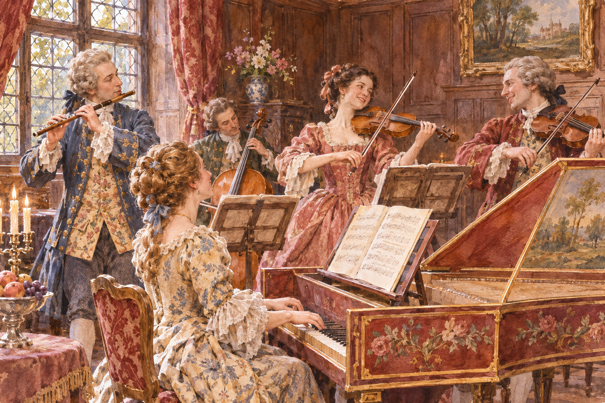

# 브란덴부르크 협주곡 — 같은 이름 아래 여섯 가지 합주가 모인 이유

*바흐의 헌정 묶음과 독주 그룹·합주·악기 색채를 비교하기*

Culture · Music

> 출처 대조와 공개 게시 승인을 마친 이야기입니다. 실제 게시 여부는 사이트 배포 상태를 따릅니다.

*AI 관련 장면 삽화 · 작품과 장소를 떠올리기 위한 상상 그림이며 실제 사진·배우 초상·정확한 복원이나 설계도가 아닙니다.*

『브란덴부르크 협주곡』은 한 곡이 아니라 바흐의 협주곡 여섯 곡을 가리킨다. 같은 제목을 달고 있지만 편성과 음색은 서로 다르다. 이 음악을 들을 때에는 웅장한 관현악을 한 덩어리로 듣기보다 누가 앞으로 나오고 누가 다른 소리를 받쳐 주는지 귀를 기울여 보자.

## 01. 제목에 들어간 것은 장소보다 수신인이다

이 이름은 바흐가 브란덴부르크의 크리스티안 루트비히 변경백에게 작품들을 바친 일과 연결된다. 1721년 3월 24일 날짜의 헌정문이 그 관계를 보여 준다. 음악의 제목은 풍경을 묘사하는 표지가 아니라 작품이 누구에게 전달되었는지를 기억하는 표지가 된 셈이다.

바흐가 여섯 곡 모두를 같은 날 처음부터 새로 작곡했다고 생각할 필요는 없다. 여러 작업의 경험이 헌정 묶음 안에 모였다. 작품이 만들어진 시간과 정리해서 누군가에게 건넨 시간이 같지 않을 수 있다는 점은 음악사를 읽을 때 중요하다.

## 02. 쾨텐의 궁정에서 일한 음악가

바흐는 당시 쾨텐에서 궁정 음악을 맡았다. 교회의 예배를 위한 작품만이 아니라 연주자들과 함께하는 기악 작업이 중요한 환경이었다. 작곡가는 머릿속의 소리만이 아니라 실제로 누가 무엇을 연주할 수 있는지 생각해야 했다.

궁정의 취향과 연주자의 능력, 작품을 후원받는 관계가 음악의 바깥에만 있었던 것은 아니다. 어떤 악기를 앞에 세울 수 있는가 하는 선택에도 연결된다. 이 협주곡들은 한 사람의 천재성뿐 아니라 여러 연주자가 소리를 주고받을 수 있었던 환경을 떠올리게 한다.

## 03. 한 명의 영웅보다 여러 목소리의 대화

오늘의 협주곡 하면 독주자 한 명과 큰 오케스트라가 마주 선 모습을 떠올리기 쉽다. 그러나 이 곡들에서는 여러 독주 악기와 합주가 다양한 관계를 맺는다. 작은 그룹과 전체가 대비되는 바로크 협주곡의 관습이 중요한 출발점이다.

그렇다고 여섯 곡을 똑같은 공식으로 들을 수는 없다. 어떤 곡은 관악기의 뚜렷한 색이 앞서고, 어떤 곡은 현악기 사이의 짜임이 중심이 된다. 제목보다 악기의 구성을 먼저 확인하면 서로 다른 음악을 같은 분위기로 뭉뚱그리지 않게 된다.

작은 독주 그룹과 전체 합주의 차이를 처음부터 전문 용어로 외울 필요는 없다. 사람이 적게 말할 때와 여럿이 함께 말할 때 소리의 두께가 어떻게 달라지는지 들어 보면 된다. 주제가 돌아올 때마다 누가 함께 연주하는지 확인하는 간단한 질문으로 음악의 구조에 접근할 수 있다.

연주를 여러 번 들을 수 있다면 첫 번째에는 높은 소리, 두 번째에는 낮은 소리를 따라가 보자. 한 번에 모든 성부를 알아듣지 못해도 괜찮다. 앞에서 들은 선율이 다른 악기의 움직임과 어떤 관계를 맺는지 조금씩 드러난다. 반복해서 듣는 시간이 곡의 짜임을 알아보는 방법이 된다.

## 04. 제2번에서 귀를 붙드는 높은 소리

제2번에서는 트럼펫을 비롯한 서로 다른 독주 악기들의 색을 비교할 수 있다. 높은 음역의 선명한 소리는 다른 악기들 사이에서 쉽게 드러난다. 하지만 가장 잘 들리는 악기만 따라가면 그 소리가 쉬는 동안 다른 성부가 이어 가는 움직임을 놓친다.

큰 소리와 작은 소리를 단순한 우열로 보지 말자. 음악은 서로 다른 재료를 같은 높이로 칠해 버리지 않고 차이를 이용한다. 한 성부가 내놓은 움직임을 다른 성부가 이어받는 순간을 찾으면, 화려함 안에서 섬세한 대화가 들리기 시작한다.

## 05. 제5번에서 건반이 앞으로 나오는 순간

제5번의 중요한 즐거움은 하프시코드가 단순한 바탕에 머물지 않는다는 점이다. 플루트와 바이올린, 건반이 관계를 이루는 가운데 건반의 존재가 크게 부각된다. 여러 성부를 오가며 두드러지는 건반의 움직임에 집중하면 그 변화를 느낄 수 있다.

평소 다른 악기를 받쳐 준다고 생각했던 소리가 갑자기 무대의 중심을 차지하면 익숙한 역할의 구분도 흔들린다. 현대 피아노 협주곡과 같은 것으로 부르기보다, 이 작품 안에서 건반이 맡는 구체적인 일을 들어 보는 편이 흥미롭다.

## 06. 제6번에는 바이올린이 없다

제6번은 높은 바이올린 소리가 없는 현악 편성으로 다른 색을 만든다. 비올라와 비올라 다 감바 등 낮고 중간 음역의 악기들이 어울린다. 악기 하나를 빼는 선택도 새로운 악기를 더하는 것만큼 전체의 분위기를 바꿀 수 있다.

늘 맨 앞에 있을 것 같은 목소리가 빠지면 다른 소리의 결이 드러난다. 제2번의 밝고 선명한 인상과 제6번의 질감을 나란히 들어 보자. 곡에 대한 좋고 싫음의 판단을 잠시 미루고 어떤 소리의 조합이 그런 인상을 만드는지 확인할 수 있다.

## 07. 헌정된 작품과 실제로 들린 음악 사이

변경백에게 악보가 전달되었다고 그곳에서 어떤 연주가 이루어졌는지까지 모두 확실해지는 것은 아니다. 오래된 전기들에도 수신인의 반응과 연주 여부에 대한 빈칸이 남아 있다. 중요한 문서가 남았다는 사실과 모든 사정을 알 수 있다는 판단은 다르다.

오늘 우리는 그 빈칸을 지나 여섯 곡을 연이어 들을 수 있다. 처음에는 제2번·제5번·제6번처럼 음색 차이가 큰 곡을 비교하고, 다음에는 한 곡 안에서 목소리가 교대하는 순간을 찾아보면 좋다. 제목을 외운 다음의 감상이 악기들이 관계 맺는 방식을 듣는 경험으로 넓어진다.

## 이야기의 바탕이 된 자료

- [Herbert Francis Peyser, Johann Sebastian Bach](https://raw.githubusercontent.com/GITenberg/Johann-Sebastian-Bach_48977/master/48977-0.txt) · 확인일 2026-11-06
  - 확인 내용: 쾨텐·크리스티안 루트비히·1721년 3월 24일 헌정·여섯 곡·악기 그룹과 합주·제2번 트럼펫·제6번 바이올린 부재. 전기의 추측을 확정 사실로 쓰지 않음
- [J. N. Forkel / Charles Sanford Terry, Johann Sebastian Bach: His Life, Art and Work](https://raw.githubusercontent.com/GITenberg/Johann-Sebastian-Bach-his-Life-Art-and-Work_35041/master/35041-0.txt) · 확인일 2026-11-06
  - 확인 내용: 여섯 협주곡의 목록·제5번 현악/플루트/건반·제6번 편성·협주곡의 성부 관계

---

[같은 소주제의 이야기](README.md) · [전체 서가](../../README.md)
