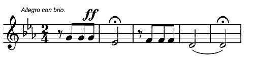

# 베토벤 교향곡 제5번 — 네 음은 어떻게 긴 이야기가 될까

*운명이라는 이름을 잠시 내려놓고 듣는 네 악장*

Culture · Music

> 자료 대조를 마친 검토용 이야기입니다. 공개 게시 승인은 아직 받지 않았습니다.

*베토벤 원작 · 19세기 교향곡 해설서 수록 악보 일부 · Project Gutenberg*

[이미지 출처·제작 근거](https://raw.githubusercontent.com/GITenberg/Beethoven-s-Symphonies-Critically-Discussed_40849/master/40849-h/images/p_061.jpg) · 퍼블릭 도메인 원작의 역사적 재현 자료 · Project Gutenberg 수록본

세 번 짧게, 한 번 길게. 베토벤 교향곡 제5번의 시작은 클래식 제목을 잘 몰라도 알아듣는 사람이 많다. 너무 익숙해서 처음 네 음만 확인하고 이미 곡 전체를 안다고 느끼기 쉽다. 하지만 그 짧은 시작은 긴 음악의 문에 가깝다.

작품은 다단조 교향곡 제5번, 작품번호 67이다. ‘운명’이라는 이름이 널리 쓰이지만 그 한 단어로 모든 장면을 정리하지 않고, 작은 음형이 어떻게 돌아오고 달라지는지 따라가 보자. 악보를 읽지 못해도 시작할 수 있다.

## 1. 악보에는 음뿐 아니라 멈춤도 있다

함께 실은 것은 옛 교향곡 해설서가 실은 실제 악보 일부다. 세 개의 짧은 음 뒤에 오래 머무는 음이 나오고, 그 앞의 쉼과 늘임표, 강하게 내라는 표기도 보인다. 익숙한 ‘따따따단’을 글자로만 적으면 빠지는 정보들이다.

처음 들어 볼 때는 소리가 난 순간뿐 아니라 멈추어 있는 순간도 기다려 보자. 다음 음이 언제 올지 생기는 기대가 시작의 힘을 만든다. 같은 네 음이라도 얼마나 밀고 어디에서 머무느냐에 따라 인상이 달라질 수 있다. 리듬은 음의 개수만을 뜻하지 않는다.

## 2. ‘운명’은 듣기 좋은 문이지만 유일한 설명은 아니다

옛 해설서에도 운명이 문을 두드린다는 유명한 설명이 등장한다. 이런 이야기는 짧은 시작을 기억하는 데 도움을 준다. 다만 그것을 곡의 모든 부분을 해석하는 확정된 작곡 일지처럼 취급할 필요는 없다. 이번에 확인한 자료의 정식 표제는 번호와 조성으로 작품을 식별한다.

운명과 싸워 이긴다는 이야기로 들어도 좋지만, 다른 방식의 듣기도 가능하다. 어떤 음형이 끊기지 않고 이어지는지, 다른 악기로 넘어갈 때 무엇이 달라지는지 듣는 것이다. 친숙한 별명 곁에 음악이 실제로 만드는 관계를 놓으면 곡이 한 가지 줄거리보다 넓어진다.

## 3. 제1악장 — 같은 말이 자꾸 다른 자리에서 나온다

첫 악장에서는 시작의 리듬을 떠올리게 하는 움직임이 여러 자리에서 귀를 붙잡는다. 강하게 몰아붙이는 순간과 잠시 다른 표정이 열리는 부분이 이어지지만, 처음의 긴장은 쉽게 사라지지 않는다. 짧은 재료를 얼마나 길고 다양하게 쓸 수 있는지 느끼게 한다.

반복은 제자리에서 같은 말을 하는 것만은 아니다. 다른 높이와 다른 악기, 더 큰 소리와 작은 소리에서 돌아올 수 있다. 처음에는 어디서 다시 알아듣게 되는지 찾고, 다음에는 그때 주변의 소리가 어떤지 들어 보자. 모르는 악기 이름을 모두 알아야 할 필요는 없다.

## 4. 제2악장 — 걸음이 느려져도 흐름은 이어진다

두 번째 악장에서는 첫 악장보다 넓게 노래하는 선율과 차분한 걸음을 만난다. 계속 긴박하게 몰아붙이는 한 편의 음악을 예상했다면 의외로 느껴질 수 있다. 한 작품 안에서도 다른 종류의 시간이 열리는 것이다.

그렇다고 모든 긴장이 사라져 편안한 배경음악만 되는 것은 아니다. 선율이 다시 나타날 때 주변의 짜임과 힘이 달라지는지 귀를 기울여 보자. 부드러운 부분과 더 당당하게 들리는 부분을 비교하면 느린 악장에도 변화의 폭이 있다는 점을 알 수 있다.

## 5. 제3악장 — 낯익은 리듬이 그림자를 드리운다

세 번째 악장에서는 낮은 소리와 조심스러운 움직임, 강하게 나타나는 부분의 대비를 느낄 수 있다. 앞에서 들은 리듬의 성격을 떠올리게 하는 대목도 있다. 첫 악장의 기억이 완전히 닫히지 않고 다른 표정으로 남는 셈이다.

이 부분을 비밀스러운 밤이나 긴장된 발걸음처럼 상상해도 좋지만, 그것이 작곡가가 정해 둔 장면이라고 할 필요는 없다. 조용하다는 것이 단지 쉬는 시간은 아니라는 점을 들어 보자. 소리가 작아질수록 다음에 무엇이 나올지 기다리는 감각이 커지기도 한다.

## 6. 마지막 악장으로 넘어가는 길을 놓치지 않기

세 번째에서 네 번째로 이어지는 부분은 전체를 듣는 중요한 이유 중 하나다. 소리가 쌓이고 기다림이 길어지다가 마지막 악장의 넓고 강한 소리로 나아간다. 처음 네 음만 따로 들었을 때는 만날 수 없는 긴 호흡이다.

이때 느끼는 해방감이나 밝음은 앞에서 어떤 시간을 거쳤는지와 연결된다. 끝부분만 떼어 들으면 웅장한 소리이지만, 그전의 긴장을 기억하며 들으면 다른 무게를 가진다. 음악의 의미가 한 선율 안에만 있는 것이 아니라 순서와 지나온 시간에도 있다는 점을 보여 준다.

## 7. 제4악장 — 끝났다고 생각한 뒤에도 더 듣게 된다

마지막 악장에서는 힘차게 나아가는 흐름 속에서도 앞선 악장의 기억이 되살아나는 순간이 있다. 직선으로 밝은 결론에 도착한다고만 예상하면 이런 되돌아옴을 놓칠 수 있다. 작품은 지나온 소리를 다시 떠올리게 하면서 끝을 향한다.

마무리가 길게 느껴질 때에는 언제 끝나는지 맞히려 하기보다 끝을 준비하는 힘이 어떻게 유지되는지 들어 보자. 한 번의 큰 소리로 닫는 것과 여러 번 확인하며 닫는 것은 다른 경험이다. 이 곡이 짧은 표어가 아니라 길게 진행되는 음악이라는 사실이 마지막까지 남는다.

## 8. 네 음을 안다는 것에서 한 작품을 듣는 것으로

처음에는 제1악장, 다음에는 제3악장에서 제4악장으로 넘어가는 부분을 들어도 좋다. 여유가 생기면 네 악장을 이어 들으며 서로 다른 표정이 어떻게 한 작품을 이루는지 살펴보자. 정해진 감정을 맞혀야 하는 감상은 아니다.

악보의 짧은 음과 긴 음을 눈으로 확인한 뒤 귀로 다시 만나면 익숙한 시작도 조금 구체적으로 들린다. 운명이라는 유명한 이름은 출발점으로 두고, 그 뒤의 선율과 멈춤, 돌아오는 리듬을 따라가 보자. 이미 안다고 생각했던 네 음이 아직 듣지 못한 긴 시간으로 이어진다.

## 이야기의 바탕이 된 자료

- [알렉산더 티트겐 — Beethoven’s Symphonies Critically Discussed 원문](https://raw.githubusercontent.com/GITenberg/Beethoven-s-Symphonies-Critically-Discussed_40849/master/40849.txt) · 확인일 2026-10-30
  - 확인 내용: 교향곡 제5번 다단조·Op.67·네 악장의 설명 / 대표 음형·반복과 대비·마지막 악장의 힘과 관현악 표현
- [알렉산더 티트겐 — 교향곡 제5번 해설과 실제 악보 도판](https://raw.githubusercontent.com/GITenberg/Beethoven-s-Symphonies-Critically-Discussed_40849/master/40849-h/40849-h.htm) · 확인일 2026-10-30
  - 확인 내용: p_061 악보의 세 짧은 음과 긴 음·쉼표·늘임표·강약 표기 / 운명이 문을 두드린다는 해석이 전해진 옛 수용 기록

---

[같은 소주제의 이야기](README.md) · [전체 서가](../../README.md)
